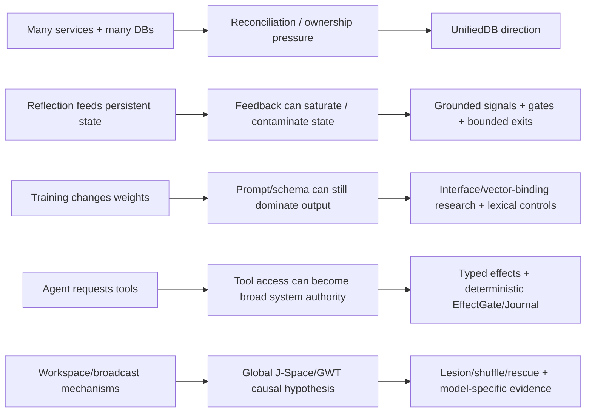

# Project Frankenstein — Git-supported chronology

This chronology deliberately uses the phrase **first verified in accessible Git** instead of “created on” unless the commit itself is the verified scope base. Git can prove presence at a commit; it cannot always prove an idea or implementation did not exist earlier elsewhere.

## Live source identity

Direct inspection on 2026-08-27 found `gschaidergabriel/Project-Frankenstein/main` at:

```text
abba90a5767d85abc8a1ac340bae92842dab35c1
```

Current research-repository anchor:

```text
research_entity/archive_assimilation/manifests/
PROJECT_FRANKENSTEIN_SOURCE_IDENTITY_HISTORY_ANCHOR_20260827.json
```

That anchor establishes:

- root tree SHA `ec21e66c4672fde1f0a5d948ebc51457b69b620a`;
- 545 commits reachable through the observed default-branch commit listing;
- oldest reachable commit `e1a8812767668091d146ee958bbc2ebb2743031c` with zero parents;
- chronology timestamps as first verified accessible-Git presence, not universal creation dates.

The older archaeology manifest remains `PARTIAL_NOT_FROZEN` for whole-repository semantic coverage and complete recursive path inventory.

## Selected lineage

| Date | Commit | First verified accessible-Git signal | Evidence interpretation |
|---|---|---|---|
| 2026-02-14 | `e1a8812767668091d146ee958bbc2ebb2743031c` | Initial accessible scope: local Linux Frank, microservices, local LLM inference, E-PQ/Titan/world-experience state, agentic tasks and safety/recovery surfaces | `HISTORICAL_SOURCE`; verified scope base |
| 2026-02-15 | `6355c4fb1637ecd833855a0e2c2936d881ae2f62` | GRF paper explicitly mapped into Frank subsystems including E-PQ and Global Workspace | `HISTORICAL_SOURCE`; documents GRF→engineering interpretation, not validity of metaphysical claims |
| 2026-02-20 | `2b4f0e8b16f28c3ecb08cc069e45d68563419423` | Memory/persistence documented as six layers including chat memory, Titan, E-PQ, consciousness stream, world experience and pattern memory | `HISTORICAL_SOURCE`; also evidence of state fragmentation later motivating unification |
| 2026-02-20 | `f2cb3914a4b35885d115d239790b716d044e0058` | GWT channel weighting, Genesis→E-PQ bridge, ego-construct updates and reflection→personality feedback | `HISTORICAL_SOURCE`; concrete feedback-loop lineage, not consciousness evidence |
| 2026-02-20 | `cf88a9c0d4a288dd34a5b2dbaa7f6c53c80ad90f` | Delayed recursive reflection introduced with gates and daily limits | `HISTORICAL_SOURCE`; precursor to reflection-with-exit control framing |
| 2026-02-23 | `8ae77cec1085bf321c1f1625f0bc5d54d8a606c5` | Therapist feedback identified as saturating E-PQ mood; unconditional positive feedback removed | `NEGATIVE_RESULT` + repair; semantically positive signal can mechanically corrupt state when ungrounded |
| 2026-02-24 | `662957eeaf1ca94c107137d8341dd3073b6b0301` | Dream daemon with replay/synthesis/consolidation and interrupt-safe phase resume | `HISTORICAL_SOURCE`; replay/consolidation lineage, not evidence that “dreaming” is required |
| 2026-03-07 | `f1ea0b47ef74cad16a3aadb9e63f633fd97a4e5d` | Global Workspace bus, attention schema, metacognitive monitor, prediction engine and longer-term semantic memory | `HISTORICAL_SOURCE`; direct predecessor family for later GWT/J-Space work |
| 2026-03-25 | `290d5e2b8640d55eb2a0aa38b99338c8070a0009` | Titan renamed L.C.M.E.; HNSW and retrieval/cold-start changes | `HISTORICAL_SOURCE`; commit-message P@5 improvement remains a commit-source measurement claim unless exact benchmark artifacts are reproduced |
| 2026-03-26 | `78f31e7f1e4fa7109a90f6e32514923ca7428a87` | SOMA personal LoRA pipeline with safety gates, snapshot/rollback and training cycle | `HISTORICAL_SOURCE`; commit reports an 18.7-minute CPU cycle and deployment, not current training credit |
| 2026-03-29 | `a016410734564abcb4ba3bd0143b04ded6b8d1e1` | SOMA rebuilt for Qwen 3.5-4B and feedback-weighted training; multiple integration bugs fixed | `HISTORICAL_SOURCE`; training lineage and integration-failure evidence |
| 2026-04-01 | `91b983a0f48a973c1fe5137d7271883e529b39fa` | `PROJECT.md` used as persistent project base-of-truth | `HISTORICAL_SOURCE`; precursor to explicit externalized state/continuity contracts |
| 2026-04-01 | `62a661f51271e8ec024c3557b921eaddda0267d3` | Project tool-use agent loop with project-directory sandbox and bounded iterations | `HISTORICAL_SOURCE`; clear state→tool→result loop |
| 2026-04-01 | `b6d8c17bde2087d88ef4a31c09d6db2756219739` | Project-folder sandbox removed and broad system access allowed | `HISTORICAL_SOURCE` + safety-relevant divergence; not a current EntityOS authority rule |
| 2026-04-03 | `62149151ba704479f46265a5b8b5865fd38ba99d` | Hard-coded `AURA` architecture text identified as overriding training behavior and purged/renamed to Swarm | `NEGATIVE_RESULT` + repair; prompt-vs-weight/interface conflict example |
| 2026-04-05 | `cfa7062ba62bc9d83fffada29dcc03a75c4f4050` | Project Engine v3 describes tiered decisions, action chaining, goals, world model, policies, learning and checkpoints | `HISTORICAL_SOURCE`; commit-level “proven results” still require exact measurement binding |
| 2026-04-05 | `35bbeacbce936e284f7cb8ab73747fd3cf7bebf0` | Project Engine v3.2 adds notifications, NL policies, A/B strategy tests and time-travel debugging | `HISTORICAL_SOURCE`; externalized agency/control lineage |
| 2026-04-05 | `abba90a5767d85abc8a1ac340bae92842dab35c1` | Current Project-Frankenstein head: chat rendering fix preserving paragraph/tool-block boundaries | `HISTORICAL_SOURCE`; directly re-verified 2026-08-27 |

## Failure-driven engineering lineage



### Fragmented persistence → UnifiedDB

The February architecture explicitly documented multiple persistence layers and databases. That modular experimentation also created ownership and reconciliation boundaries. Current UnifiedDB is best read as a response: one durable authority substrate with typed internal structure, while rebuildable projections and high-rate transient RAM can remain separate when appropriate.

### Reflection feedback → grounding and exit discipline

The February reflection/E-PQ line allowed generated reflection to alter longer-lived state. The therapist saturation repair is important negative evidence: a signal can be linguistically positive and still mechanically wrong if unconditional. Today’s reflection rule therefore requires both grounded mismatch/correction evidence and an exit into `ACT`, `ASK`, `WAIT`, re-observation, or another measurable transition.

### Training → prompt-vs-weight conflict

The April `AURA` purge shows why behavior cannot be attributed to weights simply because training occurred. Runtime prompt/schema injection can override or mask learned behavior. Current J-Space/vector-binding work therefore needs label-free, prompt/schema-leak-resistant controls at the real interface.

### Tool-use agency → explicit effect authority

The April Projects lineage moved from project-directory sandboxing to broad system access. That is valuable historical agency evidence, but current EntityOS deliberately separates cognition from real effects. Historical broad access is a donor mechanism, not present authority; current effect authority remains deterministic.

### Workspace → J-Space causal testing

Workspace/broadcast mechanisms appear early in accessible Frankenstein history and later become more explicit. Current Global J-Space is an experimental successor. Historical workspace functionality does not prove a model-internal causal control channel.

## What this chronology does not prove

It does **not** claim:

- that a listed commit is the first time an idea existed outside accessible Git;
- that commit-message benchmark claims were independently reproduced;
- that a source change was deployed to the same runtime later measured;
- that historical consciousness terminology establishes consciousness;
- that current EntityOS/HCU runtime or training acceptance follows from historical Frankenstein success;
- that all 545 commits have already been semantically reconstructed;
- that the complete recursive path denominator is already frozen.

Those limits are part of the evidence, not footnotes to it.
