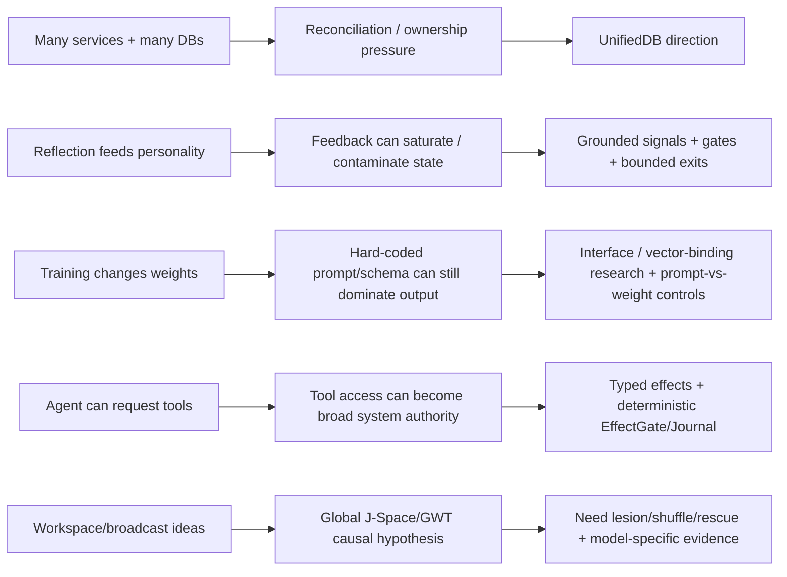

# Project Frankenstein — Git-supported chronology

This chronology deliberately uses the phrase **first verified in accessible Git** instead of “created on” unless the commit itself is the frozen scope base. Git can prove that a change is present at a commit; it cannot always prove that the idea or implementation did not exist earlier elsewhere.

## Live repository check

On 2026-08-27, direct inspection of `gschaidergabriel/Project-Frankenstein` shows current `main` at:

```text
abba90a5767d85abc8a1ac340bae92842dab35c1
```

That is the same head used by the August archive reconstruction. This is useful: the historical archive is not pointing at a head that has since moved. It does **not** make the archive semantically complete.

The explicit Level-0 scope remains:

```text
e1a8812767668091d146ee958bbc2ebb2743031c  inclusive base
...
abba90a5767d85abc8a1ac340bae92842dab35c1  current/frozen head
= 545 commit obligations total
```

## Selected lineage

| Date | Commit | First verified accessible-Git signal | Evidence interpretation |
|---|---|---|---|
| 2026-02-14 | `e1a8812767668091d146ee958bbc2ebb2743031c` | Initial open-source scope base: local Linux Frank, microservices, local LLMs, E-PQ/Titan/world-experience style state, agentic task execution and safety/recovery surfaces | `HISTORICAL_SOURCE`; this is the explicit reconstruction base, not proof of all prehistory |
| 2026-02-15 | `6355c4fb1637ecd833855a0e2c2936d881ae2f62` | GRF paper is explicitly mapped into Frank subsystems, including E-PQ and Global Workspace | `HISTORICAL_SOURCE`; establishes a documented GRF→engineering interpretation, not validity of the metaphysical claims |
| 2026-02-20 | `2b4f0e8b16f28c3ecb08cc069e45d68563419423` | Memory/persistence architecture documented as six layers, including chat memory, Titan, E-PQ, consciousness stream, world experience and pattern memory | `HISTORICAL_SOURCE`; also demonstrates the state-fragmentation that later motivates unification |
| 2026-02-20 | `f2cb3914a4b35885d115d239790b716d044e0058` | GWT channel weighting, Genesis→E-PQ bridge, automatic ego-construct updates, reflection→personality feedback | `HISTORICAL_SOURCE`; a concrete feedback-loop lineage, not a consciousness claim |
| 2026-02-20 | `cf88a9c0d4a288dd34a5b2dbaa7f6c53c80ad90f` | Delayed recursive reflection is introduced and bounded by gates/daily limits | `HISTORICAL_SOURCE`; useful precursor for today’s reflection-with-exit control framing |
| 2026-02-23 | `8ae77cec1085bf321c1f1625f0bc5d54d8a606c5` | Therapist feedback is identified as saturating E-PQ mood; unconditional positive feedback is removed | `NEGATIVE_RESULT` + repair: a direct example of a feedback loop corrupting state because its signal was not sufficiently grounded |
| 2026-02-24 | `662957eeaf1ca94c107137d8341dd3073b6b0301` | Dream daemon with replay/synthesis/consolidation and interrupt-safe phase resume | `HISTORICAL_SOURCE`; replay/consolidation lineage, not evidence that “dreaming” is required |
| 2026-03-07 | `f1ea0b47ef74cad16a3aadb9e63f633fd97a4e5d` | Global Workspace bus + attention schema + metacognitive monitor + prediction engine + long-term semantic memory | `HISTORICAL_SOURCE`; later GWT/J-Space work should be compared to this predecessor rather than narrated as unrelated invention |
| 2026-03-25 | `290d5e2b8640d55eb2a0aa38b99338c8070a0009` | Titan renamed L.C.M.E.; retrieval pipeline altered, HNSW added, cold-start gates and graph-expansion defaults changed | `HISTORICAL_SOURCE`; commit message reports P@5 improvement, which remains a commit-source measurement claim unless reproduced from exact benchmark artifacts |
| 2026-03-26 | `78f31e7f1e4fa7109a90f6e32514923ca7428a87` | SOMA personal LoRA adaptation pipeline appears with safety gates, snapshots/rollback and training cycle | `HISTORICAL_SOURCE`; commit message reports an 18.7-minute CPU cycle and deployment, but this is not current training credit |
| 2026-03-29 | `a016410734564abcb4ba3bd0143b04ded6b8d1e1` | SOMA rebuilt for Qwen 3.5-4B and feedback-weighted training; several integration bugs fixed | `HISTORICAL_SOURCE`; important training lineage and example of runtime integration failures forcing redesign |
| 2026-04-01 | `91b983a0f48a973c1fe5137d7271883e529b39fa` | `PROJECT.md` made persistent base-of-truth for project agents | `HISTORICAL_SOURCE`; precursor to explicit externalized state/continuity contracts |
| 2026-04-01 | `62a661f51271e8ec024c3557b921eaddda0267d3` | Project tool-use agent loop introduced with path sandbox and bounded iterations | `HISTORICAL_SOURCE`; clear state→tool→result loop |
| 2026-04-01 | `b6d8c17bde2087d88ef4a31c09d6db2756219739` | The project-folder sandbox is removed and broad system access is allowed | `HISTORICAL_SOURCE` + safety-relevant divergence; current EntityOS effect authority must not inherit this as an unqualified design rule |
| 2026-04-03 | `62149151ba704479f46265a5b8b5865fd38ba99d` | Hard-coded `AURA` architecture text is identified as overriding training behavior and is purged/renamed to Swarm | `NEGATIVE_RESULT` + repair; strong prompt-vs-weight/interface-conflict example |
| 2026-04-05 | `cfa7062ba62bc9d83fffada29dcc03a75c4f4050` | Project Engine v3 commit describes tiered decision, action chaining, goals, world model, policies, learning and checkpoints | `HISTORICAL_SOURCE`; commit-level “proven results” remain claims until exact measurement artifacts are bound |
| 2026-04-05 | `35bbeacbce936e284f7cb8ab73747fd3cf7bebf0` | Project Engine v3.2 adds notifications, natural-language policies, A/B strategy testing and time-travel debugging | `HISTORICAL_SOURCE`; further externalized agency/control lineage |
| 2026-04-05 | `abba90a5767d85abc8a1ac340bae92842dab35c1` | Current head: chat rendering bugfix preserving paragraph/tool-block boundaries | `HISTORICAL_SOURCE`; current direct repository head as checked 2026-08-27 |

## Failure-driven engineering lineage

The chronology is more useful when read as causes and corrections rather than as a feature list.



### 1. Fragmented persistence → UnifiedDB

The February architecture explicitly documented multiple persistence layers and databases. That was useful modular experimentation, but it also created ownership and reconciliation boundaries. Current UnifiedDB work should be read as a response to that historical topology: one durable authority substrate with typed internal structure, while rebuildable projections and high-rate transient RAM remain separate where appropriate.

### 2. Reflection feedback → signal-grounding and exit discipline

The February reflection/E-PQ line made internal reflection capable of altering longer-lived state. The therapist saturation fix is important negative evidence: a semantically “positive” signal can still be mechanically wrong if it is unconditional. Today’s reflection rule therefore has two separate requirements:

- ground the mismatch/correction in observable state or outcome;
- terminate reflection into ACT / ASK / WAIT / re-observe / another measurable transition.

### 3. Training → prompt-vs-weight conflict

The April `AURA` purge is a compact example of why training success cannot be inferred from output alone. A hard-coded runtime architecture fact injected into prompts can override or mask what weights learned. Current J-Space/vector-binding work must therefore discriminate at the actual interface and include lexical/prompt/schema controls.

### 4. Tool-use agency → explicit effect authority

The April Projects lineage moved from a project-directory sandbox to broad system access. It demonstrates practical agentic capability, but also why current EntityOS deliberately separates cognition from real effects. Historical broad tool access is a donor mechanism, not current authority. Current real effects remain behind deterministic EffectGate/EffectJournal boundaries.

### 5. Workspace → J-Space causal testing

Global workspace ideas are present early in accessible Frankenstein history and later become more explicit GWT-like buses/attention structures. Current Global J-Space work is therefore an experimental successor, not a claim that the historical workspace proved a model-internal causal channel.

## What Git does not prove

This chronology does **not** claim:

- that a listed commit is the first time an idea existed outside accessible Git;
- that commit-message benchmark claims were independently reproduced;
- that a source change was deployed to the same runtime later measured;
- that historical consciousness terminology establishes consciousness;
- that current EntityOS/HCU runtime or training acceptance follows from historical Frankenstein success;
- that the 545-commit scope is already fully semantically reconstructed.

Those boundaries are part of the chronology, not footnotes to it.
