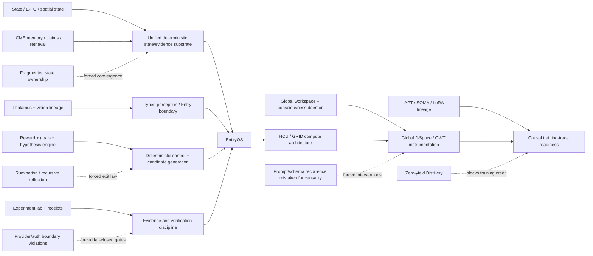

# Project Frankenstein research chronicle

This document is a compact reconstruction guide for the Frankenstein/Frank -> EntityOS/HCU engineering lineage. It is deliberately **not** a narrative truth oracle. Every claim below carries an evidence class, a source identity, or an explicit uncertainty boundary.

## Evidence vocabulary

- `CURRENT_SOURCE` — present in current canonical repository/authority.
- `HISTORICAL_SOURCE` — preserved source or archive evidence from an older architecture/epoch.
- `PROJECT_MEASUREMENT` — measured in a bounded project experiment.
- `EXTERNAL_PRIMARY` — external primary literature/specification; analogy or background only unless a project test binds it.
- `INFERENCE` — reasoned reconstruction from evidence.
- `OPEN_HYPOTHESIS` — not yet established by the project.
- `NEGATIVE_RESULT` — contradicted, blocked, failed, authority-invalid, or zero-credit result.

The promotion law is strict: source-ready != runtime-observed; request != effect; model output != world fact; component PASS != whole-product PASS; repeated model agreement != independent evidence.

## 1. What can be reconstructed from accessible Git/archive evidence

### Historical Project-Frankenstein snapshot

`HISTORICAL_SOURCE`

The archive assimilation manifest `research_entity/archive_assimilation/manifests/PROJECT_FRANKENSTEIN_MANIFEST.json` records a frozen Project-Frankenstein head:

- repository: `gschaidergabriel/Project-Frankenstein`
- frozen head: `abba90a5767d85abc8a1ac340bae92842dab35c1`
- manifest status: `PARTIAL_NOT_FROZEN`
- exact tree enumerated: `false`
- exact history enumerated: `false`
- denominator frozen: `false`

Therefore the archive supports **first verified in the accessible evidence**, not claims such as “created on date X” or “this is the complete history.”

The same manifest deep-reads the following historical implementation families:

| Area | Verified archived path | What the source family represents | Evidence boundary |
|---|---|---|---|
| Persistent cognition / workspace precursor | `services/consciousness_daemon.py` | multi-timescale loops, persistent cognition, GWT precursor | historical source, not current consciousness claim |
| GWT/broadcast | `services/global_workspace.py` | broadcast bus and salience | historical implementation, not proof of GNW/GWT equivalence |
| E-PQ/state | `personality/e_pq.py` | persistent personality/state, homeostasis, event learning | historical source |
| Perception gating | `services/thalamus.py` | sensory gating, attention, habituation, prediction error | historical source |
| Memory | `tools/lcme/lcme_core.py` | claims, graph/vector retrieval, forgetting | historical source |
| Reward/motivation | `services/nucleus_accumbens.py` | reward prediction, motivation, habituation | historical source |
| Policy/subconscious | `services/subconscious.py` | actor-critic/PPO, idle policy, hallucination tracking | historical source |
| World/body state | `services/spatial_state.py` | persistent world/body state and proprioceptive projection | historical source |
| Replay/consolidation | `services/dream_daemon.py` | replay, synthesis, consolidation, interrupt/resume | historical source |
| Goals/projects | `services/project_engine.py` | projects, goals, strategies, tasks, tool learning | historical source |
| Hypothesis loop | `services/hypothesis_engine/service.py` | hypothesis lifecycle and research orchestration | historical source |
| Experiment binding | `services/hypothesis_engine/lab_connector.py` | test translation and result interpretation | historical source |
| Deterministic experiment lab | `services/experiment_lab.py` | simulation persistence and resource budgets | historical source |
| Hypothesis evaluation | `services/hypothesis_engine/evaluator.py` | passive/active tests, relevance gates, revision | historical source |
| SOMA / LoRA | `services/soma/micro_trainer.py` | LoRA feedback training and before/after probes | historical source; training result scope must be checked separately |
| IAPT | `papers/IAPT_METHOD.md` | training-method report and negative-result methodology | historical source |
| Vision lineage | `tools/frank_adaptive_vision.py`, `tools/frank_visual_pipeline.py`, `tools/vcb_bridge.py`, `tools/frank_eye.py`, `tools/native_vision.py`, `ext/sovereign/vcb_integration.py` | adaptive routing -> visual pipeline/VCB -> FrankEye -> native multimodal vision | lineage shard only; manifest explicitly says full denominator is not frozen |

This is enough to establish a real multi-module historical architecture. It is **not** enough to claim every module was simultaneously live, stable, or causally integrated at the frozen head.

## 2. Engineering lineage as dependency, not mythology



`INFERENCE`: the useful architectural story is not “biological module names became consciousness.” It is that repeated engineering failures made explicit state, provenance, arbitration, effect receipts, replay and termination boundaries increasingly necessary.

## 3. State -> memory -> decision -> effect -> verification

The present human-readable loop is:

```text
state -> memory -> decision -> effect request -> EffectGate -> observed result -> verified re-entry
```

`CURRENT_SOURCE`: current EntityOS/HCU authority keeps canonical durable state/evidence outside model-generated cognition. HCU, model, world-model, workspace and J-Space outputs remain candidate/projection/measurement surfaces. Real state-changing effects remain behind deterministic effect authority.

This is the strongest continuity with historical Frank: not any biological naming, but the attempt to make internal state and later behavior depend on measured outcomes rather than on text alone.

## 4. UnifiedDB and Emergent Retrieval

`CURRENT_SOURCE` + `INFERENCE`

The project converged away from a many-store mental-model toward one canonical deterministic SQLite-centered state/evidence substrate. “One substrate” does not mean one giant untyped file: typed tables, journals, indexes, views, policies, writers/readers and rebuildable projections can coexist under one authority. High-rate transient sensor state can remain in RAM.

Project term `Emergent Retrieval` means that relevance can emerge at query time when independently stored evidence dimensions overlap: semantic similarity, time, causal lineage, current state, goals, perception, effects, confidence and provenance. It does **not** mean missing information appears spontaneously.

`EXTERNAL_PRIMARY` analogy boundary: SQLite documents WAL as a concurrency/transaction mechanism; that is useful systems background, but SQLite WAL by itself does not prove EntityOS semantics or causal correctness. See https://www.sqlite.org/wal.html.

## 5. Reflection: engineering control operation with an exit

`CURRENT_SOURCE` / `OPEN_HYPOTHESIS`

Reflection is useful only if it changes the next measurable transition. The operational form is:

```text
inspect state/outcome
  -> detect mismatch
  -> generate correction candidate
  -> store/retrieve correction
  -> change arbitration or later behavior
  -> ACT | ASK | WAIT | RE-OBSERVE
```

`NEGATIVE_RESULT`: recursive reflection that only produces more reflection is rumination/fixation, not agency progress.

`OPEN_HYPOTHESIS`, confidence `0.78`: robust practical agency requires a sufficiently rich external substrate of state, memory, perception, arbitration, effect receipts and verified re-entry.

Counterhypothesis: a sufficiently capable model plus a thin conventional tool wrapper can achieve equivalent task robustness without a large external cognitive substrate.

Falsifier/discriminator: matched task suites with fixed model family comparing thin-wrapper vs typed-state/effect-reentry systems; measure interruption recovery, stale-context errors, effect correctness, provenance errors, repeated-task learning and reflection termination.

## 6. GWT / Global J-Space / Hyperposition / GRF

### GWT / Global J-Space

`EXTERNAL_PRIMARY`: Global Workspace / Global Neuronal Workspace literature motivates architectures in which specialized processors can make information globally available. Primary references include Dehaene, Kerszberg & Changeux (2001), DOI `10.1111/j.1749-6632.2001.tb05714.x`, and Dehaene & Naccache (2001), DOI `10.1016/S0010-0277(00)00123-2`.

`CURRENT_SOURCE`: Project Global J-Space/GWT is **not** promoted from that analogy. It remains an empirical causal coordination/interface hypothesis. Coherent text, recurrence, majority vote or self-report cannot establish model-internal causality. Promotion requires exact model/runtime identity plus interventions such as lesion/shuffle/rescue and trace provenance.

### Hyperposition

`CURRENT_SOURCE`: Hyperposition is a control/evidence law for preserving unresolved alternatives until a discriminator closes them. Majority or recurrence cannot mint truth.

Relevant current source family includes `research_entity/topic_packets/trigger2-together-diagnostic-finetune-20260827/HYPERPOSITION_FOCUS_CONCEPT_20260827.json`; its training/execution claims must still be resolved under current authority and ancestry rules.

### GRF

`HISTORICAL_SOURCE` / `OPEN_HYPOTHESIS`: GRF belongs in the research lineage, but this trigger does not invent a mathematical derivation where the current source index has not yet been exact-linked. GRF claims should be promoted only when the specific equation/implementation path and measurement receipt are linked side by side.

## 7. Training lineage: IAPT / SOMA / LoRA -> current causal-trace requirement

`HISTORICAL_SOURCE`: the archived Frankenstein manifest identifies `papers/IAPT_METHOD.md` and `services/soma/micro_trainer.py` as training-method/LoRA source families.

`EXTERNAL_PRIMARY`: LoRA itself is an external low-rank adaptation method; Hu et al. 2021, arXiv `2106.09685`, DOI `10.48550/arXiv.2106.09685`.

`CURRENT_SOURCE`: current training promotion is stricter than “a fine-tune finished.” Current authority requires exact checkpoint/tokenizer/runtime/build identity, leak-resistant family splits, deterministic hard negatives, causal J-Space traces, and evaluation that distinguishes checkpoint/model-family ancestry.

`NEGATIVE_RESULT`: current supervisor state reports `canonical_dataset_rows_admitted = 0` and training credit `0`; latest confirmed Distillery accepted dataset tokens remain zero. Therefore historical training methods and later paid diagnostic runs do not establish current training readiness or product acceptance.

## 8. Current Frankenstein master-cognition packet: donor, not authority

`CURRENT_SOURCE`: `research_entity/topic_packets/frankenstein-master-cognition-concept/CONCEPT.md` contains a useful distinction between real GRID10 mechanisms and aspirational additions. It explicitly says external model consultation invented non-existent InfluxDB/time-series and embedding-vector infrastructure, and retains only structurally useful ideas after checking against real SQLite/WAL/CAS mechanisms.

That is a good research pattern: preserve useful proposal structure while rejecting fabricated implementation details.

`NEGATIVE_RESULT`: the same topic family also contains provider-calling 72-hour orchestration/bugfix plans. Current `SUPERVISOR_INBOX.json` at schema 9.13 says provider routes are not admitted, Together is forbidden, paid fallback is forbidden, and that 72-hour plan is quarantined/non-operative while those external call paths remain.

Useful donor mechanisms may be salvaged. Execution authority cannot.

## 9. GRID10: what is actually measured

`PROJECT_MEASUREMENT`: current supervisor records a real 4-process / 4-vCPU matched thread-count A/B:

- 1 torch thread/process: `8.3197 s/call` mean, 12 samples
- 2 threads/process: `23.1806 s/call` mean, 12 samples
- 4 threads/process: zero completed samples within experiment timeouts

This falsifies the recommendation that 2 threads/process is faster **for that measured topology** and supports the current default of 1 there.

Boundary: diagnostic component evidence only. It does not promote Physical-GRID10, HCU, canonical semantics, BASE/release, or whole EntityOS.

`NEGATIVE_RESULT`: RAM-release observations are not promoted to physical memory-efficiency credit until RSS/PSS/full `smaps_rollup` accounting and a repeated matched falsifier rule out accounting-class shifts.

## 10. Failure -> engineering move map

| Failure / contradiction | Evidence class | Engineering move it motivates |
|---|---|---|
| Multi-store ownership / reconciliation | historical + inference | one canonical state/evidence authority, rebuildable projections |
| Rumination / fixation | historical + engineering hypothesis | reflection termination into ACT/ASK/WAIT/re-observe |
| Context contamination / stale prose | repeated project negative result | current authority stack + exact source identity |
| Prompt/schema recurrence mistaken for causality | negative result / hypothesis | J-Space interventions and model-specific traces |
| Source exists but runtime unknown | recurring evidence-boundary failure | executable receipts bound to exact source/hash/environment |
| Provider plan conflicts with HARD_OFF | current negative result | canonical gate before secret lookup/import/network/fallback |
| Thread-count recommendation fails matched A/B | project measurement | topology-specific defaults, no universal performance claim |
| RAM metric can shift accounting class | current negative result | PSS/full smaps + host-level delta |
| Distillery zero accepted tokens | current negative result | prove evidence-qualified ACCEPT -> exactly one persistent packet -> accepted tokens > 0 -> replay +0 |
| Training family/checkpoint leakage | current negative result | ancestry ledger + family-level holdout + exact tokenizer ABI |

## 11. Current status ledger

As resolved from current `main` `854f6bc87780f4a5242489a6c807d186b16a8c3d` and `SUPERVISOR_INBOX.json`:

| Surface | Status |
|---|---|
| EntityOS whole runtime | `0` credit |
| HCU full runtime | `0` credit |
| Physical-GRID10 runtime | `0` promotion credit; bounded diagnostics exist |
| Canonical semantics | `0` credit |
| Training | `0` credit |
| Provider routes | HARD_OFF / not admitted |
| Together | forbidden; zero remaining paid runs authorized |
| 72h Frankenstein provider orchestration | quarantined / non-operative |
| Local/non-provider validation | allowed within current authority boundaries |

## 12. Chronicle gaps — do not paper over them

1. The archived Project-Frankenstein tree/history denominator is still not frozen. No repository-wide completeness percentage is justified from `PROJECT_FRANKENSTEIN_MANIFEST.json`.
2. A current source search in this trigger did **not** verify a canonical artifact literally identified as `Frankenstein v0.7`; therefore this document does not fabricate a v0.7 version mapping. The version label needs an exact source/commit pointer before promotion.
3. GRF mathematics still needs an exact equation/source/measurement deep-link ledger.
4. Full Git chronology must be reconstructed by commit evidence and “first verified in accessible Git,” not invented dates.
5. Root topology migration still needs a complete byte/blob/reference manifest before technical clutter is moved.
6. Provider-boundary static analysis should become machine-executable and fail-closed; prose quarantine alone is not sufficient execution protection.

## 13. External-primary reference boundary

These references supply research background or systems analogies, not project runtime evidence:

- Global workspace model: https://doi.org/10.1111/j.1749-6632.2001.tb05714.x
- Workspace framework review: https://doi.org/10.1016/S0010-0277(00)00123-2
- LoRA: https://doi.org/10.48550/arXiv.2106.09685
- SQLite WAL: https://www.sqlite.org/wal.html
- NVIDIA CUDA Unified Memory: https://docs.nvidia.com/cuda/cuda-programming-guide/

NVIDIA Unified Memory is permitted here only as a **systems-design analogy** for reducing ownership/copy boundaries across compute. Hardware memory coherence is not database semantics, causal evidence, or an EntityOS correctness proof.

## 14. Next exact Triggerword-3 curation gates

1. Freeze a complete root-entry inventory at an exact `main` SHA and create a byte/blob/reference-aware migration manifest.
2. Build an archive index that points to source rather than copying the archive into prose.
3. Add an exact Git chronology ledger for historical Frank modules, each entry tagged `first_verified_in_accessible_git`.
4. Add GRF equation/source/implementation/measurement cross-links.
5. Add a machine-executable non-provider static audit for every Frankenstein provider/secret/network/Aider boundary.
6. Only after reference-safe migration evidence, move root technical clutter below `DEV_SOURCE_RESEARCH/repository/` while preserving source bytes and compatibility paths where needed.
