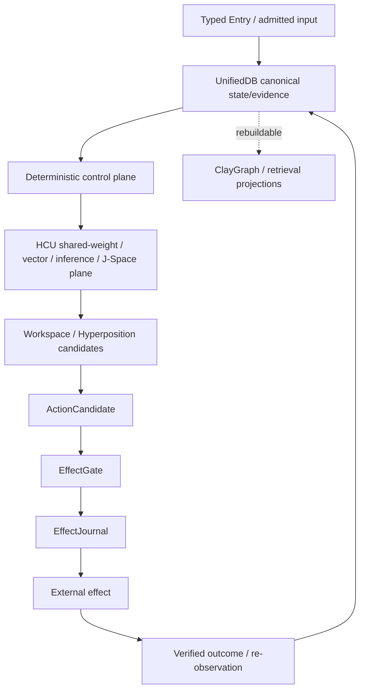
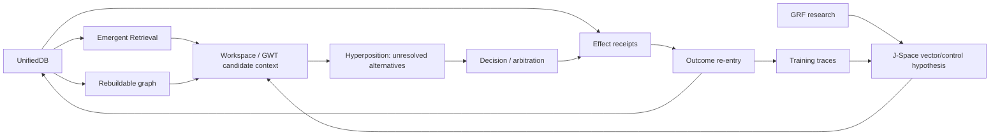

# DEV / SOURCE / RESEARCH

This directory is the technical entry point for the Triggerword-3 Frankenstein curation layer.

## Frozen curation base

- Canonical repository: `gschaidergabriel/clay-global-research-entity`
- Base branch: `main`
- Exact base SHA used for this curation pass: `854f6bc87780f4a5242489a6c807d186b16a8c3d`
- Root README: preserved byte-identically from base (`blob 4d39dbfaeace5843d4bfc6901e3ea3d8b566ec84`)
- Current project identity at the base: persistent entity `Clay`, product `EntityOS`, integrated cognition/compute architecture `HCU`.

**Refresh law:** this index is evidence about the curation base, not a forever-current authority. Before making a present-tense execution claim, read `repository/research_entity/claycode/autonomous/SUPERVISOR_INBOX.json` and the steering it selects.

## Repository topology in this branch

The public root is intentionally reduced to four entries:

```text
README.md
HUMAN_READ_THIS/
DEV_SOURCE_RESEARCH/
AI_START_HERE_DO_NOT_SCAN_REPO/
```

All previous technical root entries are relocated byte-for-byte beneath `repository/`. The relocation changes paths, not source bytes. It is therefore a curation/topology change and **not** runtime evidence. Any merge must re-run path-sensitive tests, workflow discovery and installer checks before promotion.

## Evidence labels

Use these exact classes in new synthesis work:

| Label | Meaning |
|---|---|
| `CURRENT_SOURCE` | Exact source observed at the frozen/current ref. |
| `HISTORICAL_SOURCE` | Earlier source or archived project lineage. |
| `PROJECT_MEASUREMENT` | Measured result with bounded scope. |
| `EXTERNAL_PRIMARY` | Primary literature/spec/vendor documentation. |
| `INFERENCE` | Reasoned conclusion, not directly observed. |
| `OPEN_HYPOTHESIS` | Testable proposal not yet verified. |
| `NEGATIVE_RESULT` | Failure, contradiction, blocked gate or falsification worth preserving. |

Progress words such as `attempted`, `source-ready`, `measured`, `reproduced`, `contradicted`, `blocked`, `prepared-not-run`, `adopted`, and `retired` describe state; they do not replace the evidence class.

## Current architecture map



### Boundary that must not be blurred

- Model output is a candidate or measurement, not canonical truth.
- Workspace convergence is not proof.
- A request is not an effect.
- A deployment is not a function invocation.
- A component pass is not whole EntityOS/HCU acceptance.
- A completed training job is not a behavioral pass.

## Current high-value evidence at the frozen base

### 1. UnifiedDB: source-observed canonical substrate

`repository/the artefact/clayverse/store.py` defines `UnifiedDB` as the "Single canonical state authority" and creates typed tables for sessions, turns, memory, workspace episodes, effects, causal episodes, leases, checkpoints, graph projections, retrieval episodes and feedback. It uses WAL, transactions, generation fencing and explicit effect records.

**Class:** `CURRENT_SOURCE`  
**State:** `source-ready / implemented`  
**Scope:** source semantics only; not whole-product runtime acceptance.

### 2. Emergent Retrieval: source-observed fail-closed assembly

`repository/research_entity/harness/reference/unifieddb_emergent_cascade.py` requires a valid epoch, an admitted resolution class, sufficient confidence and a binding from logical ID to current UnifiedDB reference before graph propagation. Its receipt marks the assembly as derived, with `persistent_second_store: false` and `authority: ASSEMBLY_CONTEXT_ONLY`.

**Class:** `CURRENT_SOURCE`  
**State:** `implemented / bounded`  
**Interpretation:** relevance is assembled from existing evidence; no information is manufactured from nowhere.

### 3. Project Frankenstein archive denominator

`repository/research_entity/archive_assimilation/manifests/PROJECT_FRANKENSTEIN_LEVEL0_SCOPE_LAW.json` freezes the Project-Frankenstein Git-history obligation from `e1a8812767668091d146ee958bbc2ebb2743031c` inclusive to `abba90a5767d85abc8a1ac340bae92842dab35c1` inclusive and records exactly 545 commit obligations for that scoped lineage.

The older `PROJECT_FRANKENSTEIN_MANIFEST.json` remains explicitly `PARTIAL_NOT_FROZEN` and says full tree/history enumeration was not complete at that stage. That distinction is preserved here instead of averaging the two documents into a stronger claim.

**Class:** `HISTORICAL_SOURCE`  
**State:** scope denominator frozen by later law; deep-read manifest remains partial.

### 4. Historical Frankenstein modules

The archive manifest records deep reads of historical runtime code including:

- `services/consciousness_daemon.py` — persistent cognition / multi-timescale loops / GWT precursor
- `personality/e_pq.py` — persistent personality state / homeostasis / event learning
- `services/thalamus.py` — sensory gating / attention / habituation / prediction error
- `services/global_workspace.py` — broadcast / salience / GWT precursor
- `tools/lcme/lcme_core.py` — memory / claims / graph / vector retrieval / forgetting
- `services/nucleus_accumbens.py` — reward prediction / motivation / habituation
- `services/subconscious.py` — actor-critic / PPO / idle policy / hallucination tracking
- `services/dream_daemon.py` — replay / synthesis / consolidation
- `services/project_engine.py` — projects / goals / strategies / tasks / tool learning
- `services/hypothesis_engine/*` — hypothesis lifecycle / experiment binding / evaluation
- Retina / FrankEye / native-vision lineage — changing visual backends with supersession evidence.

These names are historical engineering provenance. They do not imply a present consciousness claim.

### 5. Hyperposition / GWT / GRF

`repository/research_entity/00_CURRENT/latest/hyperposition-gwt-grf.md` is itself a cache and says the state is `PARTIAL_COMPONENT_EVIDENCE`: source/test repair exists for an exact-merge singleton issue, while physical-grid re-entry is blocked pending stronger GRID10 evidence.

**Class:** `CURRENT_SOURCE` + `OPEN_HYPOTHESIS`  
**State:** `partial / blocked for broader promotion`.

### 6. New Frankenstein Bauleiter / Bugfix orchestration

The base commit `854f6bc8…` adds three scripts and reports 29 source-level tests green. The same current authority surface, however, records that direct Nemotron/Groq/Mistral loops and any Together allowance are non-operative under `9.13 HARD_OFF`.

**Class:** `CURRENT_SOURCE` + `NEGATIVE_RESULT`  
**State:** `source-tested, execution-authority blocked`  
**Do not say:** "the autonomous 72h Frankenstein runtime is accepted/running".

### 7. GRID10 thread-count counterexample

The 9.13O supervisor delta records a real 4-process / 4-vCPU A/B: 1 torch thread/process averaged 8.3197 s/call over 12 samples; 2 threads averaged 23.1806 s/call; 4 threads produced zero completed samples within experiment timeouts.

**Class:** `PROJECT_MEASUREMENT`  
**State:** `measured / counterexample`  
**Boundary:** supports default=1 for that topology only; no Physical-GRID10/HCU release credit.

### 8. Distillery / training

At the frozen base the current supervisor surface records `0 accepted dataset tokens / 88,774 collected source tokens` and `training_credit: 0`.

**Class:** `NEGATIVE_RESULT`  
**State:** `blocked / zero yield at last confirmed point`.

## Codependency graph



This is a dependency map, not a proof graph. In particular, `GRF -> J-Space -> behavior` remains an empirical causal hypothesis until model-specific interventions establish it.

## Documents in this curation layer

- [`RESEARCH_CHRONICLE.md`](RESEARCH_CHRONICLE.md) — compressed lineage and failure-driven architecture evolution.
- [`EVIDENCE_LEDGER.md`](EVIDENCE_LEDGER.md) — claim/status/falsifier matrix.
- [`ARCHIVE_INDEX.json`](ARCHIVE_INDEX.json) — machine-readable source map.
- [`ROOT_TOPOLOGY_MIGRATION.md`](ROOT_TOPOLOGY_MIGRATION.md) — exact relocation semantics and merge gates.
- [`repository/`](repository/) — byte-preserved prior root source tree, excluding the original root README which remains at repository root.

## Research rule

If two sources conflict, do not average them. Select the newest legitimate authority for current execution, keep the older source as provenance, and write the contradiction down. Negative evidence is part of the architecture history.