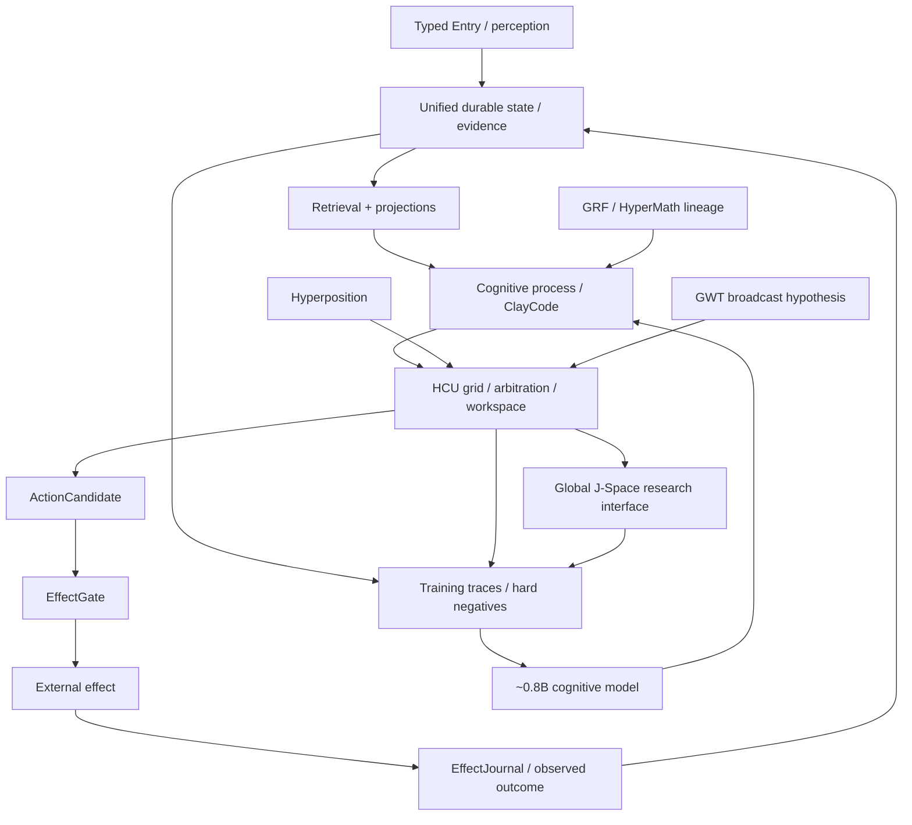

# DEV / SOURCE / RESEARCH

This layer is the technical map for Project Frankenstein / EntityOS / HCU. It is **not** a second authority tree. Current authority remains in the canonical existing governance/supervisor surfaces until a separately verified migration changes paths.

## Read order

1. `research/FRANKENSTEIN_RESEARCH_CHRONICLE.md` — architecture + lineage + failures + current evidence boundary.
2. `research/EVIDENCE_MAP.json` — machine-readable claims, evidence classes, confidence and falsifiers.
3. `repository/ROOT_TOPOLOGY_AUDIT.json` — non-destructive migration audit toward the public root target.
4. `../AI_START_HERE_DO_NOT_SCAN_REPO/INSTALL.md` — bounded host/tool installation entry.
5. Follow exact source links only for the subsystem you are inspecting.

## Current identity

```text
persistent research entity: Clay
current product: EntityOS
integrated cognition/compute architecture: HCU
historical/donor lineage: Frank / Frankenstein / ClayVerse / Mini Entity / MicroEntity
compatibility codename: Xeno
```

Identity is not evidence. These names describe the project’s organization and history; executable claims are scoped separately.

## Evidence vocabulary

| Class | Use |
|---|---|
| `CURRENT_SOURCE` | current source exists at a referenced repository identity |
| `HISTORICAL_SOURCE` | older source exists and is preserved for lineage |
| `PROJECT_MEASUREMENT` | measured result with bounded scope |
| `REPRODUCED` | same declared intervention reproduced at an exact declared scope |
| `CONTRADICTED` | counterevidence materially conflicts with a claim |
| `BLOCKED` | next discriminator cannot currently run/admit |
| `PREPARED_NOT_RUN` | implementation/test exists but no execution credit |
| `ADOPTED` | incorporated into current design/authority |
| `RETIRED` | historical mechanism no longer current |
| `EXTERNAL_PRIMARY` | primary external paper/spec/vendor documentation |
| `INFERENCE` | evidence-supported but not directly measured conclusion |
| `OPEN_HYPOTHESIS` | testable proposition awaiting decisive evidence |
| `NEGATIVE_RESULT` | first-class failure/counterexample |

### Promotion law

`source exists != runtime observed`  
`request != effect`  
`model output != world fact`  
`method exists != result exists`  
`consensus != independent evidence`  
`component PASS != whole-product PASS`

## Architecture dependency graph



The model is inside the loop, not above it. Durable truth/effect authority stays deterministic.

## Canonical current source pointers observed during this Trigger-3 pass

The following paths were read from `main` before this layer was created:

- `CLAY_EXECUTION_AUTHORITY.md`
- `research_entity/claycode/autonomous/SUPERVISOR_INBOX.json`
- `research_entity/claycode/autonomous/SUPERVISOR_STEERING_9_13O_DELTA_2026-08-27T2341P0700_GPT56SOL.json`
- `research_entity/continuity/BOOTSTRAP_MINIMAL.json`
- `research_entity/rooms/PROGRAM_STATE.json`
- `research_entity/00_CURRENT/NOW.md`
- `research_entity/00_CURRENT/latest/hyperposition-gwt-grf.md`
- `research_entity/topic_packets/frankenstein-master-cognition-concept/frankenstein_orchestrator_v1.py`
- `research_entity/topic_packets/frankenstein-master-cognition-concept/frankenstein_bugfix_v1.py`

Important: `BOOTSTRAP_MINIMAL.json`, `PROGRAM_STATE.json` and `NOW.md` visibly lag the 9.13 supervisor inbox. They are useful caches, not permission to downgrade current authority.

## Current critical contradiction

At `main@854f6bc87780f4a5242489a6c807d186b16a8c3d`, new Frankenstein orchestration code directly imports/uses external provider fallback machinery. The current `SUPERVISOR_INBOX.json` points to 9.13O steering and states:

- provider routes admitted: false;
- FreeSwarm owner emergency stop: true;
- Together forbidden;
- no paid fallback;
- runtime quiescence required before new provider execution.

Therefore these scripts are source-real but **execution-quarantined** under current authority. Their local unit tests cannot grant provider/runtime/whole-system credit.

## Why no bulk root move is performed by this pass

The target public root is intentionally tiny:

```text
README.md
HUMAN_READ_THIS/
DEV_SOURCE_RESEARCH/
AI_START_HERE_DO_NOT_SCAN_REPO/
```

Current root has many authority, compatibility and tooling paths. Moving them without a dependency census can break bootstraps, workflows, source hashes, external links and historical receipts. Trigger-3 therefore installs the new progressive-disclosure layers and a machine-readable topology audit first. A later move must prove every relocated path is either dynamically resolved, updated atomically, or retained as a compatibility stub. Historical evidence must never be rewritten merely to make the root prettier.

## Research quality rule

The repository is an evidence archive, not a truth oracle. Repetition is common because many workers, branches and generated summaries share ancestry. Treat independent runtime measurements, source-bound negative controls and primary external sources as higher information than repeated narrative agreement.
