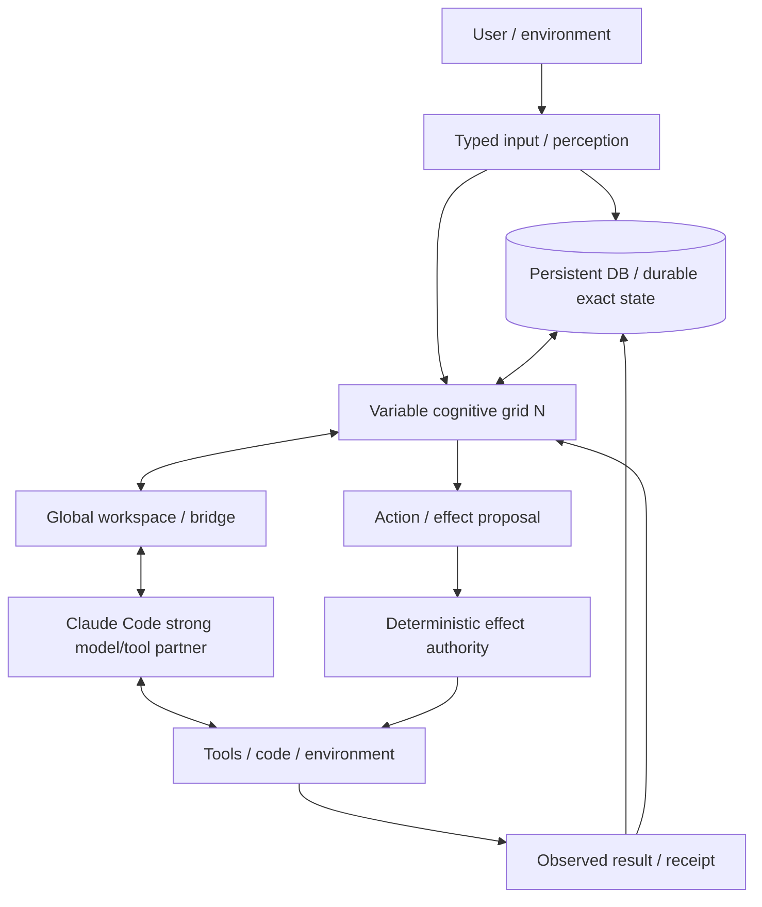
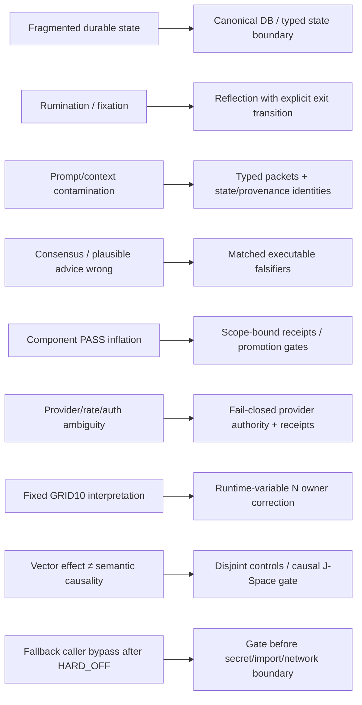

# Project Frankenstein — developer / research chronicle

This directory is the **technical navigation layer** for Project Frankenstein. It is not a second authority surface and it does not replace canonical source, receipts, owner directives, or current supervisor steering.

## 0. Read current authority before interpreting history

At the start of this Triggerword‑3 pass, canonical `main` was observed at:

`854f6bc87780f4a5242489a6c807d186b16a8c3d`

Current precedence used for this curation pass:

1. newest explicit owner authority;
2. `research_entity/claycode/autonomous/SUPERVISOR_INBOX.json` and the steering file it selects;
3. current owner/product target and canonical source;
4. exact executable evidence at the exact claimed identity;
5. historical source / receipts / donor branches;
6. summaries and bootstrap caches.

The current supervisor inbox selects **9.13O** and retains **9.13 HARD_OFF** for external provider routes. Together is forbidden; paid fallback is forbidden; the current 72‑hour Frankenstein provider orchestration is quarantined/non-operative as written.

The highest-precedence current owner target is:

`VARIABLE COGNITIVE GRID + PERSISTENT DATABASE + CLAUDE CODE`

GRID10 is an important benchmark and engineering configuration, not the final architecture identity. `N` is runtime-variable.

## 1. Evidence labels used here

| Label | Meaning |
|---|---|
| `CURRENT_SOURCE` | Present in current canonical source / current authority surface. |
| `HISTORICAL_SOURCE` | Preserved source or document from an older authority/architecture epoch. |
| `PROJECT_MEASUREMENT` | Measured project result with an identified scope; never broadened automatically. |
| `COMMIT_REPORTED_RESULT` | A result stated in a commit/receipt that this curation organ did not independently re-run. |
| `EXTERNAL_PRIMARY` | Primary literature, standards, or vendor-primary documentation used as research input. |
| `INFERENCE` | Reasoned interpretation from observed material. |
| `OPEN_HYPOTHESIS` | Plausible but not established; must carry a falsifier. |
| `NEGATIVE_RESULT` | Failure/counterevidence that constrains the architecture. |
| `BLOCKED` | Required gate unavailable or forbidden under current authority. |
| `QUARANTINED` | Source is preserved but is explicitly non-operative under current authority. |
| `RETIRED` | Historical mechanism/name no longer defines the current product. |

The two central anti-inflation rules are:

> request ≠ effect

> component PASS ≠ whole-product PASS

Also: model output ≠ world fact; method exists ≠ result exists; consensus/repetition ≠ independent evidence.

## 2. Current target architecture

**CURRENT_SOURCE / owner target:** simulate cognition; store durable data. The grid distributes cognitive processes; the persistent database owns durable exact state where deterministic storage is superior; Claude Code remains the strong external model/tool/code partner. A Global‑Workspace/J‑Space bridge is pursued only to the strongest interface that is actually exposed and causally evidenced.

### Functional decomposition

- **State / memory:** durable exact data in canonical DB substrate; transient high-rate state may remain in RAM.
- **Cognition:** runtime-variable small-model grid reproducing/distributing historical Zero/EntityOS cognitive functions.
- **Workspace:** competition, broadcast, uptake, re-entry, typed state transfer and compression.
- **Strong-model bridge:** Claude Code at the strongest supported observable interface; no invented hidden-state access.
- **Action:** proposals are not effects. Deterministic effect authority remains the real state-changing boundary.
- **Verification:** result receipts re-enter state; unknown outcomes remain unknown.

## 3. Project Frankenstein lineage — evidence-bearing chronology

This is a reconstruction index, not a claim that each mechanism was first *created* on the date its first accessible Git evidence appears.

### A. Historical Frank / Zero / fragmented cognition

`HISTORICAL_SOURCE`

The repository preserves historical Frank / Project Frankenstein / Agent Zero mechanisms across source, archive-assimilation manifests, architecture archaeology, trigger runs, old boot files and topic packets. Useful starting points:

- `research_entity/archive_assimilation/manifests/PROJECT_FRANKENSTEIN_HISTORY_SEMANTIC_K128_K159_20260809T1306p0700.json`
- `research_entity/archive_assimilation/manifests/PROJECT_FRANKENSTEIN_HISTORY_K128_K157_SEMANTIC_DISPOSITION_20260809T1310p0700.json`
- `research_entity/architecture_archaeology/MECHANISM_INDEX.json`
- `research_entity/architecture_archaeology/ARCHAEOLOGY_WORKSPACE.json`
- `agentZero/`
- historical Frank/ClayVerse boot and compatibility files in repository root and archives.

These sources are an evidence archive, not a truth oracle. Historical naming cannot override current EntityOS/owner authority.

### B. State fragmentation → UnifiedDB direction

`HISTORICAL_SOURCE` + `CURRENT_SOURCE` + `INFERENCE`

A recurring engineering pressure was fragmented state spread across modules/services. The convergence direction is one canonical durable SQLite substrate containing many typed tables, indexes, views, policies and journals, plus rebuildable projections and optional transient RAM state.

This is why “UnifiedDB” must not be described as a giant untyped file. One authority substrate can still contain strong internal type and ownership boundaries.

**Project term — Emergent Retrieval:** relevance that appears when independently stored evidence dimensions intersect at query time: semantic similarity, time, causal lineage, current state, goals, perception, effects, confidence, provenance, and related dimensions. No information is created from nothing.

External systems analogy only: SQLite WAL allows concurrent readers with one writer on the same host while preserving transaction boundaries. Primary documentation: https://www.sqlite.org/wal.html

NVIDIA Unified Memory is only a systems analogy for reducing ownership/copy boundaries. Hardware memory migration/coherence is not database semantics. Primary documentation: https://docs.nvidia.com/cuda/cuda-programming-guide/02-basics/understanding-memory.html

### C. Reflection / rumination → explicit exit requirement

`HISTORICAL_SOURCE` + `NEGATIVE_RESULT` + `ADOPTED`

Self-reflection is treated as an engineering control operation:

`inspect state/outcome -> detect mismatch -> generate correction -> store/retrieve correction -> alter later behavior`

A useful reflection loop must terminate into **ACT / ASK / WAIT / re-observe / another measurable transition**. Endless recursive reflection is a failure mode. This requirement exists because rumination/fixation and context contamination can make “more reflection” look active while producing no state-changing progress.

### D. Global workspace / GWT → empirical J-Space research

`HISTORICAL_SOURCE` + `CURRENT_SOURCE` + `OPEN_HYPOTHESIS`

Relevant project indices:

- `research_entity/triggers/GWT_RESEARCH_PROTOCOL.md`
- `research_entity/triggers/HYPERPOSITION_RESEARCH_PROTOCOL.md`
- current owner target document for `GLOBAL WORKSPACE -> GLOBAL J-SPACE`.

External primary research provides architecture inspiration, not project proof:

- Baars, 2005, *Global workspace theory of consciousness: toward a cognitive neuroscience of human experience*, DOI `10.1016/S0079-6123(05)50004-9`.
- Dehaene & Changeux, 2011, *Experimental and theoretical approaches to conscious processing*, DOI `10.1016/j.neuron.2011.03.018`.

Project use is engineering/causal: competition, broadcast, uptake and re-entry. No present architecture claim depends on consciousness, sentience or subjective experience.

**OPEN_HYPOTHESIS — confidence 0.55:** sufficiently rich external state/memory/perception/arbitration/effect receipts plus workspace re-entry can supply much of the useful reflective agency historically spread across a monolithic agent stack.

**Falsifier:** a controlled matched system with the external substrate fails to preserve/reproduce the required cognitive transitions while a simpler alternative does, or the measured behavior depends mainly on hidden prompt scaffolding rather than the state substrate.

### E. GRID / HCU computerization → variable-N correction

`CURRENT_SOURCE` + `PROJECT_MEASUREMENT` + `NEGATIVE_RESULT`

GRID10 supplied a concrete engineering surface for shared fabric, regulators, task claiming, stale recovery and concurrency experiments. Current owner authority later corrected the finished architecture: **GRID10 is a benchmark, N is runtime-variable.**

A current 4-process / 4-vCPU thread-count A/B measured:

| torch intra-op threads/process | result |
|---:|---|
| 1 | 8.3197 s/call average, 12 samples |
| 2 | 23.1806 s/call average, 12 samples |
| 4 | zero completed samples inside experiment timeouts |

**PROJECT_MEASUREMENT boundary:** this supports default `1` for that measured topology only. It does not prove general GRID performance, HCU acceptance, or a universal optimum.

The important lineage lesson is negative: a plausible external recommendation (“more threads should help”) was falsified by matched execution. Measurement beats model consensus.

### F. J-Space/vector work → causal evidence ceiling

`CURRENT_SOURCE` + `NEGATIVE_RESULT` + `OPEN_HYPOTHESIS`

The repository contains extensive vector-control, cvec, hidden-state and J-Space research. The current evidence discipline is stricter than “vector changed output.” Promotion-grade claims require exact model/runtime identity, intervention site/vector identity, matched controls, disjoint holdouts, lesion/shuffle/rescue or equivalent discriminators where applicable, and causal re-entry evidence.

Known anti-patterns preserved in the research archive include lexical target leakage, fixed label/code associations, prompt/schema recurrence mistaken for representation, terminal-readout steering overinterpreted as internal J-Space causality, and same-family replication treated as independence.

**OPEN_HYPOTHESIS — confidence 0.42:** a model-specific intermediate representation can become a useful causal J-Space control interface after label-free/disjoint controls and representation-derived intervention vectors close shortcut alternatives.

**Falsifier:** matched nuisance/off-target/sign-flip/null/permutation controls explain equal or greater behavior than the semantic intervention, or the effect fails on disjoint semantic/template families.

### G. 0.8B training research → separate from runtime authority

`CURRENT_SOURCE` + `PREPARED_NOT_RUN/BLOCKED`

The current owner direction targets a Qwen3.5‑0.8B-class low-refusal/abliterated cognitive module, but the model is trained for the **actual cognitive-process workload**, not generic chatbot quality and not a fixed GRID10 personality.

Training families include process-state interpretation, DB-vs-simulation boundaries, planning/replanning, evidence/uncertainty/Hyperposition, variable-N coordination, compression/state transfer, Claude Code handoff/return, workspace re-entry, failure/restart/rejoin and fail-closed authority behavior.

Training preparation and paid training authorization are distinct. Current 9.13 authority authorizes **zero** Together runs and forbids external provider execution.

### H. 2026-08-27 master cognition concept → useful source, bounded claims

`CURRENT_SOURCE`

`research_entity/topic_packets/frankenstein-master-cognition-concept/CONCEPT.md` deliberately distinguishes currently implemented GRID10/Fabric mechanisms from aspirational alignment/reflex/web UI/bridge work. That honesty boundary is retained.

Useful reusable ideas include:

- deterministic reflex path outside LLM inference;
- regulator-driven adaptive polling/correction;
- explicit user-visible targets and measured deviation;
- Claude bridge as an optional integration rather than an invisible authority;
- failure-visible state rather than silent fallback.

Because the final owner target is now variable-N, any GRID10-specific language is interpreted as a benchmark/donor implementation, not the final product identity.

### I. 72-hour Bauleiter/Bugfix/Package dispenser → source exists, execution quarantined

`CURRENT_SOURCE` + `COMMIT_REPORTED_RESULT` + `QUARANTINED`

Commit `854f6bc87780f4a5242489a6c807d186b16a8c3d` added:

- `frankenstein_packages_v1.py`
- `frankenstein_orchestrator_v1.py`
- `frankenstein_bugfix_v1.py`
- focused tests.

The commit reports 29 tests green (12 package, 7 orchestrator, 10 bugfix). This curation pass did **not** independently re-run those exact tests, so the statement remains `COMMIT_REPORTED_RESULT`, not newly observed runtime evidence.

The provider-calling portions are **QUARANTINED** under current 9.13 HARD_OFF. The bugfix script contains direct NVIDIA/Groq/Mistral fallback logic; the orchestration plan also treated one Together training run as available. Current authority says the opposite: external provider routes are hard-off, Together is forbidden, and remaining paid-run authorization is zero.

Read the sidecar before these files:

`research_entity/topic_packets/frankenstein-master-cognition-concept/CURRENT_AUTHORITY_OVERRIDE_20260827.md`

## 4. Failure → engineering move map

Failures are not editorial debris. They explain why the current architecture has the boundaries it has.

## 5. Interconnected research index

### State / memory / retrieval

- `research_entity/continuity/`
- `research_entity/global/`
- current UnifiedDB / SQLite implementations and migrations
- `agentZero/code/udb/`
- architecture archaeology manifests and source references.

### GWT / workspace / Hyperposition / GRF

- `research_entity/triggers/GWT_RESEARCH_PROTOCOL.md`
- `research_entity/triggers/HYPERPOSITION_RESEARCH_PROTOCOL.md`
- GRF / HyperMath / ClayCode source and topic packets
- current cognitive process ABI / workspace / restart-resize work.

### HCU / grid / Typed Entry

- retained donor lane: repository-qualified PR `gschaidergabriel/clay-global-research-entity#1263` (description may be stale; refresh before use)
- `tools/grid10_*`
- Typed Entry / engine-admission / inference receipt / workspace primitives
- physical GRID evidence and negative receipts.

### Training / model research

- current Trigger‑2 research lanes and training registries
- dynamic episode-local binding, nuisance/leakage gates, family-level split controls
- Qwen3.5‑0.8B target materials
- historical LoRA/IAPT/SOMA/adapter research retained as lineage rather than automatic current practice.

### Effects / tools / verification

- deterministic effect gate/journal authority
- tool and action proposal boundaries
- receipts / result re-entry
- unknown-outcome and replay controls.

### FreeSwarm / Forge / Distillery

Treat token volume as collection telemetry, not utility. Current authority retains zero training credit while accepted dataset yield remains unresolved/zero at the last confirmed supervisor state. Forge/Distillery failures and replay work are first-class evidence because they reveal the conversion gap between generated text and admitted training data.

## 6. Current authority conflict: why the 72h scripts are not “ready to run”

Timeline matters:

1. current 9.13 steering explicitly quarantined the provider-calling Frankenstein orchestration;
2. after that authority change, commit `854f6bc…` added working source and non-networked tests for Bauleiter/Bugfix/Package modules;
3. source existence and test greenness do not override authority;
4. therefore the current status is **SOURCE PRESENT / EXECUTION QUARANTINED**.

A future admissible version must resolve current authority **before** secret lookup, provider import, network I/O, Aider or fallback dispatch. Under HARD_OFF it must prove `provider_calls=0` and `secret_lookups=0`. Do not modify Frank's own Harness to bypass this boundary.

## 7. Current evidence-credit ledger

At this curation pass:

| Scope | Credit |
|---|---:|
| Whole EntityOS runtime | 0 |
| Full HCU runtime | 0 |
| Physical GRID10 promotion | 0 |
| Canonical semantics promotion | 0 |
| Model-specific Global J-Space promotion | 0 |
| Training | 0 |
| 72h Frankenstein provider orchestration authority | false |

This ledger deliberately resists “the code exists, therefore the system works.”

## 8. Repository curation state

The desired human-facing root is intentionally small:

- `README.md`
- `HUMAN_READ_THIS/`
- `DEV_SOURCE_RESEARCH/`
- `AI_START_HERE_DO_NOT_SCAN_REPO/`

The current repository root still contains many legacy/technical files. This Triggerword‑3 pass **does not mass-move them blindly** because root paths can be referenced by workflows, agents, bootstraps, docs, receipts or external automation. The migration manifest is:

`DEV_SOURCE_RESEARCH/repository/TRIGGERWORD3_REPOSITORY_MIGRATION_MANIFEST_2026-08-27.json`

Mass moves remain `PREPARED_NOT_RUN` until consumer/path audits prove they are safe. Historical receipts are never rewritten merely to make the tree prettier.

## 9. Research-quality rule

For every important claim, keep these adjacent:

- exact source / measurement;
- scope;
- counterhypothesis;
- falsifier;
- current status;
- next discriminator.

The target is not maximum documentation volume. It is maximum **useful compression without destroying evidence lineage**.