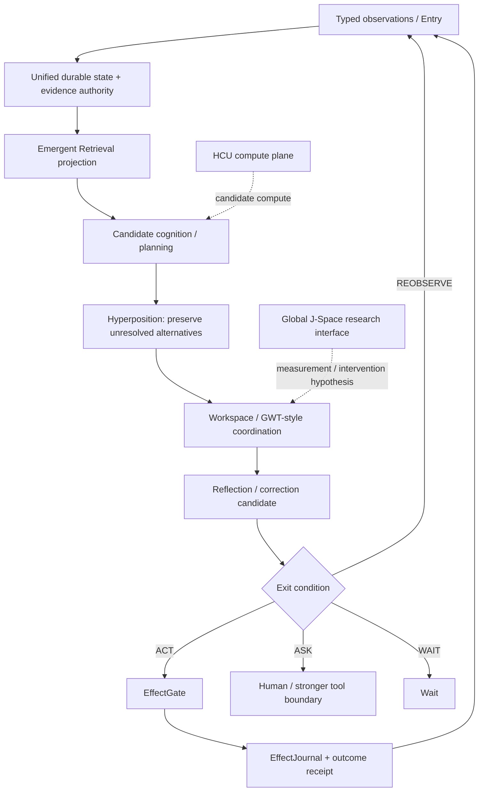

# Frankenstein developer / research entry point

This directory is the progressive-disclosure entry for Project Frankenstein engineering and research. It is an **index over evidence**, not a replacement truth store and not a prose authority layer.

## Current re-entry identity

- Repository: `gschaidergabriel/clay-global-research-entity`
- Trigger-3 baseline inspected: `main@854f6bc87780f4a5242489a6c807d186b16a8c3d`
- Persistent research entity: `Clay`
- Product: `EntityOS`
- Integrated cognition/compute architecture: `HCU`
- Current supervisor inbox observed: `9.13O_NON_AUTHORITY`, selecting provider epoch `9.13`
- Provider state at that baseline: `FREE_ONLY_HARD_OFF_ALL_PROVIDER_ROUTES_FALSE_TOGETHER_FORBIDDEN_NO_PAID_FALLBACK`
- Whole EntityOS/HCU runtime credit: `0`
- Full HCU runtime credit: `0`
- Training credit: `0`

Always re-read current `main`, `CLAY_EXECUTION_AUTHORITY.md`, `research_entity/claycode/autonomous/SUPERVISOR_INBOX.json`, its selected steering file, and exact current receipts before turning this index into a current-state claim.

## Evidence labels used in this layer

| Label | Meaning |
|---|---|
| `CURRENT_SOURCE` | directly observed in the exact current source identity named by the claim |
| `HISTORICAL_SOURCE` | source that records lineage but is not current authority |
| `PROJECT_MEASUREMENT` | an observed project measurement with explicit scope/identity |
| `EXTERNAL_PRIMARY` | primary paper, standard, official vendor/runtime documentation |
| `INFERENCE` | conclusion supported by evidence but not directly measured |
| `OPEN_HYPOTHESIS` | a testable candidate explanation/design claim |
| `NEGATIVE_RESULT` | measured/source-grounded failure or contradiction retained as evidence |

Additional lifecycle terms used by the research archive should remain explicit: `attempted`, `source-ready`, `measured`, `reproduced`, `contradicted`, `blocked`, `prepared-not-run`, `adopted`, `retired`.

## Current high-value evidence graph

The diagram is architectural framing, not proof that every edge has full integrated runtime acceptance.

## Trigger-3 current contradiction ledger

The most important current contradiction is local and concrete:

1. `CURRENT_SOURCE`: the latest Frankenstein Bauleiter/Bugfixer source exists and its commit reports 29 non-network/orchestration tests green.
2. `CURRENT_SOURCE`: those scripts contain direct NVIDIA/Groq/Mistral caller paths and import/use the external free-pool surface.
3. `CURRENT_SOURCE`: Supervisor 9.13O says all provider routes are hard-off, Together is forbidden, remaining paid runs are zero, and the 72-hour provider orchestration is quarantined/non-operative.
4. `CONTRADICTED`: therefore “tests green” cannot be promoted to “safe/authorized 72-hour deployment”. The direct caller boundary remains P0.

Exact current packet: `research_entity/topic_packets/frankenstein-master-cognition-concept/`.

## Research lineage map

Use Git history and exact paths to reconstruct lineage. When dates cannot be established from accessible Git, write **“first verified in accessible Git”**, not “created on”.

Key lines to preserve and interconnect rather than flatten:

- historical Frank architecture and GRF mathematical/engineering lineage;
- E-PQ/state, perception, memory, goals, prediction and reflection;
- UnifiedDB convergence and Emergent Retrieval;
- LoRA / IAPT / SOMA and later small-model training research;
- EntityOS runtime and Typed Entry/effect authority;
- HCU / GRID family and variable-N versus benchmark-only GRID10 distinctions;
- Xeno as transitional implementation codename, not a competing product;
- Hyperposition and Global Workspace/GWT engineering hypotheses;
- Global J-Space/vector-binding experiments and their negative controls;
- ClayCode language/compiler/protocol work;
- Claude Code bridge/interface evidence boundaries;
- FreeSwarm / Forge / Distillery conversion funnel, including zero-yield periods;
- exact receipts, negative evidence and authority transitions.

## UnifiedDB and Emergent Retrieval — engineering reading

`UnifiedDB` is a coherent authority substrate, not a “god file”. A single canonical substrate may have many typed tables, indices, views, policies and journals. Transient high-rate state can remain outside it when appropriate.

`Emergent Retrieval` means that relevance can emerge when independent dimensions overlap at query time. The claim is about *selection from stored evidence*, never creation of missing facts.

SQLite/WAL is a useful implementation mechanism where used, but not a magic concurrency guarantee. Official SQLite documentation states that WAL permits readers and a writer to proceed concurrently while still allowing only one writer at a time, and documents checkpoint behavior and failure modes. The current SQLite WAL documentation also records a rare WAL-reset corruption bug affecting unpatched versions through 3.51.2 and recommends fixed versions such as 3.51.3+ (with selected backports). **This is an external implementation warning, not evidence that the project is affected; the exact runtime SQLite version and access pattern must be measured before making that claim.**

Primary reference: https://www.sqlite.org/wal.html

## GWT / workspace analogy boundary

The historical Global Neuronal Workspace literature distinguishes a globally accessible workspace from specialized processors and proposes recurrent/global access mechanisms. Project Frankenstein may use that as a structural research analogy, but no present architecture claim depends on consciousness or on literal biological equivalence.

Primary references:

- Dehaene, Kerszberg & Changeux (1998), PNAS, DOI `10.1073/pnas.95.24.14529`: https://pubmed.ncbi.nlm.nih.gov/9826734/
- Mashour et al. (2020), *Neuron*, DOI `10.1016/j.neuron.2020.01.026`: https://doi.org/10.1016/j.neuron.2020.01.026

## Reflection research analogy boundary

`Reflexion` demonstrates one external agent design in which linguistic feedback is stored in episodic memory and used in later trials. It is a useful method comparison for “reflection changes later behavior”, not evidence that Frankenstein’s own reflection loop works or that textual reflection is sufficient.

Primary reference: Shinn et al. (2023), arXiv:2303.11366 — https://arxiv.org/abs/2303.11366

## NVIDIA Unified Memory analogy boundary

NVIDIA Unified Memory is a CUDA memory-management/coherence facility across processors. The project may borrow the systems-design intuition “reduce explicit ownership/copy boundaries so compute sees a coherent substrate”. It must **not** be described as equivalent to database semantics, provenance, transactions or authority.

Primary reference: NVIDIA CUDA Programming Guide, Unified Memory — https://docs.nvidia.com/cuda/cuda-programming-guide/

## What needs to be built in this documentation layer

1. A Git-supported chronology with commit links and module evolution.
2. A topic index that maps archive files to concepts without copying thousands of files into prose.
3. Failure → engineering-response chains for rumination, context contamination, prompt/weight conflicts, latency/timeouts, dead modules and integration failures.
4. Measurement tables that keep scope next to every number.
5. Hypothesis cards with confidence, counterhypothesis and falsifier.
6. Deep links from diagrams to source/tests/receipts.
7. An installer matrix whose end state is always `NATIVE`, `ADAPTED`, `DEGRADED` or `BLOCKED`.
8. A byte-preserving repository migration ledger toward the human-readable root topology.

Start with [`repository/TRIGGER3_CURRENT_STATE_AND_MIGRATION_2026-08-27.md`](repository/TRIGGER3_CURRENT_STATE_AND_MIGRATION_2026-08-27.md).