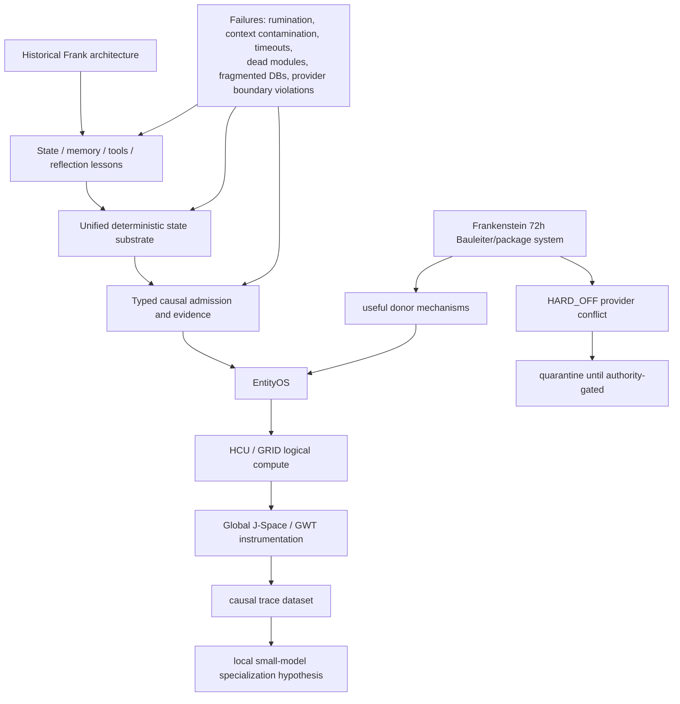

# Project Frankenstein / EntityOS research map

This is the technical entry point for Triggerword 3 curation. It is an evidence map, not a truth oracle.

Machine-readable companions:

- `RESEARCH_ARCHIVE_INDEX.json` — discoverability map across current and historical research domains without copying the archive into prose.
- `ROOT_MIGRATION_MANIFEST.json` — conservative root-to-technical-archive migration plan with exact observed Git identities and compatibility blockers.
- `AUTHORITY_DRIFT_20260827.md` — current-facing authority drift and its fail-closed resolution, including the provider-HARD_OFF vs non-provider-sandbox distinction.
- `EXTERNAL_PRIMARY_NOTES.md` — outside primary references and explicit analogy boundaries.

## Current authority snapshot

Observed at trigger execution:

- canonical branch: `main`
- canonical head before this curation branch: `854f6bc87780f4a5242489a6c807d186b16a8c3d`
- later observed moving main during the same trigger: `551ed48f9ebf8c610311c98ccaf84cdca3f487a7` (Free-Swarm/Distillery/Forge metrics refresh)
- product: `EntityOS`
- integrated cognition/compute architecture: `HCU`
- supervisor schema: `9.13`
- latest steering delta: `9.13O_NON_AUTHORITY`
- provider state: `FREE_ONLY_HARD_OFF_ALL_PROVIDER_ROUTES_FALSE_TOGETHER_FORBIDDEN_NO_PAID_FALLBACK`
- non-provider local/sandbox validation: allowed by the 9.13 inbox under current FREE_ONLY authority; this is distinct from provider admission
- whole EntityOS runtime credit: `0`
- full HCU runtime credit: `0`
- Physical-GRID10 runtime credit: `0`
- canonical semantics credit: `0`
- training credit: `0`

Primary current surfaces:

- `research_entity/claycode/autonomous/SUPERVISOR_INBOX.json`
- `research_entity/claycode/autonomous/SUPERVISOR_STEERING_9_13O_DELTA_2026-08-27T2341P0700_GPT56SOL.json`
- `research_entity/topic_packets/frankenstein-master-cognition-concept/CONCEPT.md`
- `research_entity/topic_packets/frankenstein-master-cognition-concept/BUILD_ORCHESTRATION_PLAN_20260827.json`

Authority warning: `BOOTSTRAP_MINIMAL.json` and `PROGRAM_STATE.json` still expose the older 8.78 epoch at this snapshot. For provider/runtime policy, the newer inbox-selected 9.13 state wins; do not average the surfaces. The active owner dual-machine sandbox authority is not erased by provider HARD_OFF, and 9.13 explicitly preserves non-provider local/sandbox validation.

## Evidence classification used here

| Label | Meaning |
|---|---|
| `CURRENT_SOURCE` | present in current canonical source/authority |
| `HISTORICAL_SOURCE` | useful provenance but not current authority |
| `PROJECT_MEASUREMENT` | measured by a project experiment at a bounded scope |
| `EXTERNAL_PRIMARY` | primary outside source/specification |
| `INFERENCE` | reasoned conclusion, not direct observation |
| `OPEN_HYPOTHESIS` | unverified mechanism or architectural claim |
| `NEGATIVE_RESULT` | failed, contradicted, blocked or authority-invalid result |

Promotion rule: request != effect; source-ready != runtime-observed; model output != world fact; repetition != independent evidence; component PASS != whole-product PASS.

## Current high-information finding: Frankenstein 72h orchestration conflict

### CURRENT_SOURCE

Commit `854f6bc87780f4a5242489a6c807d186b16a8c3d` added:

- `frankenstein_packages_v1.py`
- `frankenstein_orchestrator_v1.py`
- `frankenstein_bugfix_v1.py`
- associated tests

The commit reports 29 tests green. The orchestrator source directly imports/uses `~/last-resort/llm.py`, performs named-tier provider HTTP calls, and can shell out to `~/.claude/star/harness_aider.py fallback-start`. The Bugfix role likewise walks NVIDIA -> Groq -> Mistral and is designed to retry indefinitely.

### NEGATIVE_RESULT

The current 9.13 authority says all provider routes are HARD_OFF and Together is forbidden. The 9.13O steering explicitly quarantines the 72h Frankenstein provider orchestration as non-operative under that authority.

Therefore:

```text
29 local orchestration tests PASS
    != provider execution authority
    != provider-path runtime PASS
    != EntityOS/HCU runtime promotion
```

The post-steering commit is useful source material but creates a fresh authority-boundary regression surface. Any future executable launcher must resolve canonical provider authority **before** secret lookup, provider import, network access, Aider invocation or fallback dispatch, and must fail closed under HARD_OFF.

Confidence: 0.99.

Falsifier: a newer explicit owner/canonical authority that re-enables the relevant provider route, or exact current executable evidence showing an authority gate precedes every provider/secret/network boundary while preserving HARD_OFF behavior when disabled.

## GRID10 measurement lineage

### PROJECT_MEASUREMENT

The current supervisor records a real 4-process / 4-vCPU thread-count A/B:

- 1 torch thread/process: mean `8.3197 s/call` over 12 samples
- 2 threads/process: mean `23.1806 s/call` over 12 samples
- 4 threads/process: zero completed samples within experiment timeouts

This falsified the recommendation that 2 threads/process would be faster on that measured topology and supports keeping default=1 there.

Boundary: topology-specific diagnostic evidence only. It does not promote Physical-GRID10, BASE, HCU or release acceptance.

## Frankenstein research lineage — compact dependency map



## Engineering thesis under test

### OPEN_HYPOTHESIS

Useful reflective agency requires a sufficiently rich external substrate for state, memory, perception, arbitration, effect receipts and verified outcome re-entry. A model alone is not expected to provide the same reliability.

Supporting observations:

- state fragmentation produced ownership/reconciliation problems;
- recursive reflection without an exit can become rumination/fixation;
- prompt/schema recurrence can imitate deeper causal coherence;
- model-authored plans can conflict with current execution authority;
- exact effect/result receipts are needed to distinguish requests from real effects.

Counterhypothesis: a sufficiently capable model plus a thin conventional tool wrapper may achieve equivalent practical agency without much external cognitive substrate.

Discriminator: matched task suites comparing thin-wrapper vs. typed-state/effect-reentry architectures with fixed model family, measuring recovery after interruption, stale-context resistance, effect correctness, provenance errors, repeated-task learning and reflection termination.

Engineering confidence: 0.78; not a verified scientific claim.

## UnifiedDB and Emergent Retrieval

Historical multi-DB/multi-service fragmentation motivated convergence toward one canonical deterministic state/evidence substrate. This is not a “god file”: one authority substrate can contain many typed tables, indexes, journals, policies and rebuildable projections.

`Emergent Retrieval` means relevant evidence becomes retrievable when independently stored dimensions overlap at query time: semantic similarity, temporal proximity, causal lineage, current state, goals, perception, effects, confidence and provenance. It does not mean the system invents missing information.

## GRF / GWT / Hyperposition / J-Space status law

These ideas remain useful research lenses only at the evidence level actually measured.

- GWT/workspace recurrence: coordination signal, not proof of consciousness or hidden-state causality.
- Hyperposition: preserve unresolved alternatives until a discriminator closes them; majority cannot mint truth.
- Global J-Space: empirical causal interface hypothesis requiring model/runtime-specific evidence.
- GRF: preserve its mathematical/engineering lineage with exact source links where available; do not promote analogy into measured mechanism.

Representative discoverable anchors are maintained in `RESEARCH_ARCHIVE_INDEX.json`, including current/latest GRF-Hyperposition-GWT material, J-Space/vector-binding research, ClayCode, SOMA/LoRA/IAPT lineage, Xeno/HCU compatibility source, FreeSwarm/Forge/Distillery and evidence/bridge history.

## Negative-result index that must remain visible

- provider HARD_OFF bypass surfaces after authority closure;
- zero accepted Distillery dataset tokens in the latest confirmed supervisor state (`0 / 88,774` source tokens);
- source-ready or component-ready work with zero whole-system runtime credit;
- model/provider proposals that invented non-existent project infrastructure;
- thread-count recommendation falsified on the measured 4-process/4-vCPU topology;
- Physical-GRID10 RAM claims not promoted without PSS/full smaps accounting;
- paid Together runs under later HARD_OFF authority: zero credit;
- prompt/model-family/checkpoint ancestry leakage risks in training evaluation.

## Triggerword 3 repository-topology status

Target public root remains:

```text
README.md
HUMAN_READ_THIS/
DEV_SOURCE_RESEARCH/
AI_START_HERE_DO_NOT_SCAN_REPO/
```

This trigger creates the three navigational layers but **does not yet perform destructive or compatibility-breaking root moves**. `ROOT_MIGRATION_MANIFEST.json` now records an observed root snapshot, candidate targets, Git identities and explicit blockers. High-risk current paths such as `research_entity/`, `governance/`, `the artefact/`, active generated dashboards/results, host-convention files and runtime/import/test trees remain blocked until references and lifecycle assumptions are closed.

The root `README.md` is intentionally not rewritten by this trigger.

## Next exact curation gates

1. Complete the root inventory on latest `main` and compute repository-wide path-reference counts for every manifest entry.
2. Select the first byte-preserving low-risk move set; update references deterministically and verify compatibility before deleting old paths.
3. Add a non-provider static authority audit for the actual Frankenstein external caller chain (`stern.py -> harness_aider.py -> last-resort/llm.py`) and prove the intended gate location in source without invoking providers.
4. Reconstruct major module chronology as `first verified in accessible Git`, with commit identities rather than guessed creation dates.
5. Continue progressive-disclosure deep links from `RESEARCH_ARCHIVE_INDEX.json`; do not expand the README into a duplicate of the archive.
