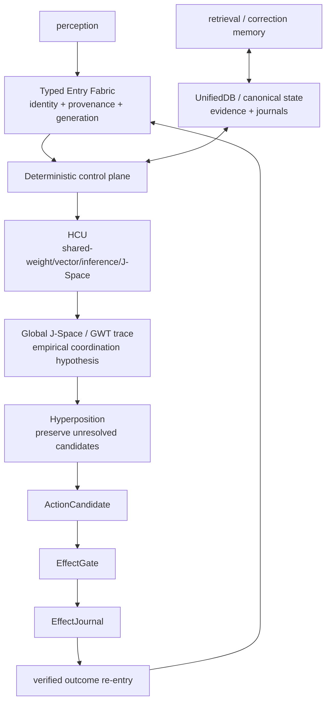

# DEV_SOURCE_RESEARCH — progressive technical index

This directory is the technical/research route for Project Frankenstein → EntityOS + HCU. It is an **index over evidence**, not a replacement truth store and not a second authority.

Snapshot basis for this first index: canonical `main` merge-base `854f6bc87780f4a5242489a6c807d186b16a8c3d`, then refreshed `main` `551ed48f9ebf8c610311c98ccaf84cdca3f487a7`. Current supervisor semantics observed during the pass: **9.13 / surface 9.13O, HARD_OFF**. Re-resolve these before using this page for live execution decisions.

## 0. Authority first

Read in this order before making current-state or runtime claims:

1. [`../CLAY_EXECUTION_AUTHORITY.md`](../CLAY_EXECUTION_AUTHORITY.md) — explicit owner authority surface.
2. [`../research_entity/claycode/autonomous/SUPERVISOR_INBOX.json`](../research_entity/claycode/autonomous/SUPERVISOR_INBOX.json) — current admitted supervisor selection/frontier.
3. The steering file named by `SUPERVISOR_INBOX.json`.
4. [`../research_entity/continuity/BOOTSTRAP_MINIMAL.json`](../research_entity/continuity/BOOTSTRAP_MINIMAL.json) and [`../research_entity/rooms/PROGRAM_STATE.json`](../research_entity/rooms/PROGRAM_STATE.json) — useful continuity surfaces, but currently observed to lag the 9.13 inbox.
5. Exact source, tests and receipts at the exact commit/artifact identity relevant to the claim.

Do not average authority disagreements. The newest admitted authority wins; stale self-consistent surfaces remain stale.

## 1. Evidence vocabulary

Use these labels in technical prose and chronologies:

- **CURRENT_SOURCE** — source present at the exact current identity being discussed.
- **HISTORICAL_SOURCE** — source/prose retained as lineage, not current authority.
- **PROJECT_MEASUREMENT** — an observed project measurement with bounded scope.
- **EXTERNAL_PRIMARY** — original paper/spec/vendor-primary documentation.
- **INFERENCE** — conclusion drawn from observations, not directly measured.
- **OPEN_HYPOTHESIS** — plausible mechanism with an explicit falsifier.
- **NEGATIVE_RESULT** — observed failure/blocker/contradiction worth preserving.

Lifecycle qualifiers for research lines: `attempted`, `source-ready`, `measured`, `reproduced`, `contradicted`, `blocked`, `prepared-not-run`, `adopted`, `retired`.

## 2. Current Frankenstein control boundary

**CURRENT_SOURCE / NEGATIVE_RESULT:** the 2026-08-27 Bauleiter/Bugfix provider-capable orchestration exists in source, but supervisor 9.13 keeps provider execution and secret use HARD_OFF. Source existence is therefore not runtime authority.

Relevant files:

- [`../research_entity/topic_packets/frankenstein-master-cognition-concept/frankenstein_orchestrator_v1.py`](../research_entity/topic_packets/frankenstein-master-cognition-concept/frankenstein_orchestrator_v1.py)
- [`../research_entity/topic_packets/frankenstein-master-cognition-concept/frankenstein_bugfix_v1.py`](../research_entity/topic_packets/frankenstein-master-cognition-concept/frankenstein_bugfix_v1.py)
- [`../research_entity/topic_packets/frankenstein-master-cognition-concept/CONCEPT.md`](../research_entity/topic_packets/frankenstein-master-cognition-concept/CONCEPT.md)
- [`../research_entity/topic_packets/frankenstein-master-cognition-concept/AUTHORITY_QUARANTINE_9_13.md`](../research_entity/topic_packets/frankenstein-master-cognition-concept/AUTHORITY_QUARANTINE_9_13.md) — branch delta in this triggerword-3 synthesis.
- [`../research_entity/topic_packets/frankenstein-master-cognition-concept/frankenstein_authority_launcher_v1.py`](../research_entity/topic_packets/frankenstein-master-cognition-concept/frankenstein_authority_launcher_v1.py) — branch fail-closed launcher.
- [`../tests/test_frankenstein_authority_launcher_v1.py`](../tests/test_frankenstein_authority_launcher_v1.py) — branch boundary tests.

The launcher is a defense-in-depth entry point. It does **not** magically make direct invocation of legacy provider-capable files safe. The engineering invariant is stronger: all supported caller paths must resolve authority before credential lookup, provider-capable import, request construction, network use or provider fallback. Direct bypass remains a falsifier until structurally eliminated or made unreachable by supported entry points.

## 3. Frankenstein lineage: how to read the archive

The archive should answer two different questions without mixing them:

1. **What was tried, and when can accessible Git first verify it?**
2. **What is current product authority now?**

The archive manifest is the archaeology entry point:

- [`../research_entity/archive_assimilation/manifests/PROJECT_FRANKENSTEIN_MANIFEST.json`](../research_entity/archive_assimilation/manifests/PROJECT_FRANKENSTEIN_MANIFEST.json)

The current concept packet is a synthesis surface, not an authority oracle:

- [`../research_entity/topic_packets/frankenstein-master-cognition-concept/`](../research_entity/topic_packets/frankenstein-master-cognition-concept/)

When reconstructing chronology, use Git commit history and say **“first verified in accessible Git”** unless creation time is independently evidenced. Do not convert file mtime, copied archives or later commits into invention dates.

## 4. Architecture dependency graph



Dependencies matter. If effect outcome does not re-enter as verified evidence, reflection can optimize against imagined success. If state fragments into competing truth stores, retrieval and arbitration lose a common reference. If model outputs can bypass EffectGate, fluency becomes accidental authority.

## 5. UnifiedDB and Emergent Retrieval

Project direction: reduce state ownership/copy boundaries by keeping durable canonical evidence in one deterministic SQLite authority substrate, while allowing typed tables, indexes, views, journals and rebuildable projections. This is not a “god file.”

Representative source/research paths discovered at the refreshed snapshot:

- [`../research_entity/runtime/UNIFIEDDB_SEGMENTED_PULSE_MAINTENANCE_S1.md`](../research_entity/runtime/UNIFIEDDB_SEGMENTED_PULSE_MAINTENANCE_S1.md)
- [`../research_entity/runtime/UNIFIEDDB_V16_SEGMENTED_PULSE_MAINTENANCE.md`](../research_entity/runtime/UNIFIEDDB_V16_SEGMENTED_PULSE_MAINTENANCE.md)
- [`../research_entity/harness/reference/unifieddb_emergent_compact.py`](../research_entity/harness/reference/unifieddb_emergent_compact.py)
- [`../research_entity/harness/reference/unifieddb_emergent_exact_topk.py`](../research_entity/harness/reference/unifieddb_emergent_exact_topk.py)
- [`../research_entity/harness/reference/unifieddb_emergent_incremental.py`](../research_entity/harness/reference/unifieddb_emergent_incremental.py)
- [`../research_entity/harness/reference/unifieddb_emergent_cascade.py`](../research_entity/harness/reference/unifieddb_emergent_cascade.py)
- [`../research_entity/harness/reference/unifieddb_claygraph_assembly.py`](../research_entity/harness/reference/unifieddb_claygraph_assembly.py)

**Emergent Retrieval** means multi-dimensional relevance arising at query time from overlap among independently stored dimensions. It does not mean facts spontaneously appear.

### Current external SQLite discriminator

**EXTERNAL_PRIMARY:** SQLite’s official WAL documentation was updated on 2026-08-24 and documents a rare **WAL-reset bug** affecting SQLite 3.7.0 through 3.51.2, fixed in 3.51.3 and later (with specified backports). The necessary conditions involve WAL mode, multiple connections and concurrent write/checkpoint timing.

Primary source: https://www.sqlite.org/wal.html

**OPEN_HYPOTHESIS / CHECK_REQUIRED:** this does **not** establish that UnifiedDB is affected. Before claiming concurrent WAL durability for a concrete EntityOS/UnifiedDB build, record the exact linked/runtime SQLite version, journal mode, connection topology and concurrency pattern. Falsifier: exact runtime is fixed/not-WAL/not in the affected concurrency class.

## 6. NVIDIA Unified Memory: analogy only

**EXTERNAL_PRIMARY:** NVIDIA documents Unified Memory as a programming model that can provide CPU/GPU access to managed/system memory with hardware- or software-coherence depending on platform. This can reduce explicit placement/copy burden but still has locality, migration and performance constraints.

Primary source: https://docs.nvidia.com/cuda/cuda-programming-guide/02-basics/understanding-memory.html

Project use is **systems-design analogy only**: fewer ownership/copy boundaries can make computation over a coherent substrate easier. CUDA memory coherence is not SQLite transaction semantics, evidence authority, or retrieval semantics.

## 7. GWT / Global J-Space

**EXTERNAL_PRIMARY / conceptual donor:** Global Neuronal Workspace literature describes global availability/broadcast as a coordination hypothesis in neuroscience. Project Frankenstein/EntityOS does not infer consciousness from adopting a workspace-shaped engineering mechanism.

Useful primary/review source: https://pmc.ncbi.nlm.nih.gov/articles/PMC8770991/

**OPEN_HYPOTHESIS:** Global J-Space/GWT-style coupling causally improves coordination between module state, model computation and action selection.

**Strong falsifiers:**

- shuffle/lesion of the control vector leaves behavior unchanged;
- label-free counterbalanced internal-state tests collapse to chance;
- apparent effect is explained by prompt/schema leakage;
- rescue using the correct vector fails while lexical proxies succeed;
- the effect does not reproduce at exact checkpoint/tokenizer/runtime identity.

Textual coherence, recurrence, model self-report and majority agreement are not causal evidence.

## 8. Reflection and acting

External agent research gives useful donors but not project proof.

- **EXTERNAL_PRIMARY:** ReAct interleaves reasoning traces and environment actions: https://arxiv.org/abs/2210.03629
- **EXTERNAL_PRIMARY:** Reflexion stores linguistic feedback in episodic memory to influence later trials: https://arxiv.org/abs/2303.11366

Project-specific stronger requirement: reflection needs an **exit condition** and observed outcome re-entry. Reflection that only generates another reflection is rumination/fixation, not evidence of greater agency.

## 9. Training lineage and credit

Archive labels such as LoRA, IAPT, SOMA, ClayCode-only training and J-Space/vector-binding work must be treated as separate evidence families. A completed training job is not a PASS by itself.

Promotion requires, at minimum, exact model/checkpoint/tokenizer/runtime identity, a frozen baseline, leak-resistant train/validation/holdout families, deterministic hard negatives, intended-behavior gain, and regression/safety/protocol retention tests appropriate to the claim.

At the current 9.13 inbox snapshot:

- canonical dataset rows admitted: **0**;
- EntityOS whole-runtime credit: **0**;
- HCU full-runtime credit: **0**;
- Physical GRID10 runtime credit: **0**;
- training credit: **0**.

Those are current bounded authority values, not a statement that no component has ever run.

## 10. Negative results that must remain first-class

Current and historical curation should retain at least these classes:

- rumination/fixation and missing reflection exits;
- context contamination and prompt/schema leakage;
- prompt-vs-weight conflicts;
- latency and timeout failures;
- dead/unwired modules;
- source-ready but unexecuted mechanisms;
- integration failures across state/memory/perception/effects;
- unknown effect outcomes;
- stale generation/provenance/loader identity;
- provider/auth/quota/rate failures classified as infrastructure, not scientific negatives;
- component PASS incorrectly promoted to whole-product PASS;
- thread/concurrency counterexamples that falsify “more parallelism is always faster.”

## 11. Repository curation rule

The intended public root is eventually:

```text
README.md
HUMAN_READ_THIS/
DEV_SOURCE_RESEARCH/
AI_START_HERE_DO_NOT_SCAN_REPO/
```

This pass does **not** claim that migration is complete. Existing technical trees have not been mass-moved here because byte identity, deep links, Git archaeology and active parallel work must be preserved. The safe strategy is additive indexing first, then a separately verified migration with exact old→new path mapping and link regression.

Root README is deliberately unchanged in this triggerword-3 pass.

## 12. Next high-information gates

1. **Authority caller closure:** prove every supported Frankenstein provider-capable caller is structurally unable to cross provider/secret/network boundary under 9.13 HARD_OFF; direct legacy invocation is the counterexample to eliminate.
2. **Authority surface convergence:** reconcile stale 8.78 continuity/program-state surfaces with the current admitted 9.13 inbox without rewriting historical evidence.
3. **UnifiedDB SQLite fingerprint:** record exact runtime SQLite version + WAL mode + writer/checkpoint topology before concurrent durability claims.
4. **J-Space causality:** use label-free, counterbalanced lesion/shuffle/rescue tests at exact model identity.
5. **Chronology reconstruction:** build commit-backed module lineage and use “first verified in accessible Git” rather than invented creation dates.
6. **Installer verification:** each host route must end `NATIVE`, `ADAPTED`, `DEGRADED`, or `BLOCKED` based on observed lifecycle hooks/state/effect receipts.

This index should grow by deep links and evidence maps, not by copying the entire research entity into prose.