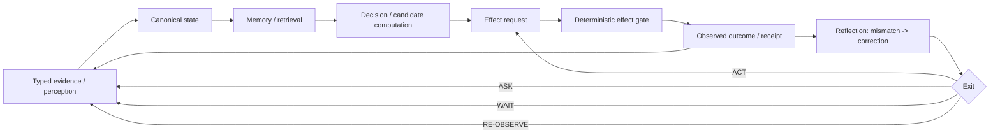
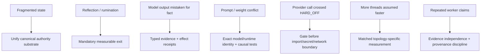

# Project Frankenstein — developer / research entry

This directory is the curated technical front door for Project Frankenstein inside the `clay-global-research-entity` evidence archive.

It is **not** a replacement authority. It is an index and synthesis layer. Current canonical claims must still be resolved from the newest admitted owner/supervisor surfaces and exact executable evidence.

Snapshot base used for this curation pass: `0ec6784cf06a47d4a955b1cc38ef0f0e526ec30e`.

## Read this before reading the archive

The repository contains several generations of the project at once. Names, architectures, execution rights, and evidence standards changed over time. A file can be useful history while being wrong about the present.

Use this ordering for current-state work:

1. newest explicit owner authority that actually exists in the checked tree;
2. newest admitted supervisor inbox / steering;
3. exact executable evidence bound to source, artifact, environment, and result identity;
4. current source and tests;
5. historical receipts, reports, topic packets, and older program surfaces;
6. summaries and caches.

Never average contradictory authorities into a nicer story.

## Current authority snapshot

At the snapshot above, `research_entity/claycode/autonomous/SUPERVISOR_INBOX.json` reports:

- global active program: `ENTITYOS_HCU`;
- product: `EntityOS`;
- integrated cognition/compute architecture: `HCU`;
- `free_only.enabled = true`;
- all provider routes unadmitted;
- Together forbidden and remaining paid runs = 0;
- whole EntityOS runtime credit = 0;
- full HCU runtime credit = 0;
- training credit = 0;
- Frankenstein 72-hour provider orchestration quarantined/non-operative under HARD_OFF.

The pointed 9.13O steering delta also treats **Project Frankenstein Active Build Program** as the current build program being supervised. These are two levels of description, not permission to silently replace the global product identity. Where surfaces genuinely conflict, this curation records the conflict rather than manufacturing a winner.

A separate consistency defect is preserved as a negative result: `research_entity/rooms/PROGRAM_STATE.json` has referenced a Project-Frankenstein owner-authority path that was not present when inspected during this Trigger-3 pass. A dangling authority pointer is not authority.

## Evidence labels used here

| Label | Meaning |
|---|---|
| `CURRENT_SOURCE` | Present source/current authority surface; not automatically runtime evidence. |
| `HISTORICAL_SOURCE` | Useful lineage/provenance from an older epoch. |
| `PROJECT_MEASUREMENT` | Measured project result with bounded scope. |
| `EXTERNAL_PRIMARY` | External primary paper/spec/vendor documentation. |
| `INFERENCE` | Reasoned conclusion from evidence, not directly observed. |
| `OPEN_HYPOTHESIS` | Testable proposal still requiring a discriminator. |
| `NEGATIVE_RESULT` | Failure, contradiction, blocked gate, or falsified expectation preserved as evidence. |

Additional lifecycle words in the evidence ledger include `attempted`, `source-ready`, `measured`, `reproduced`, `contradicted`, `blocked`, `prepared-not-run`, `adopted`, and `retired`.

## The engineering loop

The loop is intentionally asymmetric: model/workspace output can propose; canonical evidence and effect authority decide what becomes durable truth or a real-world effect.

## Progressive map

### 1. Project Frankenstein build line

Start with:

- [`../HUMAN_READ_THIS/README.md`](../HUMAN_READ_THIS/README.md)
- [`../research_entity/topic_packets/frankenstein-master-cognition-concept/`](../research_entity/topic_packets/frankenstein-master-cognition-concept/)
- [`../research_entity/archive_assimilation/manifests/PROJECT_FRANKENSTEIN_MANIFEST.json`](../research_entity/archive_assimilation/manifests/PROJECT_FRANKENSTEIN_MANIFEST.json)
- [`chronicle/FRANKENSTEIN_RESEARCH_CHRONICLE.md`](chronicle/FRANKENSTEIN_RESEARCH_CHRONICLE.md)

The recent orchestration line is particularly important because it contains both a build attempt and the failure that changed the design: provider-backed Bauleiter/Bugfixer loops were introduced, then quarantined under current HARD_OFF, and canonical entrypoints were changed to gate before provider import/secret lookup/network/Aider/fallback dispatch. Local tests are evidence for that guard logic only, not a live provider runtime pass.

### 2. UnifiedDB + Emergent Retrieval

Read:

- [`research/UNIFIEDDB_AND_EMERGENT_RETRIEVAL.md`](research/UNIFIEDDB_AND_EMERGENT_RETRIEVAL.md)
- [`../research_entity/harness/reference/unifieddb_emergent_compact.py`](../research_entity/harness/reference/unifieddb_emergent_compact.py)
- [`../research_entity/harness/reference/unifieddb_emergent_exact_topk.py`](../research_entity/harness/reference/unifieddb_emergent_exact_topk.py)
- [`../research_entity/harness/reference/unifieddb_emergent_incremental.py`](../research_entity/harness/reference/unifieddb_emergent_incremental.py)
- [`../research_entity/harness/reference/unifieddb_claygraph_assembly.py`](../research_entity/harness/reference/unifieddb_claygraph_assembly.py)
- [`../research_entity/harness/reference/benchmark_unifieddb_exact_topk.py`](../research_entity/harness/reference/benchmark_unifieddb_exact_topk.py)

These paths prove that reference mechanisms exist. They do **not** by themselves prove that a current Frankenstein runtime uses every mechanism.

### 3. GWT / Global J-Space / GRF / Hyperposition

Useful evidence families include:

- [`../research_entity/00_CURRENT/latest/hyperposition-gwt-grf.md`](../research_entity/00_CURRENT/latest/hyperposition-gwt-grf.md)
- [`../research_entity/global/j-space/README.md`](../research_entity/global/j-space/README.md)
- [`../research_entity/global/AGENT_ZERO_JSPACE_IDENTITY_GRF_INJECTION.md`](../research_entity/global/AGENT_ZERO_JSPACE_IDENTITY_GRF_INJECTION.md)
- [`../agentZero/GWT-GRF-Messung-2026-08-22.md`](../agentZero/GWT-GRF-Messung-2026-08-22.md)
- [`../research_entity/trigger_runs/hyperposition/`](../research_entity/trigger_runs/hyperposition/)

Treat these as a mixture of research concepts, prototypes, measurements, and historical authority epochs. `Global J-Space` remains an empirical coordination/interface hypothesis unless a specific model/runtime claim is backed by exact model-specific evidence.

### 4. FreeSwarm / Distillery / Forge

Useful entry paths include:

- [`../research_entity/00_CURRENT/latest/free-swarm-distillery.md`](../research_entity/00_CURRENT/latest/free-swarm-distillery.md)
- [`../tools/free_swarm_quiescence_action_v1.py`](../tools/free_swarm_quiescence_action_v1.py)
- [`../tools/free_swarm_runtime_quiescence_enforcer_v1.py`](../tools/free_swarm_runtime_quiescence_enforcer_v1.py)
- [`../research_entity/trigger_runs/2/`](../research_entity/trigger_runs/2/)

Current 9.13O state explicitly preserves `canonical_dataset_rows_admitted = 0` and training credit = 0. Past token throughput or model participation cannot be promoted into accepted training data by narration.

### 5. Reflection and agency

Read [`research/REFLECTION_WITH_EXIT.md`](research/REFLECTION_WITH_EXIT.md).

The project target is practical agency inside a human-useful operating envelope. No current architecture claim requires consciousness, sentience, or subjective experience. Reflection is a control operation and must terminate into an observable transition.

### 6. Installation / AI hosts

AI and coding-tool integration starts at:

- [`../AI_START_HERE_DO_NOT_SCAN_REPO/README.md`](../AI_START_HERE_DO_NOT_SCAN_REPO/README.md)

The installer contract deliberately avoids assuming home directory, Downloads, clone location, mount point, or current working directory. Installation is only successful after capabilities, hook firing, durable writes, and result/effect receipts are actually verified.

## Failure -> engineering move

Negative results are architectural information. Removing them would make the final system harder to understand and easier to regress.

## What this layer deliberately does not claim

- source presence != runtime pass;
- test pass != integrated product pass;
- request != effect;
- model output != world fact;
- memory != observation;
- consensus != independent replication;
- a deployment existing != an invocation succeeding;
- a training job finishing != training success;
- a logical GRID cell count != equal resident-model count or physical decode concurrency;
- a method existing != a fact being present.

## Curated files in this Trigger-3 tranche

- [`chronicle/FRANKENSTEIN_RESEARCH_CHRONICLE.md`](chronicle/FRANKENSTEIN_RESEARCH_CHRONICLE.md)
- [`research/EVIDENCE_LEDGER.md`](research/EVIDENCE_LEDGER.md)
- [`research/UNIFIEDDB_AND_EMERGENT_RETRIEVAL.md`](research/UNIFIEDDB_AND_EMERGENT_RETRIEVAL.md)
- [`research/REFLECTION_WITH_EXIT.md`](research/REFLECTION_WITH_EXIT.md)
- [`repository/TRIGGER3_TOPOLOGY_MIGRATION.md`](repository/TRIGGER3_TOPOLOGY_MIGRATION.md)
- [`archive-index.json`](archive-index.json)

This is progressive disclosure, not a new god-document. Deep evidence stays in its original source path and remains discoverable by link and index.