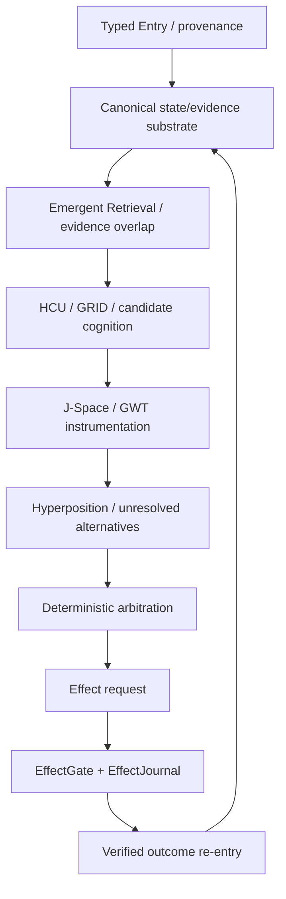

# DEV / SOURCE / RESEARCH

This is the progressive-disclosure entry for technical work. It is an index, not a second truth store.

## Authority first

For current claims, resolve in this order:

1. newest explicit owner authority (`/CLAY_EXECUTION_AUTHORITY.md` and the authority it points to)
2. `/research_entity/claycode/autonomous/SUPERVISOR_INBOX.json`
3. the inbox-selected steering file
4. current bootstrap/program state
5. exact executable evidence bound to exact source/artifact identity
6. current source/tests/receipts
7. older branches, topic packets, historical receipts
8. summaries and caches

At the Trigger-3 curation base `854f6bc87780f4a5242489a6c807d186b16a8c3d`, `SUPERVISOR_INBOX.json` is schema 9.13 and selects the 9.13O delta. Provider state is HARD_OFF: provider routes are not admitted, Together is forbidden and paid fallback is forbidden.

`BOOTSTRAP_MINIMAL.json` and `PROGRAM_STATE.json` still carry older 8.78-era fields; treat those as stale current-facing surfaces where they conflict with the newer inbox-selected steering.

During this curation, `main` advanced to `3c3dbe5020f57065f47bd4d0a2dce3c537128797`, which closed the obvious Frankenstein caller-boundary source flaw: canonical Bauleiter/Bugfix entrypoints now resolve the current authority before provider import, secret lookup, network, Aider or fallback dispatch and fail closed under HARD_OFF. Provider-backed implementations and the old provider/Together plan are retained as quarantined donor provenance. The closure reports 10/10 focused local tests; this remains source/local-unit scope only.

## Evidence labels used in this layer

| Label | Meaning |
|---|---|
| `CURRENT_SOURCE` | present in exact current source at the referenced commit |
| `HISTORICAL_SOURCE` | source existed historically; not automatically current authority |
| `PROJECT_MEASUREMENT` | measured by project runtime/experiment at stated scope |
| `EXTERNAL_PRIMARY` | primary paper/spec/vendor documentation |
| `INFERENCE` | interpretation from observed evidence |
| `OPEN_HYPOTHESIS` | candidate explanation/design not yet established |
| `NEGATIVE_RESULT` | failure/counterexample/blocker retained as evidence |

Lifecycle words are separate from evidence labels: `attempted`, `source-ready`, `measured`, `reproduced`, `contradicted`, `blocked`, `prepared-not-run`, `adopted`, `retired`.

## Architecture graph

No arrow from model/J-Space/HCU output directly to canonical truth is permitted.

## Frankenstein lineage and current code

### Master cognition packet

`research_entity/topic_packets/frankenstein-master-cognition-concept/`

Current notable files after `3c3dbe5`:

- `CONCEPT.md` — grounded master concept; explicitly separates real mechanisms from aspirational ones.
- `BUILD_ORCHESTRATION_PLAN_20260827.json` — current v2 quarantine/authority manifest. It does not authorize provider execution.
- `BUILD_ORCHESTRATION_PLAN_20260827_PROVIDER_QUARANTINED_854f6bc.json` — preserved legacy provider/Together plan as donor provenance.
- `frankenstein_authority_gate_v1.py` — stdlib-only fail-closed authority gate evaluated before provider boundaries.
- `frankenstein_packages_v1.py` — package/dependency/CAS claim logic.
- `frankenstein_orchestrator_v1.py` — canonical authority-gated Bauleiter entrypoint.
- `frankenstein_bugfix_v1.py` — canonical authority-gated Bugfix entrypoint.
- `frankenstein_orchestrator_v1_PROVIDER_QUARANTINED_854f6bc.py` — preserved original provider-backed donor.
- `frankenstein_bugfix_v1_PROVIDER_QUARANTINED_854f6bc.py` — preserved original provider-backed donor.
- `TRIGGERWORD3_HARD_OFF_CLOSURE_20260827_GPT56SOL.json` — bounded closure receipt.

The first implementation commit (`854f6bc…`) reported 29 local tests across package/orchestrator/bugfix modules. The later HARD_OFF closure (`3c3dbe5…`) reports 10/10 focused local tests for the authority-bound source path. Neither result promotes provider runtime, EntityOS/HCU/BASE, J-Space, canonical semantics or training credit.

### GRID10 / Fabric lineage

The master concept points to the real code substrate:

- `tools/grid10_fabric.py` — SQLite/WAL Fabric, task/scope/lease/regulator coordination.
- `tools/grid10_node.py` — node loop, elastic polling, regulator behavior and idle-memory release.

The latest supervisor records a real thread-count A/B counterexample on one measured topology: four concurrent processes / four vCPUs performed best at one torch intra-op thread per process; two threads were much slower and four threads produced no completed samples within experiment timeouts. Treat this as topology-specific diagnostic evidence, not a universal law.

## UnifiedDB and Emergent Retrieval

The design goal is one canonical state/evidence authority substrate, not one untyped “god file.” One SQLite substrate can contain many typed tables, indexes, views, journals and policy boundaries while high-rate ephemeral sensor state remains outside in RAM.

`Emergent Retrieval` means query-time relevance from overlap among independently stored evidence dimensions. It is a retrieval composition mechanism, not spontaneous fact creation.

SQLite WAL is relevant as a concrete engineering substrate because it separates appending to the WAL from checkpointing and supports concurrent readers with a writer discipline. That external database behavior is an analogy/implementation fact, not evidence that project-level causality is correct by itself.

Primary reference: https://www.sqlite.org/wal.html

## GWT / Global J-Space

Global Workspace Theory is used as an architectural inspiration/hypothesis, not as evidence of consciousness. Baars describes a global workspace architecture as a way for distributed knowledge sources to cooperate; Baars & Franklin discuss an implementable cognitive architecture with distributed codelets and workspace access. The project borrows the coordination idea while requiring model-specific causal tests for its own J-Space claims.

Primary references:

- Bernard J. Baars, 2005, DOI `10.1016/S0079-6123(05)50004-9` — https://pubmed.ncbi.nlm.nih.gov/16186014/
- Bernard J. Baars & Stan Franklin, 2007, DOI `10.1016/j.neunet.2007.09.013` — https://pubmed.ncbi.nlm.nih.gov/17998071/
- Murray Shanahan & Bernard Baars, 2005, DOI `10.1016/j.cognition.2004.11.007` — https://pubmed.ncbi.nlm.nih.gov/16307957/

Project falsifier: if lesion/shuffle/rescue or equivalent interventions show no causal dependence between the proposed J-Space control variable and measured model behavior beyond prompt/schema leakage, the causal interface claim fails.

## NVIDIA Unified Memory analogy — bounded

NVIDIA Unified Memory reduces explicit ownership/copy management across CPU/GPU memory domains and can provide coherent managed-memory access depending on hardware/OS/runtime support. This is useful only as a **systems-design analogy** for reducing fragmented ownership boundaries.

It is **not** evidence that UnifiedDB is equivalent to CUDA memory, and hardware coherence is not database semantics.

Primary reference: https://docs.nvidia.com/cuda/cuda-programming-guide/04-special-topics/unified-memory.html

## Reflection, fixation and exit conditions

Reflection is a control operation with a mandatory exit. A robust implementation must be able to detect:

- repeated state with no new evidence;
- repeated candidate/action proposals;
- rising latency without information gain;
- context contamination or prompt-vs-weight conflict;
- effect request with missing/unknown outcome;
- mismatch between claimed and observed state.

A reflection episode must end in `ACT`, `ASK`, `WAIT`, re-observation, or another bounded measurable transition. Endless self-commentary is a negative result.

## Training research boundary

Training and model-specialization material belongs in the evidence map with explicit ancestry, tokenizer/renderer binding, family-level split discipline, hard negatives, and exact runtime identity. Completed training is not a PASS by itself. The 9.13 supervisor state records training credit = 0 and canonical dataset rows admitted = 0.

## Frankenstein provider-orchestration quarantine

The current canonical source now implements the right **source-level** fail-closed pattern: authority is resolved before the provider boundary, and the old provider-backed implementations are isolated under explicit `_PROVIDER_QUARANTINED_854f6bc` names. Under current 9.13 HARD_OFF:

- canonical entrypoints must fail closed before provider import/secret lookup/network/Aider/fallback;
- quarantined donor files are historical implementation material, not executable authority;
- the current plan explicitly authorizes zero Together runs;
- historical/provider-authored changes still receive no runtime credit without admitted clean execution evidence;
- future provider reopening requires a later explicit canonical authority plus then-current economic/provenance gates;
- under HARD_OFF, any runtime safety witness must show provider calls = 0 and secret lookups = 0 without probing a real provider.

The donor source remains useful for package decomposition, continuity, rollback and supervision mechanics.

## Deep links

- Human overview: [`../HUMAN_READ_THIS/README.md`](../HUMAN_READ_THIS/README.md)
- Evidence/status map: [`research/FRANKENSTEIN_EVIDENCE_MAP.md`](research/FRANKENSTEIN_EVIDENCE_MAP.md)
- Archive navigation: [`research/ARCHIVE_INDEX.json`](research/ARCHIVE_INDEX.json)
- Root migration plan: [`repository/ROOT_MIGRATION_MANIFEST.md`](repository/ROOT_MIGRATION_MANIFEST.md)
- AI installer layer: [`../AI_START_HERE_DO_NOT_SCAN_REPO/README.md`](../AI_START_HERE_DO_NOT_SCAN_REPO/README.md)

The goal of this directory is to make the repository navigable without flattening its research history into one confident story.