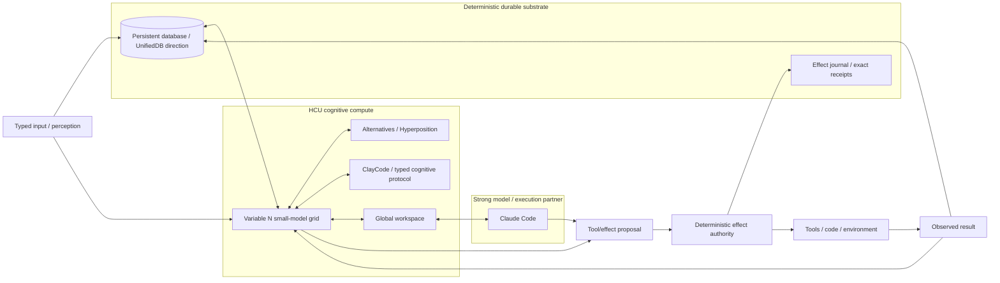
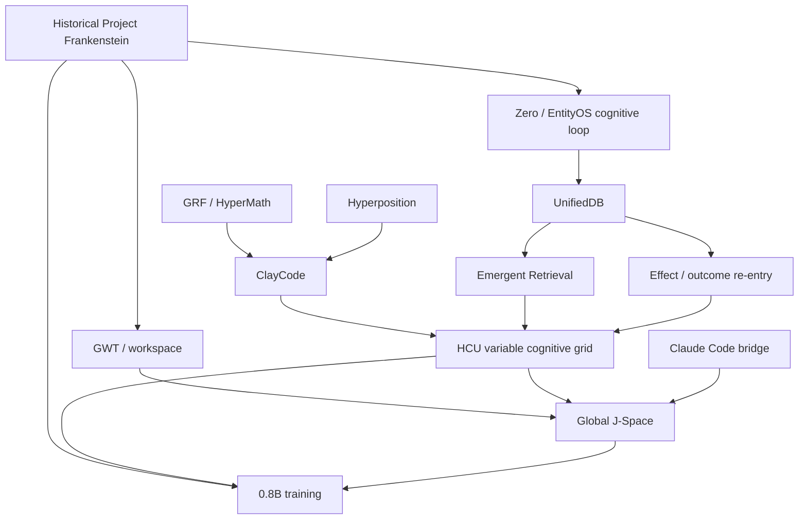

# Project Frankenstein — developer / research map

This directory is the progressive-disclosure technical entry layer for Project Frankenstein / EntityOS research.

It is **not** a second canonical authority. Current source, exact executable receipts, newest explicit owner authority and admitted supervisor authority still outrank this index.

## Read order

1. [`repository/CURRENT_AUTHORITY_AND_EVIDENCE.md`](repository/CURRENT_AUTHORITY_AND_EVIDENCE.md) — what is current, what is quarantined, and how claims are scoped.
2. [`research/FRANKENSTEIN_RESEARCH_CHRONICLE.md`](research/FRANKENSTEIN_RESEARCH_CHRONICLE.md) — architecture/research lineage, including failures that forced later design changes.
3. [`repository/ARCHIVE_INDEX.json`](repository/ARCHIVE_INDEX.json) — machine-readable pointers into the existing archive instead of prose-copying thousands of files.
4. [`repository/ROOT_TOPOLOGY_MIGRATION.md`](repository/ROOT_TOPOLOGY_MIGRATION.md) — why the public root is not yet physically reduced to four entries and how to get there without breaking provenance or tooling.

Human overview: [`../HUMAN_READ_THIS/README.md`](../HUMAN_READ_THIS/README.md)  
AI/tool bootstrap: [`../AI_START_HERE_DO_NOT_SCAN_REPO/README.md`](../AI_START_HERE_DO_NOT_SCAN_REPO/README.md)

---

## Evidence labels

Every important claim in this layer should be readable as one of these classes:

| Label | Meaning |
|---|---|
| `CURRENT_SOURCE` | Present in current canonical repository source or current admitted authority. |
| `HISTORICAL_SOURCE` | Preserved source/provenance from an earlier architecture or repository state. |
| `PROJECT_MEASUREMENT` | A measured result with an identifiable test/runtime/evidence surface. |
| `EXTERNAL_PRIMARY` | Primary literature, standard, official vendor documentation or original paper. |
| `INFERENCE` | A conclusion derived from evidence but not directly measured. |
| `OPEN_HYPOTHESIS` | A proposed mechanism/claim not yet promoted by its falsifier. |
| `NEGATIVE_RESULT` | A failed/rejected/blocked result that materially constrains architecture. |

Research-status verbs are deliberately finer-grained than `works` / `doesn't work`:

`attempted · source-ready · measured · reproduced · contradicted · blocked · prepared-not-run · adopted · retired`

---

## Current architecture in one graph



### Current target correction

`CURRENT_SOURCE` — The owner target dated 2026-08-25 makes the cognitive-grid size variable. `N=10` is a benchmark/debug configuration, not architectural identity. The intended finished form is:

`VARIABLE COGNITIVE GRID + PERSISTENT DATABASE + CLAUDE CODE`

`CURRENT_SOURCE` — The grid simulates/distributes cognition. Durable exact information should live in the database. Claude Code remains the strong model/tool/code partner. Global J-Space coupling may be claimed only to the strongest interface actually exposed and causally demonstrated.

---

## Dependency map: how the major research lines constrain each other



This graph is architectural dependency, not chronology proof.

---

## High-value source anchors already in the repository

### Current owner / execution / supervisor surfaces

- `research_entity/global/OWNER_CORRECTION_ZERO_ENTITYOS_COGNITIVE_GRID_DB_CLAUDECODE_GLOBAL_JSPACE_2026-08-25.md`
- `CLAY_EXECUTION_AUTHORITY.md`
- `governance/CLAY_VPS_SANDBOX_FULL_EXECUTION_AUTHORITY_2026-08-25.md`
- `research_entity/claycode/autonomous/SUPERVISOR_INBOX.json`
- `research_entity/claycode/autonomous/SUPERVISOR_STEERING_9_13O_DELTA_2026-08-27T2341P0700_GPT56SOL.json`

### Historical Frankenstein archive

- `research_entity/archive_assimilation/manifests/PROJECT_FRANKENSTEIN_MANIFEST.json`
- `research_entity/archive_assimilation/manifests/PROJECT_FRANKENSTEIN_HISTORY_INTERVAL_MANIFEST.json`
- `research_entity/archive_assimilation/manifests/PROJECT_FRANKENSTEIN_LEVEL0_SCOPE_LAW.json`
- `research_entity/topic_packets/frankenstein-master-cognition-concept/CONCEPT.md`

### Zero / exported EntityOS evidence

- `agentZero/README.md`
- `agentZero/unifieddb/schema.sql`
- `agentZero/kognition/`
- `agentZero/messwerk/`
- `agentZero/architekt-log.jsonl`
- `agentZero/bauverlauf/`
- `agentZero/tests/`

### UnifiedDB research

- `research_entity/trigger_runs/unifieddb/unifieddb-20260811T0441p0700-chatgpt-secondary-deeper-deltas/FINAL_REPORT.md`
- `research_entity/trigger_runs/unifieddb/unifieddb-20260811T2335p0700-chatgpt-secondary-projection-outbox-v1/`

### GRF / Hyperposition / ClayCode

- `research_entity/trigger_runs/hyperposition/hyperposition-20260810T2342p0700-chatgpt-secondary-hypermath-grf-fusion/FINAL_REPORT.md`
- `research_entity/trigger_runs/hyperposition/hyperposition-20260810T2342p0700-chatgpt-secondary-hypermath-grf-fusion/architecture/HYPERMATH_GRF_PROOF_CARRYING_IR_V11.clay`
- `research_entity/trigger_runs/claycode/`

### J-Space / training research

- `research_entity/global/j-space/`
- `research_entity/global/j-space/research/2026-08-25_FORSCHUNGSRUN_2_QWEN35_08B_XENO_HCU_CORPUS_RECIPE_EVAL_V3_GPT56SOL.json`

---

## Research law: evidence must survive the story

The curation layer follows these non-negotiable separations:

```text
request != effect
model output != world fact
method exists != result exists
memory != observation
source-ready != runtime-observed
consensus/repetition != independent evidence
component PASS != whole-product PASS
pre-load hash != loader-consumed-byte attestation
logical module count != physical decode concurrency
```

Where current authority surfaces disagree, this directory does not average them. It points at the conflict and names the higher-precedence/current surface.

---

## External primary context — analogy, not project proof

These sources are useful for terminology and engineering analogies, but do not create Project Frankenstein evidence:

- SQLite, **Atomic Commit in SQLite**: https://www.sqlite.org/atomiccommit.html
- SQLite, **Write-Ahead Logging**: https://www.sqlite.org/wal.html
- NVIDIA, **CUDA Programming Guide — Unified Memory**: https://docs.nvidia.com/cuda/cuda-programming-guide/04-special-topics/unified-memory.html
- Dehaene & Changeux (2011), **Experimental and theoretical approaches to conscious processing**, *Neuron*, DOI `10.1016/j.neuron.2011.03.018`
- Yao et al. (2023), **ReAct: Synergizing Reasoning and Acting in Language Models**, ICLR
- Shinn et al. (2023), **Reflexion: Language Agents with Verbal Reinforcement Learning**, NeurIPS, DOI `10.52202/075280-0377`

The NVIDIA analogy is limited: reducing ownership/copy boundaries in hardware memory systems is a useful systems-design analogy for coherent state access; it is not evidence that database semantics and GPU memory coherence are the same problem.
