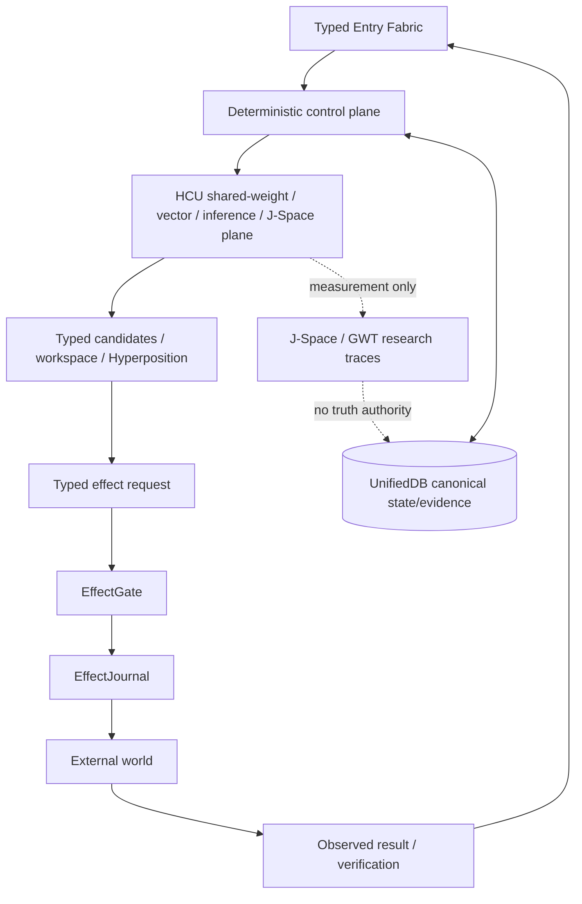

# Developer / Source / Research map

This directory is the progressive-disclosure entrance for people who need more than the human overview but should not have to scan the whole repository.

> Evidence rule: **current authority and exact executable evidence outrank old caches, prose, model consensus, and historical naming.** Component evidence never silently becomes whole-product evidence.

## Start here

| Need | Read |
|---|---|
| Human explanation | [`../HUMAN_READ_THIS/README.md`](../HUMAN_READ_THIS/README.md) |
| Current Frankenstein research synthesis | [`research/FRANKENSTEIN_RESEARCH_CHRONICLE.md`](research/FRANKENSTEIN_RESEARCH_CHRONICLE.md) |
| Evidence labels and promotion law | [`research/EVIDENCE_LABELS.md`](research/EVIDENCE_LABELS.md) |
| Machine-readable evidence index | [`research/FRANKENSTEIN_EVIDENCE_INDEX.json`](research/FRANKENSTEIN_EVIDENCE_INDEX.json) |
| External research anchors | [`research/EXTERNAL_RESEARCH_NOTES.md`](research/EXTERNAL_RESEARCH_NOTES.md) |
| Root cleanup / move contract | [`repository/ROOT_TOPOLOGY_MIGRATION_PLAN.md`](repository/ROOT_TOPOLOGY_MIGRATION_PLAN.md) |
| AI/tool installation | [`../AI_START_HERE_DO_NOT_SCAN_REPO/README.md`](../AI_START_HERE_DO_NOT_SCAN_REPO/README.md) |

## Current authority resolution

For a current claim, resolve in this order:

1. newest explicit owner authority;
2. current `research_entity/claycode/autonomous/SUPERVISOR_INBOX.json` selection and its governing authority epoch;
3. exact current executable evidence at exact source/artifact identity;
4. current source/tests/receipts;
5. historical repositories, branches, manifests, topic packets, and caches;
6. conversational summaries.

The 2026-08-27 repository currently contains stale lower-level surfaces alongside a newer authority epoch. That inconsistency must remain visible rather than being averaged into a convenient story.

## Current product map



**Current system identity:** EntityOS  
**Integrated cognition/compute architecture:** HCU  
**Persistent research entity:** Clay  
**Temporary model/session/worker:** organ, not a second entity

Compatibility/history names are preserved where they carry lineage or ABI value; they do not create competing present-day products.

## Main research threads

### State, memory, and retrieval

UnifiedDB is the deterministic durable authority substrate. Rebuildable graph/workspace/search projections may derive context from it but must retain source identity and epistemic status. Current reference code for Emergent Retrieval explicitly returns derived context with `persistent_second_store=False` and `authority='ASSEMBLY_CONTEXT_ONLY'`.

### HCU / GRID

HCU separates logical module/cell structure from physical model residency and physical decode concurrency. `GRID10` is the baseline ten-logical-cell mode; current measurements must be reported with the exact process/core/model topology rather than generalized from the logical count.

### Global J-Space / GWT

J-Space/GWT is a measurable causal hypothesis. Useful evidence includes exact checkpoint/tokenizer/lens identity, matched traces, perturbation, lesion/shuffle/rescue, dose-response and behavior change. Textual coherence, labels, recurrence or self-report are insufficient.

### Hyperposition and GRF

Hyperposition preserves unresolved alternatives without promoting a majority into truth. The Clay Generative Reality Framework (C-GRF) is a historical/current research direction for typed possible-world planning, not metaphysics. Generated branches remain prediction/hypothesis until verified outcomes reconcile them.

### Agency and reflection

The target is useful agency with externalized state, memory, perception, arbitration, effect receipts and verified re-entry. Reflection must end in an observable transition such as ACT / ASK / WAIT / re-observe; recursive reflection without an exit is a failure mode.

### Training

Training evidence must bind exact lineage and evaluation partitions. The current 2026-08-27 authority places autonomous external providers under HARD-OFF and Together under explicit prohibition. Historical training artifacts can be analyzed as evidence, but they do not authorize another run or create training credit.

## Historical Project Frankenstein archive

The archive assimilation layer freezes a historical Git scope from `e1a881…` inclusive through `abba90a…` inclusive, with 545 commit obligations derived from one inclusive base plus 544 verified descendants. This defines a reproducible historical denominator without claiming unobserved pre-base history.

The broader historical manifest remains intentionally `PARTIAL_NOT_FROZEN`: source deep-reads exist, but exact tree/history enumeration is not complete. That is a useful example of the project's evidence discipline: a large amount of analysis is not the same thing as a complete denominator.

## Repository topology status

The intended public root is eventually:

```text
README.md
HUMAN_READ_THIS/
DEV_SOURCE_RESEARCH/
AI_START_HERE_DO_NOT_SCAN_REPO/
```

That move is **not yet complete**. Current technical root files remain in place until path/import/automation dependencies are inventoried and moves can be performed without silently breaking execution or evidence links. See the migration plan.

## Do not infer

- a test exists → it ran;
- a run happened → it was authorized;
- a provider said 200 OK → the route was free or admitted;
- a component passed → EntityOS/HCU passed;
- a workspace token appeared → the model 'knew the truth';
- a reflection was generated → later behavior improved;
- a simulated future looked plausible → it happened;
- many workers agreed → evidence became independent;
- a file was recently modified → its internal authority is current.
