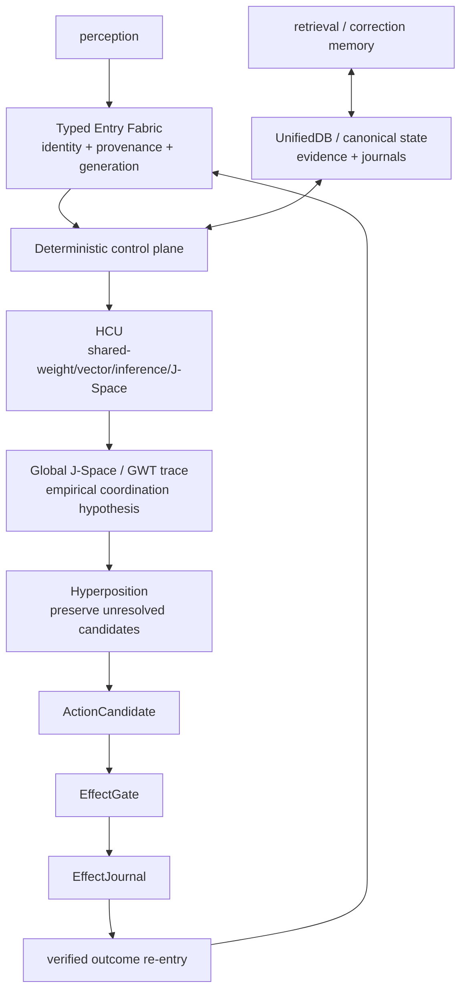

# DEV_SOURCE_RESEARCH — progressive technical index

This directory is the technical/research route for Project Frankenstein → EntityOS + HCU. It is an **index over evidence**, not a replacement truth store and not a second authority.

Re-resolve `main` and current authority before live execution decisions. During the 2026-08-27 Trigger-3 pass, the admitted supervisor semantics were **9.13 HARD_OFF**; `main` advanced during the pass and fused a source/local-unit closure of the Frankenstein provider caller boundary.

## 0. Authority first

Read in this order before current-state/runtime claims:

1. [`../CLAY_EXECUTION_AUTHORITY.md`](../CLAY_EXECUTION_AUTHORITY.md)
2. [`../research_entity/claycode/autonomous/SUPERVISOR_INBOX.json`](../research_entity/claycode/autonomous/SUPERVISOR_INBOX.json)
3. the steering file named by the inbox
4. [`../research_entity/continuity/BOOTSTRAP_MINIMAL.json`](../research_entity/continuity/BOOTSTRAP_MINIMAL.json) and [`../research_entity/rooms/PROGRAM_STATE.json`](../research_entity/rooms/PROGRAM_STATE.json)
5. exact source/tests/receipts at the exact identity relevant to the claim

Do not average authority disagreements. A stale self-consistent surface is still stale.

Curated companions:

- [`repository/CURRENT_AUTHORITY_AND_EVIDENCE.md`](repository/CURRENT_AUTHORITY_AND_EVIDENCE.md) — compact current-vs-historical evidence matrix;
- [`research/FRANKENSTEIN_RESEARCH_CHRONICLE.md`](research/FRANKENSTEIN_RESEARCH_CHRONICLE.md) — failure-driven architecture/research lineage with explicit hypotheses and falsifiers;
- [`repository/FRANKENSTEIN_SOURCE_INDEX.json`](repository/FRANKENSTEIN_SOURCE_INDEX.json) — machine-readable source/history index.

## 1. Evidence vocabulary

- **CURRENT_SOURCE** — source present at the exact current identity.
- **HISTORICAL_SOURCE** — retained lineage, not current authority.
- **PROJECT_MEASUREMENT** — observed project measurement with bounded scope.
- **EXTERNAL_PRIMARY** — original paper/spec/vendor-primary documentation.
- **INFERENCE** — conclusion drawn from observations.
- **OPEN_HYPOTHESIS** — candidate mechanism with an explicit falsifier.
- **NEGATIVE_RESULT** — failure/blocker/contradiction worth preserving.

Lifecycle qualifiers: `attempted`, `source-ready`, `measured`, `reproduced`, `contradicted`, `blocked`, `prepared-not-run`, `adopted`, `retired`.

`SOURCE_READY != RUNTIME_VERIFIED`. Component PASS never implies whole-product PASS. Model output does not create world facts.

## 2. Current Frankenstein control boundary

The 2026-08-27 Bauleiter/Bugfix provider-capable implementation initially crossed into provider-capable imports/fallbacks before satisfying the current 9.13 authority boundary. That became a first-class negative result.

Current `main` now preserves the original provider-backed implementations as quarantined donor provenance and puts the supported entrypoints behind an authority gate that must resolve before provider import, secret lookup, network, Aider, or fallback dispatch. The fused commit reports **10/10 focused local tests PASS**, explicitly source/local-unit scope only.

Key current packet:

- [`../research_entity/topic_packets/frankenstein-master-cognition-concept/`](../research_entity/topic_packets/frankenstein-master-cognition-concept/)
- `frankenstein_authority_gate_v1.py`
- `frankenstein_orchestrator_v1.py`
- `frankenstein_bugfix_v1.py`
- quarantined `*_PROVIDER_QUARANTINED_854f6bc.py` provenance files
- `BUILD_ORCHESTRATION_PLAN_20260827_PROVIDER_QUARANTINED_854f6bc.json`
- `TRIGGERWORD3_HARD_OFF_CLOSURE_20260827_GPT56SOL.json`
- [`../tests/test_frankenstein_provider_hardoff_gate_v1.py`](../tests/test_frankenstein_provider_hardoff_gate_v1.py)

This closes a source/local-unit boundary; it does **not** grant provider, HCU, training, or whole-product runtime credit.

## 3. Historical Project-Frankenstein archive

Archaeology entry points:

- [`../research_entity/archive_assimilation/manifests/PROJECT_FRANKENSTEIN_MANIFEST.json`](../research_entity/archive_assimilation/manifests/PROJECT_FRANKENSTEIN_MANIFEST.json)
- [`../research_entity/archive_assimilation/manifests/PROJECT_FRANKENSTEIN_SOURCE_IDENTITY_HISTORY_ANCHOR_20260827.json`](../research_entity/archive_assimilation/manifests/PROJECT_FRANKENSTEIN_SOURCE_IDENTITY_HISTORY_ANCHOR_20260827.json)

The older manifest remains explicitly `PARTIAL_NOT_FROZEN` and pins historical Project-Frankenstein head `abba90a5767d85abc8a1ac340bae92842dab35c1`.

Trigger-3 now freezes a **narrower exact history denominator** for that snapshot:

```text
root tree SHA = ec21e66c4672fde1f0a5d948ebc51457b69b620a
default-branch reachable commits = 545
oldest reachable commit = e1a8812767668091d146ee958bbc2ebb2743031c
```

The 545 count is proven by the GitHub REST default-branch listing with `per_page=1`: page 545 non-empty, page 546 empty.

This does **not** freeze the recursive path/topology denominator, every ref/deleted/unreachable commit, or repository-wide semantic coverage. No whole-repository completion percentage is justified yet.

Deep-read lineage includes:

| Source | Historical engineering role |
|---|---|
| `services/consciousness_daemon.py` | persistent/multi-timescale loop; workspace precursor |
| `personality/e_pq.py` | persistent state, homeostasis, event learning |
| `services/thalamus.py` | sensory gating, attention, habituation, prediction error |
| `services/global_workspace.py` | broadcast/salience workspace |
| `tools/lcme/lcme_core.py` | memory, claims, graph/vector retrieval, forgetting |
| `services/soma/micro_trainer.py` | LoRA training, feedback weighting, before/after probes |
| `services/nucleus_accumbens.py` | reward prediction, motivation, habituation |
| `services/subconscious.py` | actor-critic/PPO/idle-policy lineage |
| `services/spatial_state.py` | persistent world/body state |
| `services/dream_daemon.py` | replay, synthesis, consolidation, interrupt/resume |
| `services/project_engine.py` | projects, goals, strategies, tasks, tool learning |
| hypothesis-engine/lab sources | hypothesis lifecycle, test translation, experiment persistence |
| vision sources | adaptive routing → FrankEye/Retina → native multimodal vision claims |

These establish source lineage, not current runtime presence.

## 4. Chronology law

When reconstructing history, use Git and say **“first verified in accessible Git”** unless creation time is independently evidenced.

Current anchors include:

- `e1a8812767668091d146ee958bbc2ebb2743031c` — oldest commit reachable from the frozen historical default branch through the observed GitHub REST listing (2026-02-14T17:05:27Z); not proof of pre-Git real-world creation time.
- historical snapshot `abba90a5767d85abc8a1ac340bae92842dab35c1` — frozen default-branch head for the source/history anchor, while recursive topology/semantic coverage remains partial.
- `96623ef096ba189b771ca10835cd5a20499c1da9` — first archaeology-workspace commit returned by the accessible Frankenstein commit search in the earlier archive pass (2026-08-09); not a project-creation-date claim.
- `ab15b482caff1fa5e446d7795cea8df81bc41b97` — 2026-08-27 grounded master-cognition concept; rejects helper-model architecture inventions not present in real code.
- `854f6bc87780f4a5242489a6c807d186b16a8c3d` — provider-capable Bauleiter/Bugfix/package-dispenser source lands.
- supervisor 9.13O — quarantines provider-calling orchestration under HARD_OFF.
- `3c3dbe5020f57065f47bd4d0a2dce3c537128797` — source/local-unit HARD_OFF caller closure fused on `main`.
- `bf10a71a1d6b69ac63654ab01724b2879bc05003` — exact 545-commit default-branch history denominator fused into the machine-readable source index.

The useful chronology is **failure → correction → stricter evidence boundary**, not a victory timeline.

## 5. Architecture dependency graph



If effect outcome does not re-enter as verified evidence, reflection can optimize against imagined success. If state fragments into competing truth stores, retrieval and arbitration lose a common reference. If model outputs bypass EffectGate, fluency becomes accidental authority.

## 6. UnifiedDB + Emergent Retrieval

UnifiedDB is an authority pattern, not a “god file.” One canonical SQLite substrate may contain many typed tables, indexes, views, policies, journals, and rebuildable projections while high-rate transient sensor state can remain outside in RAM.

**Emergent Retrieval** means relevance appearing when independently stored dimensions overlap at query time: semantics, time, causal lineage, current state, goals, perception, effect receipts, confidence, provenance, etc. Nothing appears from nowhere.

Representative source paths:

- [`../research_entity/harness/reference/unifieddb_emergent_cascade.py`](../research_entity/harness/reference/unifieddb_emergent_cascade.py)
- [`../research_entity/harness/reference/benchmark_unifieddb_emergent_cascade.py`](../research_entity/harness/reference/benchmark_unifieddb_emergent_cascade.py)
- [`../research_entity/harness/reference/benchmark_unifieddb_emergent_assembly.py`](../research_entity/harness/reference/benchmark_unifieddb_emergent_assembly.py)
- [`../research_entity/unifieddb/`](../research_entity/unifieddb/)

### Current SQLite discriminator

**EXTERNAL_PRIMARY:** SQLite documents a rare WAL-reset corruption bug affecting 3.7.0 through 3.51.2 under a specific concurrent WAL write/checkpoint pattern, fixed in 3.51.3 and later (with some backports). Primary sources:

- https://www.sqlite.org/wal.html
- https://sqlite.org/releaselog/3_51_3.html

**OPEN_HYPOTHESIS / CHECK_REQUIRED:** this does not establish that UnifiedDB is affected. Before a concrete concurrent-WAL durability claim, bind the runtime SQLite version, journal mode, connection topology and concurrency pattern.

## 7. NVIDIA Unified Memory: analogy only

**EXTERNAL_PRIMARY:** NVIDIA documents CUDA Unified Memory as CPU/GPU accessible managed/system memory with platform-dependent hardware/software coherency and performance/migration constraints:

https://docs.nvidia.com/cuda/cuda-programming-guide/02-basics/understanding-memory.html

Project use is analogy only: reducing ownership/copy boundaries can make coherent computation easier. CUDA memory coherence is not SQLite transaction semantics, evidence authority, or retrieval semantics.

## 8. GRF / Hyperposition / GWT / Global J-Space

Current cache entry:

[`../research_entity/00_CURRENT/latest/hyperposition-gwt-grf.md`](../research_entity/00_CURRENT/latest/hyperposition-gwt-grf.md)

Its classification is `PARTIAL_COMPONENT_EVIDENCE`: component source/test repair exists while physical-grid Hyperposition/GWT re-entry remains blocked pending true GRID10 runtime acceptance.

Rules:

- **Hyperposition** preserves unresolved alternatives; majority cannot mint truth.
- **GWT/workspace** is an engineering coordination donor/hypothesis, not a consciousness claim.
- **GRF** must remain tied to exact project mathematics/receipts, not become a poetic synonym for emergence.
- **Global J-Space** is an empirical causal interface hypothesis requiring model-specific intervention evidence.

**EXTERNAL_PRIMARY conceptual donor:** Global Neuronal Workspace review: https://pmc.ncbi.nlm.nih.gov/articles/PMC8770991/

Strong J-Space falsifiers include label-free counterbalanced intervention, lesion/shuffle/rescue, prompt/schema-leak controls, and exact checkpoint/tokenizer/runtime identity.

## 9. Reflection and agency

Reflection is an engineering control operation:

```text
observe state/outcome
→ compare against expectation/goal
→ detect mismatch
→ propose correction
→ store/retrieve correction evidence
→ ACT | ASK | WAIT | RE-OBSERVE | measurable transition
```

Reflection with no exit is rumination/fixation.

External donor mechanisms such as ReAct and Reflexion are relevant because they connect reasoning/reflection to environment interaction or later trials, but they are not Project-Frankenstein runtime proof:

- ReAct: https://arxiv.org/abs/2210.03629
- Reflexion: https://arxiv.org/abs/2303.11366

**OPEN_HYPOTHESIS:** useful reflective agency improves with a sufficiently rich external substrate of state, memory, perception, arbitration, effect receipts, and verified outcome re-entry.

**Engineering confidence:** medium.  
**Falsifier:** a materially simpler substrate matches/exceeds it on preregistered long-horizon correction/recovery tasks, or controlled ablation shows no benefit from the richer substrate.

## 10. Failure → engineering move

| Failure / contradiction | Move forced by the evidence |
|---|---|
| fragmented state/authority | converge toward one canonical deterministic state/evidence substrate |
| recursive reflection | explicit exit transitions + verified outcome re-entry |
| helper-model invented architecture | source-grounding before adoption |
| coherence mistaken for hidden-state causality | causal intervention controls for J-Space/GWT |
| more threads presumed faster | matched topology measurement; one thread/process retained for measured 4proc/4vCPU case |
| provider caller crossed authority boundary | pre-provider fail-closed gate + quarantined donor provenance |
| stale Together allowance contradicted current zero | current authority wins; stale plan cannot spend |
| Distillery zero-yield | no training credit from raw token volume |
| historical default-branch denominator was unknown | freeze exact reachable history count while keeping recursive topology/all-ref limits explicit |
| component/source PASS | never promote automatically to whole-product runtime PASS |

## 11. Training lineage and current credit

Historical LoRA/IAPT/SOMA and later ClayCode/J-Space/vector-binding work are separate evidence families. Training completion alone is not PASS.

Promotion requires exact model/checkpoint/tokenizer/runtime identity, frozen baseline, leak-resistant family splits, deterministic hard negatives, intended behavior gain, and appropriate regression/fail-closed tests.

At the current 9.13 frontier, whole EntityOS/HCU, full HCU, Physical GRID10, canonical semantics, and training promotion remain zero/unpromoted unless newer exact executable evidence says otherwise.

## 12. Repository curation

Intended public root:

```text
README.md
HUMAN_READ_THIS/
DEV_SOURCE_RESEARCH/
AI_START_HERE_DO_NOT_SCAN_REPO/
```

This Trigger-3 pass is additive first. Existing technical trees are **not** mass-moved until exact root/tree inventory, blob identity, deep-link impact, active-work overlap, and old→new mapping are verified. Root `README.md` is deliberately unchanged.

Machine-readable/source topology material belongs under [`repository/`](repository/).

## 13. Next high-information gates

1. re-enter current authority after every parallel `main` move;
2. prove supported Frankenstein callers remain blocked before provider/secret/network boundary under HARD_OFF;
3. obtain the complete recursive historical path inventory for root tree `ec21e66c...` and freeze its path-count denominator;
4. bind exact SQLite runtime/journal/concurrency identity before UnifiedDB WAL durability claims;
5. run label-free causal J-Space lesion/shuffle/rescue at exact model identity when authority permits;
6. derive a Zero/EntityOS cognitive-process census and stable ABI that is independent of fixed `N`;
7. verify each AI host installer route as `NATIVE`, `ADAPTED`, `DEGRADED`, or `BLOCKED` from observed capabilities and receipts.

This index should grow through deep links, evidence maps, and machine-readable indices — not by copying the entire archive into prose.
