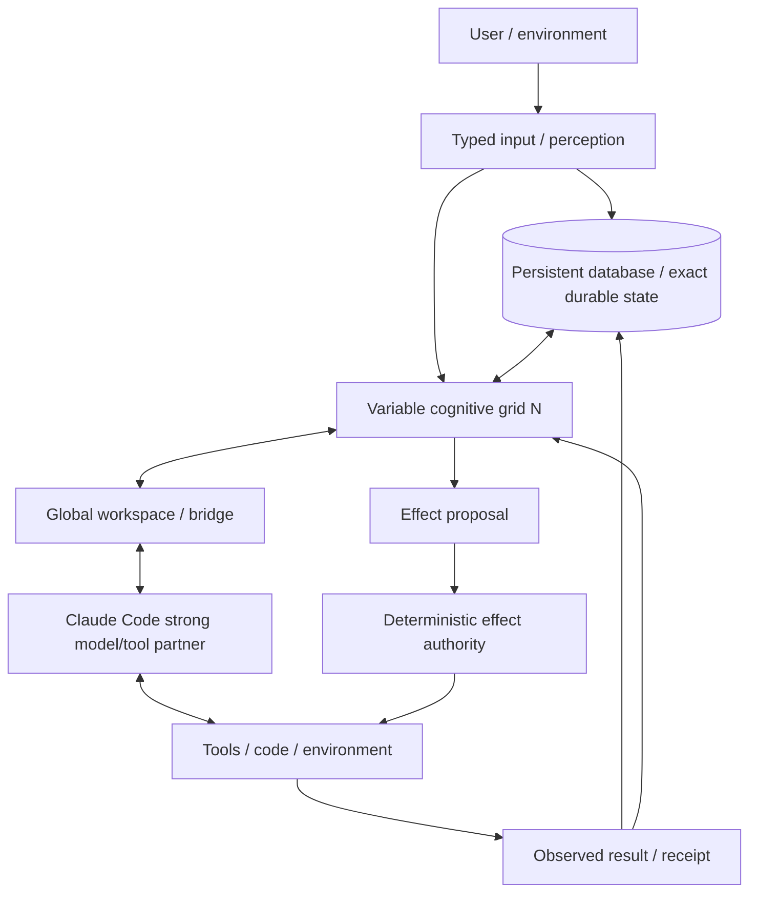
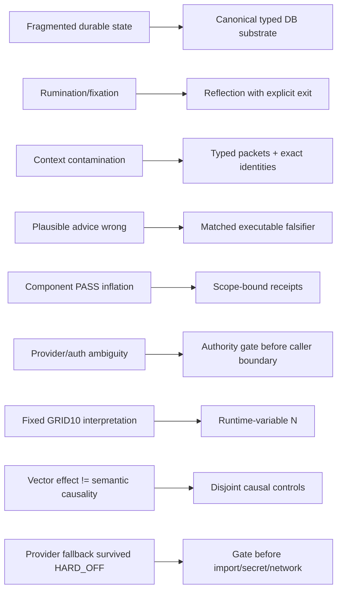

# Project Frankenstein — developer / research chronicle

This is the technical navigation layer for Project Frankenstein. It is **not** a second authority surface. Current owner/supervisor authority and exact executable evidence always outrank this index.

## 0. Current re-entry

Triggerword‑3 began from:

`main@854f6bc87780f4a5242489a6c807d186b16a8c3d`

During this pass, `main` advanced to:

`3c3dbe5020f57065f47bd4d0a2dce3c537128797`

That successor is important: it closes the current Frankenstein source-side provider boundary by adding a stdlib authority gate before provider import/secret/network/Aider/fallback and replacing the old provider-capable entrypoints with fail-closed wrappers. The old provider-backed implementations and old v1 plan are preserved under explicit `_PROVIDER_QUARANTINED_854f6bc` provenance names. Commit `3c3dbe5…` reports 10/10 focused local tests green; this curation organ did not independently re-run them, so that remains `COMMIT_REPORTED_RESULT`, not provider/runtime promotion. 

Current authority still says:

- **9.13 HARD_OFF** for external provider routes;
- Together **FORBIDDEN**;
- paid fallback **FORBIDDEN**;
- remaining Together paid runs authorized: **0**;
- provider route runtime credit: **0**.

Current owner target remains:

> **VARIABLE COGNITIVE GRID + PERSISTENT DATABASE + CLAUDE CODE**

`N` is runtime-variable. GRID10 is a benchmark/engineering configuration, not the final architecture identity.

## 1. Evidence vocabulary

| Label | Meaning |
|---|---|
| `CURRENT_SOURCE` | Present in current source or current authority. |
| `HISTORICAL_SOURCE` | Preserved older source/provenance. |
| `PROJECT_MEASUREMENT` | Measured project result at an identified scope. |
| `COMMIT_REPORTED_RESULT` | Result reported by a commit/receipt but not independently rerun in this curation organ. |
| `EXTERNAL_PRIMARY` | Primary paper/standard/vendor doc used as research input. |
| `INFERENCE` | Reasoned interpretation. |
| `OPEN_HYPOTHESIS` | Candidate claim with explicit falsifier. |
| `NEGATIVE_RESULT` | Failure/counterevidence constraining the architecture. |
| `BLOCKED` | A required gate is unavailable/forbidden. |
| `QUARANTINED` | Preserved source that is not current executable authority. |
| `RETIRED` | Historical mechanism/name no longer defines the current product. |

Core discipline:

> request ≠ effect

> source-ready ≠ runtime-observed

> component PASS ≠ whole-product PASS

> model output ≠ world fact

> consensus/repetition ≠ independent evidence

## 2. Current architecture



**Owner rule:** `SIMULATE COGNITION; STORE DURABLE DATA.`

The variable small-model grid distributes cognitive work that historically lived across Zero/EntityOS modules. Exact durable state belongs in the database when deterministic storage is more reliable/cheap than repeated cognitive simulation. Claude Code remains the strong model/tool/code partner; the 0.8B grid is not intended to replace it.

The Global Workspace/J-Space bridge is allowed to be only as deep as the actually exposed and causally evidenced interface. No unproven Claude Code activation access may be claimed.

## 3. Research lineage

### 3.1 Historical Frank / Zero / Project Frankenstein

`HISTORICAL_SOURCE`

Useful reconstruction anchors:

- `research_entity/archive_assimilation/manifests/PROJECT_FRANKENSTEIN_HISTORY_SEMANTIC_K128_K159_20260809T1306p0700.json`
- `research_entity/archive_assimilation/manifests/PROJECT_FRANKENSTEIN_HISTORY_K128_K157_SEMANTIC_DISPOSITION_20260809T1310p0700.json`
- `research_entity/architecture_archaeology/MECHANISM_INDEX.json`
- `research_entity/architecture_archaeology/ARCHAEOLOGY_WORKSPACE.json`
- `agentZero/`
- historical Frank/ClayVerse boot and compatibility material.

These are evidence archives, not truth or current product authority. “First verified in accessible Git” must not be rewritten as “created on this date.”

### 3.2 Fragmented state → UnifiedDB

`HISTORICAL_SOURCE + CURRENT_SOURCE + INFERENCE`

A recurring failure pressure was state fragmentation across databases/services/modules. The convergence direction is one canonical durable SQLite substrate with many typed tables, indexes, views, policies and journals plus rebuildable projections. High-rate transient state may still live in RAM.

UnifiedDB is therefore not a “god file.” The architectural claim is one durable authority substrate, not one untyped table or one writer.

**Emergent Retrieval** is the project term for relevance that appears when independently stored evidence dimensions overlap at query time: semantic similarity, time, causal lineage, current state, goals, perception, effects, confidence, provenance, etc. It never means information appears from nowhere.

External implementation reference: SQLite WAL permits readers and a writer to proceed concurrently on one host while retaining transaction semantics: https://www.sqlite.org/wal.html

NVIDIA Unified Memory is only a systems analogy for reducing ownership/copy boundaries. Hardware coherence/migration is not database semantics: https://docs.nvidia.com/cuda/cuda-programming-guide/02-basics/understanding-memory.html

### 3.3 Reflection / rumination → measurable exit

`NEGATIVE_RESULT + ADOPTED`

Self-reflection is treated as an engineering control operation:

`inspect state/outcome -> detect mismatch -> generate correction -> store/retrieve correction -> alter later behavior`

Reflection must terminate into **ACT / ASK / WAIT / re-observe / another measurable transition**. Recursive self-reflection without an exit is a failure mode because it consumes time/context without closing the state→action→verification loop.

### 3.4 GWT / global workspace → causal J-Space research

`CURRENT_SOURCE + OPEN_HYPOTHESIS`

Project anchors:

- `research_entity/triggers/GWT_RESEARCH_PROTOCOL.md`
- `research_entity/triggers/HYPERPOSITION_RESEARCH_PROTOCOL.md`
- current owner target document.

External primary research is architecture input only:

- Baars (2005), DOI `10.1016/S0079-6123(05)50004-9`.
- Dehaene & Changeux (2011), DOI `10.1016/j.neuron.2011.03.018`.

Project use is engineering: competition, broadcast, uptake and re-entry. No present architecture claim depends on consciousness, sentience or subjective experience.

**OPEN_HYPOTHESIS — confidence 0.55:** a rich external substrate of state, memory, perception, arbitration, effect receipts and verified re-entry can reproduce much of the useful reflective agency historically spread across a monolithic agent stack.

**Falsifier:** matched systems show the substrate does not preserve required cognitive transitions, or behavior depends mainly on hidden prompt scaffolding rather than state/memory/effect re-entry.

### 3.5 GRID/HCU → variable-N correction

`CURRENT_SOURCE + PROJECT_MEASUREMENT + NEGATIVE_RESULT`

GRID10 remains a useful benchmark surface for shared fabric, claiming, stale recovery, regulators and concurrency measurement. Current owner authority corrected fixed-GRID interpretations: final identity is variable `N`.

Current 4-process / 4-vCPU thread A/B:

| torch intra-op threads/process | measured result |
|---:|---|
| 1 | 8.3197 s/call average, 12 samples |
| 2 | 23.1806 s/call average, 12 samples |
| 4 | zero completed samples inside experiment timeouts |

This falsified the tested recommendation that 2 threads/process should be faster for this topology. It supports default=1 **only** for the measured 4proc/4vCPU workload and grants no Physical-GRID10/HCU/release promotion.

### 3.6 J-Space / vector steering → evidence ceiling

`CURRENT_SOURCE + NEGATIVE_RESULT + OPEN_HYPOTHESIS`

Project history contains cvec, hidden-state, vector-control and semantic-binding work. A vector changing output is not by itself a semantic J-Space result.

Promotion-grade evidence needs exact model/runtime/site/vector identity, disjoint semantic/template holdouts, matched nuisance/off-target/null/sign-flip/permutation controls, and causal re-entry evidence. Known failure classes include lexical target leakage, fixed label/code associations, prompt/schema recurrence, terminal-readout steering overinterpreted as intermediate representation, and same-family replication treated as independent confirmation.

**OPEN_HYPOTHESIS — confidence 0.42:** an intermediate model-specific representation can become a useful causal control interface after label-free/disjoint controls and representation-derived intervention vectors close shortcut alternatives.

**Falsifier:** nuisance/off-target controls explain equal or larger behavior, or the effect fails on disjoint semantic/template families.

### 3.7 0.8B training → separate from execution authority

`CURRENT_SOURCE + PREPARED_NOT_RUN/BLOCKED`

Current training target is a Qwen3.5‑0.8B-class low-refusal/abliterated cognitive module for the **actual cognitive-process workload**, not generic chatbot quality and not fixed GRID10 personalities.

Important families: process-state interpretation, DB-vs-simulation, planning/replanning, uncertainty/Hyperposition, evidence reconciliation, variable-N coordination, compression/state transfer, Claude Code handoff/return, workspace re-entry, failure/restart/rejoin and fail-closed authority behavior.

Training research ≠ training authorization. Current 9.13 authorizes zero Together runs.

### 3.8 2026-08-27 master cognition concept

`CURRENT_SOURCE`

`research_entity/topic_packets/frankenstein-master-cognition-concept/CONCEPT.md` explicitly separates implemented GRID10/Fabric mechanisms from aspirational alignment/reflex/UI/bridge work. Useful donor principles include deterministic reflexes outside LLM inference, regulator-driven adaptive behavior, measured deviation, failure-visible state and an optional strong-model bridge.

Where the concept speaks in fixed GRID10 terms, current owner authority narrows that to benchmark/donor scope.

### 3.9 72h Bauleiter / Bugfix / Package dispenser

`CURRENT_SOURCE + HISTORICAL_SOURCE + COMMIT_REPORTED_RESULT + QUARANTINED`

Commit `854f6bc…` originally added the package dispenser, provider-backed Bauleiter and provider-backed Bugfix watchdog. It reports 29 focused tests green (12 package, 7 orchestrator, 10 bugfix).

The supervisor then retained HARD_OFF and quarantined provider/Together assumptions. During this Triggerword‑3 pass, current `main@3c3dbe5…` closed the source-side entrypoint boundary:

```text
canonical entrypoint
  -> stdlib current-authority resolver
  -> HARD_OFF? stop before provider import/secret/network/Aider/fallback
  -> only later admitted authority could load preserved provider donor
```

The old provider implementations now survive under `_PROVIDER_QUARANTINED_854f6bc.py`; the old plan survives under `BUILD_ORCHESTRATION_PLAN_20260827_PROVIDER_QUARANTINED_854f6bc.json`.

`3c3dbe5…` reports 10/10 focused local gate tests green. This is **source/local-unit scope only**. Current provider routes remain OFF, Together remains forbidden, and provider runtime credit remains zero.

Read:

`research_entity/topic_packets/frankenstein-master-cognition-concept/CURRENT_AUTHORITY_OVERRIDE_20260827.md`

## 4. Failure → engineering move



Failures are first-class evidence because they explain each architecture move.

## 5. Interconnected source map

### State / memory / retrieval

- `research_entity/continuity/`
- `research_entity/global/`
- UnifiedDB / SQLite implementations and migrations
- `agentZero/code/udb/`
- architecture archaeology.

### GWT / Hyperposition / GRF / ClayCode

- `research_entity/triggers/GWT_RESEARCH_PROTOCOL.md`
- `research_entity/triggers/HYPERPOSITION_RESEARCH_PROTOCOL.md`
- current GRF / HyperMath / ClayCode source and topic packets
- cognitive-process ABI / workspace / restart-resize work.

### HCU / Typed Entry / grid

- retained HCU donor: repository-qualified PR `gschaidergabriel/clay-global-research-entity#1263` (refresh; its description may lag authority)
- `tools/grid10_*`
- Typed Entry / engine-admission / inference-receipt / workspace primitives.

### Training / model research

- current Trigger‑2 lanes and registries
- dynamic episode-local binding
- nuisance/leakage/family split controls
- Qwen3.5‑0.8B preparation
- historical LoRA/IAPT/SOMA as lineage, not automatic current practice.

### Effects / tools

- deterministic effect gate/journal authority
- proposal vs effect boundaries
- receipts and result re-entry
- unknown-outcome/replay controls.

### FreeSwarm / Forge / Distillery

Token volume is collection telemetry, not utility or training evidence. Current training credit remains zero; Forge/Distillery negative results remain essential because they reveal the conversion gap from generated text to evidence-qualified admitted data.

Machine-readable cross-topic index:

`DEV_SOURCE_RESEARCH/research/FRANKENSTEIN_EVIDENCE_INDEX_2026-08-27.json`

## 6. Current provider closure boundary

The previous statement “the provider caller is still entirely ungated” is now stale after `3c3dbe5…`.

**Now observed in current source:** canonical Frankenstein entrypoints call a current-authority gate before provider import/secret/network/Aider/fallback and preserve provider-backed donors separately.

**Still unproven at promotion scope:** a clean exact-current non-provider runtime receipt binding exact source/authority bytes and proving under HARD_OFF:

```text
provider_calls = 0
secret_lookups = 0
external_fallback_dispatches = 0
together_calls = 0
```

No credentials need to be probed to run that discriminator.

A later provider re-admission must come from later explicit current authority and be re-resolved dynamically. Historical plan text, configured keys or “free” labels never self-authorize.

## 7. Current credit ledger

| Scope | Current credit |
|---|---:|
| Whole EntityOS runtime | 0 |
| Full HCU runtime | 0 |
| Physical GRID10 promotion | 0 |
| Canonical semantics promotion | 0 |
| Model-specific Global J-Space promotion | 0 |
| Provider runtime | 0 |
| Training | 0 |

## 8. Repository curation state

Desired public root:

- `README.md`
- `HUMAN_READ_THIS/`
- `DEV_SOURCE_RESEARCH/`
- `AI_START_HERE_DO_NOT_SCAN_REPO/`

Current root is still cluttered. This pass does **not** mass-move technical files blindly because workflows, agent discovery, bootstraps, external automation and evidence links can be path-sensitive.

Migration manifest:

`DEV_SOURCE_RESEARCH/repository/TRIGGERWORD3_REPOSITORY_MIGRATION_MANIFEST_2026-08-27.json`

Root movement remains `PREPARED_NOT_RUN` until an exact consumer index is built. The root README is intentionally untouched because Triggerword‑3 says not to silently rewrite it.

## 9. Research quality law

Keep every important claim adjacent to:

- exact source/measurement;
- scope;
- counterhypothesis;
- falsifier;
- status;
- next discriminator.

The target is maximum **useful compression without destroying evidence lineage**, not maximum page count.