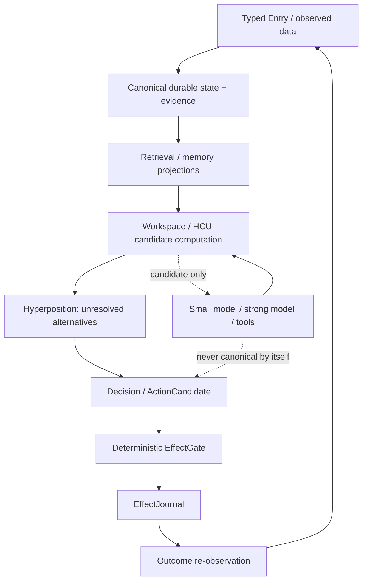

# DEV_SOURCE_RESEARCH

Technical map for Project Frankenstein → EntityOS/HCU reconstruction.

This directory is an **index and interpretation layer**, not a second authority. Current canonical source, owner authority, supervisor selection and executable receipts outrank this prose.

## Read order

1. [`research/FRANKENSTEIN_RESEARCH_CHRONICLE.md`](research/FRANKENSTEIN_RESEARCH_CHRONICLE.md) — architecture/research lineage and failure-driven transitions.
2. [`research/EVIDENCE_LEDGER.md`](research/EVIDENCE_LEDGER.md) — claim-by-claim status, scope and falsifiers.
3. [`research/ARCHIVE_INDEX.json`](research/ARCHIVE_INDEX.json) — machine-readable paths into the evidence archive.
4. [`research/EXTERNAL_PRIMARY_REFERENCES.md`](research/EXTERNAL_PRIMARY_REFERENCES.md) — papers/vendor docs used only as method or analogy.
5. [`repository/ROOT_MIGRATION_MAP.md`](repository/ROOT_MIGRATION_MAP.md) — additive path to the four-entry public root without breaking authority/runtime references.

## Current authority re-entry

At the start of this Trigger-3 curation pass:

- canonical repo: `gschaidergabriel/clay-global-research-entity`
- canonical branch: `main`
- observed head: `854f6bc87780f4a5242489a6c807d186b16a8c3d`
- persistent research entity: Clay
- product: EntityOS
- integrated cognition/compute architecture: HCU
- selected supervisor state: `research_entity/claycode/autonomous/SUPERVISOR_INBOX.json` → 9.13O steering, provider authority epoch 9.13 HARD_OFF
- newer owner execution pointer: `CLAY_EXECUTION_AUTHORITY.md`

Do not infer provider execution permission from older 8.78 bootstrap/program surfaces. Do not infer a whole runtime PASS from source, unit tests, a deployment, a receipt name, token count or model consensus.

## Canonical/current source anchors

### Authority and continuity

- `CLAY_EXECUTION_AUTHORITY.md`
- `research_entity/claycode/autonomous/SUPERVISOR_INBOX.json`
- `research_entity/continuity/BOOTSTRAP_MINIMAL.json`
- `research_entity/rooms/PROGRAM_STATE.json`
- `research_entity/continuity/GO_MACROCYCLE_IDENTITY_CONTRACT.md`
- `research_entity/continuity/GO_EXPERIMENT_ATOMIC_LEASE_PROTOCOL.md`

### Current machine direction

- `the artefact/`
- `research_entity/`
- `tools/`
- `tests/`
- `schemas/`
- `runtime_checks/`

### Frankenstein historical archive

- `research_entity/archive_assimilation/manifests/PROJECT_FRANKENSTEIN_MANIFEST.json`
- `research_entity/archive_assimilation/manifests/PROJECT_FRANKENSTEIN_LEVEL0_SCOPE_LAW.json`
- `research_entity/archive_assimilation/manifests/PROJECT_FRANKENSTEIN_HISTORY_INTERVAL_MANIFEST.json`
- `research_entity/archive_assimilation/manifests/PROJECT_FRANKENSTEIN_TREE_SEG_*`

Historical frozen Project-Frankenstein head in the current archive manifest:

`abba90a5767d85abc8a1ac340bae92842dab35c1`

Explicit Level-0 inclusive base:

`e1a8812767668091d146ee958bbc2ebb2743031c`

The scope law establishes **545 commit obligations** (base + 544 descendants). It does not by itself establish a complete ordered SHA list or a complete exact head-tree denominator.

## Architecture dependency sketch

## Historical-to-current vocabulary

| Historical / compatibility term | Current reading |
|---|---|
| Frank / Project Frankenstein | historical engineering/research lineage |
| ClayVerse | historical donor/provenance |
| Mini Entity / MicroEntity | historical implementation/provenance |
| Xeno | transitional implementation codename only |
| XCU | transitional/research alias for HCU only |
| EntityOS | current product/system |
| HCU | current integrated cognition/compute architecture |
| GRID10 | measured/reference configuration, not proof that ten permanent models define the architecture |

## Evidence discipline for contributors

Every material statement should be interpretable as one of:

`CURRENT_SOURCE · HISTORICAL_SOURCE · PROJECT_MEASUREMENT · EXTERNAL_PRIMARY · INFERENCE · OPEN_HYPOTHESIS · NEGATIVE_RESULT`

Every broad claim must answer:

- What exact source/measurement supports it?
- What does that evidence **not** establish?
- What could falsify it?
- Is the evidence current, historical, source-only, component runtime, or integrated runtime?
- Is there a newer authority surface?
- Is a parallel branch/PR already doing the same work?

## Root policy

The target public root is eventually:

`README.md + HUMAN_READ_THIS/ + DEV_SOURCE_RESEARCH/ + AI_START_HERE_DO_NOT_SCAN_REPO/`

This Trigger-3 pass does **not** move existing authority/runtime files yet. The current root contains many compatibility and runtime entry paths; moving them without a reference/consumer audit could convert a documentation cleanup into a product regression. See the migration map for the fail-closed sequence.
