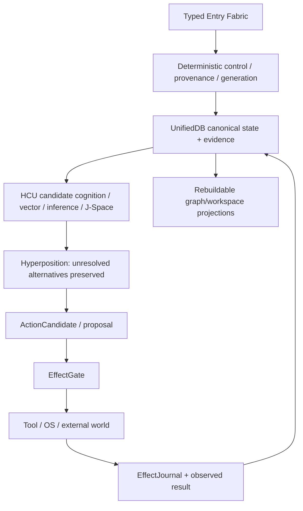

# DEV / SOURCE / RESEARCH — Frankenstein Map

> **NON-AUTHORITY INDEX.** This directory is a curated map into the repository. It must never become a second source of truth. Resolve current authority before trusting any status line here.

## Re-entry order

For any current claim, read in this order:

1. `research_entity/claycode/autonomous/SUPERVISOR_INBOX.json`
2. the steering file selected by that inbox;
3. current owner authority pointers and explicit owner corrections;
4. `research_entity/continuity/BOOTSTRAP_MINIMAL.json` and `research_entity/rooms/PROGRAM_STATE.json` as lower-priority/current-facing caches;
5. exact current source + tests + receipts for the claim;
6. historical topic packets/trigger runs only as provenance.

At the trigger-3 snapshot used to create this layer, `main` was `854f6bc87780f4a5242489a6c807d186b16a8c3d`. `SUPERVISOR_INBOX.json` selected a 9.13O non-authority steering delta while the provider authority epoch remained 9.13 HARD_OFF. `BOOTSTRAP_MINIMAL.json` and `PROGRAM_STATE.json` still contained older 8.78 pointers, so they are demonstrably stale current-facing caches and must not be used alone.

## Current identity

| Concept | Current meaning |
|---|---|
| Persistent research entity | Clay |
| Product/system | EntityOS |
| Integrated cognition/compute architecture | HCU |
| Xeno | transitional implementation compatibility codename |
| XCU | transitional/research alias for HCU |
| Mini Entity / MicroEntity | historical implementation/provenance where migration is incomplete |
| Frank / ClayVerse | historical donor/provenance unless explicitly re-admitted |

## Evidence law

Every technical claim in this curated layer should be understood as one of:

`CURRENT_SOURCE` · `HISTORICAL_SOURCE` · `PROJECT_MEASUREMENT` · `EXTERNAL_PRIMARY` · `INFERENCE` · `OPEN_HYPOTHESIS` · `NEGATIVE_RESULT`

Hard boundaries:

- request != effect;
- model output != world fact;
- method exists != result exists;
- memory != observation;
- source-ready != runtime-observed;
- component PASS != whole-product PASS;
- repeated same-pipeline model consensus != independent evidence;
- pre-load hash != proof of bytes actually consumed by a loader;
- logical cell count != physical decode concurrency.

## Architecture map

### Canonical-state / memory line

Useful source/archive entry points discovered in the current repository:

- `the artefact/clayverse/store.py` — historical/current-compatibility store implementation path.
- `agentZero/code/produkt/store.py` — Agent Zero donor implementation path.
- `research_entity/harness/reference/unifieddb_emergent_compact.py`
- `research_entity/harness/reference/unifieddb_emergent_exact_topk.py`
- `research_entity/harness/reference/unifieddb_emergent_incremental.py`
- `research_entity/harness/reference/unifieddb_emergent_cascade.py`
- `research_entity/harness/reference/unifieddb_claygraph_assembly.py`
- `research_entity/runtime/UNIFIEDDB_V16_SEGMENTED_PULSE_MAINTENANCE.md`
- `research_entity/runtime/UNIFIEDDB_SEGMENTED_PULSE_MAINTENANCE_S1.md`

These paths show a real implementation/research lineage around SQLite-backed canonical state and retrieval. Their existence does not by itself prove current production/runtime acceptance.

### Emergent Retrieval line

Reference/prototype paths include:

- `research_entity/harness/reference/unifieddb_emergent_compact.py`
- `research_entity/harness/reference/unifieddb_emergent_exact_topk.py`
- `research_entity/harness/reference/unifieddb_emergent_incremental.py`
- `research_entity/harness/reference/unifieddb_emergent_cascade.py`
- `research_entity/harness/reference/benchmark_unifieddb_emergent_cascade.py`
- `research_entity/harness/reference/benchmark_unifieddb_emergent_assembly.py`

Project definition: relevance is composed from stored evidence dimensions at query time. No information is allowed to appear without provenance.

### GRF / Hyperposition line

Git chronology first verified by accessible commit search:

- `7367f0e4` (2026-08-10): executable C-GRF candidate contract.
- `7544d636` (2026-08-10): HyperMath GRF proof-carrying IR v1.1 candidate.
- `d4ceafc6` (2026-08-10): synthetic execution receipt.
- `57a10a4f` (2026-08-10): executable HyperMath GRF reference prototype.
- `fc731bbd` (2026-08-10): fusion research report.
- `4287d32f` (2026-08-22 local date context): GWT-GRF measurement record.

Key archive paths:

- `research_entity/trigger_runs/hyperposition/hyperposition-20260810T2342p0700-chatgpt-secondary-hypermath-grf-fusion/architecture/HYPERMATH_GRF_PROOF_CARRYING_IR_V11.clay`
- same run: `EXECUTION_RECEIPT.json`, `FINAL_REPORT.md`, `RESEARCH_REENTRY_MANIFEST.json`.

Treat synthetic/prototype receipts at their declared scope. They are lineage evidence, not automatic validation of modern EntityOS/HCU semantics.

### ClayCode line

Verified source/index paths:

- `tools/claycode_base_compiler.py`
- `tools/claycode_base_package_compiler.py`
- `tools/claycode_compiler_lab.py`
- `tools/claycode_base_compiler_validation.py`
- `CLAYCODE_GENERAL_PURPOSE_COMPILER_MANIFEST.json`
- `research_entity/global/CLAYCODE_GENERAL_PURPOSE_COMPILER_ACCEPTANCE_CONTRACT.md`
- `research_entity/trigger_runs/claycode/claycode-20260811T2243p0700-chatgpt-secondary-first-compiler-lowering/FINAL_REPORT.md`

Current supervisor state at this trigger still keeps broad BASE/release promotion open beyond WP-01/WP-02. A compiler prototype existing or passing a narrow suite must not be narrated as general-purpose release acceptance.

### GRID10 / HCU current execution line

Current real Frankenstein cognition source explicitly references:

- `tools/grid10_fabric.py` — SQLite/WAL fabric, CAS/leases/tasks/regulators according to the current concept source;
- `tools/grid10_node.py` — node loop, elastic polling, meta-regulation, idle-memory release;
- `research_entity/topic_packets/frankenstein-master-cognition-concept/CONCEPT.md` — source-grounded master concept that explicitly distinguishes real code from aspiration.

Latest project measurement retained by supervisor 9.13O:

- 4 concurrent processes / 4 vCPU;
- 1 torch thread/process: mean ~8.3197 s/call over 12 samples;
- 2 threads/process: mean ~23.1806 s/call over 12 samples;
- 4 threads/process: zero completed samples within experiment timeouts.

`PROJECT_MEASUREMENT`: this supports default=1 only for the measured topology. It does not promote Physical-GRID10, HCU or whole-product runtime acceptance.

## Frankenstein 72-hour orchestration: source exists, execution authority does not

Current `main` contains:

- `research_entity/topic_packets/frankenstein-master-cognition-concept/frankenstein_packages_v1.py`
- `research_entity/topic_packets/frankenstein-master-cognition-concept/frankenstein_orchestrator_v1.py`
- `research_entity/topic_packets/frankenstein-master-cognition-concept/frankenstein_bugfix_v1.py`
- tests for those modules; the creating commit reports 29 tests green.

But the current supervisor found that the orchestrator/bugfix design directly walks NVIDIA/Groq/Mistral provider tiers and retains a stale Together-run idea. Under provider authority epoch 9.13 HARD_OFF this is:

`CURRENT_SOURCE + NEGATIVE_RESULT + QUARANTINED_NON_OPERATIVE`

It must not be deployed unchanged. The required repair is at the **external caller/orchestration boundary before secret lookup, provider import, network, Aider, or fallback dispatch**. Current steering also says not to modify Frank's own Harness to solve this.

## Current high-value negative evidence

| Finding | Classification | What it forced |
|---|---|---|
| External free-pool fallback still emitted NVIDIA/Mistral provenance after HARD_OFF | `NEGATIVE_RESULT` | Gate the real caller boundary; quarantine persistent provider loops |
| Generic advice suggested 2 torch threads/process; measured topology was much slower | `PROJECT_MEASUREMENT / NEGATIVE_RESULT` | Keep topology-specific measurement, default=1 for 4proc/4vCPU |
| Free-pool raw design invented nonexistent DB/vector structures | `NEGATIVE_RESULT` | Source-check model advice before architecture adoption |
| Distillery accepted dataset tokens remained 0 in supervisor 9.13O | `NEGATIVE_RESULT` | Do not confuse collected/swarm tokens with training yield |
| Component/source tests exist while whole EntityOS/HCU credit remains zero | `CURRENT_SOURCE` | Keep claim scope aligned with executable evidence |

## Research chronicle

See [`FRANKENSTEIN_RESEARCH_CHRONICLE.md`](FRANKENSTEIN_RESEARCH_CHRONICLE.md). It connects the architecture transitions, verified Git landmarks, external research analogies, failures, and current falsifiers.

## Machine-readable source map

See [`EVIDENCE_INDEX.json`](EVIDENCE_INDEX.json). It is an index only; source files and current authority always outrank its cached status fields.
