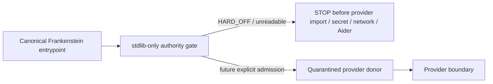
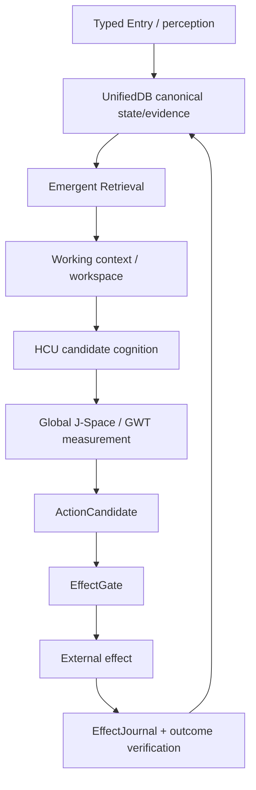

# Frankenstein developer / research index

This is a progressive-disclosure index, not a replacement truth store.

## Re-entry identity

- Trigger: `triggerword 3`
- Initial `main` observed in this pass: `854f6bc87780f4a5242489a6c807d186b16a8c3d`
- Concurrent fused `main` after re-entry: `3c3dbe5020f57065f47bd4d0a2dce3c537128797`
- Product/system: **EntityOS**
- Integrated cognition/compute architecture: **HCU**
- Persistent research entity: **Clay**; temporary workers are organs, not new entities.

Evidence labels used below:

`CURRENT_SOURCE` · `HISTORICAL_SOURCE` · `PROJECT_MEASUREMENT` · `EXTERNAL_PRIMARY` · `INFERENCE` · `OPEN_HYPOTHESIS` · `NEGATIVE_RESULT`

Source-ready is not runtime-observed. Component PASS is not whole-product PASS.

## 1. Authority before architecture

| Claim | Status | Exact source / boundary |
|---|---|---|
| Current owner authority admits broad development inside designated `clay-direct-dev`, while external provider spend/effects remain separate | CURRENT_SOURCE | `../CLAY_EXECUTION_AUTHORITY.md` |
| Provider orchestration is HARD_OFF; Together forbidden | CURRENT_SOURCE | `../research_entity/claycode/autonomous/SUPERVISOR_INBOX.json`, `FREE_PROVIDER_ADMISSION.json` |
| 9.13O identified the 72h provider caller as non-operative until it fails before provider import/secret/network/Aider | CURRENT_SOURCE | current supervisor steering/inbox |
| Concurrent `main` `3c3dbe…` fused a canonical HARD_OFF wrapper, byte-preserved provider donors, a v2 quarantined plan, and focused local tests reported `10/10 PASS` | CURRENT_SOURCE + PROJECT_MEASUREMENT_REPORTED_BY_COMMIT | commit `3c3dbe5020f57065f47bd4d0a2dce3c537128797` |
| Whole EntityOS/HCU, full HCU, canonical semantics, J-Space model and training credit remain unpromoted/zero | CURRENT_SOURCE | current supervisor promotion state |

The uploaded 8.63 bootstrap remains useful provenance but is not current authority.

## 2. Frankenstein provider-loop failure and repair

The old orchestration plan and provider-backed scripts are valuable donor history. Their previous current-facing form could reach NVIDIA/Groq/Mistral/Aider paths while current canonical authority said HARD_OFF. The stale plan also described Together run availability that no longer existed.

`NEGATIVE_RESULT`: historical plan text and a technically working provider caller were able to outlive the authority epoch that originally motivated them.

The fused current design preserves history rather than rewriting it:



Key paths:

- `../research_entity/topic_packets/frankenstein-master-cognition-concept/frankenstein_authority_gate_v1.py`
- `../research_entity/topic_packets/frankenstein-master-cognition-concept/frankenstein_orchestrator_v1.py`
- `../research_entity/topic_packets/frankenstein-master-cognition-concept/frankenstein_bugfix_v1.py`
- `../research_entity/topic_packets/frankenstein-master-cognition-concept/BUILD_ORCHESTRATION_PLAN_20260827.json`
- byte-preserved `*_PROVIDER_QUARANTINED_854f6bc.*` donors
- `../tests/test_frankenstein_provider_hardoff_gate_v1.py`

The local `10/10 PASS` is scoped to source/local-unit closure as stated by the canonical commit. It does not create provider runtime, HCU, BASE, J-Space, training, or whole-product credit.

## 3. State → memory → decision → effect → verification

The architecture claim is not “the model is the system.” HCU/model/workspace outputs are candidates or measurements; durable state/evidence and real effects retain deterministic authority.



### UnifiedDB

`CURRENT_SOURCE/HISTORICAL_SOURCE`: the project converged away from fragmented state ownership toward one canonical SQLite authority substrate. One authority substrate can still contain many typed tables, indexes, journals, views, policies, writers/readers, and rebuildable projections. High-rate transient sensor state can remain in RAM.

### Emergent Retrieval

Project term: relevance that appears when independently stored evidence dimensions overlap at query time — semantic similarity, time, causal lineage, current state, goals, perception, effects, confidence, provenance. It never means evidence appears from nowhere.

## 4. Workspace / GWT / Global J-Space

`OPEN_HYPOTHESIS`: Global J-Space is a model-specific causal coordination interface. The project borrows the computational idea of a limited workspace with global availability/broadcast from Global Workspace / Global Neuronal Workspace research. That literature is an external design analogy and source of falsifiers, not evidence that EntityOS implements a biological workspace.

Primary/review anchors:

- Dehaene/Changeux et al., *Conscious Processing and the Global Neuronal Workspace Hypothesis*: `https://pmc.ncbi.nlm.nih.gov/articles/PMC8770991/`
- Dehaene et al., *A neuronal model of a global workspace in effortful cognitive tasks*: `https://pmc.ncbi.nlm.nih.gov/articles/PMC24407/`

Project falsifier: if shuffle/lesion/rescue or vector-control interventions cannot reproducibly alter downstream behavior beyond prompt/schema confounds, the claimed causal J-Space interface is not established.

## 5. Reflection with an exit

`OPEN_HYPOTHESIS`: useful reflective agency benefits from an external substrate rich enough to preserve state, outcome evidence, memory, perception, arbitration, and effect receipts.

`EXTERNAL_PRIMARY`: Shinn et al., *Reflexion* (2023) demonstrates a language-agent design using episodic verbal feedback without weight updates: `https://arxiv.org/abs/2303.11366`.

Project distinction: reflection is not merely “write a critique.” It must terminate into ACT / ASK / WAIT / re-observe / another measurable transition. Recursive reflection without transition is rumination/fixation.

Falsifier: matched tasks where reflection does not improve preregistered success/error recovery against an equal-budget baseline, or mainly increases latency/repetition, count against the mechanism for that workload.

## 6. GRF and Hyperposition

### GRF

GRF belongs to the historical mathematical/engineering lineage. Reconstruct exact chronology from source and Git history. Use “first verified in accessible Git” when creation date cannot be proven; do not infer dates from later summaries.

### Hyperposition

Project engineering meaning: preserve unresolved alternatives instead of collapsing them by majority or narrative confidence. Competing candidates stay candidates until an evidence-bearing discriminator closes them.

`OPEN_HYPOTHESIS`: structured alternative preservation improves decisions under incomplete evidence. Falsifier: if matched tasks show extra cost without calibrated improvement in error, uncertainty, or recovery, that weighs against it.

## 7. GRID/HCU measured counterexample

`PROJECT_MEASUREMENT`: current supervisor evidence records a thread-count A/B on four concurrent model processes / four vCPUs:

- one torch thread/process: mean `8.3197 s/call`, 12 samples;
- two threads/process: mean `23.1806 s/call`, 12 samples;
- four threads/process: zero completed samples within the experiment timeouts.

This falsified the recommendation that two threads/process would be faster on that topology. It supports the existing default of one **only for that measured topology**.

`EXTERNAL_PRIMARY`: PyTorch multiprocessing guidance warns about CPU oversubscription and recommends controlling per-process thread counts.

Logical GRID cell count is not resident-model count and not physical decode concurrency.

## 8. SQLite/WAL boundary

`EXTERNAL_PRIMARY`: SQLite WAL changes reader/writer concurrency and adds checkpointing as a separate concern. Current SQLite documentation also records a 2026 WAL-reset corruption issue affecting versions through 3.51.2 and fixed in 3.51.3 (with some backports). Exact SQLite runtime version therefore belongs in serious concurrent-runtime receipts.

External SQLite facts constrain validation; they do not prove UnifiedDB correctness.

## 9. NVIDIA Unified Memory is analogy only

`EXTERNAL_PRIMARY`: CUDA Unified Memory provides a common/coherent address-space abstraction with system-managed placement/migration. Project use is systems analogy: fewer ownership/copy boundaries can simplify compute. Hardware memory coherence is not database semantics, causal provenance, canonical evidence, or effect authority.

## 10. Training evidence law

Training completion alone is not PASS. Promotion requires exact checkpoint/tokenizer/runtime/build identity, leak-resistant family splits, causal trace binding, deterministic hard negatives, frozen baselines, intended-behavior gains, and off-target regression tests.

Historical Together runs remain provenance under current HARD_OFF; they do not create current run authority.

## 11. Failure → engineering move

| Failure / negative result | Engineering move |
|---|---|
| fragmented state ownership | converge toward one canonical UnifiedDB authority substrate |
| request mistaken for effect | deterministic EffectGate + EffectJournal boundary |
| recursive reflection/fixation | require reflection to terminate into measurable transition |
| prompt/context contamination | typed state/provenance and causal controls |
| same-pipeline consensus mistaken for evidence | executable evidence outranks consensus |
| provider failure conflated with science | separate authority/transport failure from product logic |
| provider HARD_OFF bypass | canonical wrapper before import/secret/network/Aider; quarantine donors |
| CPU thread intuition wrong | matched executable A/B; retain topology-scoped result |
| component PASS inflated to whole system | scope receipts; no broad promotion without matching acceptance |

## 12. Repository topology

At the beginning of this Trigger-3 pass the three target entry directories were absent and root remained technically crowded. This fused branch adds the human/dev/AI entry layers **without modifying root `README.md` and without a mass move** while `main` is actively changing.

Target public root remains:

```text
README.md
HUMAN_READ_THIS/
DEV_SOURCE_RESEARCH/
AI_START_HERE_DO_NOT_SCAN_REPO/
```

A later root migration should move technical material below `DEV_SOURCE_RESEARCH/repository/` only with explicit link/import/CI/evidence-reproducibility checks. Moving files for aesthetics is not worth breaking causal lineage.

## 13. Acceptance map

| Area | Classification |
|---|---|
| provider-backed 854f6bc Frankenstein scripts | HISTORICAL/DONOR, quarantined |
| canonical HARD_OFF entrypoint gate on main | SOURCE + commit-reported LOCAL_UNIT 10/10 PASS |
| 72h autonomous provider orchestration | BLOCKED/NON_OPERATIVE under current authority |
| stale Together allowance | HISTORICAL_PROVENANCE, zero current authority |
| package/decomposition concept | SOURCE_READY / donor mechanisms preserved |
| Global J-Space causal claim | OPEN_HYPOTHESIS |
| full HCU runtime | NOT PROMOTED |
| whole EntityOS runtime | NOT PROMOTED |
| training | zero current promotion credit |

Machine-readable indexing is in `FRANKENSTEIN_EVIDENCE_INDEX.json`.
