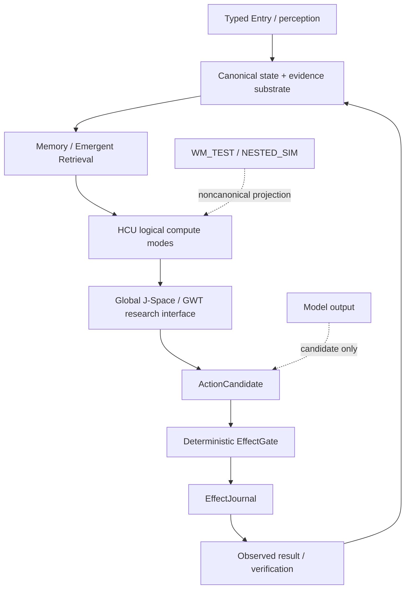

# Frankenstein developer / research entry

This directory is the **progressive-disclosure technical layer** for Project Frankenstein / EntityOS research. It does not replace canonical source, Git history, receipts, or current authority files. It links them and labels their evidential scope.

## Current re-entry snapshot for this Trigger-3 pass

- canonical repository: `gschaidergabriel/clay-global-research-entity`
- base `main` observed before this synthesis branch: `854f6bc87780f4a5242489a6c807d186b16a8c3d`
- current supervisor inbox schema: `9.13`, delta `9.13O_NON_AUTHORITY`
- product: `EntityOS`
- integrated cognition / compute architecture: `HCU`
- provider authority: `FREE_ONLY_HARD_OFF_ALL_PROVIDER_ROUTES_FALSE_TOGETHER_FORBIDDEN_NO_PAID_FALLBACK`
- whole EntityOS runtime credit: `0`
- HCU full runtime credit: `0`
- training credit: `0`

The bootstrap/program files still contain older 8.x surfaces in places. Under the repository's own authority ordering, the current `SUPERVISOR_INBOX.json`-selected 9.13O steering must be read before interpreting those older caches.

## Evidence vocabulary

| Label | Meaning |
|---|---|
| `CURRENT_SOURCE` | Exact current source or current authority surface at a named revision. |
| `HISTORICAL_SOURCE` | Reproducible historical source useful for lineage, not current authority. |
| `PROJECT_MEASUREMENT` | Measured project result with a bounded scope. |
| `EXTERNAL_PRIMARY` | Primary paper, specification or vendor documentation used as an outside reference. |
| `INFERENCE` | Reasoned conclusion not directly measured. |
| `OPEN_HYPOTHESIS` | Proposed mechanism that needs a discriminator. |
| `NEGATIVE_RESULT` | Failed hypothesis, blocked path or falsified expectation preserved as evidence. |

Lifecycle/status terms used in the research index:

`attempted` · `source-ready` · `measured` · `reproduced` · `contradicted` · `blocked` · `prepared-not-run` · `adopted` · `retired`

## Architecture map

### Authority boundary

Canonical durable state/evidence and real-effect authority must remain outside model-generated cognition. HCU, workspace, J-Space, world-model and model outputs can propose, measure or project; they cannot mint facts or bypass the effect journal.

## Current Frankenstein lineage: strongest evidence-bearing paths

### 1. Current authority and executable frontier

- `../research_entity/claycode/autonomous/SUPERVISOR_INBOX.json` — `CURRENT_SOURCE`
- `../research_entity/claycode/autonomous/SUPERVISOR_STEERING_9_13O_DELTA_2026-08-27T2341P0700_GPT56SOL.json` — `CURRENT_SOURCE`
- `../research_entity/continuity/BOOTSTRAP_MINIMAL.json` — `CURRENT_SOURCE` but older cached authority epoch; do not use alone
- `../research_entity/rooms/PROGRAM_STATE.json` — `CURRENT_SOURCE` but older cached authority epoch; do not use alone

Current 9.13O frontier says the external provider caller boundary remains a P0 problem: post-HARD_OFF NVIDIA/Mistral fallback commits prove that at least one real caller path still reached the provider-oriented fallback surface after provider routes were disabled. That is a control-plane defect, not a permission to keep using the path.

### 2. Frankenstein master cognition concept

- `../research_entity/topic_packets/frankenstein-master-cognition-concept/CONCEPT.md` — `HISTORICAL_SOURCE` + `OPEN_HYPOTHESIS`
- `../research_entity/topic_packets/frankenstein-master-cognition-concept/BUILD_ORCHESTRATION_PLAN_20260827.json` — `HISTORICAL_SOURCE`, currently `blocked`
- `../research_entity/topic_packets/frankenstein-master-cognition-concept/frankenstein_packages_v1.py` — `CURRENT_SOURCE`, package/dispenser implementation
- `../research_entity/topic_packets/frankenstein-master-cognition-concept/frankenstein_orchestrator_v1.py` — `CURRENT_SOURCE`, but provider-calling execution design is quarantined under 9.13 HARD_OFF
- `../research_entity/topic_packets/frankenstein-master-cognition-concept/frankenstein_bugfix_v1.py` — `CURRENT_SOURCE`, but provider-calling execution design is quarantined under 9.13 HARD_OFF

The latest direct implementation commit reports 29 local tests green across package dispenser, orchestrator and bugfix scripts. This is source/component evidence only. It does **not** grant permission to execute the provider-calling loops and does not promote whole-product runtime credit.

### 3. GRID10 / HCU computerization

Current design uses logical cells and shared software architecture roles. A logical cell count is not resident model count and not physical decode concurrency.

The useful recent thread-count result is deliberately narrow:

- measured topology: four concurrent model processes, four vCPUs
- 1 intra-op thread/process: mean `8.3197 s/call` over 12 samples
- 2 threads/process: mean `23.1806 s/call` over 12 samples
- 4 threads/process: zero completed samples within the experiment timeouts
- status: `PROJECT_MEASUREMENT` + `NEGATIVE_RESULT` for the “more threads will be faster” hypothesis
- promotion: no Physical-GRID10 / HCU / release promotion from this measurement alone

This result is consistent with PyTorch's official multiprocessing guidance that CPU oversubscription creates contention and that a useful upper bound is approximately `floor(vCPUs / processes)` threads per process for the multiprocessing topology being considered.

### 4. UnifiedDB and Emergent Retrieval

`UnifiedDB` denotes a canonical authority substrate, historically converged toward SQLite. It is not a promise that all transient state lives in one table or file. Typed tables, indexes, views, journals and rebuildable projections remain valid. High-rate transient state can stay in RAM if its authority boundary is explicit.

`Emergent Retrieval` is a project term: relevance emerges when independently stored dimensions overlap at query time, e.g. semantic similarity + time + causal lineage + current state + goals + effects + confidence + provenance. No information is created by retrieval.

### 5. Reflection and agency

The engineering interpretation of reflection is:

`inspect -> detect mismatch -> generate bounded correction -> persist/retrieve correction -> alter later behavior -> exit`

Allowed exits include `ACT`, `ASK`, `WAIT`, re-observe, or another measurable transition. Endless self-reflection is classified as rumination/fixation and is a defect.

**Open hypothesis:** richer external state/memory/perception/arbitration/effect receipts/outcome re-entry increases practical reflective agency.

**Counter-hypothesis:** observed gains are largely explained by prompt scaffolding, ordinary workflow decomposition, or logging correlation rather than a distinct J-Space/workspace causal mechanism.

**Falsifier direction:** model-specific intervention, lesion/shuffle/rescue and matched controls that alter the proposed workspace/J-Space variable while holding prompt/task families stable.

## Failure-driven evolution

The research chronicle should keep these failure classes adjacent to the mechanisms they motivated:

- multi-store state fragmentation -> canonical authority substrate / UnifiedDB direction;
- rumination/fixation -> reflection exit law;
- context contamination -> typed provenance, family-level splits, re-entry discipline;
- prompt-vs-weight conflicts -> explicit tokenizer/renderer/checkpoint ancestry and training controls;
- latency/timeouts -> measured topology-specific tuning rather than generic optimization folklore;
- dead modules / integration failures -> bounded component credit and exact causal-path tests;
- provider bypass after HARD_OFF -> caller-boundary gate before secret lookup/import/network/fallback;
- raw Free-Swarm token growth with zero accepted dataset yield -> optimize conversion/evidence quality before raw scale.

## External primary references used in this synthesis

These references are analogies or supporting engineering/science context. They do not prove project-specific mechanisms.

1. Bernard Baars, *Global workspace theory of consciousness: toward a cognitive neuroscience of human experience*, Prog Brain Res. 2005. DOI `10.1016/S0079-6123(05)50004-9`. `EXTERNAL_PRIMARY`.
2. Bernard Baars & Stan Franklin, *An architectural model of conscious and unconscious brain functions: Global Workspace Theory and IDA*, Neural Networks, 2007. DOI `10.1016/j.neunet.2007.09.013`. `EXTERNAL_PRIMARY`.
3. PyTorch, *Multiprocessing best practices* (current documentation, CPU oversubscription section). `EXTERNAL_PRIMARY` vendor documentation.
4. SQLite, *Write-Ahead Logging*. `EXTERNAL_PRIMARY` implementation documentation.
5. Shinn et al., *Reflexion: Language Agents with Verbal Reinforcement Learning*, arXiv:2303.11366. `EXTERNAL_PRIMARY` research reference for feedback + episodic reflection; it is not evidence that Frankenstein implements or reproduces Reflexion.

## Repository topology target

The Trigger-3 public-root target is:

- `README.md`
- `HUMAN_READ_THIS/`
- `DEV_SOURCE_RESEARCH/`
- `AI_START_HERE_DO_NOT_SCAN_REPO/`

This branch creates the three entry layers without rewriting the root README. The current root still contains extensive technical material, so the topology migration is **not complete**.

Moving existing files is deliberately not done blindly in this pass because path changes can break runtime code, historical citations and evidence links. The next migration phase should classify each root path, prove whether it is runtime-referenced, then move technical clutter below `DEV_SOURCE_RESEARCH/repository/` in byte-identical batches with link/reference regression checks.

See: [`repository/ROOT_TOPOLOGY_MIGRATION.md`](repository/ROOT_TOPOLOGY_MIGRATION.md)

## Machine-readable research index

See: [`repository/FRANKENSTEIN_EVIDENCE_INDEX_2026-08-27.json`](repository/FRANKENSTEIN_EVIDENCE_INDEX_2026-08-27.json)
