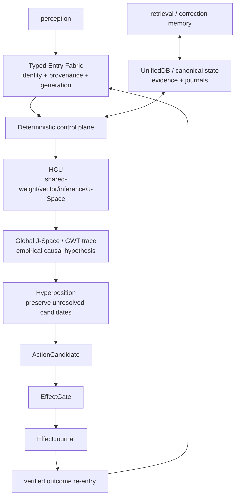

# DEV_SOURCE_RESEARCH — progressive technical index

This directory is the technical/research route for Project Frankenstein → EntityOS + HCU. It is an **index over evidence**, not a replacement truth store and not a second authority.

Re-resolve `main` and current authority before live execution decisions. During the 2026-08-27 Trigger-3 pass, the admitted supervisor semantics were **9.13 HARD_OFF**; `main` moved repeatedly as parallel organs fused source, research-history and curation deltas.

## 0. Authority first

Read before present-tense/runtime claims:

1. [`../CLAY_EXECUTION_AUTHORITY.md`](../CLAY_EXECUTION_AUTHORITY.md)
2. [`../research_entity/claycode/autonomous/SUPERVISOR_INBOX.json`](../research_entity/claycode/autonomous/SUPERVISOR_INBOX.json)
3. steering selected by that inbox
4. [`../research_entity/continuity/BOOTSTRAP_MINIMAL.json`](../research_entity/continuity/BOOTSTRAP_MINIMAL.json) and [`../research_entity/rooms/PROGRAM_STATE.json`](../research_entity/rooms/PROGRAM_STATE.json)
5. exact source/tests/receipts for the exact claim

Do not average authority disagreements. Current Trigger-3 evidence records a real stale-island conflict: `PROGRAM_STATE.json` remains on an older 8.78 provider epoch while the inbox is 9.13 HARD_OFF. See [`AUTHORITY_DRIFT_20260827.md`](AUTHORITY_DRIFT_20260827.md).

## 1. Evidence vocabulary

- **CURRENT_SOURCE** — source at the exact current identity.
- **HISTORICAL_SOURCE** — retained lineage, not current authority.
- **PROJECT_MEASUREMENT** — observed bounded project measurement.
- **EXTERNAL_PRIMARY** — original paper/spec/vendor-primary documentation.
- **INFERENCE** — conclusion drawn from observations.
- **OPEN_HYPOTHESIS** — candidate mechanism with a falsifier.
- **NEGATIVE_RESULT** — failure/blocker/contradiction worth preserving.

Lifecycle qualifiers: `attempted`, `source-ready`, `measured`, `reproduced`, `contradicted`, `blocked`, `prepared-not-run`, `adopted`, `retired`.

`SOURCE_READY != RUNTIME_VERIFIED`. Component PASS never implies whole-product PASS. Model output does not create world facts.

## 2. Current Frankenstein control boundary

The 2026-08-27 Bauleiter/Bugfix implementation initially reached provider-capable imports/fallbacks before satisfying current 9.13 authority. That became a first-class negative result.

Current `main` preserves the original provider-backed implementations as quarantined donor provenance and puts supported entrypoints behind an authority gate resolved before provider import, secret lookup, network, Aider or fallback dispatch. Commit `3c3dbe5020f57065f47bd4d0a2dce3c537128797` reports **10/10 focused local tests PASS**, explicitly source/local-unit scope only.

Key packet:

- [`../research_entity/topic_packets/frankenstein-master-cognition-concept/`](../research_entity/topic_packets/frankenstein-master-cognition-concept/)
- `frankenstein_authority_gate_v1.py`
- current gated `frankenstein_orchestrator_v1.py` / `frankenstein_bugfix_v1.py`
- quarantined `*_PROVIDER_QUARANTINED_854f6bc.py` donor files
- `BUILD_ORCHESTRATION_PLAN_20260827_PROVIDER_QUARANTINED_854f6bc.json`
- `TRIGGERWORD3_HARD_OFF_CLOSURE_20260827_GPT56SOL.json`
- [`../tests/test_frankenstein_provider_hardoff_gate_v1.py`](../tests/test_frankenstein_provider_hardoff_gate_v1.py)

This grants no provider, HCU, training, canonical-semantics or whole-product runtime credit.

## 3. Historical Project-Frankenstein source identity

Two archive surfaces now complement each other:

- [`../research_entity/archive_assimilation/manifests/PROJECT_FRANKENSTEIN_MANIFEST.json`](../research_entity/archive_assimilation/manifests/PROJECT_FRANKENSTEIN_MANIFEST.json) — semantic deep-read manifest, still `PARTIAL_NOT_FROZEN`.
- [`../research_entity/archive_assimilation/manifests/PROJECT_FRANKENSTEIN_SOURCE_IDENTITY_HISTORY_ANCHOR_20260827.json`](../research_entity/archive_assimilation/manifests/PROJECT_FRANKENSTEIN_SOURCE_IDENTITY_HISTORY_ANCHOR_20260827.json) — exact source/history identity anchor added during this pass.

The stronger history anchor establishes for the separate `gschaidergabriel/Project-Frankenstein` default branch at the observed snapshot:

```text
head: abba90a5767d85abc8a1ac340bae92842dab35c1
root tree: ec21e66c4672fde1f0a5d948ebc51457b69b620a
reachable default-branch commits: 545
oldest reachable commit: e1a8812767668091d146ee958bbc2ebb2743031c
oldest reachable commit time: 2026-02-14T17:05:27Z
message: Initial commit: AI-Core / Frank — local AI desktop companion
```

The 545 denominator is reproducible for **default-branch reachable history** (page 545 non-empty, page 546 empty with `per_page=1`). It is not a claim about every ref, deleted/unreachable history, or full semantic coverage.

The recursive path inventory is still **not claimed complete**, so repository-wide topology/semantic completeness remains unpromoted.

### Deep-read lineage

The partial semantic manifest includes:

| Source | Historical engineering role |
|---|---|
| `services/consciousness_daemon.py` | persistent/multi-timescale loop; workspace precursor |
| `personality/e_pq.py` | persistent state, homeostasis, event learning |
| `services/thalamus.py` | sensory gating, attention, habituation, prediction error |
| `services/global_workspace.py` | broadcast/salience workspace |
| `tools/lcme/lcme_core.py` | memory, claims, graph/vector retrieval, forgetting |
| `services/soma/micro_trainer.py` | LoRA training, feedback weighting, before/after probes |
| `services/nucleus_accumbens.py` | reward prediction, motivation, habituation |
| `services/subconscious.py` | actor-critic/PPO/idle-policy lineage |
| `services/spatial_state.py` | persistent world/body state |
| `services/dream_daemon.py` | replay, synthesis, consolidation, interrupt/resume |
| `services/project_engine.py` | projects, goals, strategies, tasks, tool learning |
| hypothesis-engine/lab sources | hypothesis lifecycle, test translation, experiment persistence |
| visual sources | adaptive routing → FrankEye/Retina → native multimodal vision claims |

These establish source lineage, not current runtime presence.

## 4. Chronology law

Use Git and say **“first verified in accessible Git”** unless creation time is independently evidenced.

Current anchors:

- `e1a8812767668091d146ee958bbc2ebb2743031c` — oldest commit reachable from the frozen Project-Frankenstein default branch in the reproducible 545-commit listing; first verified Git presence at that scope, not proof of pre-Git creation date.
- `abba90a5767d85abc8a1ac340bae92842dab35c1` — observed Project-Frankenstein default-branch head (2026-04-05T18:10:31Z), root-tree identity exact; recursive path coverage still incomplete.
- `96623ef096ba189b771ca10835cd5a20499c1da9` — 2026-08-09 archaeology-workspace initialization in the Clay research repo, not project creation.
- `ab15b482caff1fa5e446d7795cea8df81bc41b97` — 2026-08-27 grounded master-cognition concept; rejects helper-model inventions not present in real source.
- `854f6bc87780f4a5242489a6c807d186b16a8c3d` — provider-capable Bauleiter/Bugfix/package-dispenser source lands.
- supervisor 9.13O — quarantines provider-calling orchestration under HARD_OFF.
- `3c3dbe5020f57065f47bd4d0a2dce3c537128797` — source/local-unit HARD_OFF caller closure fused on `main`.

The useful chronology is **failure → correction → stricter evidence boundary**, not a victory timeline.

Detailed chronicle: [`repository/FRANKENSTEIN_RESEARCH_CHRONICLE.md`](repository/FRANKENSTEIN_RESEARCH_CHRONICLE.md).

## 5. Architecture dependency graph



Dependencies matter: without verified outcome re-entry, reflection can optimize imagined success; without one canonical evidence authority, arbitration can split; without EffectGate, fluent model output can become accidental authority.

## 6. UnifiedDB + Emergent Retrieval

UnifiedDB is an authority pattern, not a “god file.” One canonical SQLite substrate may contain many typed tables, indexes, views, policies, journals and rebuildable projections while high-rate transient state can remain in RAM.

**Emergent Retrieval** means relevance appearing when independently stored dimensions overlap at query time: semantics, time, causal lineage, current state, goals, perception, effect receipts, confidence, provenance, etc. Nothing appears from nowhere.

Representative current source entry points:

- [`../research_entity/harness/reference/unifieddb_emergent_cascade.py`](../research_entity/harness/reference/unifieddb_emergent_cascade.py)
- [`../research_entity/harness/reference/benchmark_unifieddb_emergent_cascade.py`](../research_entity/harness/reference/benchmark_unifieddb_emergent_cascade.py)
- [`../research_entity/harness/reference/benchmark_unifieddb_emergent_assembly.py`](../research_entity/harness/reference/benchmark_unifieddb_emergent_assembly.py)
- [`../research_entity/unifieddb/`](../research_entity/unifieddb/)

**EXTERNAL_PRIMARY discriminator:** SQLite documents a rare WAL-reset corruption bug affecting 3.7.0 through 3.51.2 under a specific concurrent WAL write/checkpoint pattern, fixed in 3.51.3 and later (plus some backports):

- https://www.sqlite.org/wal.html
- https://sqlite.org/releaselog/3_51_3.html

This does not establish that UnifiedDB is affected. Bind exact SQLite runtime version + journal mode + connection/checkpoint topology before concrete concurrent-WAL durability claims.

## 7. NVIDIA Unified Memory: analogy only

NVIDIA CUDA Unified Memory is a systems-design analogy for reducing ownership/copy boundaries, not evidence about database semantics. Official documentation describes platform-dependent CPU/GPU managed/system memory and hardware/software coherency:

https://docs.nvidia.com/cuda/cuda-programming-guide/02-basics/understanding-memory.html

Hardware coherence != SQLite transaction semantics != evidence authority.

## 8. GRF / Hyperposition / GWT / Global J-Space

Current cache: [`../research_entity/00_CURRENT/latest/hyperposition-gwt-grf.md`](../research_entity/00_CURRENT/latest/hyperposition-gwt-grf.md) is `PARTIAL_COMPONENT_EVIDENCE`; physical-grid re-entry remains blocked pending true GRID10 runtime acceptance.

- **Hyperposition:** preserve unresolved alternatives; majority cannot mint truth.
- **GWT/workspace:** engineering coordination donor/hypothesis, not consciousness evidence.
- **GRF:** keep tied to exact mathematics/prototypes/receipts, not vague “emergence.”
- **Global J-Space:** empirical causal interface hypothesis requiring model-specific intervention evidence.

External conceptual donor: https://pmc.ncbi.nlm.nih.gov/articles/PMC8770991/

Strong falsifiers: label-free counterbalanced intervention, lesion/shuffle/rescue, schema-leak controls and exact checkpoint/tokenizer/runtime binding.

## 9. Reflection and agency

```text
observe state/outcome
→ compare with expectation/goal
→ detect mismatch
→ propose correction
→ store/retrieve correction evidence
→ ACT | ASK | WAIT | RE-OBSERVE | measurable transition
```

Reflection with no exit is rumination/fixation.

External donors:

- ReAct: https://arxiv.org/abs/2210.03629
- Reflexion: https://arxiv.org/abs/2303.11366

They are relevant analogies/research context, not Project-Frankenstein runtime proof.

**OPEN_HYPOTHESIS (confidence MEDIUM):** useful reflective agency improves with a rich external substrate of state, memory, perception, arbitration, effect receipts and verified outcome re-entry.

**Falsifier:** a materially simpler substrate matches/exceeds it on preregistered long-horizon correction/recovery tasks, or controlled ablation shows no benefit.

## 10. Failure → engineering move

| Failure / contradiction | Move forced by evidence |
|---|---|
| fragmented state/authority | converge toward one canonical deterministic state/evidence substrate |
| recursive reflection | explicit exit transitions + verified outcome re-entry |
| helper-model invented architecture | source-grounding before adoption |
| coherence mistaken for hidden-state causality | causal intervention controls for J-Space/GWT |
| more threads presumed faster | topology-specific matched measurement |
| provider caller crossed authority boundary | gate before capability boundary + quarantined provenance |
| stale Together allowance contradicted zero | current authority wins; stale plan cannot spend |
| Distillery zero-yield | no training credit from raw token volume |
| stale 8.78 program state vs 9.13 inbox | successor-dynamic authority convergence required |
| recursive Project-Frankenstein tree not fully inventoried | no fake topology/semantic completeness percentage |

## 11. Training lineage and current credit

Historical LoRA/IAPT/SOMA and later ClayCode/J-Space/vector-binding work are separate evidence families. Training completion alone is not PASS.

Promotion requires exact checkpoint/tokenizer/runtime identity, frozen baseline, leak-resistant family splits, deterministic hard negatives, intended-behavior gain and appropriate regression/fail-closed tests.

At the observed 9.13 frontier, whole EntityOS/HCU, full HCU, Physical GRID10, canonical semantics and training promotion remain zero/unpromoted unless newer exact executable evidence says otherwise.

## 12. Repository curation

Intended public navigation target:

```text
README.md
HUMAN_READ_THIS/
DEV_SOURCE_RESEARCH/
AI_START_HERE_DO_NOT_SCAN_REPO/
```

This is not current permission to move canonical root paths. Current precheck shows two hard constraints: `research_entity/` is a canonical authority/evidence tree and `the artefact/` is a canonical product workspace. The root inventory was also not proven complete because the connector tree response truncated. Therefore mass migration is correctly blocked pending exact inventory/reference audit/path-authority resolution.

See:

- [`repository/ROOT_TOPOLOGY_MIGRATION_PLAN.md`](repository/ROOT_TOPOLOGY_MIGRATION_PLAN.md)
- [`repository/ROOT_MIGRATION_PRECHECK.json`](repository/ROOT_MIGRATION_PRECHECK.json)
- [`repository/ROOT_MIGRATION_MANIFEST_2026-08-27.json`](repository/ROOT_MIGRATION_MANIFEST_2026-08-27.json)

Root `README.md` remains deliberately unchanged.

## 13. Next high-information gates

1. synchronize stale current-facing provider-authority surfaces successor-dynamically;
2. obtain a complete non-truncated root inventory and reference audit before moving canonical paths;
3. bind exact SQLite runtime/journal/concurrency identity before UnifiedDB WAL durability claims;
4. run label-free causal J-Space lesion/shuffle/rescue at exact model identity when authority permits;
5. continue recursive Project-Frankenstein path inventory against exact root-tree anchor;
6. verify every AI installer host route as `NATIVE`, `ADAPTED`, `DEGRADED` or `BLOCKED` using observed lifecycle/state/effect receipts.

Machine-readable index: [`repository/FRANKENSTEIN_SOURCE_INDEX.json`](repository/FRANKENSTEIN_SOURCE_INDEX.json).

This index should grow through deep links, evidence maps and exact identities — not by copying the entire archive into prose.
