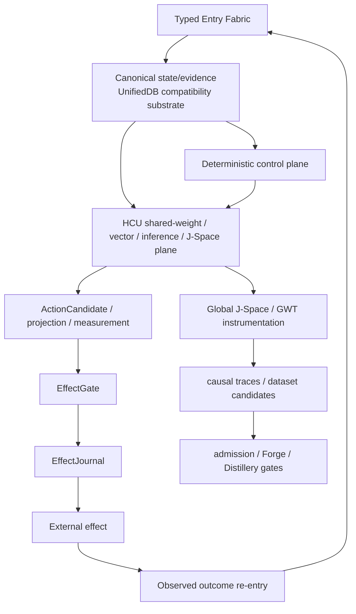

# DEV_SOURCE_RESEARCH

Technical and research entrance for Project Frankenstein / EntityOS / HCU.

This layer is an **index over evidence**, not a replacement truth store. Do not copy thousands of archive files into prose. Deep-link them, preserve exact provenance, and keep contradictory results visible.

## 0. Resolve current authority before interpretation

Read in this order:

1. `CLAY_EXECUTION_AUTHORITY.md`
2. `research_entity/continuity/BOOTSTRAP_MINIMAL.json`
3. `research_entity/rooms/PROGRAM_STATE.json`
4. `research_entity/claycode/autonomous/SUPERVISOR_INBOX.json`
5. the inbox-selected current steering/delta
6. exact task-relevant source, tests, receipts, commits and runtime evidence

Current-at-creation snapshot for this index: EntityOS is the only current product authority; HCU is the only current integrated cognition/compute architecture; supervisor inbox schema is 9.13; provider routes are HARD_OFF; Together is forbidden; broader runtime/training promotion remains fail-closed. Refresh before relying on that snapshot.

## 1. Evidence vocabulary

Every important claim should be classifiable as one of:

| Status | Meaning |
|---|---|
| `ATTEMPTED` | work was tried; outcome may be incomplete |
| `SOURCE_READY` | implementation/spec exists; target runtime not yet observed |
| `MEASURED` | a declared measurement actually ran at a bounded scope |
| `REPRODUCED` | the same claim was reproduced with adequate identity/provenance |
| `CONTRADICTED` | a stronger control or observation contradicts the claim |
| `BLOCKED` | an explicit authority, dependency, or evidence gate prevents promotion |
| `PREPARED_NOT_RUN` | runnable/prepared artifact exists but execution was not observed |
| `ADOPTED` | current architecture/authority selected it |
| `RETIRED` | kept for lineage/donor value but no longer current authority |

Evidence labels used in prose:

`CURRENT_SOURCE` · `HISTORICAL_SOURCE` · `PROJECT_MEASUREMENT` · `EXTERNAL_PRIMARY` · `INFERENCE` · `OPEN_HYPOTHESIS` · `NEGATIVE_RESULT`.

## 2. Architecture map

Canonical durable state and real effect authority remain outside model-generated cognition. HCU/J-Space/world-model/workspace outputs can propose or measure; they do not mint truth.

## 3. Research lineage map

### Historical Frank / Frankenstein architecture

Start with:

- `research_entity/trigger_runs/fusion/fusion-20260809T1538p0700-frank-architecture-lineage/FUSED_FRANK_TARGET_ARCHITECTURE.json`
- `research_entity/archive_assimilation/manifests/PROJECT_FRANKENSTEIN_HISTORY_SEMANTIC_K110_K117_20260809T1256p0700.json`
- `frank_reference/`

Treat “first verified in accessible Git” as different from “created on that date”. Git can prove accessible history; it cannot retroactively prove undocumented earlier creation.

### UnifiedDB / Emergent Retrieval

- `research_entity/unifieddb/`
- `research_entity/knowledge_micro_packets/unifieddb/`
- `research_entity/harness/reference/unifieddb_emergent_cascade.py`
- `research_entity/harness/reference/unifieddb_emergent_assembly.py`
- `research_entity/harness/reference/benchmark_unifieddb_emergent_cascade.py`
- `research_entity/harness/reference/benchmark_unifieddb_emergent_assembly.py`

Interpretation rule: relevance assembled from overlapping stored evidence dimensions is retrieval behavior, not creation of facts.

### GWT / Global J-Space / vector binding

- `research_entity/global/MINI_ENTITY_JSPACE_GWT_INSTRUMENTED_COGNITION.md`
- `research_entity/claycode/HCU_JSPACE_VECTOR_CONTROL_ABI_NAMESPACE_CONTRACT_V1.md`
- `research_entity/claycode/HCU_JSPACE_MODEL_INPUT_CONTROL_CAUSALITY_GATE_V1.md`
- `research_entity/claycode/HCU_JSPACE_CONTROL_TEMPORAL_CAUSALITY_GATE_V1.md`
- `tools/jspace_vector_control_abi_v1.py`
- `tools/trigger1_full_vector_control_bridge.py`
- `tools/trigger1_local_qwen06_midlayer_causal_execute.py`

Model-specific causal credit requires controlled intervention evidence. Textual coherence or a readable vector direction is not enough.

### HCU / GRID / Xeno compatibility lineage

- `tools/grid10_fabric.py`
- `tools/grid10_node.py`
- `the artefact/Xeno/XENO_HARNESS_V1_ACCEPTANCE_CONTRACT.md`
- `research_entity/topic_packets/frankenstein-master-cognition-concept/`

`Xeno` is a transitional implementation compatibility codename, not a second current product. GRID logical-cell count must stay separate from resident-model count and physical decode concurrency.

### ClayCode

- `research_entity/claycode/`
- `CLAYCODE_GENERAL_PURPOSE_COMPILER_MANIFEST.json`

Current supervisor evidence at this index creation records WP-01/WP-02 as passed while WP-03..WP-14 remain open; do not turn partial work-package success into general-purpose/release PASS.

### Training / model specialization

- J-Space vector/control contracts above
- local Qwen3-0.6B execution/probe tools under `tools/trigger1_local_qwen06_*`
- current Forge/Distillery metrics and receipts

Current training credit is zero. Historical training plans or model runs are provenance; they cannot authorize or promote a current run.

### FreeSwarm / Forge / Distillery

- `000_FREE_SWARM_LIVE_DASHBOARD.md`
- `free swarm/`
- current supervisor inbox/steering

Raw token volume is not semantic evidence. A Forge ACCEPT is not useful training yield until the exact evidence-qualified packet becomes admitted Distillery data and replay/idempotence gates hold.

### Claude / tool bridges

Historical and current bridge material is distributed across the research archive. Treat bridge requests, generated text and provider calls as effects/candidates with provenance, never as canonical truth. Current provider HARD_OFF applies before external provider import, secret lookup or network dispatch.

## 4. Frankenstein curation status

The current provider-backed 72-hour Bauleiter/Bugfixer design was preserved as byte-identical quarantined donor provenance while canonical entrypoints were changed to fail closed under current provider HARD_OFF. See:

- `research_entity/topic_packets/frankenstein-master-cognition-concept/frankenstein_authority_gate_v1.py`
- `research_entity/topic_packets/frankenstein-master-cognition-concept/BUILD_ORCHESTRATION_PLAN_20260827.json`
- `research_entity/topic_packets/frankenstein-master-cognition-concept/TRIGGERWORD3_HARD_OFF_CLOSURE_20260827_GPT56SOL.json`

This is source/local-unit closure only, not provider runtime or whole-system promotion.

## 5. Reflection as a control operation

Project framing:

`state/outcome inspection -> mismatch detection -> correction candidate -> provenance-bearing memory -> later behavior change -> explicit exit`

Valid exits include ACT, ASK, WAIT and re-observe. Recursive reflection without a measurable transition is a failure mode, not a deeper level of agency.

Useful external comparison: Shinn et al., *Reflexion: Language Agents with Verbal Reinforcement Learning* (2023), https://arxiv.org/abs/2303.11366 . This is `EXTERNAL_PRIMARY` context, not evidence that Frankenstein implements or reproduces Reflexion.

## 6. External primary context — analogy only

- Bernard Baars, *Global workspace theory of consciousness: toward a cognitive neuroscience of human experience* (2005), DOI `10.1016/S0079-6123(05)50004-9`. GWT is background for workspace-style coordination; this project does not use it as evidence of consciousness.
- SQLite official WAL documentation: https://www.sqlite.org/wal.html . Useful for the actual SQLite/WAL substrate and its concurrency/recovery constraints.
- NVIDIA CUDA Programming Guide, Unified Memory: https://docs.nvidia.com/cuda/cuda-programming-guide/04-special-topics/unified-memory.html . Used only as a systems-design analogy for reducing ownership/copy boundaries; hardware memory coherence is not database semantics.

## 7. Open hypotheses and falsifiers

| Hypothesis | Engineering confidence | Cheap falsifier / discriminator |
|---|---:|---|
| A richer external substrate of state, memory, perception, arbitration, effect receipts and verified outcome re-entry improves useful reflective agency versus prompt-only reflection. | 0.72 | matched task suite with substrate ablation; no meaningful gain or worse termination/error behavior |
| Label-independent J-Space/vector interventions can causally control intended model behavior without nuisance leakage. | 0.45 | preregistered counterbalanced/disjoint intervention produces no target-specific effect or a nuisance-only decoder explains it |
| Emergent Retrieval improves retrieval quality over semantic-only retrieval on held-out causal/state-sensitive queries. | 0.65 | family-level held-out benchmark shows no reproducible uplift after leakage controls |
| Shared-weight HCU logical scaling can increase useful parallel cognition without proportional resident-model duplication. | 0.50 | exact physical RAM/latency/decode-concurrency benchmark loses to simpler baseline or reveals hidden duplication |
| A single canonical state/evidence substrate reduces split-brain/state-loss failure modes versus fragmented stores. | 0.70 | controlled fault-injection comparison shows no reduction in conflicting/lost state or introduces worse single-authority failure modes |

These numbers are engineering priors, not probabilities of truth.

## 8. Repository topology

The target human-facing root is intentionally small, but the current root still contains many legacy/current technical surfaces. Do not perform a cosmetic mass move. Follow `DEV_SOURCE_RESEARCH/repository/ROOT_MIGRATION_PLAN.md` and preserve path semantics, exact bytes where appropriate, and evidence lineage.
