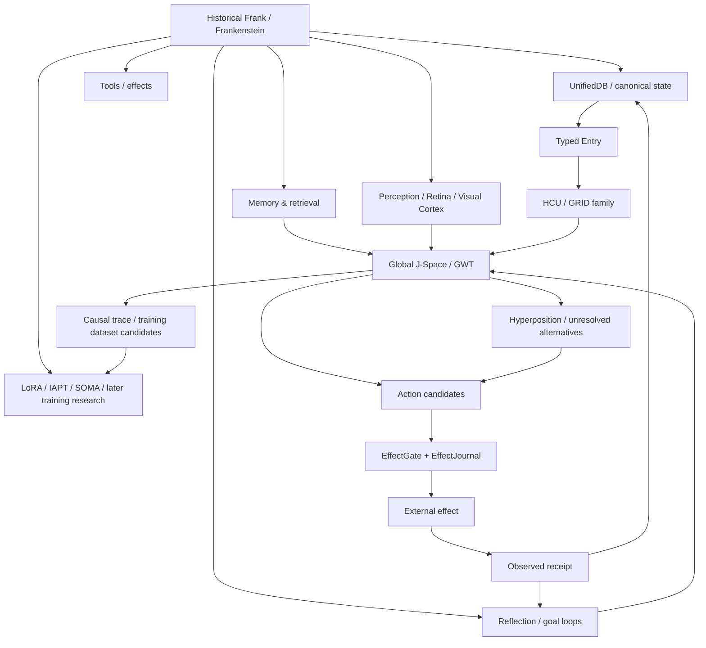

# DEV / SOURCE / RESEARCH — Project Frankenstein

This directory is the progressive-disclosure entry point for engineers and researchers. It is a **curated map over the repository**, not a replacement truth store.

Canonical current state must still be resolved from `main`, newest explicit owner authority, `research_entity/claycode/autonomous/SUPERVISOR_INBOX.json`, exact source, and exact executable receipts. Old prose and old branch summaries are evidence archives, not automatic truth.

## Evidence vocabulary

Use these labels for important claims:

| Label | Meaning |
|---|---|
| `CURRENT_SOURCE` | Present in the exact current source/authority being inspected. |
| `HISTORICAL_SOURCE` | Present in older source, commit, packet or archive; not assumed current. |
| `PROJECT_MEASUREMENT` | A project-produced measurement with stated scope/identity. |
| `EXTERNAL_PRIMARY` | Primary paper, standard, vendor or upstream documentation. |
| `INFERENCE` | Reasoned synthesis from evidence; not directly measured. |
| `OPEN_HYPOTHESIS` | Testable claim not yet closed by its declared discriminator. |
| `NEGATIVE_RESULT` | Failure, contradiction, zero-yield result, blocked gate or falsifier. |

For lifecycle/status indexing use:

`attempted · source-ready · measured · reproduced · contradicted · blocked · prepared-not-run · adopted · retired`

A source can have more than one status at different scopes. For example, a mechanism may be `source-ready` while its whole-system promotion remains `blocked`.

## Authority first

At the trigger-3 branch base (`854f6bc87780f4a5242489a6c807d186b16a8c3d`):

- persistent research entity: **Clay**;
- product: **EntityOS**;
- integrated cognition/compute architecture: **HCU**;
- programme stage: `ENTITYOS_HCU_COMPUTATIONAL_BOOTSTRAP`;
- supervisor provider epoch: **9.13 HARD_OFF**;
- external provider routes: **false / non-operative**;
- Together: **forbidden**;
- paid fallback: **forbidden**;
- local normal-user and designated `clay-direct-dev` VPS sandbox development: separately owner-authorized;
- whole EntityOS/HCU runtime credit: **0**;
- training credit: **0**.

The inbox-selected `9.13O` record is explicitly `NON_AUTHORITY_STEERING_ONLY`; it preserves provider epoch `9.13` and records that recent Frankenstein provider orchestration must remain quarantined.

Start every current-state investigation with:

1. `CLAY_EXECUTION_AUTHORITY.md`
2. `research_entity/claycode/autonomous/SUPERVISOR_INBOX.json`
3. inbox-selected steering file
4. exact current source / receipts relevant to the claim
5. current `main` SHA

`research_entity/continuity/BOOTSTRAP_MINIMAL.json` and `research_entity/rooms/PROGRAM_STATE.json` are useful but currently lag newer supervisor state and therefore must not override the inbox.

## Research map

The arrows are architecture/dependency relations, not proof that every path has full integrated runtime credit.

## Current Frankenstein packet

The active source packet is:

`research_entity/topic_packets/frankenstein-master-cognition-concept/`

Important files:

- `CONCEPT.md` — grounded first concept; explicitly distinguishes existing GRID10 mechanisms from aspirational additions and records hallucinated external suggestions that were rejected.
- `BUILD_ORCHESTRATION_PLAN_20260827.json` — 72-hour build plan; **currently non-operative where it assumes external providers/Together**.
- `frankenstein_packages_v1.py` — package/dependency decomposition and CAS-safe claiming.
- `frankenstein_orchestrator_v1.py` — Bauleiter orchestration/continuation implementation.
- `frankenstein_bugfix_v1.py` — independent watchdog and regression checkpointing; its direct provider path is quarantined under current HARD_OFF.

Commit `854f6bc87780f4a5242489a6c807d186b16a8c3d` reports 12 + 7 + 10 = **29 local tests passing** for these three Python files. Evidence scope: source/component tests only. The same commit explicitly says the backup had not completed and VPS start required later verification/personal acceptance.

## Current high-value negative evidence

### Provider boundary bypass

`CURRENT_SOURCE + NEGATIVE_RESULT`

The supervisor records that new NVIDIA/Nemotron/Mistral fallback provenance and direct-caller code still appeared after provider HARD_OFF. The required repair is at the caller boundary **before** secret lookup, provider import, network, Aider or fallback dispatch. Under HARD_OFF the executable receipt target is `provider_calls=0` and `secret_lookups=0`.

Do not “fix” this by weakening authority or changing Frank's own Harness; the current steering explicitly says `DO_NOT_MODIFY_FRANK_HARNESS` for this closure.

### Dataset conversion zero-yield

`PROJECT_MEASUREMENT + NEGATIVE_RESULT`

Last confirmed supervisor value: **0 accepted dataset tokens / 88,774 collected source tokens**. Raw Free-Swarm volume therefore receives no training credit. The useful question is conversion/evidence quality, not how many more tokens can be generated.

### Whole-system credit remains zero

`CURRENT_SOURCE`

Component measurements and tests exist, but the current supervisor keeps whole EntityOS/HCU, full HCU, Physical-GRID10, canonical semantics and training credit at zero.

### GRID10 thread recommendation falsified on measured topology

`PROJECT_MEASUREMENT + CONTRADICTED_EXTERNAL_RECOMMENDATION`

Four concurrent processes / four vCPUs:

| Torch threads/process | Result |
|---:|---|
| 1 | 8.3197 s/call mean, 12 samples |
| 2 | 23.1806 s/call mean, 12 samples |
| 4 | 0 completed samples inside experiment timeouts |

This supports `1` for that measured topology. It does not establish an architecture-independent optimum.

## UnifiedDB and Emergent Retrieval

Historical evidence is distributed across `agentZero/code/udb/`, `research_entity/trigger_runs/unifieddb/`, archive-assimilation receipts, and later EntityOS state authority.

The current synthesis is:

- **UnifiedDB** is an authority-substrate design: one canonical SQLite boundary can expose many typed stores without creating many competing truth authorities.
- **Emergent Retrieval** is a retrieval design: relevance can emerge from overlap among stored dimensions such as semantics, time, causality, goals, perception, effect history, state, confidence and provenance.
- Neither term permits information to appear without stored evidence.
- Rebuildable projections/graphs may exist, but they must not silently become a second canonical truth store.

External systems analogy only: NVIDIA CUDA Unified Memory reduces explicit CPU/GPU memory-placement and copy burden and offers coherent programming models on supported systems. That is useful intuition for reducing ownership boundaries, **not** evidence that database semantics and hardware memory coherence are the same mechanism.

## GWT / Global J-Space

The project uses GWT/Global Workspace ideas as an engineering inspiration for candidate competition and broadcast/coordination. The current Global J-Space claim is deliberately narrower:

> a measurable coordination/interface surface may provide useful causal control and training traces.

`OPEN_HYPOTHESIS` — local model-internal J-Space causality has to be demonstrated for an exact model/runtime identity using interventions such as vector perturbation, shuffle/lesion and rescue controls. Coherent text, repeated labels, model self-report or workspace recurrence are insufficient.

Relevant external primary background:

- Dehaene & Changeux, *Experimental and theoretical approaches to conscious processing*, Neuron 70(2), 2011, DOI `10.1016/j.neuron.2011.03.018`. Use as theory background, not as evidence that Frankenstein is conscious.
- Zou et al., *Representation Engineering: A Top-Down Approach to AI Transparency*, arXiv:2310.01405. Useful for population-level representation monitoring/manipulation context; it does not validate this project's exact J-Space vectors.

## Reflection and agency

Frankenstein's target is practical agency inside a human-useful operating envelope. Reflection is counted only when it closes a measurable control loop:

`state/outcome -> mismatch -> correction -> durable/retrievable update -> changed later decision -> ACT/ASK/WAIT/re-observe`

External primary comparison:

- Shinn et al., *Reflexion: Language Agents with Verbal Reinforcement Learning*, NeurIPS 2023, shows an agent design where feedback is converted into reflective text and reused in later trials. This supports reflection-as-control-loop as a legitimate engineering design family; it does not establish Frankenstein's runtime behaviour.

## SQLite/WAL and state coherence

SQLite is not magical distributed consensus. Its WAL mode provides atomic commit/rollback semantics and concurrent-reader behaviour under SQLite's documented rules. Any project claim about multi-process state must remain within those semantics and the project’s own CAS/lease layer.

Primary reference: `https://www.sqlite.org/wal.html` and `https://www.sqlite.org/lang_transaction.html`.

## Training lineage

The repository contains several training directions and historical names: LoRA, IAPT, SOMA, later J-Space/vector-control specialization, and the approximately-0.8B HCU target. Treat these as a lineage, not one uninterrupted successful training programme.

Current promotion law:

1. exact model/checkpoint/tokenizer/runtime identity;
2. loader-consumption identity where claimed;
3. causal J-Space/control traces;
4. family-level leak-resistant split;
5. deterministic hard negatives;
6. frozen baseline;
7. intervention + lesion/rescue tests;
8. off-target regressions;
9. only then training promotion.

Completed training alone is not PASS.

## Archive synthesis

The machine-readable starting index is:

- [`research/FRANKENSTEIN_ARCHIVE_INDEX.json`](research/FRANKENSTEIN_ARCHIVE_INDEX.json)

The narrative evidence chronology is:

- [`research/FRANKENSTEIN_EVIDENCE_CHRONICLE.md`](research/FRANKENSTEIN_EVIDENCE_CHRONICLE.md)

Repository-root migration is intentionally staged rather than destructive:

- [`repository/ROOT_TOPOLOGY_MIGRATION.md`](repository/ROOT_TOPOLOGY_MIGRATION.md)

## Research rule of thumb

For every exciting architecture claim, write down a serious alternative explanation and one discriminator.

Examples:

- **Claim:** J-Space vector steers semantics.  
  **Counter:** output changed because prompt/label leakage correlated with the vector.  
  **Discriminator:** label-free, disjoint, counterbalanced internal-state intervention plus shuffle/lesion/rescue.

- **Claim:** reflection improves agency.  
  **Counter:** extra tokens/context alone improve performance.  
  **Discriminator:** matched-token control with reflection content shuffled or replaced.

- **Claim:** UnifiedDB improves retrieval.  
  **Counter:** gains come only from a new embedding/model or recency heuristic.  
  **Discriminator:** ablation by evidence dimension under fixed corpus/model/query set.

- **Claim:** HCU/GRID coordination improves throughput or cognition.  
  **Counter:** apparent improvement is process scheduling, caching or duplicated work.  
  **Discriminator:** matched workload with exact process/thread/memory/accounting and causal task identities.

The archive is most valuable when failed discriminators remain findable.
