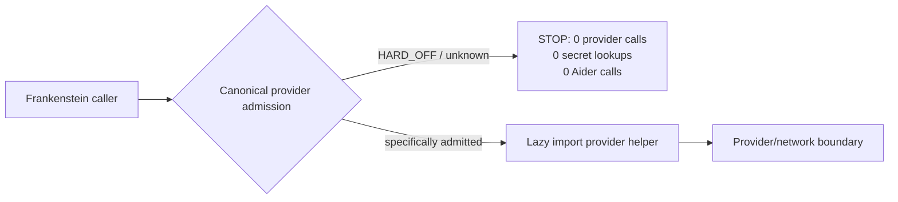
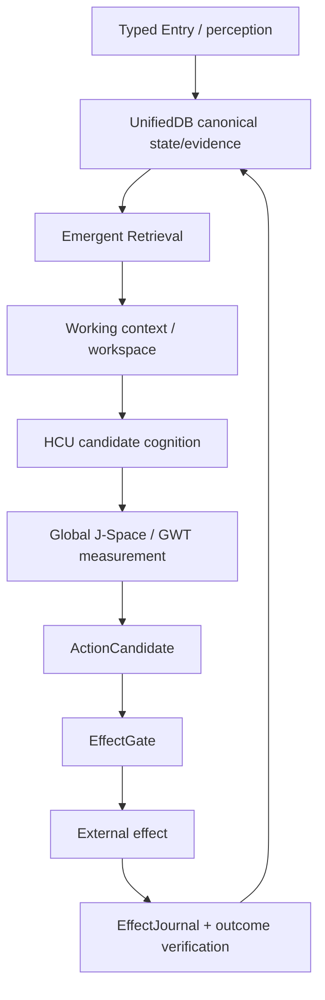

# Frankenstein developer / research index

This is a progressive-disclosure index, not a replacement truth store.

## Re-entry identity for this curation pass

- Trigger: `triggerword 3`
- Base canonical `main` observed before this pass: `854f6bc87780f4a5242489a6c807d186b16a8c3d`
- Curation branch: `trigger3-frankenstein-hardoff-20260827-2350`
- Product/system identity: **EntityOS**
- Integrated cognition/compute architecture: **HCU**
- Persistent research entity: **Clay**; temporary workers are organs, not new entities.

### Evidence labels used here

`CURRENT_SOURCE` · `HISTORICAL_SOURCE` · `PROJECT_MEASUREMENT` · `EXTERNAL_PRIMARY` · `INFERENCE` · `OPEN_HYPOTHESIS` · `NEGATIVE_RESULT`

No label is decorative. Source-ready is not runtime-observed; a component PASS is not a whole-product PASS.

## 1. Authority before architecture

| Claim | Status | Exact source / boundary |
|---|---|---|
| Canonical repo `main` at start of this pass was `854f6bc…` | CURRENT_SOURCE | GitHub `main` branch head observed before writes |
| Current owner execution pointer allows broad work inside the designated `clay-direct-dev` VPS sandbox, while external provider spending/effects remain separate | CURRENT_SOURCE | `../CLAY_EXECUTION_AUTHORITY.md` |
| Autonomous provider routes are HARD_OFF; Groq, Mistral, NVIDIA and OpenRouter all `admitted:false`; Together forbidden | CURRENT_SOURCE | `../research_entity/claycode/autonomous/FREE_PROVIDER_ADMISSION.json` |
| Current supervisor inbox is 9.13O and calls the provider-calling 72h Frankenstein orchestration non-operative under HARD_OFF | CURRENT_SOURCE | `../research_entity/claycode/autonomous/SUPERVISOR_INBOX.json` |
| 9.13O requires the external caller boundary to fail before secret lookup, provider import, network or Aider | CURRENT_SOURCE | `../research_entity/claycode/autonomous/SUPERVISOR_STEERING_9_13O_DELTA_2026-08-27T2341P0700_GPT56SOL.json` |
| Whole EntityOS/HCU, full HCU, canonical semantics and training credit remain zero | CURRENT_SOURCE | current supervisor inbox / steering promotion state |

The older 8.63 bootstrap remains useful provenance, but it is not current authority.

## 2. Current Frankenstein packet

Primary packet:

- `../research_entity/topic_packets/frankenstein-master-cognition-concept/CONCEPT.md`
- `../research_entity/topic_packets/frankenstein-master-cognition-concept/BUILD_ORCHESTRATION_PLAN_20260827.json`
- `../research_entity/topic_packets/frankenstein-master-cognition-concept/frankenstein_packages_v1.py`
- `../research_entity/topic_packets/frankenstein-master-cognition-concept/frankenstein_orchestrator_v1.py`
- `../research_entity/topic_packets/frankenstein-master-cognition-concept/frankenstein_bugfix_v1.py`

### Important conflict resolved by this branch

`BUILD_ORCHESTRATION_PLAN_20260827.json` contains a historical/local plan statement that exactly one Together training run remains available and that the 72h controller should use NVIDIA/Groq/Mistral free-pool routes. That text is **not execution authority** under current 9.13 HARD_OFF.

The original v1 caller code imported `~/last-resort/llm.py` at module import and could reach provider/Aider paths without first resolving current canonical admission. `NEGATIVE_RESULT`: this is the concrete caller-boundary bypass identified by 9.13O.

This branch changes the external Frankenstein callers, not Frank's Harness:



For `harness_aider.py fallback-start`, the caller cannot safely prove which downstream free-pool tier will be selected without modifying Frank's Harness. Therefore the branch fails closed on partial admission rather than silently widening a capability.

## 3. State → memory → decision → effect → verification

The architecture claim is not “the model is the system.” The model/HCU produces candidates and measurements; durable state/evidence and real effects have separate deterministic authority.



### UnifiedDB

`CURRENT_SOURCE/HISTORICAL_SOURCE`: the project converged away from fragmented multi-DB/multi-service state toward one canonical SQLite authority substrate. “One database” means one authority boundary, not one untyped table. Typed tables, journals, indexes, views, readers/writers and rebuildable projections can coexist; high-rate transient sensor state may remain in RAM.

### Emergent Retrieval

Project term: relevance that emerges when independently stored evidence dimensions overlap at query time — semantic similarity, time, causal lineage, current state, goals, perception, effects, confidence and provenance. `INFERENCE`: this can reduce the need for brittle single-key retrieval, but it cannot create evidence absent from the stored substrate.

## 4. Workspace / GWT / Global J-Space

`OPEN_HYPOTHESIS`: Global J-Space is a model-specific causal coordination interface. It borrows the broad computational idea of limited workspace + global availability/broadcast from Global Workspace / Global Neuronal Workspace literature, but the neuroscience literature is an analogy/source of testable design ideas, not proof that EntityOS implements a biological workspace.

Useful external primary/review anchors:

- Dehaene/Changeux et al., *Conscious Processing and the Global Neuronal Workspace Hypothesis*: https://pmc.ncbi.nlm.nih.gov/articles/PMC8770991/
- Dehaene et al., *A neuronal model of a global workspace in effortful cognitive tasks*: https://pmc.ncbi.nlm.nih.gov/articles/PMC24407/

Project falsifier: if shuffle/lesion/rescue or vector-control intervention cannot alter downstream behavior in a reproducible model-specific way beyond prompt/schema confounds, the claimed causal J-Space interface is not established.

## 5. Reflection with an exit

`OPEN_HYPOTHESIS`: useful reflective agency benefits from an external substrate rich enough to preserve state, outcome evidence, memory, perception, arbitration and effect receipts.

`EXTERNAL_PRIMARY`: Reflexion demonstrates that episodic verbal feedback can improve later language-agent behavior without weight updates (Shinn et al., 2023): https://arxiv.org/abs/2303.11366

Project distinction: Frankenstein reflection is not defined as “write a critique.” A valid control loop must eventually terminate into ACT / ASK / WAIT / re-observe / another measurable transition. Recursive reflection without a transition is rumination/fixation and is treated as a failure mode.

Falsifier: if a reflection subsystem does not improve preregistered task success/error recovery against an equal-token non-reflective baseline, or mainly increases latency/repetition, its claimed utility is rejected for that workload.

## 6. GRF / Hyperposition / state

### GRF

GRF belongs to the historical mathematical/engineering lineage and should be reconstructed from exact repository source/commits rather than from remembered prose. Do not assign a creation date unless Git history supports it; use “first verified in accessible Git” when that is all the evidence provides.

### Hyperposition

Project engineering meaning: keep unresolved alternatives live rather than collapsing them by majority or narrative confidence. Competing candidates remain candidates until an evidence-bearing discriminator closes them.

`OPEN_HYPOTHESIS`: preserving structured alternatives can improve decision quality when evidence is incomplete. Falsifier: matched tasks where Hyperposition adds cost but produces no calibrated improvement in error rate, uncertainty quality or recovery should count against it.

## 7. HCU / GRID and measured counterexamples

`PROJECT_MEASUREMENT`: current 9.13O records a GRID10 thread-count A/B on four concurrent processes / four vCPUs:

- 1 torch thread/process: mean `8.3197 s/call` over 12 samples;
- 2 threads/process: mean `23.1806 s/call` over 12 samples;
- 4 threads/process: zero completed samples within experiment timeouts.

This falsified the recommendation that two threads/process would be faster on that topology. It supports the existing default of one only for the measured topology.

`EXTERNAL_PRIMARY`: current PyTorch multiprocessing guidance warns about CPU oversubscription and gives `floor(vCPUs/processes)` as a maximum thread guideline: https://docs.pytorch.org/docs/stable/notes/multiprocessing.html

No logical GRID cell count is evidence of equal resident-model count or equal physical decode concurrency.

## 8. SQLite/WAL evidence boundary

`EXTERNAL_PRIMARY`: SQLite WAL allows readers and a writer to operate with different concurrency behavior than rollback journaling and introduces checkpointing as a separate operation: https://www.sqlite.org/wal.html

Important 2026 operational note from SQLite's own documentation: a WAL-reset corruption bug affected versions through 3.51.2 and was fixed in 3.51.3 (with some backports). Any claim of robust concurrent WAL behavior should record the exact SQLite library version used in executable evidence.

This external fact constrains project runtime validation; it does not itself prove UnifiedDB correctness.

## 9. NVIDIA Unified Memory is analogy, not semantics

`EXTERNAL_PRIMARY`: CUDA Unified Memory provides a coherent address-space abstraction and system-managed data placement/migration across processors: https://docs.nvidia.com/cuda/cuda-programming-guide/

Project use is analogy only: reducing ownership/copy boundaries can simplify a compute system. Hardware address-space coherence is not database semantics, causal provenance, effect authority, or evidence admission.

## 10. Training lineage / evidence law

Current training promotion remains fail-closed.

A training job existing or completing is not PASS. Required evidence includes exact checkpoint/tokenizer/runtime/build identity, leak-resistant family-level splits, causal trace binding, deterministic hard negatives, frozen baselines, intended-behavior gains and off-target regression checks.

Current supervisor state explicitly records `canonical_dataset_rows_admitted: 0` and `training_credit: 0`.

Historical Together runs are evidence/provenance only under current HARD_OFF; they do not create new run authority.

## 11. Failure → engineering move map

| Failure / negative result | Engineering response |
|---|---|
| fragmented state ownership | converge toward one canonical UnifiedDB authority substrate |
| request mistaken for effect | deterministic EffectGate + EffectJournal boundary |
| recursive self-reflection / fixation | reflection must terminate into measurable transition |
| prompt/context contamination | stronger typed state/provenance and causal controls |
| model consensus mistaken for evidence | executable evidence outranks same-pipeline consensus |
| provider/rate-limit/auth failures conflated with science | classify transport/authority failure separately from product logic |
| provider HARD_OFF bypass in Frankenstein caller | caller-level admission before secret lookup/import/network/Aider |
| CPU thread intuition wrong on GRID10 topology | matched executable A/B; retain measured default=1 |
| component PASS inflated to whole system | scope every receipt and keep whole EntityOS/HCU credit at zero until integrated acceptance |

## 12. Repository topology status

At base SHA `854f6bc…`, root still contained substantial technical clutter and the target entry directories `HUMAN_READ_THIS/`, `DEV_SOURCE_RESEARCH/`, and `AI_START_HERE_DO_NOT_SCAN_REPO/` were absent. This branch seeds those three layers additively.

It deliberately does **not** rewrite root `README.md`, and it does not mass-move root files while `main` is rapidly active and unprotected. The eventual topology target remains:

```text
README.md
HUMAN_READ_THIS/
DEV_SOURCE_RESEARCH/
AI_START_HERE_DO_NOT_SCAN_REPO/
```

with technical material moved below `DEV_SOURCE_RESEARCH/repository/` only through a path-preserving migration plan that explicitly handles links, scripts, imports, CI and evidence reproducibility.

## 13. Current acceptance map

| Area | Classification |
|---|---|
| Frankenstein concept packet | SOURCE_READY / RESEARCH_PACKET |
| package dispenser | SOURCE_READY; prior commit reports tests, independent current branch execution still required |
| Bauleiter provider/Aider caller gate in this branch | SOURCE_READY, TESTS_ADDED, RUNTIME_PENDING |
| Bugfix provider caller gate in this branch | SOURCE_READY, TESTS_ADDED, RUNTIME_PENDING |
| 72h autonomous provider orchestration | BLOCKED / NON_OPERATIVE under 9.13 HARD_OFF |
| Together training allowance in old plan | RETIRED_AS_CURRENT_AUTHORITY / HISTORICAL_PROVENANCE_ONLY |
| Global J-Space causal claim | OPEN_HYPOTHESIS |
| full HCU runtime | NOT_PASS / zero current credit |
| whole EntityOS runtime | NOT_PASS / zero current credit |
| training | zero current credit |

The next promotion gate for this branch is an independent clean checkout executing the existing Frankenstein tests plus `tests/test_frankenstein_provider_hardoff_gate_v1.py`, with exact HEAD/tree/dirty=false and captured stdout/stderr. Under current 9.13 HARD_OFF the key acceptance statement is: **provider_calls=0, secret_lookups=0, Aider calls=0 before any provider boundary**.
