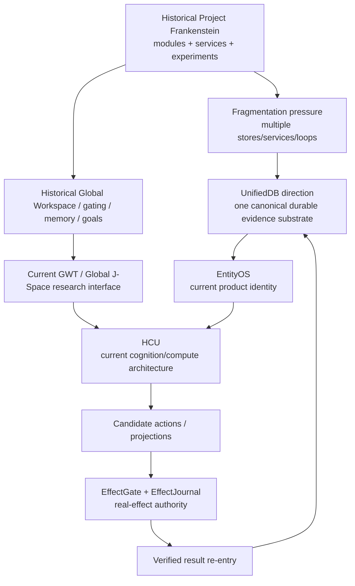
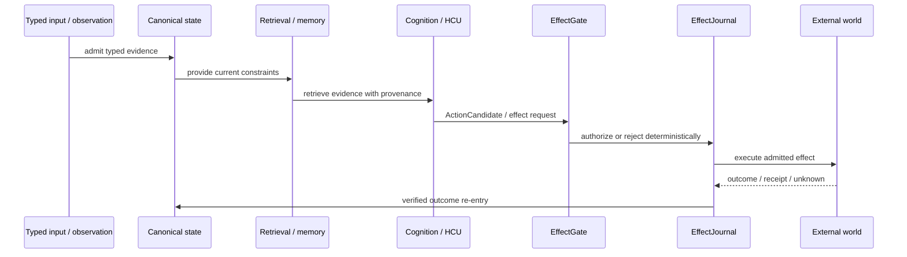

# Project Frankenstein — Developer & Research Chronicle

This is the technical entry point for Triggerword 3 curation. It is a **map of evidence and lineage**, not a replacement truth store. Current authority, exact executable receipts, and exact source identity outrank this prose.

## Evidence vocabulary

| Label | Meaning |
|---|---|
| `CURRENT_SOURCE` | current canonical source/authority at the referenced identity |
| `HISTORICAL_SOURCE` | source that existed in the reconstructed historical lineage |
| `PROJECT_MEASUREMENT` | measured project result with a bounded scope |
| `EXTERNAL_PRIMARY` | primary paper/spec/vendor documentation used as background or analogy |
| `INFERENCE` | reasoned synthesis not directly measured |
| `OPEN_HYPOTHESIS` | proposed mechanism awaiting a discriminator |
| `NEGATIVE_RESULT` | failed, contradicted, blocked, zero-credit, or explicitly non-operative result |

Additional lifecycle states used in the evidence ledger: `attempted`, `source-ready`, `measured`, `reproduced`, `contradicted`, `blocked`, `prepared-not-run`, `adopted`, `retired`.

## Current authority before architecture

At branch base `854f6bc87780f4a5242489a6c807d186b16a8c3d`, the newest supervisor inbox is schema `9.13`, delta `9.13O_NON_AUTHORITY`, with **HARD_OFF** external-provider authority. It says:

- all provider routes are currently not admitted;
- Together is forbidden and remaining paid-run authorization is zero;
- runtime quiescence must precede any future provider execution;
- the freshly committed Frankenstein 72h Bauleiter/Bugfixer provider loops are quarantined and non-operative;
- post-HARD_OFF provider-authored core changes need independent clean non-provider review and re-execution before runtime credit;
- whole EntityOS/HCU, full HCU, physical GRID10, canonical semantics, and training credit remain zero.

**Consequence:** source presence is preserved, but no documentation in this layer may describe those loops as an authorized autonomous runtime.

## Architecture lineage in one picture



The transition is not “old system bad, new system good.” It is a sequence of engineering responses to observed integration pressure, state fragmentation, ambiguous authority, recursive control loops, unreliable external execution, and evidence inflation.

## Historical Project-Frankenstein reconstruction

`PROJECT_FRANKENSTEIN_LEVEL0_SCOPE_LAW.json` freezes an accessible Git-history denominator from `e1a8812767668091d146ee958bbc2ebb2743031c` through `abba90a5767d85abc8a1ac340bae92842dab35c1`: 1 inclusive base + 544 verified descendants = **545 commit obligations**.

That closes only the scope-boundary ambiguity. The broader archive manifest remains `PARTIAL_NOT_FROZEN`; exact full tree and complete semantic history reconstruction are not yet credited.

Deep-read historical units recorded by the archive include:

| Area | Historical paths / evidence |
|---|---|
| Workspace / broadcast | `services/global_workspace.py` |
| Persistent cognition loops | `services/consciousness_daemon.py` |
| Personality / state | `personality/e_pq.py` |
| Perceptual gating | `services/thalamus.py` |
| Memory / claims / graph / retrieval | `tools/lcme/lcme_core.py` |
| Reward / motivation | `services/nucleus_accumbens.py` |
| Actor-critic / idle policy | `services/subconscious.py` |
| Persistent world/body state | `services/spatial_state.py` |
| Replay / consolidation | `services/dream_daemon.py` |
| Goals / projects / strategies | `services/project_engine.py` |
| Hypothesis lifecycle | `services/hypothesis_engine/service.py` |
| Experiments | `services/experiment_lab.py` |
| Training | `services/soma/micro_trainer.py`, `papers/IAPT_METHOD.md` |
| Vision lineage | `tools/frank_adaptive_vision.py` → `tools/frank_eye.py` → `tools/native_vision.py` |

These are `HISTORICAL_SOURCE` obligations. A file existing is not proof that the corresponding capability was integrated, stable, or causally effective across the whole historical system.

## State → memory → decision → effect → verification

This is the most durable architectural thread:



Failure to preserve any arrow produces a characteristic research error:

- missing typed admission → interpretation silently becomes fact;
- missing provenance → memory becomes indistinguishable from observation;
- model output directly changes state → cognition becomes a second authority;
- no effect receipt → request is confused with effect;
- no verified re-entry → the system cannot learn whether its action actually worked.

## UnifiedDB and Emergent Retrieval

### UnifiedDB

The project direction is one canonical SQLite-based durable substrate with many typed internal structures. This reduces ownership and reconciliation boundaries without requiring every transient signal to be written to one table or one file format.

Repository evidence for the retrieval line includes:

- `research_entity/harness/reference/unifieddb_emergent_cascade.py`
- `research_entity/harness/reference/benchmark_unifieddb_emergent_cascade.py`
- `research_entity/harness/reference/benchmark_unifieddb_emergent_assembly.py`
- `research_entity/knowledge_micro_packets/unifieddb/...`
- `research_entity/unifieddb/receipts/...`

### Emergent Retrieval

Project definition: relevance emerges when independently recorded dimensions overlap at query time. Candidate dimensions include semantic similarity, causal lineage, time, state, goals, perception, effects, confidence, and provenance.

`OPEN_HYPOTHESIS`: multi-dimensional overlap can outperform isolated semantic top-k retrieval for decision-relevant recall.

**Falsifier:** on a preregistered query family with leakage-controlled relevance labels, a multi-dimensional retrieval policy fails to beat a semantic-only baseline on decision-relevant precision/recall or downstream task success after accounting for added latency/complexity.

**Engineering confidence:** `0.66` — plausible and source-supported as a design direction, but this Triggerword 3 pass does not establish a current integrated runtime win.

### Important current external SQLite risk

SQLite's official WAL documentation now records a rare **WAL-reset bug** affecting versions through 3.51.2, fixed in 3.51.3 (and selected backports), under a concurrent multi-connection write/checkpoint race. Because current Frankenstein/GRID10 concepts explicitly use SQLite/WAL, any release-grade runtime claim should record the exact SQLite library version and reject vulnerable configurations when the measured topology can hit the affected pattern.

This is `EXTERNAL_PRIMARY` risk information, not evidence that the project has encountered the bug.

## Reflection with an exit

The engineering interpretation of self-reflection is:

```text
observe outcome
  -> compare against goal / expectation
  -> detect mismatch
  -> retrieve prior corrections
  -> propose bounded correction
  -> ACT | ASK | WAIT | RE-OBSERVE
```

`OPEN_HYPOTHESIS`: useful reflective agency requires enough external substrate — durable state, memory, perception, arbitration, effect receipts, and verified outcome re-entry — that reflection can change later behavior without relying on an ever-growing prompt.

**Counterhypothesis:** most observed benefit may come from ordinary retrieval + deterministic control + better prompting; an explicit “reflection” subsystem may add latency and fixation without unique causal value.

**Falsifier:** matched tasks in which the explicit reflection path is lesioned show no degradation after controlling for retrieved evidence, token budget, and action opportunities.

**Engineering confidence:** `0.59`.

## GWT / Global J-Space / GRF / Hyperposition

### Historical and external lineage

Historical Frankenstein contains a `global_workspace.py` broadcast bus / salience mechanism. External Global Workspace Theory is a cognitive-neuroscience framework; Baars describes a global-workspace/blackboard architecture in which distributed knowledge sources cooperate. This is background, not project runtime evidence.

### Current project research surfaces

- `research_entity/00_CURRENT/latest/hyperposition-gwt-grf.md`
- `research_entity/00_CURRENT/latest/hyperposition-gwt-grf.json`
- `research_entity/claycode/HCU_JSPACE_MODEL_INPUT_CONTROL_CAUSALITY_GATE_V1.md`
- `research_entity/claycode/HCU_JSPACE_OBSERVE_CONTROL_TRANSLATE_ARCHITECTURE_V1.md`
- `research_entity/global/j-space/...`
- `research_entity/trigger_runs/hyperposition/...`

Current authority treats Global J-Space/GWT as an **empirical causal coordination/interface hypothesis**, not automatically as observed hidden-state truth.

`OPEN_HYPOTHESIS`: a controlled shared J-Space signal can causally coordinate multiple bounded HCU functions and alter target-model behavior in a reproducible way that survives label removal and matched controls.

**Counterhypothesis:** observed behavior is caused by prompt/schema recurrence, lexical leakage, ordinary context conditioning, or shared preprocessing rather than an internal vector-control interface.

**Falsifier:** label-free, counterbalanced, disjoint internal-state interventions plus shuffle/lesion/rescue controls fail to show a stable effect tied to the intended vector channel.

**Engineering confidence:** `0.44` until exact model-specific causal runtime evidence is admitted.

### Hyperposition

Project use: preserve unresolved alternatives rather than collapsing uncertainty because one candidate recurs more often. Hyperposition is a control/evidence discipline; recurrence or majority cannot mint truth.

`OPEN_HYPOTHESIS`: retaining structured competing candidates until an evidence-bearing discriminator arrives improves complex planning/research accuracy relative to early single-hypothesis commitment.

**Falsifier:** across matched tasks, preserved alternatives do not improve final decision accuracy/calibration and only increase latency/compute.

**Engineering confidence:** `0.62` as a research-control principle; lower for any stronger model-internal claim.

### GRF

GRF has a substantial internal mathematical/ClayCode lineage, including the current snapshot paths and HyperMath/GRF proof-carrying IR experiments. This curation pass indexes those surfaces but does not collapse multiple historical GRF formulations into one invented canonical equation.

That reconciliation remains an evidence task: identify the newest admitted definition, map predecessor equations to it, and explicitly mark incompatible formulations retired or historical.

## ClayCode

Relevant current surfaces include:

- `CLAYCODE_GENERAL_PURPOSE_COMPILER_MANIFEST.json`
- `research_entity/global/CLAYCODE_GENERAL_PURPOSE_COMPILER_ACCEPTANCE_CONTRACT.md`
- `research_entity/triggers/CLAYCODE_GENERAL_PURPOSE_COMPILER_ADDENDUM.md`
- `tools/claycode_base_release_audit.py`
- `tools/claycode_base_wp14_strict_audit.py`

Current supervisor evidence says the BASE release has WP01/WP02 pass while WP03–WP14 and general-purpose/release gates remain open. Therefore:

> `source-ready` or a green sub-work-package is not equivalent to `general-purpose compiler released`.

## HCU / GRID / Xeno

Current naming law:

- **EntityOS** = sole current product/system identity.
- **HCU** = sole current integrated cognition/compute architecture.
- **Xeno** = transitional implementation compatibility codename only.
- **XCU** = transitional/research alias for HCU only.

HCU logical cells are functional slots, not independent persistent agents. Logical cell count must not be reported as resident-model count or physical decode concurrency.

GRID10 is the canonical 10-cell logical baseline. The larger 10→32→64→128→256→~600 ladder is a benchmark ladder/hypothesis until exact scale evidence exists.

### Current 2026-08-27 diagnostics

The supervisor records a matched GRID10 thread-count A/B on 4 concurrent processes / 4 vCPUs:

- 1 thread/process: mean `8.3197 s/call`
- 2 threads/process: mean `23.1806 s/call`
- 4 threads/process: zero completed samples within experiment timeouts

`PROJECT_MEASUREMENT`: this supports the existing default of one thread **for that measured topology**.

`NEGATIVE_RESULT`: it falsifies the external recommendation that two threads/process would improve latency on that topology.

It does **not** promote physical GRID10, canonical semantics, BASE, or Whole-HCU.

## Training lineage: LoRA / IAPT / SOMA → current J-Space specialization research

Historical Frankenstein contains training source and methodology (`services/soma/micro_trainer.py`, `papers/IAPT_METHOD.md`). Current research adds J-Space/vector-control curricula and approximately-0.8B specialization work, including:

- `research_entity/global/j-space/research/2026-08-25_FORSCHUNGSRUN_2_QWEN35_08B_ENTITYOS_HCU_TRAINING_CURRICULUM_GPT56SOL.json`
- HCU J-Space causality and translate architecture documents
- Trigger-2 semantic-Hyperposition labelers / seed generation tools

Current authority is explicit: **training credit = 0**. A completed or historical training run does not establish current HCU/J-Space behavior. Provider execution is HARD_OFF.

A valid future promotion needs at least: exact checkpoint/tokenizer/runtime/build identity, leak-resistant family splits, hard negatives, frozen baselines, causal controls, retention checks, and admitted execution authority.

## Failure → engineering move chronology

| Failure / pressure | Evidence status | Engineering move it motivated |
|---|---|---|
| Multi-service / multi-store state fragmentation | `HISTORICAL_SOURCE` + `INFERENCE` | converge durable authority toward UnifiedDB |
| Rumination / fixation / recursive self-reflection | `HISTORICAL_SOURCE` / research concern | require reflection exit into measurable transition |
| Prompt vs weight / label-binding ambiguity | `PROJECT_MEASUREMENT` lineage / open causal question | train/measure explicit internal interface; require label-free controls |
| Context contamination / semantic leakage | `NEGATIVE_RESULT` class | family-level splits, hard negatives, disjoint/counterbalanced tests |
| Request treated as effect | evidence-law failure mode | EffectGate + EffectJournal + verified re-entry |
| Model consensus treated as evidence | repeated research anti-pattern | executable evidence outranks consensus |
| FreeSwarm token volume with zero training conversion | `NEGATIVE_RESULT` | measure Forge→Distillery acceptance funnel, not tokens generated |
| Provider routes continued after HARD_OFF | `NEGATIVE_RESULT`, current P0 | gate before secret lookup/import/network; quarantine provider-authored core changes |
| External recommendation: 2 torch threads/process | `CONTRADICTED` on 4proc/4vCPU | keep measured default=1 for that topology |
| RAM “win” inferred from private dirty only | `NEGATIVE_RESULT` boundary | require RSS/PSS/full smaps + host-level accounting |
| Giant 72h provider orchestration | `prepared-not-run`, now `blocked/quarantined` | redesign future orchestration around current authority gate and small dependency packages |

## Research archive, not truth oracle

The `clay-global-research-entity` repository contains source, hypotheses, receipts, summaries, generated proposals, negative results, stale authorities, provider-generated material, and partial reconstructions. Search hits are **candidates**. Promotion requires checking:

1. authority epoch;
2. exact source identity;
3. whether the evidence is source-only or executable;
4. whether the runtime result matches the claim scope;
5. whether a repeated result is genuinely independent;
6. whether a newer contradiction exists.

## Root-topology work

Triggerword 3 targets a public root containing only:

```text
README.md
HUMAN_READ_THIS/
DEV_SOURCE_RESEARCH/
AI_START_HERE_DO_NOT_SCAN_REPO/
```

That target is **not yet achieved**. The current root contains many legacy/current technical files and directories. Moving them blindly could break imports, workflows, relative links, scripts, and historical reproducibility. This branch therefore creates the public layers first and includes a migration protocol under `repository/ROOT_MIGRATION_PLAN.md` before any destructive relocation.

The root `README.md` is intentionally untouched, per Triggerword 3 law.

## Primary external references

- `EXTERNAL_PRIMARY` — Bernard J. Baars (2005), *Global workspace theory of consciousness: toward a cognitive neuroscience of human experience*. DOI `10.1016/S0079-6123(05)50004-9`.
- `EXTERNAL_PRIMARY` — SQLite, *Write-Ahead Logging*: `https://www.sqlite.org/wal.html`.
- `EXTERNAL_PRIMARY` — NVIDIA, CUDA Programming Guide, *Unified Memory*: `https://docs.nvidia.com/cuda/cuda-programming-guide/04-special-topics/unified-memory.html`.

NVIDIA Unified Memory is used only as a **systems analogy** for reducing explicit ownership/copy boundaries across compute domains. Hardware memory coherence is not database semantics and is not evidence for cognition.

## Machine-readable evidence map

See [`repository/TRIGGERWORD3_EVIDENCE_LEDGER_20260827.json`](repository/TRIGGERWORD3_EVIDENCE_LEDGER_20260827.json).
