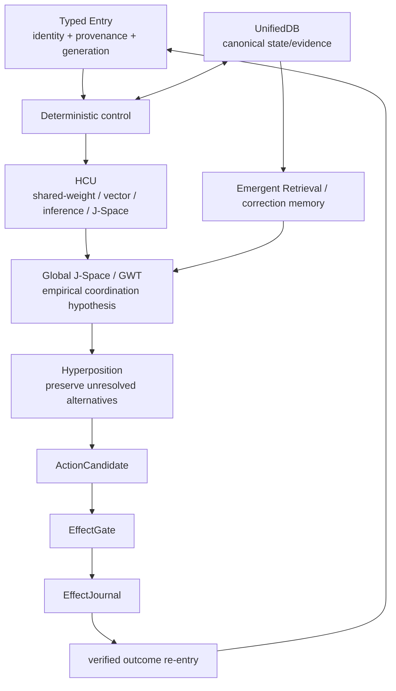

# DEV_SOURCE_RESEARCH — progressive technical index

This directory is the technical/research route for Project Frankenstein → **EntityOS + HCU**. It is an index over evidence, not a second authority.

## Frozen fusion point

This Triggerword-3 curation re-entered parallel `main` and fused through:

`ed70385760c03a30dea7b6ecf8f6b78cbbaa584a`

That head includes the current Human/Dev curation lane, a Project-Frankenstein source-identity history anchor, and a source/local-unit HARD_OFF caller closure. The selected supervisor inbox remains schema `9.13` / steering `9.13O_NON_AUTHORITY`; it has not promoted provider-path runtime credit. Re-resolve current `main` and authority before live execution decisions.

## 0. Authority first

After this public-root transformation, current technical source is preserved below [`repository/`](repository/). Read in this order before present-tense runtime claims:

1. [`repository/CLAY_EXECUTION_AUTHORITY.md`](repository/CLAY_EXECUTION_AUTHORITY.md)
2. [`repository/research_entity/claycode/autonomous/SUPERVISOR_INBOX.json`](repository/research_entity/claycode/autonomous/SUPERVISOR_INBOX.json)
3. the exact steering selected by the inbox
4. [`repository/research_entity/continuity/BOOTSTRAP_MINIMAL.json`](repository/research_entity/continuity/BOOTSTRAP_MINIMAL.json) and [`repository/research_entity/rooms/PROGRAM_STATE.json`](repository/research_entity/rooms/PROGRAM_STATE.json)
5. exact source/tests/receipts at the identity relevant to the claim.

Do not average authority conflicts. Current explicit authority outranks stale caches; exact executable evidence outranks narrative claims.

## 1. Evidence vocabulary

| Label | Meaning |
|---|---|
| `CURRENT_SOURCE` | Exact source observed at the current/frozen identity. |
| `HISTORICAL_SOURCE` | Retained lineage, not current authority. |
| `PROJECT_MEASUREMENT` | Observed project measurement with bounded scope. |
| `EXTERNAL_PRIMARY` | Original paper/spec/vendor-primary documentation. |
| `INFERENCE` | Conclusion drawn from observations. |
| `OPEN_HYPOTHESIS` | Candidate mechanism with an explicit falsifier. |
| `NEGATIVE_RESULT` | Failure/blocker/contradiction worth preserving. |

Lifecycle qualifiers: `attempted`, `source-ready`, `measured`, `reproduced`, `contradicted`, `blocked`, `prepared-not-run`, `adopted`, `retired`.

`SOURCE_READY != RUNTIME_VERIFIED`. Component PASS never implies whole-product PASS. Model output does not create world facts.

## 2. Current Frankenstein control boundary

The first 2026-08-27 Bauleiter/Bugfix implementation at `854f6bc87780...` directly loaded provider machinery and could dispatch NVIDIA/Groq/Mistral/fallback work despite canonical `9.13 HARD_OFF`; its plan also retained a stale Together allowance.

Parallel Trigger-3 work on `main` then:

- preserved the provider-backed orchestrator, bugfixer, and plan as quarantined donor provenance;
- replaced supported entrypoints with stdlib-only authority gates that refuse before provider import, secret lookup, network, Aider, or donor execution;
- removed the canonical Together allowance under current HARD_OFF;
- reported `10/10` focused local gate tests PASS plus Python compile PASS;
- explicitly scoped that evidence to `SOURCE_AND_LOCAL_UNIT_ONLY` and retained all provider/HCU/J-Space/training/whole-product credits at zero.

See:

- [`repository/research_entity/topic_packets/frankenstein-master-cognition-concept/TRIGGERWORD3_HARD_OFF_CLOSURE_20260827_GPT56SOL.json`](repository/research_entity/topic_packets/frankenstein-master-cognition-concept/TRIGGERWORD3_HARD_OFF_CLOSURE_20260827_GPT56SOL.json)
- [`repository/research_entity/topic_packets/frankenstein-master-cognition-concept/frankenstein_authority_gate_v1.py`](repository/research_entity/topic_packets/frankenstein-master-cognition-concept/frankenstein_authority_gate_v1.py)
- [`repository/tests/test_frankenstein_provider_hardoff_gate_v1.py`](repository/tests/test_frankenstein_provider_hardoff_gate_v1.py)

**Important asynchrony:** the current `SUPERVISOR_INBOX.json` still describes the pre-closure caller boundary as P0 open. The new closure is later exact source/local-unit evidence, not a new supervisor promotion. Therefore the correct state is: **source/local gate closed; provider-path runtime acceptance still zero/unpromoted.**

## 3. Repository topology

The public root of this curation candidate is exactly:

```text
README.md
HUMAN_READ_THIS/
DEV_SOURCE_RESEARCH/
AI_START_HERE_DO_NOT_SCAN_REPO/
```

The root `README.md` is byte-identical to `main` at the fusion point (`blob 4d39dbfaeace5843d4bfc6901e3ea3d8b566ec84`). Technical root material from `ed703857…` is preserved through existing Git blob/tree identities below [`repository/`](repository/).

This preserves bytes, **not path behavior**. `.github/`, imports, scripts, relative file opens, installers, and workflow discovery are path-sensitive. See [`ROOT_TOPOLOGY_MIGRATION.md`](ROOT_TOPOLOGY_MIGRATION.md). This is why the PR remains a draft/reference topology rather than an executable-path promotion.

## 4. Historical Project-Frankenstein identity

The newest history anchor at the fusion point records:

- source repository `gschaidergabriel/Project-Frankenstein`;
- default-branch head `abba90a5767d85abc8a1ac340bae92842dab35c1`;
- exact root-tree Merkle anchor `ec21e66c4672fde1f0a5d948ebc51457b69b620a`;
- 545 commits reachable through the observed default-branch commit listing;
- oldest reachable commit `e1a8812767668091d146ee958bbc2ebb2743031c`, parentless in that listing;
- recursive path inventory **not claimed complete**.

See [`repository/research_entity/archive_assimilation/manifests/PROJECT_FRANKENSTEIN_SOURCE_IDENTITY_HISTORY_ANCHOR_20260827.json`](repository/research_entity/archive_assimilation/manifests/PROJECT_FRANKENSTEIN_SOURCE_IDENTITY_HISTORY_ANCHOR_20260827.json).

The older [`PROJECT_FRANKENSTEIN_MANIFEST.json`](repository/research_entity/archive_assimilation/manifests/PROJECT_FRANKENSTEIN_MANIFEST.json) remains `PARTIAL_NOT_FROZEN`; the newer identity anchor supersedes only the prior lack of a reproducible reachable-history denominator, not the incomplete semantic/tree-analysis status.

Historical deep-read lineage includes persistent cognition loops, E-PQ/homeostasis, Thalamus/attention, global workspace, LCME memory/claims/graph retrieval, SOMA/LoRA, reward, replay/dream consolidation, projects/goals, hypothesis/experiment systems, and adaptive vision → FrankEye/Retina → native multimodal vision. These are lineage facts, not automatic current runtime presence.

## 5. UnifiedDB + Emergent Retrieval

`repository/the artefact/clayverse/store.py` defines `UnifiedDB` as the **single canonical state authority** and uses SQLite/WAL with typed tables for turns, durable memory, workspace episodes, effects, causal episodes, active turns, leases, checkpoints, graph projections, retrieval policy/episodes, and feedback.

UnifiedDB is not a god file: one authority substrate may contain many typed structures, indexes, readers/writers, journals and rebuildable projections; high-rate transient sensor state may remain in RAM.

`repository/research_entity/harness/reference/unifieddb_emergent_cascade.py` implements fail-closed derived retrieval. It blocks stale epoch, invalid/weak resolution, candidate inconsistency, and missing current UnifiedDB binding. Successful receipts explicitly say `derived: true`, `persistent_second_store: false`, `authority: ASSEMBLY_CONTEXT_ONLY`.

**Emergent Retrieval** therefore means relevance assembled when independently stored evidence dimensions overlap at query time — not information appearing from nowhere.

## 6. Architecture dependency graph



If effect outcome does not re-enter as verified evidence, reflection can optimize against imagined success. If state fragments into competing truth stores, retrieval/arbitration lose a common reference. If model outputs bypass EffectGate, fluency becomes accidental authority.

## 7. GWT / Hyperposition / GRF / Global J-Space

Current cached state at the fusion point remains `PARTIAL_COMPONENT_EVIDENCE`: exact-merge singleton repair exists at source/test scope, while physical-grid Hyperposition/GWT re-entry remains blocked pending stronger GRID10 runtime evidence.

Rules:

- **Hyperposition** preserves unresolved alternatives; majority/recurrence cannot mint truth.
- **GWT/workspace** is an engineering coordination donor/hypothesis, not a consciousness claim.
- **GRF** is a candidate formalism/feature family whose privileged causal value remains testable, not assumed.
- **Global J-Space** is an empirical causal interface hypothesis requiring exact model-specific intervention evidence.

High-information falsifiers: label-free counterbalanced intervention, lesion/shuffle/rescue, prompt/schema-leak controls, exact checkpoint/tokenizer/runtime binding, and off-target regression tests.

## 8. Reflection and agency

Reflection is an engineering control operation:

```text
observe state/outcome
→ compare with expectation/goal
→ detect mismatch
→ propose correction
→ store/retrieve correction evidence
→ ACT | ASK | WAIT | RE-OBSERVE | another measurable transition
```

Reflection without an exit is rumination/fixation.

**OPEN_HYPOTHESIS:** useful reflective agency benefits from a sufficiently rich external substrate of state, memory, perception, arbitration, effect receipts, and verified outcome re-entry.

**Counterhypothesis:** a much simpler planner with deterministic state/memory/tool receipts may match the richer workspace/J-Space stack under equal budget.

**Discriminator:** compare matched systems with equal task/tool/compute budgets, including shuffled/lesioned J-Space controls, and measure completion, correction retention, stale-effect errors, loops, latency and held-out behavior change.

## 9. Negative results that constrain the architecture

| Failure / contradiction | Engineering move |
|---|---|
| fragmented state/authority | one canonical deterministic state/evidence substrate |
| recursive reflection | explicit exit transitions + verified outcome re-entry |
| helper-model invented architecture | source grounding before adoption |
| coherence mistaken for hidden-state causality | causal intervention controls for J-Space/GWT |
| more threads presumed faster | matched topology measurement; 1 thread/process retained for measured 4proc/4vCPU case |
| provider caller crossed authority boundary | pre-provider fail-closed gate + quarantined donor provenance |
| stale Together allowance contradicted HARD_OFF | current authority wins; zero paid-run allowance |
| Distillery zero accepted dataset tokens | no training credit from raw token volume |
| partial archaeology manifest | no fabricated repository-completeness percentage |
| path-preserving Git move | byte identity does not imply runtime/path identity |

## 10. Training lineage and credit

Historical LoRA/IAPT/SOMA and later ClayCode/J-Space/vector-binding work are separate evidence families. Training completion alone is not PASS.

Promotion requires exact model/checkpoint/tokenizer/runtime identity, frozen baseline, leak-resistant family splits, deterministic hard negatives, intended behavior gain, and regression/fail-closed/causal controls.

At the fusion point, supervisor-visible promotion remains zero for whole EntityOS, full HCU, Physical-GRID10, canonical semantics, and training. The local Frankenstein authority-gate closure does not change those credits.

## 11. Curation artifacts

- [`RESEARCH_CHRONICLE.md`](RESEARCH_CHRONICLE.md) — failure-driven architecture/research lineage.
- [`EVIDENCE_LEDGER.md`](EVIDENCE_LEDGER.md) — exact claim/status/falsifier/credit matrix.
- [`ARCHIVE_INDEX.json`](ARCHIVE_INDEX.json) — machine-readable source map.
- [`ROOT_TOPOLOGY_MIGRATION.md`](ROOT_TOPOLOGY_MIGRATION.md) — path-migration risks and merge gates.
- [`repository/`](repository/) — byte-preserved current technical source tree at the fusion point, excluding the public Human/Dev layers which are fused into this curation layer.

## 12. Next exact gates

1. re-enter `main` and supervisor authority after parallel movement;
2. run the HARD_OFF gate tests on a clean exact-current non-provider checkout and preserve exact source/hash/stdout/stderr identity if runtime credit is sought;
3. decide whether the four-entry public root becomes a generated publication view or a canonical physical move;
4. if physical move: adapt/revalidate workflow discovery, imports, scripts and installers before merge;
5. obtain complete recursive path inventory for the historical Project-Frankenstein root-tree anchor before topology-coverage claims;
6. only when authority/evidence permit, test model-specific J-Space/Hyperposition/GRF causal claims with intervention controls.

Maximum useful compression means keeping measurements next to the claims they constrain and preserving failures that explain why the architecture changed.