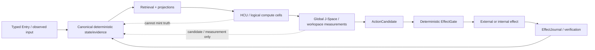

# DEV / SOURCE / RESEARCH — Project Frankenstein

This is the progressive-disclosure entry for engineers and researchers. It is a navigation and evidence layer, not a replacement for canonical authority files or exact source.

## 0. Authority before interpretation

For any current-state claim, resolve in this order:

1. newest explicit owner authority;
2. current `research_entity/claycode/autonomous/SUPERVISOR_INBOX.json` and its selected steering;
3. current continuity/bootstrap/program state;
4. exact current executable evidence at exact source identity;
5. current source/tests/receipts;
6. older branches, packets and archives;
7. summaries and conversational memory.

At this Triggerword-3 pass, verified starting head: `854f6bc87780f4a5242489a6c807d186b16a8c3d`.

The 9.13O inbox is newer than the stale 8.78 bootstrap/program surfaces. It carries provider-authority epoch 9.13 HARD_OFF: all provider routes false, Together forbidden, no paid fallback. Therefore provider-calling Frankenstein orchestration authored after that boundary is quarantined/non-operative regardless of whether its source tests are green.

## 1. Research architecture map



Invariant: cognition, workspace stability, majority, model self-report and simulation may produce candidates or measurements; they do not mint canonical facts.

## 2. Historical Frankenstein lineage

The archived Project-Frankenstein manifest is explicitly partial and non-frozen. It records deep-read units for architecture, personality/homeostasis, thalamic gating, Global Workspace, memory, reward, subconscious/actor-critic machinery, spatial state, dream/replay, project/goal management, hypothesis/experiment machinery, visual pipelines and training material.

Start with:

- `research_entity/archive_assimilation/manifests/PROJECT_FRANKENSTEIN_MANIFEST.json`
- `research_entity/archive_assimilation/manifests/PROJECT_FRANKENSTEIN_HISTORY_INTERVAL_MANIFEST.json`
- `research_entity/archive_assimilation/manifests/PROJECT_FRANKENSTEIN_TREE_SEG_*.json`

Evidence warning from the manifest itself: exact tree/history denominator is not frozen, so “first in Git” must be phrased as **first verified in accessible Git** unless the relevant history interval has actually been exhaustively enumerated.

## 3. State, UnifiedDB and Emergent Retrieval

### Project claim

The engineering direction collapses fragmented durable state toward a canonical SQLite substrate while keeping typed roles separate. Rebuildable graphs/workspaces remain projections rather than competing truth stores.

### Emergent Retrieval

Project definition: relevance emerges when multiple independently stored evidence dimensions overlap at query time. Typical dimensions include semantic similarity, time, causal lineage, current state, goals, perception, effects, confidence and provenance.

Relevant implementation/research surfaces include:

- `research_entity/harness/reference/unifieddb_emergent_cascade.py`
- `research_entity/harness/reference/benchmark_unifieddb_emergent_cascade.py`
- `research_entity/harness/reference/benchmark_unifieddb_emergent_assembly.py`
- `research_entity/unifieddb/receipts/`
- `research_entity/trigger_runs/unifieddb/`

Never rephrase this as information “appearing from nowhere”.

### External primary support / analogy boundary

SQLite WAL is a real transaction/concurrency mechanism: changes are appended to a WAL and checkpointed later; readers can continue against a stable end-mark while writers append commits. Current SQLite documentation also records a WAL-reset corruption bug fixed in SQLite 3.51.3 and backports, relevant to any multi-process WAL deployment. This is external systems evidence, not proof that a particular project runtime uses a safe SQLite build.

## 4. GWT / Global J-Space / GRF / Hyperposition

### External research basis

Global Neuronal Workspace research describes selective amplification and broad availability/broadcast of information across distributed processors. Dehaene & Changeux (Neuron, 2011, DOI `10.1016/j.neuron.2011.03.018`) is a primary reference.

### Project use

The project uses GWT-like broadcast/workspace structure as an engineering hypothesis. It does **not** infer consciousness, sentience or subjective experience from a workspace implementation.

Current project evidence law requires model/runtime-specific causal traces. Textual coherence, recurring labels, self-report, recurrence or consensus are insufficient.

### Hyperposition

Hyperposition preserves unresolved competing candidates. A majority or recurrent candidate does not become a fact without an evidence-bearing discriminator. Use it to keep alternatives alive until an intervention or observation closes them.

### GRF

GRF material is part of the project’s mathematical/engineering lineage. Treat historical formulas and claims by their exact source/receipt status; do not let a later prose synthesis upgrade an unexecuted mathematical proposal into runtime evidence.

## 5. Reflection and agency

Target: maximum practical agency inside a human-useful operating envelope.

Engineering definition of reflection:

```text
inspect -> compare -> generate correction -> store/retrieve -> change later policy -> terminate
```

Required termination classes:

- ACT
- ASK
- WAIT
- RE-OBSERVE
- another measurable state transition

A reflection loop that only emits another reflection is a known anti-pattern.

External comparison: Reflexion (Shinn et al., 2023, arXiv:2303.11366) demonstrates an agent design where verbal feedback is stored in episodic memory and affects later trials. That supports reflection-as-control/memory as a plausible agent technique, but it does not validate this project’s specific state, causal or effect architecture.

## 6. HCU / GRID / compute semantics

Current product identity: **EntityOS**.

Current integrated cognition/compute architecture: **HCU**.

Reference modes:

- GRID10
- COGSIM10
- WM_TEST
- NESTED_SIM
- SCALEOUT

Logical cells are request-scoped function slots; cell count is not resident model count.

The scale ladder `10 -> 32 -> 64 -> 128 -> 256 -> ~600` is a benchmark ladder. The ~600 H100-class idea remains a hypothesis until exact benchmark evidence.

### Current GRID10 counterexample

Supervisor 9.13O records a real diagnostic A/B on four concurrent processes and four vCPUs:

- 1 thread/process: 8.3197 s/call average, 12 samples;
- 2 threads/process: 23.1806 s/call average, 12 samples;
- 4 threads/process: zero completed samples within timeouts.

Interpretation: the external suggestion that two threads/process should be faster was falsified for this measured topology. Keep default=1 there. Do not generalize to a changed core/process topology without matched measurement.

## 7. Training and model-binding research

Training credit is currently zero.

A completed training job is not PASS by itself. Promotion requires intended HCU/J-Space behavior plus off-target regression tests, exact checkpoint/tokenizer/runtime/build identity, causal controls and leak-resistant evaluation.

Current 9.13O evidence also keeps model-family/checkpoint ancestry explicit and distinguishes retained Josiefied lineage from a Huihui paid substitute. Do not merge them narratively.

The strongest current training blocker visible in the supervisor inbox is not “need more tokens”; it is evidence closure: canonical dataset rows remain 0 and accepted Distillery dataset tokens remain 0 in the latest confirmed state.

## 8. FreeSwarm / Forge / Distillery

Raw worker/token volume is not quality and not independent evidence.

Current supervisor finding:

- latest confirmed Distillery accepted dataset tokens: `0 / 88,774` collected source tokens;
- Source -> GO yield: `0.000%`;
- canonical dataset rows admitted: `0`;
- training credit: `0`.

The curation layer must preserve this negative result because it explains why the program shifted from raw scaling toward exact admitted conversion, replay and causal dataset closure.

## 9. Frankenstein 72h orchestration quarantine

The current main contains a Bauleiter/Bugfix/package-dispenser implementation with local source tests reported green in commit `854f6bc87780f4a5242489a6c807d186b16a8c3d`.

Those green tests do not create execution authority.

Supervisor 9.13O explicitly states that the provider-calling plan and loops are **QUARANTINED_NON_OPERATIVE_UNDER_CURRENT_HARD_OFF** because they directly select NVIDIA/Groq/Mistral and retain a stale Together allowance. Any future variant must resolve current authority before secret lookup, provider import, network, Aider or fallback dispatch and must fail closed with zero provider calls and zero secret lookups under HARD_OFF. It must not modify Frank’s own Harness to accomplish that closure.

See the exact pass report:

- `repository/TRIGGERWORD3_2026-08-27_GPT56SOL.md`

## 10. External analogies are not project evidence

### NVIDIA Unified Memory

CUDA Unified Memory provides managed memory accessible from CPU/GPU with behavior dependent on OS, driver, GPU and coherence support. It is a useful analogy for reducing explicit ownership/copy boundaries.

Do not translate it into claims that UnifiedDB has hardware coherence, automatic migration semantics or GPU memory behavior.

### Neuroscience

GWT/GNW is a research analogy and hypothesis source. It does not certify software consciousness.

### Agent literature

Reflection/memory papers can motivate experiments. They do not establish project runtime effects without exact local evidence.

## 11. Evidence labels for new documentation

Use these labels for material claims:

- `CURRENT_SOURCE`
- `HISTORICAL_SOURCE`
- `PROJECT_MEASUREMENT`
- `EXTERNAL_PRIMARY`
- `INFERENCE`
- `OPEN_HYPOTHESIS`
- `NEGATIVE_RESULT`

Recommended status vocabulary for archive lines:

- attempted
- source-ready
- measured
- reproduced
- contradicted
- blocked
- prepared-not-run
- adopted
- retired

## 12. Installation / agent entry

Do not force an AI installer to scan the root. Use:

`../AI_START_HERE_DO_NOT_SCAN_REPO/README.md`

## 13. Triggerword-3 current-pass artifacts

- `repository/TRIGGERWORD3_2026-08-27_GPT56SOL.md`
- `repository/FRANKENSTEIN_EVIDENCE_INDEX_2026-08-27.json`

These are curation artifacts. They do not replace `SUPERVISOR_INBOX.json`, steering, exact source or runtime receipts.