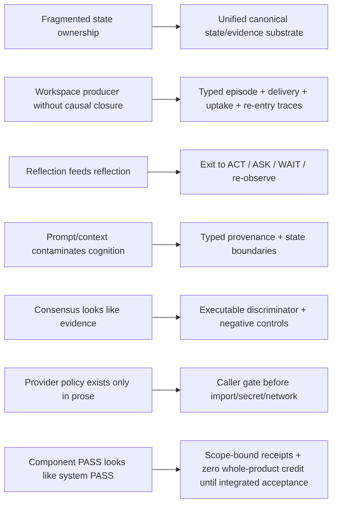

# Project Frankenstein research chronicle

This chronicle is a navigation layer over the repository. It does **not** mint truth from archive prose.

Evidence labels used here:

`CURRENT_SOURCE` · `HISTORICAL_SOURCE` · `PROJECT_MEASUREMENT` · `EXTERNAL_PRIMARY` · `INFERENCE` · `OPEN_HYPOTHESIS` · `NEGATIVE_RESULT`

Status verbs used for mechanisms:

`ATTEMPTED` · `SOURCE_READY` · `MEASURED` · `REPRODUCED` · `CONTRADICTED` · `BLOCKED` · `PREPARED_NOT_RUN` · `ADOPTED` · `RETIRED`

## 1. How to read chronology without inventing history

The repository contains imported Drive material, reconstructed archives, frozen Git trees, current source and later research overlays. Therefore:

- use **“first verified in accessible Git”** when the evidence only establishes the first reachable commit;
- do not turn an import timestamp into a mechanism creation date;
- do not turn a later reconstruction into independent replication;
- do not turn a source-ready module into runtime evidence;
- keep deleted and failed mechanisms visible when they explain a successor architecture.

The strongest existing lineage reconstruction is:

`../research_entity/trigger_runs/fusion/fusion-20260809T1538p0700-frank-architecture-lineage/FINAL_REPORT.md`

That fusion reports a source-indexed universe covering 545/545 reachable Project-Frankenstein commit events and 873/873 tracked entries at its frozen PF head. Its own boundary is explicit: lineage coverage PASS is **not** scientific promotion or replication.

## 2. Architecture generations already reconstructed

`HISTORICAL_SOURCE` — the August 9 lineage fusion records this explicit research-generation chain:

```text
R1 Integrated Semantic Runtime
 -> R2 Workspace Reachability correction
 -> R3 Hybrid Freshness / Multi-timescale Runtime
 -> C4 CognitiveFrame Multi-rate Runtime
 -> C5 Cognitive Epoch Capsule + Reader ABI
 -> C6 Clay-native Unified Cognitive Substrate
 -> C7 Clay Organ Runtime Fabric
 -> C8 Selective Cognitive Runtime Fabric
 -> C9 Typed Causal Admission & Effect Fabric
```

The fusion explicitly refused to invent `C10`. Current EntityOS/HCU work is a later product/compute authority layer over this ancestry; it does not retroactively rename historical evidence.

## 3. Selected verified-in-Git milestones

### 2026-03-03 — Thalamus appears in accessible Git

`HISTORICAL_SOURCE`: the lineage fusion identifies commit `ccebdc78...` as the first explicit Thalamus implementation it could verify. The mechanism began as a fast in-process access-control/gating layer over heterogeneous state channels.

Later mechanism stack included base gain, novelty, habituation, top-down mode weighting, salience breakthrough, **E-PQ vigilance modulation**, prediction error and feedback bias.

`NEGATIVE_RESULT`: reported failures include shutdown races, missing state initialization, missing entity-active state, profile drift, a gain/relay decoupling that reportedly suppressed 91% of Amygdala events, and stale architectural text overriding an AURA→Swarm migration.

Engineering consequence: `computed gain != actual relay != workspace candidacy != model-visible uptake != causal use`.

### 2026-03-19 — workspace path deletion becomes an architectural lesson

`HISTORICAL_SOURCE`: the lineage fusion ties commit `ce00787...` to deletion of an overlay tree during UI cleanup. The later analysis identifies the old workspace implementation inside that tree.

`NEGATIVE_RESULT`: the system continuing to run after the deletion demonstrates why process/component health cannot stand in for causal cognitive-path health.

Engineering consequence: every workspace stage now needs traceable distinctions among candidate, selection, delivery, reconstruction, uptake, causal use, outcome and re-entry.

### 2026-08-05 — measured workspace-stage costs

`PROJECT_MEASUREMENT` as preserved by the lineage fusion: a six-channel workspace implementation reports an ignition threshold of 0.55, focus-detail budget 320 chars, compressed-alternative budget 90 chars, max stage 1100 chars, and measured median costs of approximately 0.0035 ms build, 0.2168 ms Core read and 1.0565 ms DB write.

Boundary: these measurements support the claim that stage construction itself was cheap in that measured implementation. They do not prove Global Workspace Theory, hidden-state causality or current EntityOS runtime behavior.

### 2026-08-09 — architecture archaeology fused

`HISTORICAL_SOURCE`: the fusion run `fusion-20260809T1538p0700-frank-architecture-lineage` dispositions the catalogued mechanism/module universe into chronological lineage or explicit support/non-organ roles. It preserves deleted and superseded modules rather than presenting only the final tree.

Useful machine-readable companions include:

- `../research_entity/trigger_runs/fusion/fusion-20260809T1538p0700-frank-architecture-lineage/FRANK_ARCHITECTURE_LINEAGE.json`
- `../research_entity/trigger_runs/fusion/fusion-20260809T1538p0700-frank-architecture-lineage/GLOBAL_COVERAGE_MANIFEST.json`
- `../research_entity/architecture_archaeology/MECHANISM_INDEX.json`
- `../research_entity/archive_assimilation/manifests/PROJECT_FRANKENSTEIN_MANIFEST.json`

### 2026-08-25/26 — Xeno/HCU training research becomes runtime-aligned

`CURRENT_SOURCE` with execution caveat: `../research_entity/global/TRIGGERWORT_2_CURRENT_TRAINING_COURSE_XENO_HARNESS_2026-08-26.md` defines the current curriculum direction as runtime-aligned Xeno/HCU behavior rather than generic “more 0.8B data”. It separates canonical S0, shared noncanonical S1 and node-local S2 state; makes ordinary nodes S1 read-only; treats coordinator status as a deterministic leased role; and maps Hyperposition/GWT/Claude bridge/effect proposals into typed training families.

It also records model-specific research inputs for a Qwen3.5-0.8B-class target and a 46-atom writable symbol set, while warning that final checkpoint selection is not established.

`CURRENT_SOURCE`: newer supervisor 9.13 HARD_OFF still controls execution. Training research material can be indexed while current training credit and currently authorized paid runs remain zero.

### 2026-08-27 — HARD_OFF catches a real Frankenstein caller boundary

`CURRENT_SOURCE`: `../research_entity/claycode/autonomous/SUPERVISOR_INBOX.json` records schema 9.13 and a 9.13O non-authority delta. It states that provider-calling Frankenstein orchestration is non-operative under HARD_OFF and requires the gate to resolve **before** secret lookup, provider import, network or Aider.

`NEGATIVE_RESULT`: current source reports repeated post-HARD_OFF provider-backed commits, so documentation-only policy was insufficient at the real caller boundary.

PR #2050 repairs the external Frankenstein callers without modifying Frank's Harness and adds a fail-closed regression test. Runtime promotion remains pending independent clean non-provider execution.

## 4. Mechanism evolution map

| Mechanism / lineage | Repository role | Current disposition | Evidence boundary / failure that forced the next move |
|---|---|---|---|
| Personality / Self / **E-PQ** | temperament, homeostasis, vigilance/state shaping | `ADOPTED` as typed/versioned state semantics, not prompt identity | singleton overwrite, saturation, mood death spiral, descriptor/language drift, identity projection |
| Global Workspace / GWT | competition, broadcast, reader uptake, re-entry | `ADOPTED` as instrumented empirical interface; causal claim remains `OPEN_HYPOTHESIS` | overlay deletion, producer≠consumer closure, pub/sub≠full GWT |
| Thalamus | fast evidence/access gating | `ADOPTED` logical organ/function | gain≠relay; stale state; self-confirming feedback risk |
| Memory: Titan → LCME → Hippocampus/MemoryHub | provenance-bearing memory/retrieval | `ADOPTED` into Unified Memory/UnifiedDB/ClayGraph direction | graph corruption, stale retrieval, cold-start learned retrieval, self-generated contamination |
| Perception / Retina / PerceptualField | typed current-world evidence | `ADOPTED` direction | rich ambience/context can become recursive contamination; source/prior/familiarity must stay separate |
| Amygdala / NAc / ACC | risk, value/RPE, conflict | `ADOPTED` as logical functions, biological names analogical | NAc inverted-habituation reportedly killed 9/14 channels; relay suppression |
| Goals / prediction | slow objective + expectation state | `ADOPTED` only with typed causal state | unconstrained recurrent goals/prediction can become self-confirming context |
| Reflection | inspect mismatch, propose correction, alter later behavior | `ADOPTED` with mandatory exit | rumination/fixation when reflection recursively feeds itself |
| Subconscious / Neural Conscience / Reality Gate / ThoughtSeed | learned micro-organs | `ATTEMPTED`; lessons retained, authority rejected | failed writes, action-mask mismatch, premature enablement, 0-negative/960-positive Conscience dataset, room-text poisoning |
| Genesis / Hypothesis / Experiment | proposal/scientific workflow | `ADOPTED` as typed proposal/evidence lineage; self-modifying authority `RETIRED` | hypothesis/model output cannot mint truth or modify Harness authority |
| Dream / SOMA / LoRA / IAPT | consolidation + historical training lifecycle | `HISTORICAL_SOURCE`; lifecycle/rollback lessons retained | training completion alone is not behavior promotion; current execution authority can retire older run plans |
| Tools / Needle / effects | action proposal and external effects | `ADOPTED` only behind deterministic effect authority | historical `skip_approval=True` is preserved as a destructive-authority failure class |
| Recovery / watchdogs | restart/continuity | `ADOPTED` as typed recovery + idempotency/replay | duplicate restart authorities and recursively generated recovery events can become faults themselves |

## 5. Research-entity synthesis map

The research entity is an evidence archive, not a truth oracle. The following index is intentionally conservative.

| Topic | Classification | High-value source roots | Current interpretation |
|---|---|---|---|
| EntityOS runtime | `SOURCE_READY / PARTIAL_COMPONENT_MEASUREMENT` | `../the artefact/`, `../research_entity/claycode/`, supervisor receipts | whole-runtime credit remains zero under current supervisor state |
| HCU / GRID | `SOURCE_READY / DIAGNOSTIC_MEASURED` | `../research_entity/global/`, `../research_entity/global/j-space/`, current supervisor | GRID10 thread A/B is topology-specific diagnostic evidence, not HCU promotion |
| Xeno | `CURRENT_DESIGN / TRAINING_RESEARCH` | `../research_entity/global/TRIGGERWORT_2_CURRENT_TRAINING_COURSE_XENO_HARNESS_2026-08-26.md` | compatibility implementation/training target under EntityOS/HCU, not a second product |
| vector binding | `MEASURED_RESEARCH_INPUT / REBIND_REQUIRED` | `../research_entity/global/j-space/research/` | symbol/write capability research exists; exact model/tokenizer/vector ABI must be rebound after FT/runtime changes |
| Hyperposition | `OPEN_HYPOTHESIS / SOURCE_READY` | `../research_entity/global/j-space/research/`, semantic-hyperposition tools | preserve unresolved branches; majority/repetition cannot collapse fact status |
| GWT / Global J-Space | `OPEN_HYPOTHESIS / INSTRUMENTATION_RESEARCH` | workspace lineage + `../research_entity/global/j-space/` | requires model-specific lesion/shuffle/rescue/vector-control causal evidence |
| GRF | `HISTORICAL_SOURCE / RECONSTRUCTION_REQUIRED` | architecture archaeology, Project-Frankenstein history manifests | do not assign creation dates or current semantics from memory alone |
| ClayCode | `SOURCE_READY / RELEASE_GATES_OPEN` | `../research_entity/claycode/` | current supervisor says WP01/WP02 pass while WP03-WP14 remain open; do not call BASE release complete |
| training | `PREPARED / PARTLY_EXECUTED_HISTORICALLY / CURRENT_CREDIT_0` | Trigger-2 ledgers + J-Space research | current canonical dataset rows admitted = 0 and training credit = 0 under 9.13 |
| Claude bridge | `CURRENT_DESIGN` | `../research_entity/runtime/claude_state_bridge.py`, `../research_entity/00_CURRENT/latest/claude-bridge.md` | Claude is a strong model/tool/code partner, never S0 truth authority or permanent coordinator |
| FreeSwarm / Forge / Distillery | `BLOCKED / NEGATIVE_RESULT_ARCHIVE` | `../research_entity/00_CURRENT/latest/free-swarm-distillery.md`, quiescence tools/receipts | HARD_OFF; accepted training tokens remain 0 absent newer exact evidence |

## 6. Failure → engineering-move chain



## 7. Agentic research framing

Project target: maximum practical agency inside a human-useful operating envelope.

No present architecture claim needs consciousness, sentience or subjective experience.

Reflection is a control operation. Workspace/GWT is an empirical interface hypothesis. HCU/model outputs are candidates/measurements. Canonical evidence and real effects remain separate deterministic authorities.

### Open hypothesis: rich external substrate enables useful reflective agency

**Engineering confidence:** 0.70 — plausible and supported by the project's failure lineage, but not established as a universal necessity.

**Claim:** useful reflective agency is more reliable when state, memory, perception, arbitration, effect receipts and verified outcome re-entry exist outside free-form model text.

**Counterhypothesis:** matched gains may come primarily from extra inference tokens or task decomposition, not the external substrate itself.

**Falsifier:** on preregistered matched tasks, compare equal-token systems with and without the external state/effect/re-entry substrate. If the richer substrate fails to improve task success, error recovery, calibration or replayability, the claim must be weakened for that workload.

External comparison only: Reflexion (Shinn et al., 2023, arXiv:2303.11366) shows language-agent improvement using episodic verbal feedback without weight updates. It is **not** evidence that Frankenstein's substrate is necessary or sufficient.

## 8. External research anchors — analogy vs project evidence

- Global Neuronal Workspace review: https://pmc.ncbi.nlm.nih.gov/articles/PMC8770991/ — `EXTERNAL_PRIMARY/REVIEW`; useful for global availability/ignition concepts, not proof of EntityOS implementation.
- Reflexion: https://arxiv.org/abs/2303.11366 — `EXTERNAL_PRIMARY`; useful comparator for reflection + episodic feedback, not project runtime evidence.
- PyTorch multiprocessing best practices: https://docs.pytorch.org/docs/stable/notes/multiprocessing.html — `EXTERNAL_PRIMARY/VENDOR`; constrains CPU oversubscription interpretation.
- SQLite WAL: https://sqlite.org/wal.html — `EXTERNAL_PRIMARY`; relevant to concurrent SQLite validation. The documented WAL-reset bug affected versions through 3.51.2 and was fixed in 3.51.3; runtime receipts should record SQLite version.
- CUDA Unified Memory: https://docs.nvidia.com/cuda/cuda-programming-guide/04-special-topics/unified-memory.html — `EXTERNAL_PRIMARY/VENDOR`; systems-design analogy for reducing ownership/copy boundaries only. Memory coherence is not database semantics or evidence authority.

## 9. Explicit unresolved items

1. **“Frankenstein v0.7” label** — `UNRESOLVED`: no reliable current-repository search hit was found in this curation pass. Do not manufacture a version-history claim from the trigger wording alone. If an external/private source establishes the label, add it with exact provenance.
2. **GRF chronology** — `RECONSTRUCTION_REQUIRED`: the archive contains GRF references, but a dedicated commit/path chronology should be derived from exact Git evidence before assigning dates or current semantics.
3. **Whole EntityOS/HCU runtime** — `NOT_PASS`: current supervisor credit remains zero.
4. **Training** — `CURRENT_CREDIT_0`: historical runs/data work do not create current promotion.
5. **Provider-backed 72h Frankenstein orchestration** — `BLOCKED/NON_OPERATIVE` under current HARD_OFF.
6. **PR #2050 runtime gate** — source/test added; exact clean non-provider execution evidence still required before runtime promotion.

## 10. Read next

- `README.md` — progressive-disclosure developer/research entry.
- `ARCHIVE_INDEX.v1.json` — machine-readable topic/source/status index.
- `ROOT_MIGRATION_PLAN.md` — safe path-preserving plan toward the four-entry public root target.
- `../HUMAN_READ_THIS/README.md` — human layer.
- `../AI_START_HERE_DO_NOT_SCAN_REPO/README.md` — capability-first AI installer/adaptation layer.
