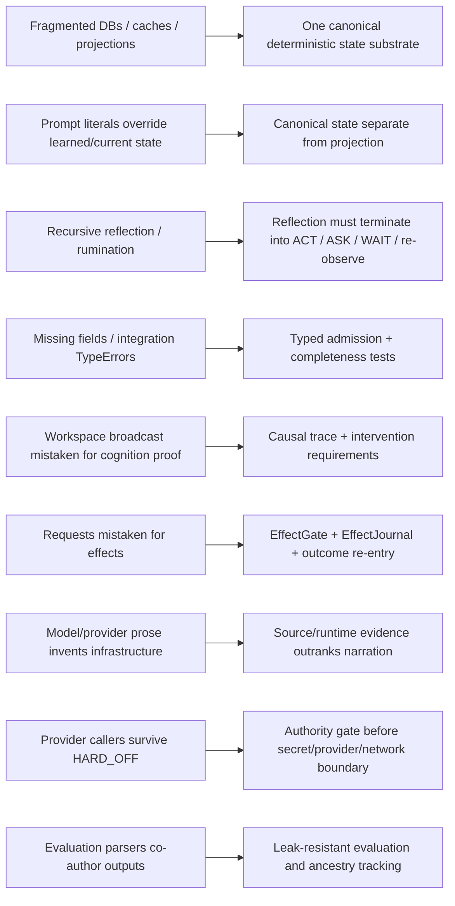
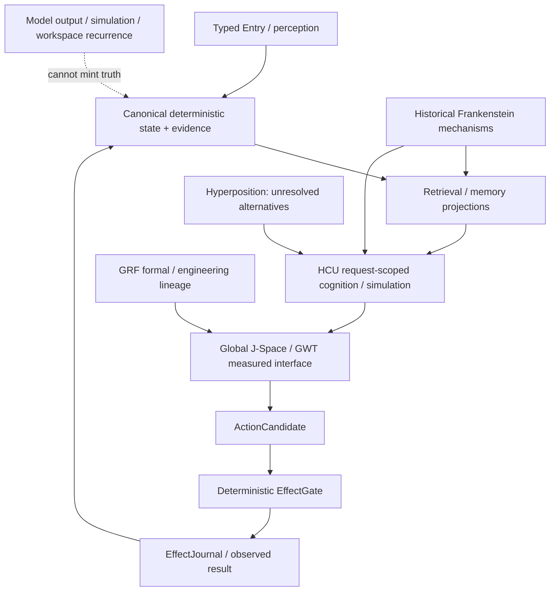

# Project Frankenstein research chronicle — evidence-first reconstruction

This chronicle reconstructs the engineering lineage visible in the current research archive. It is **not** a claim that every historical module remains current, correct, or active. Where exact creation dates are not established from accessible Git, this document says only that a mechanism is **verified in the archived source/index**.

Primary archaeology anchor: `research_entity/architecture_archaeology/MECHANISM_INDEX.json` (schema 1.1, `PARTIAL_LEVEL0_ACTIVE`). Its frozen Project-Frankenstein source context is `abba90a5767d85abc8a1ac340bae92842dab35c1`. That historical source identity is provenance, not current EntityOS authority.

## 1. The recurring engineering problem

Across the Frankenstein lineage, the same practical loop keeps reappearing in progressively stricter forms:

```text
perceive / receive state
        ↓
select what matters
        ↓
retrieve memory + prior corrections
        ↓
form a bounded decision / candidate
        ↓
request an effect
        ↓
observe what actually happened
        ↓
compare expected vs. observed
        ↓
store evidence / correction
        ↺
```

The modern EntityOS/HCU direction is best understood as a tightening of the boundaries in this old loop: stronger provenance, one deterministic state/evidence authority, typed admission, explicit effect authority, and causal re-entry instead of trusting generated narration.

## 2. Mechanism lineage and present status

| Mechanism | First status safely supported here | Historical evidence | Failure / limitation that matters | Current reuse direction |
|---|---|---|---|---|
| Persistent multi-timescale cognition | `HISTORICAL_SOURCE` | archived `consciousness_daemon.py` includes workspace refresh, idle thought, mood trajectory, predictions, consolidation, perception sampling, attention, goals, recursive reflection, ultradian phases and rumination detection | Rich looping does not by itself prove causal usefulness; recursive reflection can become fixation | reference semantics and test oracle, not blind port |
| E-PQ personality/homeostasis | `HISTORICAL_SOURCE` | five persistent vectors, transient mood, confidence anchor, event weighting/quality tiers, age/learning-rate behavior, SQLite/WAL persistence and snapshots | state/personality projection can become an uncontrolled prompt-level authority if duplicated | preserve state semantics; adapt implementation beneath canonical state authority |
| Thalamic sensory gating | `HISTORICAL_SOURCE` + `NEGATIVE_RESULT` | nine sensory channels, gain, habituation, burst/salience behavior, profiles, prediction error and persistent baselines | missing `is_entity_active` once killed a path with `TypeError`; a documented session mode lacked a profile | reuse only with typed completeness/fail-closed tests |
| Global workspace broadcast bus | `HISTORICAL_SOURCE` | salience-bearing events, publish/subscribe, bounded history, subscriber failure isolation | a broadcast bus is not by itself coalition competition, selection, causal use, outcome verification or GWT proof | precursor for Global J-Space/GWT instrumentation |
| SOMA / LoRA / IAPT | `HISTORICAL_SOURCE` / historically reported method | Qwen3.5-4B LoRA trainer, low-memory CPU path, feedback-weighted samples, before/after probes, telemetry, adapters; IAPT reports adversarial evaluation, failure extraction, positive anchoring and anti-regression | regex/output parsers could become invisible co-authors and distort what appears to be learned behavior | reuse tooling/method only after current model/dataset/evaluation revalidation |
| Shared-state “emergent loop” | `OPEN_HYPOTHESIS` seeded by historical report | idle thought, spatial transition and later contextual thought reportedly coupled through shared spatial state without a direct desire→action API | same observations can arise from prompt/state leakage or common preprocessing | lesion, shuffled-state, counterfactual replay, fixed-model content controls and causal-use traces |
| Claim freshness / prompt truth | `NEGATIVE_RESULT` | archived docs disagree on model/LoRA generation; an obsolete hard-coded architecture label reportedly overrode trained behavior | prompt literals can silently outrank learned/current state | canonical semantic state must not be duplicated as uncontrolled prompt truth |
| LCME / Titan hybrid memory | `HISTORICAL_SOURCE` | claims-not-facts, time-weighted confidence, counterhypotheses, SQLite + vector store + graph expansion, controlled forgetting, maintenance, cache invalidation | multiple stores create ownership/reconciliation boundaries and projections can be mistaken for truth | donor for UnifiedDB / ClayGraph / Emergent Retrieval |
| NAC reward prediction | `HISTORICAL_SOURCE` | channel-specific reward, RPE, tonic/phasic state, habituation, boredom, opponent process, E-PQ coupling and persistent reward log | parameter meaning and reward signal validity are context-dependent | donor for bounded motivation/state signals, not canonical truth |
| Subconscious policy | `HISTORICAL_SOURCE` + `NEGATIVE_RESULT` | 100D state, 20 thought/action classes, actor-critic/PPO, persistent transitions | historical policy reportedly reduced from ~3.1M parameters to ~19K because reward-signal volume was too small | retest role after modern tool/state boundaries; size follows evidence volume |
| Persistent spatial body/world | `HISTORICAL_SOURCE` + `NEGATIVE_RESULT` | persistent location, 11 rooms, activity/location mapping, topology/proprioceptive mapping | rich ambient room prose was removed because it biased/fixated generated thought | keep canonical state separate from model-facing projection and measure projection effects |
| Dream replay / consolidation | `HISTORICAL_SOURCE` + `NEGATIVE_RESULT` | budgeted replay, synthesis, consolidation, interruption/resume, phase persistence, memory boost/decay, E-PQ homeostasis | thresholds needed retuning because cycles were too rare; package/path shadowing broke LCME import | donor for resumable consolidation with recovery tests |
| Project/goal strategy engine | `HISTORICAL_SOURCE` | project memory/hypotheses, heartbeats, tool statistics, strategy logs, goals, tasks, campaign/contact/budget state and crew roles | persistent goal state can become a second authority if not bounded | donor for agentic goal/world-model tooling beneath EntityOS authority |

## 3. Failure → engineering move

The most useful lineage is not “feature A existed, then feature B existed.” It is the sequence of failures that forced stronger boundaries.



### Why negative results are structural evidence

A failure is valuable when it rules out an architectural shortcut. A missing field killing a sensory path supports typed completeness. A prompt label overriding learned behavior supports separating semantic authority from prompt projection. A provider-calling loop appearing after HARD_OFF supports moving authority resolution earlier than any secret/network/provider import. A green component suite that does not exercise those boundaries shows why test scope must match claim scope.

## 4. GRF, Hyperposition, GWT and Global J-Space

The archive contains multiple GRF/GWT/Hyperposition surfaces, including:

- `agentZero/GWT-GRF-Messung-2026-08-22.md`
- `research_entity/00_CURRENT/latest/hyperposition-gwt-grf.md`
- `research_entity/global/AGENT_ZERO_JSPACE_IDENTITY_GRF_INJECTION.md`
- `research_entity/global/j-space/README.md`
- the 2026-08-24 HCU/Zero/ClayCode/GRF/GWT/J-Space compression layer

These materials establish a **research lineage**, not automatic model-internal truth.

### Current interpretation

- **GWT/workspace:** a coordination architecture and measurement lens. A broadcast bus or repeated global state is not enough to prove selective access, causal use, or biological GNW.
- **GRF:** preserve the project’s mathematical/engineering formulations and exact executable artifacts where available; do not convert the elegance of a formalism into empirical credit.
- **Hyperposition:** maintain unresolved alternatives explicitly instead of collapsing them by majority vote or narrative convenience.
- **Global J-Space:** treat vector/state coupling as a model-specific causal hypothesis. Promotion needs exact model/checkpoint/tokenizer/runtime identity and intervention evidence.

### Strong discriminator

For any claimed J-Space control variable `v`:

```text
baseline
vs. truthful v
vs. shuffled v
vs. lesion/no-v
vs. rescue/reintroduced v
```

with fixed task families, exact model/runtime identity, causal event IDs, output/effect receipts and family-separated evaluation. If truthful-v performance does not beat shuffled/lesioned controls in a reproducible model-specific way, the causal-control claim fails.

## 5. Memory lineage → UnifiedDB + Emergent Retrieval

Frankenstein historically experimented with multiple forms of persistent memory: SQLite state, vector stores, graph expansion, time-weighted confidence, cache invalidation, dream replay and project-specific memory. The modern lesson is not “put everything in one table.” It is to reduce competing ownership boundaries.

A single canonical substrate can still expose many typed tables, indexes, journals, policies and rebuildable projections. Transient high-rate signals may remain in RAM. What matters is that durable truth/evidence ownership is unambiguous.

`Emergent Retrieval` is the project term for relevance that emerges when independently stored dimensions overlap at query time — for example semantic similarity + time + causal lineage + current state + goals + perception + effect receipts + provenance. It does **not** mean facts appear without stored evidence.

## 6. Reflection, prediction and action

Historical Frankenstein contains prediction checks, reward-prediction-error state, project goals, dream/replay and recursive reflection. These become useful agency only when the loop has a measurable exit.

A practical reflection contract is:

```text
inspect current state + prior expected outcome
→ detect mismatch
→ generate one or more bounded corrections
→ preserve alternatives if unresolved
→ choose ACT / ASK / WAIT / re-observe
→ obtain effect/result receipt
→ update memory from verified outcome
```

The failure case is:

```text
reflection → reflection about reflection → more reflection
```

with no state transition or evidence gain.

## 7. Training lineage: SOMA / IAPT / LoRA → current small-model hypothesis

Historical training infrastructure demonstrates that adapter training and feedback-weighted iteration were implemented in the archived Frankenstein lineage. It does **not** establish that the current HCU/J-Space training objective is solved.

Current promotion requires a stronger chain:

```text
exact causal trace
→ stable vector-control ABI
→ family-level split
→ deterministic hard negatives
→ exact checkpoint/tokenizer/renderer/runtime identity
→ fixed baseline
→ train
→ intervention + off-target regression tests
```

The current supervisor still records training credit `0` and accepted Distillery dataset tokens `0`. Historical training code is therefore a donor, not current training PASS.

## 8. Current Frankenstein 72-hour build lane

Current `main` contains a package/dispenser module plus Bauleiter and independent Bugfix roles. The package idea is structurally useful: large work is decomposed into bounded packages with dependencies and claim/coordination instead of giving one limited-context helper an unbounded 72-hour history.

However, the current Bauleiter/Bugfix implementations directly expose provider paths (`llm.py`, named NVIDIA/Groq/Mistral calls, and/or `harness_aider fallback-start`). Current supervisor 9.13 HARD_OFF explicitly quarantines this provider orchestration. Therefore its present status is:

```text
package/decomposition mechanics: SOURCE_READY / locally component-tested
provider-calling orchestration: QUARANTINED_NON_OPERATIVE
provider runtime credit: 0
EntityOS/HCU promotion: 0
```

A future version must resolve canonical provider authority before secret lookup, provider import, network, Aider or fallback dispatch and must prove zero provider calls / zero secret lookups when HARD_OFF.

## 9. Current architecture synthesis



This synthesis does not require a consciousness, sentience or subjective-experience claim. It is an engineering architecture for stateful, evidence-reentering agency.

## 10. Open hypotheses and falsifiers

### H1 — external cognitive substrate improves practical agency

**Hypothesis:** a rich external substrate of typed state, memory, arbitration, effects and verified re-entry improves interruption recovery, stale-context resistance, effect correctness and reflective termination compared with a thin model+tools wrapper.

**Confidence:** 0.78 engineering confidence.

**Counterhypothesis:** sufficiently capable models plus a thin conventional tool wrapper achieve equivalent practical reliability.

**Falsifier:** matched model/task suites where the thin wrapper equals or beats the substrate architecture on recovery, provenance error rate, effect correctness, repeated-task correction retention and reflection termination without hidden extra state.

### H2 — Global J-Space is causally useful rather than merely correlated

**Hypothesis:** exact vector/state variables in Global J-Space causally affect relevant model behavior.

**Counterhypothesis:** apparent control comes from prompt/schema recurrence, preprocessing or output decoding.

**Falsifier:** truthful controls fail to outperform shuffled/lesioned controls, or effects disappear when lexical/output-label leakage is removed.

### H3 — Emergent Retrieval improves useful recall without becoming a second truth authority

**Hypothesis:** multi-dimensional overlap retrieves more task-relevant evidence than isolated semantic search while preserving provenance.

**Counterhypothesis:** extra dimensions mainly add correlated noise and confirmation bias.

**Falsifier:** blinded retrieval evaluation shows no gain in relevant-evidence recall/precision or reveals provenance loss/false-confidence inflation.

## 11. Evidence links

Core archaeology:

- `../../research_entity/architecture_archaeology/MECHANISM_INDEX.json`
- `../../research_entity/global/FRANK_ARCHITECTURE_ARCHAEOLOGY_PROTOCOL.md`
- `../../research_entity/archive_assimilation/manifests/PROJECT_FRANKENSTEIN_MANIFEST.json`

GRF/GWT/J-Space:

- `../../agentZero/GWT-GRF-Messung-2026-08-22.md`
- `../../research_entity/00_CURRENT/latest/hyperposition-gwt-grf.md`
- `../../research_entity/global/AGENT_ZERO_JSPACE_IDENTITY_GRF_INJECTION.md`
- `../../research_entity/global/j-space/README.md`

Frank causal/reentry lineage:

- `../../research_entity/frank/FRANK_LOOP_OF_LOOPS_CAUSAL_REENTRY_ARCHITECTURE_20260809.md`
- `../../research_entity/global/FRANK_DATABASE_PULSE_CONTRACT.md`
- `../../research_entity/global/FRANK_V0_1_TARGET_MODULE_ARCHITECTURE.md`

Training lineage:

- `../../research_entity/trigger_runs/fusion/fusion-20260809T1538p0700-frank-architecture-lineage/DREAM_SOMA_LORA_DEEP_LINEAGE.md`
- `../../research_entity/trigger_runs/fusion/fusion-20260809T1538p0700-frank-architecture-lineage/FINAL_REPORT.md`

Current Frankenstein lane:

- `../../research_entity/topic_packets/frankenstein-master-cognition-concept/CONCEPT.md`
- `../../research_entity/topic_packets/frankenstein-master-cognition-concept/BUILD_ORCHESTRATION_PLAN_20260827.json`
- `../../research_entity/topic_packets/frankenstein-master-cognition-concept/frankenstein_packages_v1.py`
- `../../research_entity/topic_packets/frankenstein-master-cognition-concept/frankenstein_orchestrator_v1.py`
- `../../research_entity/topic_packets/frankenstein-master-cognition-concept/frankenstein_bugfix_v1.py`

Current authority must always be resolved separately from this chronicle.
