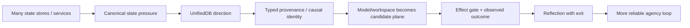

# Project Frankenstein — research chronicle

This is a **curated chronology**, not a creation myth.

Dates below mean **first verified in the accessible Git evidence inspected for this curation**, or the timestamp recorded by the cited artifact. They do not prove that an idea was first conceived on that date.

Snapshot base: `0ec6784cf06a47d4a955b1cc38ef0f0e526ec30e`.

## How to read this chronology

Each entry separates:

- **evidence** — what the repository actually shows;
- **interpretation** — what that supports;
- **boundary** — what it does not prove;
- **engineering consequence** — what changed because of it.

## Long lineage: Frank -> Clay research archive -> EntityOS/HCU -> Project Frankenstein build

The archive contains historical Frank architecture, state and E-PQ work, memory systems, visual/perception lines, tools/effects, prediction, reflection, goals, LoRA/IAPT/SOMA training, GWT/GRF, Global J-Space, Hyperposition, ClayCode, UnifiedDB, FreeSwarm, Forge/Distillery, Xeno, HCU/GRID, and later EntityOS integration work.

That breadth is evidence of **lineage**, not evidence that all modules coexist in one current executable.

The recurring engineering pressure visible across those generations is more useful than the names:

### Failure line: fragmented state

**HISTORICAL_SOURCE / INFERENCE.** Multiple memory/state mechanisms and stores appear throughout the archive. Later UnifiedDB work moves toward one canonical SQLite authority substrate with typed tables, indexes, journals, views, and rebuildable projections.

**Engineering consequence:** reduce competing ownership boundaries while preserving distinct data types and transient RAM state where appropriate.

**Boundary:** repository presence alone does not prove every historical store was migrated into one current runtime.

### Failure line: reflection can become fixation

**HISTORICAL_SOURCE / OPEN_HYPOTHESIS.** Reflection and self-correction recur across the project, along with the risk of recursive reflection that never changes the external or internal measurable state.

**Engineering consequence:** define reflection as a bounded control operation that must terminate into `ACT`, `ASK`, `WAIT`, re-observation, or another measurable transition.

See [`../research/REFLECTION_WITH_EXIT.md`](../research/REFLECTION_WITH_EXIT.md).

### Failure line: fluent output can masquerade as evidence

**ADOPTED evidence discipline.** Later authority surfaces make this explicit: model output, workspace convergence, consensus, memory, or a method cannot mint facts. Real effects require deterministic authority and outcome re-entry.

**Engineering consequence:** the project increasingly binds claims to exact source/runtime identities and preserves UNKNOWN rather than converting missing evidence into a convenient answer.

## 2026-08-22: GWT / GRF measurement lineage is explicitly recorded

**HISTORICAL_SOURCE / PROJECT_MEASUREMENT candidate family.** The accessible tree contains:

- `agentZero/GWT-GRF-Messung-2026-08-22.md`;
- `research_entity/global/AGENT_ZERO_JSPACE_IDENTITY_GRF_INJECTION.md`;
- `research_entity/global/j-space/README.md`;
- later compression/current packets joining Hyperposition, GWT, GRF and J-Space.

**Interpretation:** GWT/GRF/J-Space were not merely retrospective vocabulary; they have concrete research artifacts and measurement-oriented paths.

**Boundary:** a general measurement artifact does not establish model-specific hidden-state causality for every later model/runtime. That requires exact model-specific evidence.

## 2026-08-24 onward: EntityOS + HCU evidence law hardens

**HISTORICAL_SOURCE / ADOPTED donor architecture.** The archive increasingly separates:

- deterministic canonical state/evidence;
- typed entry/admission;
- candidate cognition/simulation/J-Space computation;
- deterministic effect authority;
- exact receipts and generation/provenance binding.

HCU/GRID/Xeno/Global-J-Space research survives as an important donor line. Current 9.13O global inbox still names `EntityOS` and `HCU`, while simultaneously withholding whole-EntityOS, full-HCU, Physical-GRID10, canonical-semantics, and training credit.

**Engineering consequence:** component evidence can be useful without becoming a product-level pass.

## 2026-08-24 to 2026-08-27: FreeSwarm / Distillery pressure exposes evidence-conversion problems

**HISTORICAL_SOURCE + CURRENT negative boundary.** The repository includes FreeSwarm supervisors, quiescence/restart-attribution tools, Distillery research paths, trigger-run receipts, and recurring metrics commits.

Current 9.13O state records:

- `canonical_dataset_rows_admitted = 0`;
- training credit = 0;
- external provider routes unadmitted;
- FreeSwarm owner emergency stop = true.

**Engineering consequence:** raw model/token throughput is not accepted data; accepted data requires causal identity, provenance, admission, and leakage-resistant evaluation boundaries.

## 2026-08-27 16:24Z: autonomous Frankenstein orchestration plan appears in accessible Git

Commit `741667759fcf9c9b8beae3cc13f0c3b5b7ef611d` records a build-orchestration plan containing:

- backup-first sequencing;
- Bauleiter continuity/respawn design;
- a separate Bugfix-Frankenstein role;
- fallback provider tiers;
- baseline/checkpoint logic;
- a Together training gate kept manual.

**Classification:** `SOURCE_READY / PREPARED_NOT_RUN` at that point.

**Boundary:** plan text did not itself grant provider or paid-run authority.

## 2026-08-27 16:29Z: fallback provenance lands after HARD_OFF pressure

Commits `f3b2e48dcfefbc9335b088a3af459ef09eddd04a` and `045f8cbd1292d59d2c2be88c70069feb67e82ca3` record free-pool fallback provenance for NVIDIA Nemotron and Mistral task packets.

Later 9.13O authority treats fresh provider-backed activity as evidence that the caller boundary was not yet fail-closed early enough.

**Classification:** `NEGATIVE_RESULT` for authority containment, not a scientific negative about the model providers.

**Engineering consequence:** authority must be checked before provider import, secret lookup, network dispatch, Aider, or fallback call — not merely after a worker process starts.

## 2026-08-27 16:43Z: 9.13O quarantines the provider orchestration

Commits `dae8af98b2109c09a2fb5705c48f6e71fcf8c5b2` and `6c0bf3292fa748b3fd8292057e2f3616fdfb0fad` introduce/advance the 9.13O quarantine surface.

Current inbox language is explicit:

- HARD_OFF before any external provider call;
- provider routes not admitted;
- Together forbidden;
- zero remaining paid runs;
- provider-backed 72-hour Frankenstein orchestration non-operative under that authority.

**Engineering consequence:** orchestration code can survive as donor provenance while its live external execution remains blocked.

## 2026-08-27 16:49Z: first coordinator-written Bauleiter/Bugfix/package-dispenser implementation

Commit `854f6bc87780f4a5242489a6c807d186b16a8c3d` records:

- `frankenstein_packages_v1.py` with 12/12 local tests;
- `frankenstein_orchestrator_v1.py` with 7/7 local tests;
- `frankenstein_bugfix_v1.py` with 10/10 local tests;
- 29/29 tests green in aggregate.

**Classification:** `SOURCE_READY + LOCAL_TESTED`.

**Boundary:** those local tests do not establish an authorized live provider loop. A test suite can validate package/continuity/watchdog logic while the external-caller boundary remains forbidden.

This is an important Trigger-3 lesson: **green tests and operational authority are orthogonal dimensions**.

## 2026-08-27 16:59Z: provider loops are quarantined behind canonical entry guards

Commit `3c3dbe5020f57065f47bd4d0a2dce3c537128797` records a direct repair:

- provider-backed Bauleiter/Bugfix implementations retained as quarantined donor provenance;
- canonical entrypoints resolve `SUPERVISOR_INBOX` before provider import, secret lookup, network, Aider, or fallback dispatch;
- current 9.13 HARD_OFF fails closed;
- Together allowance set explicitly to zero;
- focused local validation 10/10 PASS.

**Classification:** `SOURCE_READY + LOCAL_UNIT_PASS` for the guard repair.

**Boundary:** the commit itself says source/local-unit scope only. It cannot promote a live provider runtime, whole EntityOS, HCU, GRID10, or training.

## 2026-08-27 17:01Z: human-readable Frankenstein layer lands

Commit `0ec6784cf06a47d4a955b1cc38ef0f0e526ec30e` adds `HUMAN_READ_THIS/README.md`.

This is the first verified accessible-Git point in this curation where the requested human-facing Trigger-3 topology exists.

It explains:

- practical agency without consciousness claims;
- state -> memory -> decision -> effect -> verification;
- UnifiedDB and Emergent Retrieval;
- reflection with exit;
- provider quarantine as a negative result;
- historical lineages as donor evidence rather than automatic current truth.

## Trigger-3 synthesis consequence

The next useful move is not to write a bigger story. It is to make the evidence archive navigable without flattening it.

This curation therefore adds:

1. a technical/research front door;
2. this chronology;
3. an evidence ledger with lifecycle/status boundaries;
4. focused UnifiedDB/Emergent-Retrieval and reflection-with-exit explanations;
5. an AI installer entry that detects capabilities and refuses fake success;
6. a staged topology-migration plan rather than a destructive root reshuffle.

## Open falsifiers / confidence

| Hypothesis | Engineering confidence | Strong falsifier |
|---|---:|---|
| Rich external state/memory/perception/effect receipts improve useful reflective agency versus prompt-only reflection. | 0.78 | Matched tasks show no reproducible gain, or prompt-only control matches/exceeds it after equal compute/context while the external substrate adds only latency/complexity. |
| One canonical authority substrate reduces contradictory state compared with multiple competing durable stores. | 0.90 | A controlled multi-authority design produces equal or lower contradiction/recovery cost without hidden reconciliation authority. |
| Reflection needs an explicit measurable exit to avoid rumination/fixation. | 0.92 | A recursive reflection policy without exit gating reliably improves task outcomes without increased loops/latency/fixation under matched conditions. |
| GWT/J-Space coordination has causal value beyond prompt/schema recurrence. | 0.55 | Lesion/shuffle controls preserve behavior while destroying the purported J-Space signal, or nuisance controls explain the effect. |
| More logical HCU/GRID cells can scale useful cognition without equal resident-model count. | 0.62 | Matched scale-out benchmarks show no quality/throughput benefit after accounting for scheduler/contention overhead. |

Confidence is an engineering prior, not evidence promotion. Only the falsifier can move the claim.