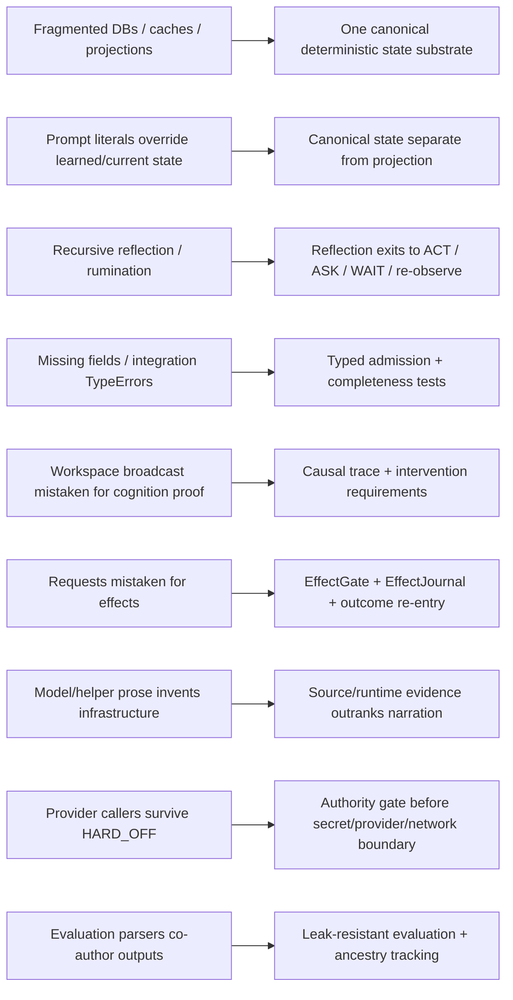
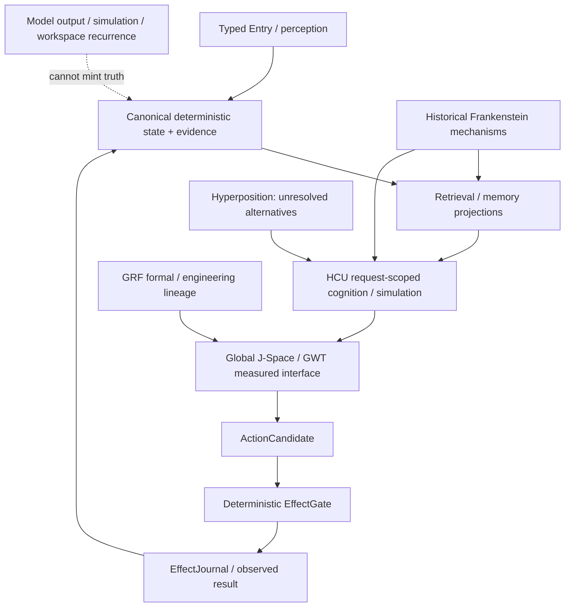

# Project Frankenstein research chronicle — evidence-first reconstruction

This chronicle reconstructs the engineering lineage visible in the current research archive. It is **not** a claim that every historical module remains current, correct, or active. Where exact creation dates are not established from accessible Git, this document says only that a mechanism is **verified in the archived source/index**.

Primary archaeology anchor: `research_entity/architecture_archaeology/MECHANISM_INDEX.json` (schema 1.1, `PARTIAL_LEVEL0_ACTIVE`). Its frozen Project-Frankenstein source context is `abba90a5767d85abc8a1ac340bae92842dab35c1`. That historical identity is provenance, not current EntityOS authority.

## 1. Recurring engineering loop

```text
perceive / receive state
→ select what matters
→ retrieve evidence + prior corrections
→ form a bounded decision / candidate
→ request an effect
→ observe what actually happened
→ compare expected vs. observed
→ store evidence / correction
↺
```

The modern EntityOS/HCU direction is best understood as a tightening of the boundaries in this old loop: stronger provenance, one deterministic state/evidence authority, typed admission, explicit effect authority, and causal re-entry instead of trusting generated narration.

## 2. Mechanism lineage and status

| Mechanism | Safely supported status | Historical evidence | Failure / limitation | Current reuse direction |
|---|---|---|---|---|
| Persistent multi-timescale cognition | `HISTORICAL_SOURCE` | archived `consciousness_daemon.py`: workspace refresh, idle thought, mood trajectory, predictions, consolidation, perception, attention, goals, recursive reflection, ultradian phases, rumination detection | rich looping does not prove causal usefulness; reflection can become fixation | reference semantics/test oracle, not blind port |
| E-PQ personality/homeostasis | `HISTORICAL_SOURCE` | five persistent vectors, transient mood, confidence anchor, event weights/quality tiers, age/learning-rate behavior, SQLite/WAL persistence, snapshots | state/personality projection can become uncontrolled prompt authority if duplicated | preserve semantics beneath canonical state authority |
| Thalamic sensory gating | `HISTORICAL_SOURCE` + `NEGATIVE_RESULT` | nine channels, gain, habituation, burst/salience, profiles, prediction error, baselines | missing `is_entity_active` killed a path with `TypeError`; a documented mode lacked a profile | typed completeness/fail-closed tests |
| Global workspace broadcast bus | `HISTORICAL_SOURCE` | salience events, pub/sub, bounded history, subscriber isolation | broadcast bus is not coalition selection, causal use, outcome verification or GWT proof | precursor to Global J-Space/GWT instrumentation |
| SOMA / LoRA / IAPT | `HISTORICAL_SOURCE` / reported method | Qwen3.5-4B LoRA trainer, low-memory CPU path, feedback samples, before/after probes, telemetry, adapters; IAPT adversarial/failure-extraction/anti-regression method | regex/output parsers could become invisible co-authors | reuse tooling/method after current model/dataset/evaluation revalidation |
| Shared-state “emergent loop” | `OPEN_HYPOTHESIS` seeded by historical report | idle thought, spatial transition and later context reportedly coupled through shared spatial state | same pattern may arise from prompt/state leakage or common preprocessing | lesion, shuffled-state, counterfactual replay, fixed-model and causal-use controls |
| Claim freshness / prompt truth | `NEGATIVE_RESULT` | archived docs disagree on model/LoRA generation; obsolete hard-coded architecture label reportedly overrode trained behavior | prompt literals can silently outrank learned/current state | canonical semantic state separate from prompt projection |
| LCME / Titan hybrid memory | `HISTORICAL_SOURCE` | claims-not-facts, time confidence, counterhypotheses, SQLite + vector + graph retrieval, forgetting, maintenance, cache invalidation | multiple stores create ownership/reconciliation boundaries; projections may be mistaken for truth | donor for UnifiedDB / ClayGraph / Emergent Retrieval |
| NAC reward prediction | `HISTORICAL_SOURCE` | reward/RPE, tonic/phasic state, habituation, boredom, opponent process, E-PQ coupling, persistent reward log | reward validity and parameter meaning are context dependent | bounded motivation/state donor only |
| Subconscious policy | `HISTORICAL_SOURCE` + `NEGATIVE_RESULT` | 100D state, 20 thought/action classes, actor-critic/PPO, transitions | policy reportedly shrank from ~3.1M to ~19K because reward-signal volume was too small | retest role; capacity should follow evidence volume |
| Persistent spatial body/world | `HISTORICAL_SOURCE` + `NEGATIVE_RESULT` | persistent location, 11 rooms, activity mapping, topology/proprioception | rich ambient room prose was removed because it biased/fixated generated thought | canonical state separate from model projection; measure projection effects |
| Dream replay / consolidation | `HISTORICAL_SOURCE` + `NEGATIVE_RESULT` | replay, synthesis, consolidation, interruption/resume, phase persistence, memory boost/decay, E-PQ homeostasis | trigger thresholds needed retuning; package/path shadowing broke LCME import | resumable consolidation donor with recovery tests |
| Project/goal strategy | `HISTORICAL_SOURCE` | project memory/hypotheses, heartbeats, tool statistics, goals, tasks, campaign/contact/budget and crew roles | persistent goal state can become a second authority if unbounded | goal/world-model tooling beneath EntityOS authority |

## 3. Failure → engineering move



Negative results are architectural evidence when they rule out a shortcut. A missing field killing a sensory path supports typed completeness. A prompt label overriding learned behavior supports separating semantic authority from prompt projection. A provider caller after HARD_OFF supports moving authority resolution earlier than secret/network/provider boundaries. A green component suite that does not exercise those boundaries shows why test scope must match claim scope.

## 4. GRF, Hyperposition, GWT and Global J-Space

The archive exposes a substantial lineage in:

- `agentZero/GWT-GRF-Messung-2026-08-22.md`
- `research_entity/00_CURRENT/latest/hyperposition-gwt-grf.md`
- `research_entity/global/AGENT_ZERO_JSPACE_IDENTITY_GRF_INJECTION.md`
- `research_entity/global/j-space/README.md`
- 2026-08-24 HCU/Zero/ClayCode/GRF/GWT/J-Space compression material

These establish **research lineage**, not automatic model-internal truth.

- **GWT/workspace:** coordination architecture/measurement lens. Global recurrence does not prove selective access or biological GNW.
- **GRF:** preserve exact formulas, implementations and receipts; elegance is not empirical credit.
- **Hyperposition:** preserve unresolved alternatives instead of collapsing them by majority or narrative convenience.
- **Global J-Space:** model-specific causal interface hypothesis; promotion needs exact checkpoint/tokenizer/runtime identity and intervention evidence.

Strong discriminator for a claimed J-Space control variable `v`:

```text
baseline
vs truthful-v
vs shuffled-v
vs lesion/no-v
vs rescue/reintroduced-v
```

with fixed task families, exact model/runtime identity, causal event IDs, output/effect receipts and family-separated evaluation.

## 5. Memory lineage → UnifiedDB + Emergent Retrieval

Historical Frankenstein used SQLite state, vector stores, graph expansion, time-weighted confidence, cache invalidation, replay and project-specific memory. The modern lesson is not “put everything in one table”; it is to reduce competing ownership boundaries.

One canonical substrate may expose many typed tables, indexes, journals, policies and rebuildable projections. High-rate transient state may remain in RAM. Durable truth/evidence ownership must stay unambiguous.

`Emergent Retrieval` means useful relevance appears when independently stored dimensions overlap at query time — semantics, time, causal lineage, current state, goals, perception, effect receipts, confidence and provenance. It does not mean facts appear without evidence.

## 6. Reflection, prediction and action

Historical mechanisms include prediction checks, reward prediction error, project goals, dream/replay and recursive reflection. These become useful agency only when reflection has a measurable exit:

```text
inspect state + prior expected outcome
→ detect mismatch
→ generate bounded correction candidates
→ preserve alternatives if unresolved
→ ACT / ASK / WAIT / re-observe
→ obtain effect/result receipt
→ update memory from verified outcome
```

Failure mode:

```text
reflection → reflection about reflection → more reflection
```

with no state transition or information gain.

## 7. Training lineage: SOMA / IAPT / LoRA → small-model HCU/J-Space hypothesis

Historical adapter training and feedback iteration were implemented in the archived lineage. That does not establish current HCU/J-Space training success.

Current promotion shape is stricter:

```text
exact causal trace
→ stable vector-control ABI
→ family-level split
→ deterministic hard negatives
→ exact checkpoint/tokenizer/renderer/runtime identity
→ fixed baseline
→ train
→ intervention + off-target regression tests
```

Current 9.13 supervisor state still records training credit `0` and accepted Distillery dataset tokens `0`. Historical training code is a donor, not current PASS.

## 8. Current Frankenstein build lane

The 2026-08-27 package/dispenser idea is structurally useful: decompose long work into bounded dependency-aware packages instead of handing a limited-context helper an unbounded 72-hour history.

A provider-capable Bauleiter/Bugfix implementation landed after 9.13 HARD_OFF and was therefore a real negative result. Triggerword-3 work subsequently changed the **canonical Frankenstein entrypoints** to resolve authority before loading their quarantined provider-backed donors and reports 10/10 focused local source/unit tests.

That is not the end of the caller problem. A fresh `harness(freepool-fallback)` Mistral provenance commit subsequently became canonical `main` (`05c66f47495b22b5366e1471d842e77e5ca174ba`). Current supervisor state therefore still classifies the outer `stern.py -> harness_aider.py -> last-resort/llm.py` caller boundary as P0 open.

Current status:

```text
package/decomposition mechanics: SOURCE_READY / component-tested
Frankenstein canonical entrypoint HARD_OFF gate: SOURCE/LOCAL-UNIT CLOSURE
outer FreePool caller boundary: OPEN
provider runtime credit: 0
EntityOS/HCU promotion: 0
```

## 9. Current architecture synthesis



This architecture does not require a consciousness, sentience or subjective-experience claim.

## 10. Open hypotheses and falsifiers

### H1 — external cognitive substrate improves practical agency

**Hypothesis:** typed state, memory, arbitration, effects and verified re-entry improve interruption recovery, stale-context resistance, effect correctness and reflective termination compared with a thin model+tools wrapper.

**Engineering confidence:** 0.78.

**Counterhypothesis:** sufficiently capable models plus a thin conventional tool wrapper achieve equivalent practical reliability.

**Falsifier:** matched model/task suites where the thin wrapper equals or beats the substrate architecture on recovery, provenance errors, effect correctness, repeated-task correction retention and reflection termination without hidden extra state.

### H2 — Global J-Space is causally useful rather than correlated

**Hypothesis:** exact vector/state variables causally affect relevant behavior.

**Counterhypothesis:** apparent control comes from prompt/schema recurrence, preprocessing or output decoding.

**Falsifier:** truthful controls fail to outperform shuffled/lesioned controls, or effects vanish when lexical/output-label leakage is removed.

### H3 — Emergent Retrieval improves evidence recall without becoming a second truth authority

**Hypothesis:** multi-dimensional overlap retrieves more task-relevant evidence than isolated semantic search while preserving provenance.

**Counterhypothesis:** extra dimensions mainly add correlated noise and confirmation bias.

**Falsifier:** blinded retrieval evaluation shows no gain in relevant-evidence precision/recall or shows provenance loss/false-confidence inflation.

## 11. Deep links

Archaeology:

- `../../research_entity/architecture_archaeology/MECHANISM_INDEX.json`
- `../../research_entity/global/FRANK_ARCHITECTURE_ARCHAEOLOGY_PROTOCOL.md`
- `../../research_entity/archive_assimilation/manifests/PROJECT_FRANKENSTEIN_MANIFEST.json`

GRF/GWT/J-Space:

- `../../agentZero/GWT-GRF-Messung-2026-08-22.md`
- `../../research_entity/00_CURRENT/latest/hyperposition-gwt-grf.md`
- `../../research_entity/global/AGENT_ZERO_JSPACE_IDENTITY_GRF_INJECTION.md`
- `../../research_entity/global/j-space/README.md`

Causal/reentry lineage:

- `../../research_entity/frank/FRANK_LOOP_OF_LOOPS_CAUSAL_REENTRY_ARCHITECTURE_20260809.md`
- `../../research_entity/global/FRANK_DATABASE_PULSE_CONTRACT.md`
- `../../research_entity/global/FRANK_V0_1_TARGET_MODULE_ARCHITECTURE.md`

Training lineage:

- `../../research_entity/trigger_runs/fusion/fusion-20260809T1538p0700-frank-architecture-lineage/DREAM_SOMA_LORA_DEEP_LINEAGE.md`
- `../../research_entity/trigger_runs/fusion/fusion-20260809T1538p0700-frank-architecture-lineage/FINAL_REPORT.md`

Current Frankenstein lane:

- `../../research_entity/topic_packets/frankenstein-master-cognition-concept/CONCEPT.md`
- `../../research_entity/topic_packets/frankenstein-master-cognition-concept/BUILD_ORCHESTRATION_PLAN_20260827.json`
- `../../research_entity/topic_packets/frankenstein-master-cognition-concept/frankenstein_packages_v1.py`
- `../../research_entity/topic_packets/frankenstein-master-cognition-concept/frankenstein_orchestrator_v1.py`
- `../../research_entity/topic_packets/frankenstein-master-cognition-concept/frankenstein_bugfix_v1.py`

Current authority must always be resolved separately from this chronicle.