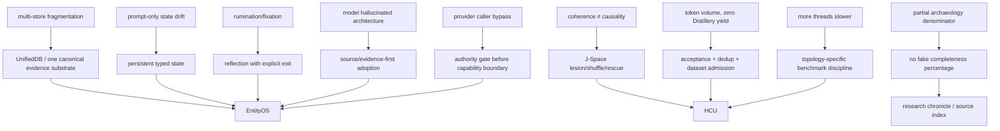

# Project Frankenstein research chronicle

**Purpose:** reconstruct the engineering/research lineage without turning archive prose into present truth.  
**Method:** current authority first; exact source/receipts next; historical Git/source as lineage; inference and hypotheses explicitly marked.

## Reading rule

This chronicle uses four different verbs deliberately:

- **existed in source** — code/document can be pointed to;
- **was measured** — a bounded measurement/receipt exists;
- **was adopted** — mechanism influenced a later architecture;
- **is current** — newest authority/source still admits it.

These are not synonyms.

## 1. The recurring problem

Across Frankenstein, Frank, Clay, EntityOS and HCU, the recurring engineering problem is the same:

```text
new evidence
→ coherent state
→ retrieve relevant history
→ choose/coordinate a response
→ request an effect
→ observe what actually happened
→ correct future behavior
```

The project changed names and implementations because individual parts of that loop repeatedly failed under real integration pressure.

## 2. Historical Frankenstein: many organs, many boundaries

**HISTORICAL_SOURCE:** the Project-Frankenstein archive manifest deep-reads a broad modular architecture: persistent cognition loops, E-PQ/homeostatic state, thalamic gating, global workspace, LCME memory/claims/graph retrieval, reward/motivation, subconscious policy, world/body state, replay/consolidation, projects/goals, hypothesis engines, experiment lab, SOMA training and several visual stacks.

This breadth demonstrates an important design ambition: agency was not treated as “one prompt.” The system tried to externalize functions that ordinary chat models leave implicit.

It also created a cost: every separate service/database/projection created another ownership, synchronization, recovery and provenance boundary.

**INFERENCE:** the later UnifiedDB/canonical-state direction is best understood partly as a reaction to that fragmentation, not as a rejection of modular cognition. The modules can remain typed functions while durable truth converges on one authority substrate.

## 3. State / E-PQ / homeostasis

**HISTORICAL_SOURCE:** `personality/e_pq.py` appears in the archaeology manifest as persistent personality/state, homeostasis and event-learning code.

The durable idea that survives is not a biological label. It is:

> generate and persist a measurable state first; let language/personality realize that state later.

This is compatible with the current separation between deterministic state authority and model-generated realization.

**Failure pressure:** state that exists only in prompt text is easy to overwrite, contaminate or reinterpret. State that exists in several competing stores is easy to contradict.

**Later move:** canonical state/evidence substrate + typed projections + explicit generation/provenance.

## 4. Global workspace / GWT

**HISTORICAL_SOURCE:** `services/global_workspace.py` and `services/consciousness_daemon.py` form part of the historical broadcast/multi-timescale workspace lineage.

**CURRENT_RESEARCH_DIRECTION:** Global J-Space/GWT is now treated as an empirical causal coordination/interface hypothesis rather than a consciousness claim.

That is a major epistemic tightening:

```text
old tempting evidence:
coherent broadcast + recurrence + model report

current required evidence:
exact vector/state identity + intervention + lesion/shuffle/rescue + leak controls
```

**NEGATIVE_RESULT class:** textual recurrence or consensus can be caused by the prompt/schema itself. Therefore output similarity cannot prove hidden-state causality.

## 5. GRF and Hyperposition

**CURRENT_SOURCE CACHE:** `research_entity/00_CURRENT/latest/hyperposition-gwt-grf.md` classifies the area as `PARTIAL_COMPONENT_EVIDENCE`; physical-grid re-entry is still blocked pending true GRID10 runtime acceptance.

Hyperposition’s durable role is to prevent premature collapse of unresolved alternatives. That fits the project’s evidence law:

```text
candidate A + candidate B + recurrence
!= world fact
```

GRF belongs to the project’s mathematical/engineering lineage. It should be linked to exact formulas, prototypes and receipts rather than generalized into a vague claim of emergence.

Useful deep paths include:

- `agentZero/GWT-GRF-Messung-2026-08-22.md`
- `research_entity/global/AGENT_ZERO_JSPACE_IDENTITY_GRF_INJECTION.md`
- `research_entity/trigger_runs/hyperposition/.../HYPERMATH_GRF_PROOF_CARRYING_IR_V11.clay`
- `research_entity/trigger_runs/hyperposition/.../prototype/hypermath_grf_reference.py`

## 6. Memory → UnifiedDB → Emergent Retrieval

Historical memory mechanisms included claims, graph links, vector retrieval, replay/consolidation, project/task memory and world-state persistence.

**Architectural move:** collapse durable truth toward a canonical SQLite substrate while retaining typed tables/views/journals and rebuildable projections.

**Project term:** `Emergent Retrieval` means useful relevance that appears from intersecting independently stored evidence dimensions at query time.

Example:

```text
semantic match
∩ recent enough
∩ causally related
∩ compatible with current state
∩ relevant to current goal
∩ backed by effect/outcome receipt
∩ acceptable provenance/confidence
```

No new fact is created by the intersection.

Reference implementation/benchmark entry points:

- `research_entity/harness/reference/unifieddb_emergent_cascade.py`
- `research_entity/harness/reference/benchmark_unifieddb_emergent_cascade.py`
- `research_entity/harness/reference/benchmark_unifieddb_emergent_assembly.py`

**Current systems discriminator:** SQLite documents a rare WAL-reset corruption bug in older affected versions under concurrent WAL write/checkpoint conditions. That is not evidence that UnifiedDB is affected; it creates a concrete requirement to bind SQLite version + journal mode + connection/concurrency topology before strong durability claims.

## 7. Perception lineage

**HISTORICAL_SOURCE:** archive deep reads cover adaptive vision routing, YOLO/OCR-era pipelines, visual-causal bridge work, FrankEye/Retina artifact consumption and later native multimodal vision replacement claims.

The useful lineage is not “which vision module won.” It is the repeated architecture pattern:

```text
cheap/fast observation
→ uncertainty/error signal
→ selective escalation
→ persist observation with provenance
→ correlate with later state/outcome
```

**NEGATIVE_RESULT class:** a perception stack can exist in source without being causally wired into decision/effect/outcome loops. The archive explicitly preserves integration gaps rather than counting module existence as embodied agency.

## 8. Goals, motivation, policy and projects

Historical sources include reward prediction/motivation (`nucleus_accumbens`), actor-critic/PPO/idle policy (`subconscious`) and persistent project/goal/task machinery (`project_engine`).

These are donor mechanisms for a broader distinction:

- goal/motivation signals can rank candidates;
- they do not create facts;
- they do not bypass capability/effect authority;
- they need observed outcomes to update responsibly.

A goal system without outcome re-entry optimizes an internal story.

## 9. Reflection: useful only with an exit

The project’s strongest current reflection framing is operational, not mystical:

```text
inspect state/outcome
→ detect mismatch
→ propose correction
→ store/retrieve correction
→ alter later behavior
→ EXIT to ACT / ASK / WAIT / RE-OBSERVE / measurable transition
```

**NEGATIVE_RESULT:** recursive reflection can become fixation/rumination.

**OPEN_HYPOTHESIS (confidence: MEDIUM):** a rich external substrate of state + memory + perception + arbitration + effect receipts + verified re-entry materially improves reflective agency.

**Falsifier:** a simpler architecture matches/exceeds the richer substrate on preregistered long-horizon correction/recovery tasks, or ablation finds no benefit.

External agent literature such as ReAct and Reflexion is useful as donor context because it ties reasoning/reflection to action or later trials. It is not evidence that Frankenstein’s implementation works.

## 10. Training: IAPT / SOMA / LoRA → vector/J-Space specialization

**HISTORICAL_SOURCE:** archive material includes IAPT and SOMA training methods, LoRA micro-training, feedback weighting and before/after probes.

Later research moves toward small-model specialization for protocol/ClayCode/J-Space/vector-control behavior.

The recurring failure mode is **interface mismatch**:

- the model may represent a concept internally;
- a prompt may ask for a concrete output label/token;
- the binding between internal state and required external protocol can fail;
- prompt wording can dominate or conflict with weight-level behavior.

Therefore training readiness now requires more than dataset volume:

```text
exact checkpoint/tokenizer/runtime identity
+ exact causal trace identity
+ leak-resistant family split
+ hard negatives
+ frozen baseline
+ intended-behavior intervention
+ off-target regression tests
```

**NEGATIVE_RESULT:** current canonical dataset/Distillery acceptance remains zero at the observed 9.13 frontier, so raw generated token counts grant no training credit.

## 11. ClayCode

ClayCode is part of the project’s attempt to make internal protocol/state transitions more explicit and machine-checkable instead of relying entirely on natural-language convention.

Its research role intersects:

- typed operations and evidence envelopes;
- GRF/Hyperposition intermediate representations;
- model specialization toward one protocol language;
- deterministic compiler/runtime boundaries;
- reduced ambiguity between “model suggested an operation” and “system admitted/executed it.”

This chronicle does not declare a single historical ClayCode file/version as current compiler authority without re-entering its exact current paths/tests first.

## 12. FreeSwarm / Forge / Distillery

The FreeSwarm era is important chiefly because it produced a quantitative Goodhart warning:

> millions of generated tokens and many deltas can coexist with zero accepted Forge/Distillery yield.

That failure sharpened the project’s conversion law:

```text
provider/model output
→ source-qualified delta
→ exact acceptance
→ deterministic package/dataset admission
→ replay/dedup proof
```

Without that chain, token volume is activity, not learning progress.

Current HARD_OFF authority also prevents old free-provider orchestration from silently reactivating.

## 13. GRID10 / HCU

GRID10 supplies a bounded logical-cell baseline and a concrete fabric/regulator/task/lease substrate used by recent experiments.

HCU is the current integrated cognition/compute architecture. Logical cells are function slots, not proof of equal resident models or physical decode concurrency.

**PROJECT_MEASUREMENT / NEGATIVE_RESULT:** a current 4-process/4-vCPU thread-count A/B reported approximately:

```text
1 Torch thread/process: ~8.32 s/call
2 Torch threads/process: ~23.18 s/call
4 Torch threads/process: no completed samples within timeout
```

This does not prove one thread is globally optimal. It falsifies the local hypothesis that two threads were faster on that measured topology.

**OPEN_HYPOTHESIS:** logical scaleout 10→32→64→128→256→~600 can improve useful compute when physical workers, memory, latency and quality are accounted for.

**Falsifier:** matched benchmark shows no useful throughput/quality gain or unacceptable resource/coordination cost.

## 14. Frankenstein master-cognition concept (2026-08-27)

The current concept packet is important because it records a rare good negative result directly in the design process: a helper model proposed architectural components that did not exist in the real GRID10 code. The coordinator rejected those inventions and kept only patterns that could be mapped onto actual SQLite/WAL/CAS regulators and measured mechanisms.

That is exactly how the research archive should be used:

```text
external idea
→ compare with exact source
→ reject invented mismatch
→ salvage structurally useful donor idea
→ label new work as new
```

## 15. Bauleiter / Bugfix / package dispenser and the 9.13 quarantine

Commit `854f6bc87780f4a5242489a6c807d186b16a8c3d` introduced a 72-hour Bauleiter, independent Bugfix role and package dispenser with test sources.

But its direct provider path contradicted current HARD_OFF authority: provider-capable imports/fallback execution could be reached before the canonical authority boundary.

**NEGATIVE_RESULT:** source can be “working” and still be non-operative under current authority.

Commit `3c3dbe5020f57065f47bd4d0a2dce3c537128797` fused the repair on `main`:

- old provider-backed files retained as quarantined provenance;
- supported entrypoints resolve current authority first;
- Together allowance set to zero;
- focused local validation reported `10/10 PASS`;
- evidence scope remains source/local-unit only.

This is a clean example of failure forcing architecture:

```text
capability code existed
→ authority mismatch discovered
→ old code preserved as evidence
→ authority gate moved before capability boundary
→ local boundary tests added
→ no runtime-credit inflation
```

## 16. “Frankenstein v0.7” status

The Trigger-3 specification asks to cover “current Frankenstein v0.7.”

**SEARCH RESULT / NEGATIVE FINDING:** current repository search in this pass did not resolve a source that unambiguously establishes **“Frankenstein v0.7”** as the current canonical version label. A broad `0.7` search returned unrelated numeric occurrences but no verified Frankenstein-v0.7 authority surface.

Therefore this chronicle does **not** manufacture the label.

Status:

```text
Frankenstein v0.7 canonical-version claim: UNRESOLVED
Falsifier/closure: locate exact source/tag/release/authority file binding v0.7 to Frankenstein
```

## 17. Current identity after Frankenstein

Current authority separates lineage from product identity:

```text
persistent research entity: Clay
current product/system: EntityOS
integrated cognition/compute architecture: HCU
Frankenstein/Frank: historical/donor lineage unless current source explicitly re-admits a mechanism
```

This lets the project reuse valuable mechanisms without creating multiple competing products, truth stores or identities.

## 18. Current evidence-credit floor

At the observed supervisor-9.13 frontier during this Trigger-3 pass:

```text
whole EntityOS runtime credit: 0
full HCU runtime credit: 0
Physical GRID10 runtime credit: 0
canonical semantics credit: 0
training credit: 0
canonical dataset rows admitted: 0
```

This does not erase component evidence. It prevents component evidence from being inflated into a larger claim.

## 19. Research graph: failures drive the architecture



## 20. Next exact research gates

1. **Authority convergence:** keep current-facing bootstrap/program/inbox surfaces successor-dynamic and noncontradictory.
2. **UnifiedDB durability fingerprint:** record exact SQLite runtime version, journal mode and concurrent connection/checkpoint topology.
3. **Global J-Space causality:** label-free counterbalanced intervention + lesion/shuffle/rescue at exact model identity.
4. **GRID10/HCU runtime:** regain exact admitted physical runtime evidence before promoting physical-grid/Hyperposition claims.
5. **Dataset conversion:** prove accepted Forge→Distillery row admission + identical replay `+0` before training-readiness promotion.
6. **Archive chronology:** continue exact Git/tree enumeration and preserve “first verified” semantics.
7. **Root topology:** execute mass moves only after frozen path/blob inventory and reference-regression mapping.
8. **AI installer:** verify lifecycle/tool/state/effect capabilities per host and end each route `NATIVE`, `ADAPTED`, `DEGRADED`, or `BLOCKED`.

The research objective is not to make the story cleaner than the evidence. It is to make the evidence graph clean enough that the story cannot silently outrun it.
