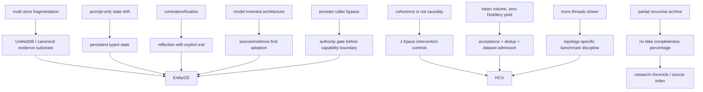

# Project Frankenstein research chronicle

**Purpose:** reconstruct the engineering/research lineage without turning archive prose into present truth.  
**Method:** current authority first; exact source/receipts next; historical Git/source as lineage; inference and hypotheses explicitly marked.

## Reading rule

Four verbs are deliberately different:

- **existed in source** — exact code/document can be pointed to;
- **was measured** — a bounded measurement/receipt exists;
- **was adopted** — a mechanism influenced later architecture;
- **is current** — newest admitted authority/source still admits it.

These are not synonyms.

## 1. Source identity and Git chronology

The historical source repository is `gschaidergabriel/Project-Frankenstein`.

Current Trigger-3 source/history anchor:

`research_entity/archive_assimilation/manifests/PROJECT_FRANKENSTEIN_SOURCE_IDENTITY_HISTORY_ANCHOR_20260827.json`

At the frozen observed source snapshot it establishes:

```text
default-branch head: abba90a5767d85abc8a1ac340bae92842dab35c1
root-tree Merkle anchor: ec21e66c4672fde1f0a5d948ebc51457b69b620a
reachable default-branch commits: 545
oldest reachable commit: e1a8812767668091d146ee958bbc2ebb2743031c
oldest reachable time: 2026-02-14T17:05:27Z
message prefix: Initial commit: AI-Core / Frank — local AI desktop companion
```

The 545 count is a reproducible **default-branch reachable-history denominator** at that frozen scope. It is not an all-ref/unreachable-history denominator and it does not imply complete recursive path or semantic analysis.

Chronology law:

> say **“first verified in accessible Git”** unless creation time is independently evidenced.

The older semantic archaeology manifest remains `PARTIAL_NOT_FROZEN` because its recursive semantic/path obligations are still incomplete.

## 2. Historical Frankenstein: many organs, many boundaries

**HISTORICAL_SOURCE:** the archive deep-reads a broad modular system: persistent cognition loops, E-PQ/homeostatic state, thalamic gating, global workspace, LCME memory/claims/graph retrieval, reward/motivation, subconscious policy, body/world state, replay/consolidation, projects/goals, hypothesis engines, experiment lab, SOMA training, and several visual stacks.

The important design ambition was already clear: agency was not treated as one prompt.

The cost was also clear: every separate service/database/projection created another ownership, synchronization, recovery and provenance boundary.

**INFERENCE:** the later UnifiedDB/canonical-state direction is partly a response to that fragmentation, not a rejection of modular cognition. Typed modules can remain diverse while durable truth converges on one authority substrate.

## 3. State / E-PQ / homeostasis

**HISTORICAL_SOURCE:** `personality/e_pq.py` appears in the archaeology manifest as persistent personality/state, homeostasis and event-learning code.

Durable engineering idea:

> generate and persist measurable state first; let language/personality realize that state later.

Failure pressure:

- prompt-only state is easy to overwrite or contaminate;
- several competing state stores are easy to contradict.

Later move:

```text
canonical state/evidence substrate
+ typed projections
+ explicit generation/provenance
```

## 4. Workspace / GWT → Global J-Space

**HISTORICAL_SOURCE:** `services/global_workspace.py` and `services/consciousness_daemon.py` are part of the historical broadcast/multi-timescale workspace lineage.

**CURRENT_RESEARCH_DIRECTION:** Global J-Space/GWT is now an empirical causal coordination/interface hypothesis, not a consciousness claim.

Epistemic tightening:

```text
insufficient:
coherent broadcast + recurrence + model self-report

required direction:
exact vector/state identity
+ intervention
+ lesion/shuffle/rescue
+ label-free counterbalance
+ prompt/schema-leak controls
```

Textual recurrence or consensus can be caused by prompt/schema recurrence. Output similarity cannot prove hidden-state causality.

## 5. GRF and Hyperposition

Current cache:

`research_entity/00_CURRENT/latest/hyperposition-gwt-grf.md`

Classification remains `PARTIAL_COMPONENT_EVIDENCE`. Physical-grid Hyperposition/GWT re-entry remains blocked pending true GRID10 runtime acceptance.

**Hyperposition** preserves unresolved alternatives. Recurrence or majority does not mint truth.

**GRF** belongs to exact project mathematics/engineering lineage. Link it to formulas, prototypes and receipts rather than using it as a poetic synonym for “emergence.”

Useful deep paths include:

- `agentZero/GWT-GRF-Messung-2026-08-22.md`
- `research_entity/global/AGENT_ZERO_JSPACE_IDENTITY_GRF_INJECTION.md`
- Hyperposition trigger-run proof-carrying ClayCode IR
- Hyperposition/GRF Python reference prototypes

## 6. Memory → UnifiedDB → Emergent Retrieval

Historical memory included claims, graph relations, vector retrieval, replay/consolidation, project/task memory and world-state persistence.

Architectural move:

> collapse durable truth toward one canonical SQLite authority while retaining typed tables, indexes, views, journals, writers/readers and rebuildable projections.

UnifiedDB is not a “god file.” High-rate transient sensor state may remain in RAM when persistence is inappropriate.

Project term **Emergent Retrieval** means relevance becoming visible when independently stored dimensions overlap at query time.

Example:

```text
semantic match
∩ time
∩ causal lineage
∩ current state
∩ goal relevance
∩ perception
∩ effect/outcome receipt
∩ confidence/provenance
```

No new fact is created by the intersection.

Reference entry points:

- `research_entity/harness/reference/unifieddb_emergent_cascade.py`
- `research_entity/harness/reference/benchmark_unifieddb_emergent_cascade.py`
- `research_entity/harness/reference/benchmark_unifieddb_emergent_assembly.py`

### Current SQLite discriminator

SQLite’s official WAL documentation records a rare WAL-reset corruption bug affecting 3.7.0 through 3.51.2 under a specific concurrent WAL write/checkpoint pattern, fixed in 3.51.3 and later (plus specified backports).

This is **not** evidence that UnifiedDB is affected. It creates an exact check:

```text
runtime SQLite version
+ journal mode
+ connection topology
+ concurrent write/checkpoint topology
```

must be bound before strong concurrent-WAL durability claims.

## 7. NVIDIA Unified Memory analogy boundary

CUDA Unified Memory is useful as a systems analogy: fewer ownership/copy boundaries can make coherent computation easier.

It is not database evidence.

```text
GPU/CPU memory coherence
!= SQLite transaction semantics
!= evidence provenance
!= canonical truth authority
```

## 8. Perception lineage

Historical visual deep reads include adaptive routing, YOLO/OCR-era pipelines, visual-causal bridge work, FrankEye/Retina artifact consumption and later native multimodal replacement claims.

Durable pattern:

```text
cheap observation
→ uncertainty/error signal
→ selective escalation
→ persist observation with provenance
→ correlate with later state/outcome
```

A perception module existing in source does not prove causal wiring into the decision/effect/outcome loop.

## 9. Goals, motivation, policy and projects

Historical sources include reward prediction/motivation (`nucleus_accumbens`), actor-critic/PPO/idle policy (`subconscious`) and persistent project/goal/task machinery (`project_engine`).

Durable boundary:

- goal/motivation can rank candidates;
- it cannot create facts;
- it cannot bypass capability/effect authority;
- it needs observed outcomes to update responsibly.

A goal system without outcome re-entry optimizes an internal story.

## 10. Reflection: useful only with an exit

Current engineering framing:

```text
inspect state/outcome
→ detect mismatch
→ propose correction
→ store/retrieve correction
→ alter later behavior
→ ACT | ASK | WAIT | RE-OBSERVE | measurable transition
```

**NEGATIVE_RESULT:** recursive reflection can become fixation/rumination.

**OPEN_HYPOTHESIS:** rich external state/memory/perception/arbitration/effect-receipt substrate improves long-horizon reflective agency.

**Engineering confidence:** medium.  
**Counterhypothesis:** most gain comes from better context construction and a thinner wrapper is sufficient.  
**Falsifier:** matched thin-wrapper vs full-substrate tasks controlling checkpoint, tools and token/context budget, plus component ablations.

ReAct and Reflexion are useful external donor mechanisms because they tie reasoning/reflection to environment interaction or later trials. They are not Frankenstein runtime evidence.

## 11. Training: IAPT / SOMA / LoRA → J-Space/vector specialization

**HISTORICAL_SOURCE:** archive material includes IAPT/SOMA training methods, LoRA micro-training, feedback weighting and before/after probes.

Later research moves toward small-model specialization for protocol/ClayCode/J-Space/vector-control behavior.

Recurring failure mode: **interface mismatch**.

- a model may encode a concept internally;
- the required external label/token/protocol binding can still fail;
- prompt wording may dominate or conflict with weight-level behavior.

Current training-readiness chain is therefore stricter:

```text
exact checkpoint/tokenizer/renderer/runtime identity
+ exact causal trace identity
+ leak-resistant family split
+ deterministic hard negatives
+ frozen baseline
+ intended-behavior intervention
+ off-target regression tests
```

At the observed 9.13 frontier, canonical accepted dataset rows and training credit remain zero.

## 12. ClayCode

ClayCode is part of the attempt to make protocol/state transitions explicit and machine-checkable instead of relying entirely on natural-language convention.

Its research role intersects:

- typed operations/evidence envelopes;
- GRF/Hyperposition intermediate representations;
- model specialization toward one protocol language;
- deterministic compiler/runtime boundaries;
- separating “model suggested operation” from “system admitted/executed operation.”

Do not declare a historical ClayCode compiler/version current without re-entering exact current source/tests.

## 13. FreeSwarm / Forge / Distillery

FreeSwarm produced a strong Goodhart warning:

> large generated-token volume can coexist with zero accepted downstream dataset utility.

Required conversion chain:

```text
model output
→ source-qualified delta
→ exact acceptance
→ Forge/Distillery package or row admission
→ replay/dedup proof
```

Without that chain, token volume is activity, not learning progress.

Current provider HARD_OFF prevents old free-provider orchestration from silently reactivating.

## 14. GRID10 / HCU

GRID10 supplies a bounded logical-cell baseline and fabric/regulator/task/lease substrate.

HCU is the current integrated cognition/compute architecture. Logical cells are function slots, not proof of equal resident models or equal physical decode concurrency.

**PROJECT_MEASUREMENT / NEGATIVE_RESULT:** for the measured four-process/four-vCPU topology:

```text
1 Torch thread/process: 8.3197 s/call average
2 threads/process: 23.1806 s/call average
4 threads/process: zero completed samples within experiment timeouts
```

This falsifies “2 threads is faster” for that topology. It does not prove one thread globally optimal.

**OPEN_HYPOTHESIS:** logical scaleout 10→32→64→128→256→~600 improves useful compute when physical workers, memory, latency and quality are accounted for.

## 15. Frankenstein master-cognition concept (2026-08-27)

The current concept packet records an important negative result: a helper model proposed architecture not present in real GRID10 source. The coordinator rejected those inventions and retained only patterns that mapped onto actual SQLite/WAL/CAS regulators and measured mechanisms.

Correct research pattern:

```text
external idea
→ compare with exact source
→ reject invented mismatch
→ salvage structurally useful donor idea
→ label new work as new
```

## 16. Bauleiter / Bugfix / package dispenser and 9.13 HARD_OFF

Commit `854f6bc87780f4a5242489a6c807d186b16a8c3d` introduced the 72-hour Bauleiter, independent Bugfix role and package dispenser.

Its direct provider path conflicted with current HARD_OFF authority: provider-capable imports/fallback execution were reachable before the canonical authority boundary.

**NEGATIVE_RESULT:** source can be “working” yet non-operative under current authority.

Commit `3c3dbe5020f57065f47bd4d0a2dce3c537128797` fused a source/local-unit closure on `main`:

- provider-backed originals retained as quarantined provenance;
- supported entrypoints resolve authority first;
- Together allowance zeroed;
- focused local validation reported `10/10 PASS`;
- evidence remains source/local-unit scope only.

Architecture lesson:

```text
capability existed
→ authority mismatch discovered
→ provenance retained
→ gate moved before capability boundary
→ local boundary tests
→ no runtime-credit inflation
```

## 17. Version evidence: requested “current Frankenstein v0.7” is contradicted

Trigger-3 requested coverage of “current Frankenstein v0.7.” Exact source-repository evidence does not support that as the current verified version label.

Receipt:

`DEV_SOURCE_RESEARCH/repository/PROJECT_FRANKENSTEIN_VERSION_EVIDENCE_20260827.json`

Observed:

```text
exact code search v0.7: no match
exact code search Frankenstein v0.7: no match
verified tag: v0.8.0
v0.8.0 commit: cd61158937004df6660ee8dafb2e195062b72bd7
release name: F.R.A.N.K. v0.8.0
release published: 2026-03-11T22:41:25Z
release self-description: v0.8 pre-release
```

Bounded conclusion:

```text
“current Frankenstein v0.7” requirement: CONTRADICTED_AS_CURRENT_VERSION_REQUIREMENT
latest verified historical release tag observed: v0.8.0
```

Do **not** infer:

- that an informal internal 0.7 state never existed;
- that v0.8.0 labels every later historical commit;
- that v0.8.0 is the current EntityOS/HCU product version.

Current product identity remains EntityOS + HCU; F.R.A.N.K./Project-Frankenstein is historical/donor lineage unless explicitly re-admitted.

## 18. Current identity after Frankenstein

```text
persistent research entity: Clay
current product/system: EntityOS
integrated cognition/compute architecture: HCU
Frankenstein/Frank: historical/donor lineage unless current source re-admits a mechanism
```

This permits reuse without creating competing product, truth-store or identity authorities.

## 19. Current evidence-credit floor

At the observed supervisor-9.13 frontier:

```text
whole EntityOS runtime credit: 0
full HCU runtime credit: 0
Physical GRID10 runtime credit: 0
canonical semantics credit: 0
training credit: 0
canonical dataset rows admitted: 0
```

This preserves component evidence while preventing scope inflation.

## 20. Failure → architecture graph



## 21. Root curation and installer layer

The intended human navigation layers now exist:

```text
HUMAN_READ_THIS/
DEV_SOURCE_RESEARCH/
AI_START_HERE_DO_NOT_SCAN_REPO/
```

Root `README.md` was deliberately not rewritten.

Mass root relocation remains blocked because:

- the observed root inventory was not proven complete due connector truncation;
- `research_entity/` is a canonical authority/evidence path;
- `the artefact/` is a canonical product workspace;
- a literal four-entry root would therefore require explicit path/authority migration, not cosmetic movement.

Installer work includes a read-only/non-network discovery helper and explicit install-result schema/contract. Host integration must end `NATIVE`, `ADAPTED`, `DEGRADED`, or `BLOCKED` based on observed capability. Config-file existence is never hook/runtime proof.

## 22. External-primary research boundaries

Useful external donors in this Trigger-3 synthesis include:

- SQLite official WAL documentation and 3.51.3 release notes for the WAL-reset discriminator;
- NVIDIA CUDA Unified Memory documentation for ownership/coherence analogy only;
- Global Neuronal Workspace literature as conceptual workspace donor, not software-consciousness evidence;
- ReAct and Reflexion for reasoning/action and reflection-memory mechanisms, not project runtime proof.

## 23. Next exact gates

1. **Authority convergence:** synchronize stale current-facing 8.78 provider language with successor-dynamic 9.13 HARD_OFF while preserving separate owner-authorized non-provider sandbox authority.
2. **Post-gate re-entry:** verify supported Frankenstein caller ordering remains closed at exact newest source identity after parallel movement.
3. **UnifiedDB fingerprint:** bind exact SQLite runtime version, journal mode and concurrent connection/checkpoint topology.
4. **J-Space causality:** label-free counterbalanced intervention + lesion/shuffle/rescue at exact model identity when admitted.
5. **GRID10/HCU:** regain exact admitted physical runtime evidence before physical-grid/Hyperposition promotion.
6. **Dataset conversion:** prove one evidence-qualified accepted Forge→Distillery row/packet plus replay `+0` before training-data utility promotion.
7. **Archive topology:** complete recursive path inventory against the exact Project-Frankenstein root-tree anchor.
8. **Root migration:** move only after exact path/blob inventory, reference audit and canonical path-authority resolution.
9. **Installer verification:** prove real lifecycle firing, durable state and effect receipts per host; otherwise remain ADAPTED/DEGRADED/BLOCKED.

The research objective is not to make the story cleaner than the evidence. It is to make the evidence graph clean enough that the story cannot silently outrun it.
