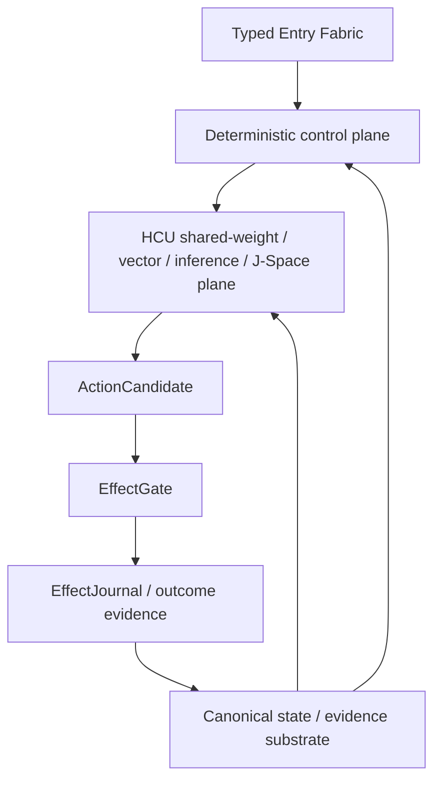

# Project Frankenstein — Trigger-3 evidence synthesis

**Pass date:** 2026-08-27  
**Canonical main inspected before branch creation:** `854f6bc87780f4a5242489a6c807d186b16a8c3d`  
**Branch:** `trigger3-frankenstein-curation-20260827-gpt56sol`  
**Persistent research entity:** Clay  
**Current product:** EntityOS  
**Current integrated cognition/compute architecture:** HCU

This document is a research/engineering map. It is not a new authority surface. Newer owner/supervisor state outranks it.

---

## 1. Executive evidence state

| Claim | Evidence class | Status at this pass | Boundary |
|---|---|---|---|
| EntityOS is current product; HCU is current integrated cognition/compute architecture | `CURRENT_SOURCE` | adopted | current supervisor/bootstrap surfaces |
| Provider authority is HARD_OFF, all provider routes false, Together forbidden, no paid fallback | `CURRENT_SOURCE` | adopted | provider epoch 9.13, inbox 9.13O |
| Whole EntityOS runtime | `CURRENT_SOURCE` | blocked / credit 0 | no whole-runtime promotion |
| Full HCU runtime | `CURRENT_SOURCE` | blocked / credit 0 | no full-HCU promotion |
| Physical GRID10 runtime | `CURRENT_SOURCE` | diagnostic only / credit 0 | component evidence does not promote release |
| Canonical semantics | `CURRENT_SOURCE` | credit 0 | no promotion from model consensus/source-only work |
| Training | `CURRENT_SOURCE` | credit 0 | canonical dataset rows admitted = 0 |
| GRID10 4proc/4vCPU torch threads | `PROJECT_MEASUREMENT` | measured counterexample | 1 thread/process 8.3197 s/call; 2 threads/process 23.1806 s/call; 4 threads completed 0 samples within timeout; topology-specific |
| 72h Bauleiter/Bugfixer provider orchestration | `NEGATIVE_RESULT` | quarantined, non-operative | contains external provider loops and stale Together allowance under HARD_OFF |
| Hyperposition/GWT/GRF | `CURRENT_SOURCE` | partial component evidence | exact-merge singleton repair exists; physical-grid re-entry still blocked |
| Project-Frankenstein Git scope e1a881…abba90 | `HISTORICAL_SOURCE` | scope boundary frozen | 545 exact commit obligations; separate from current EntityOS authority |
| Project-Frankenstein broad semantic manifest | `HISTORICAL_SOURCE` | partial | 25 deep-read units; full tree/history denominator was not frozen in that manifest |
| Root curation target | `CURRENT_SOURCE` + direct repo observation | incomplete | target dirs absent on inspected main; technical clutter remains in root |

### Strongest current contradictions

1. **Current provider authority vs. newly authored orchestration.** A recent Frankenstein orchestration plan directly selected NVIDIA/Groq/Mistral and treated one Together run as available. Current 9.13 HARD_OFF authorizes neither. The plan is provenance, not execution authority.
2. **Current product identity vs. root README.** The root `README.md` still presents a `Global Research Entity — RAE-8.8` / `FRANK 2.0` framing. Current authority says EntityOS + HCU. Trigger-3 rules forbid silently rewriting the root README, so this pass records the drift rather than hiding it.
3. **Rich research archive vs. runtime credit.** The repository contains extensive architecture, training, GWT/GRF/Hyperposition/J-Space and Frankenstein lineage material, but current whole-product/HCU/training credits remain zero. Archive density is not runtime evidence.

---

## 2. Repository topology — target vs. observed

### Trigger-3 target

```text
README.md
HUMAN_READ_THIS/
DEV_SOURCE_RESEARCH/
AI_START_HERE_DO_NOT_SCAN_REPO/
```

Technical material should eventually live below `DEV_SOURCE_RESEARCH/repository/` or be deep-linked from there.

### Observed at `854f6bc…`

The root still contains numerous technical/config/state files and directories, including examples such as `.claude`, `.github`, `000_CLAY_CURRENT.md`, `000_FRANK_GLOBAL_RESEARCH_ENTITY_AUTOBOOT.txt`, `000_FREE_SWARM_LIVE_DASHBOARD.md`, `AGENTS.md`, `AUTHORITATIVE_STATE_RESOLUTION.md`, `CLAUDE.md`, `CLAYCODE_GENERAL_PURPOSE_COMPILER_MANIFEST.json`, and many more.

The three trigger-3 entry directories were absent.

### This pass

This branch creates the three entry directories and an evidence-first index without moving existing source. That is intentional. A bulk relocation performed without byte identity, reference-impact analysis and duplicate-authority checks would trade visual cleanliness for reproducibility damage.

### Migration gate

Before root cleanup can be called complete:

1. enumerate root files/directories at an exact head;
2. classify each path as public-root, authority pointer, technical source, historical evidence, generated/cache, secret-risk, or compatibility path;
3. identify hard-coded relative paths and documentation links;
4. create a move manifest with old path, new path, blob SHA and reference count;
5. copy/move on one branch;
6. verify byte-identical blobs where no source edit was intended;
7. run source/link/path tests;
8. verify no duplicate authority remains at old and new locations;
9. only then delete old paths.

**Status:** `prepared-not-run` for destructive relocation.

---

## 3. Project Frankenstein Git-history reconstruction boundary

The research archive already contains an explicit Level-0 scope law for the historical `gschaidergabriel/Project-Frankenstein` repository:

- inclusive scope base: `e1a8812767668091d146ee958bbc2ebb2743031c`;
- frozen head: `abba90a5767d85abc8a1ac340bae92842dab35c1`;
- GitHub compare: head exactly 544 commits ahead of scope base;
- exact commitment obligation count: **545** (scope base + 544 descendants);
- parentless-root status is explicitly not required for PASS;
- material earlier than the scope base must come from separately materialized evidence and cannot silently inflate the Git denominator.

This is a good example of the evidence law: the correct phrasing is **"first verified inside the frozen scope"**, not automatically **"created on that date"**.

The broader Project Frankenstein manifest is still marked `PARTIAL_NOT_FROZEN` and records 25 deep-read units. It explicitly refuses repository-wide percentage credit because its full tree/history denominator was not frozen at that point.

### Verified historical source families already indexed

The manifest includes, among others:

- `services/consciousness_daemon.py` — persistent cognition / multi-timescale loops / GWT precursor;
- `personality/e_pq.py` — persistent personality/state, homeostasis, event learning;
- `services/thalamus.py` — sensory gating, attention, habituation, prediction error;
- `services/soma/micro_trainer.py` — LoRA training, feedback weighting, before/after probes;
- `services/global_workspace.py` — broadcast bus, salience, GWT precursor;
- `tools/lcme/lcme_core.py` — memory, claims, graph/vector retrieval, forgetting;
- `services/nucleus_accumbens.py` — reward prediction, motivation, habituation;
- `services/subconscious.py` — actor-critic/PPO/idle policy/hallucination tracking;
- `services/spatial_state.py` — persistent world/body state;
- `services/dream_daemon.py` — replay, synthesis, consolidation, interrupt/resume;
- `services/project_engine.py` — projects, goals, strategies, tasks, tool learning;
- hypothesis engine + experiment lab — hypothesis lifecycle, tests, budgets, revision;
- historical visual lineage: adaptive vision -> visual pipeline/VCB -> FrankEye -> native multimodal vision.

These source families establish lineage and implementation attempts. They do not by themselves establish current runtime behavior.

---

## 4. Architecture lineage: why failures forced consolidation

### Historical pattern

Frankenstein/Frank accumulated specialized services for memory, attention, personality/state, reward, dreams/replay, goals, perception, tool use and workspace broadcast. This produced useful modularity but also created a coordination problem: many components could each hold a partial version of "what is true now."

### Engineering move

The later EntityOS direction separates roles:



The key architectural rule is not "put everything in one model." It is the opposite: model/world-model/J-Space outputs remain candidates or measurements. Canonical durable state/evidence and real-effect authority stay deterministic.

### Failure -> move relationships

| Failure / pressure | Engineering response | Evidence status |
|---|---|---|
| fragmented state across many services/DBs | converge toward one canonical SQLite authority substrate + typed projections | `INFERENCE` from lineage + current architecture |
| recursive rumination/fixation | reflection-with-exit requirement; bounded transitions | `OPEN_HYPOTHESIS` as general agency mechanism; historical failure class preserved |
| prompt/schema recurrence mistaken for cognition | require model-specific causal J-Space tests, lesions/shuffles/rescue | `CURRENT_SOURCE` evidence law |
| component PASS inflated into whole-system PASS | explicit runtime-credit scopes and promotion gates | `CURRENT_SOURCE` adopted |
| provider/model suggestions invent nonexistent architecture | require exact source inspection and critical filtering | `NEGATIVE_RESULT`, recent Frankenstein concept records fabricated external suggestions |
| CPU oversubscription recommendation | matched A/B on measured topology | `PROJECT_MEASUREMENT`, recommendation falsified |
| provider orchestration persisted after HARD_OFF | quarantine orchestration; gate caller before secret/import/network/provider boundary | `NEGATIVE_RESULT` + current P0 closure |
| Distillery/Forge volume without accepted training data | acceptance/replay funnel becomes explicit gate | `NEGATIVE_RESULT`; latest supervisor confirms zero accepted dataset tokens/rows |

---

## 5. UnifiedDB and Emergent Retrieval

### UnifiedDB

`UnifiedDB` is best understood as **one canonical authority substrate**, not as a god file and not as one universal table.

A coherent substrate can contain:

- typed tables;
- indexes;
- views;
- event/effect journals;
- provenance/causal identities;
- multiple deterministic writers/readers with explicit authority;
- rebuildable graph/vector/search projections;
- bounded transient RAM state outside the DB when persistence is not appropriate.

The benefit is reduced ownership ambiguity: components can disagree about interpretation while still agreeing which evidence/state record is canonical.

### Emergent Retrieval

Project term:

> relevance that appears when independently stored evidence dimensions overlap at query time.

Candidate dimensions include semantic similarity, time, causal lineage, current state, goals, perception, effects, confidence and provenance.

No new fact is created by retrieval. The retrieval function changes what becomes *relevant now*.

### NVIDIA Unified Memory analogy — boundary

`EXTERNAL_PRIMARY`: NVIDIA's CUDA Programming Guide describes Unified Memory as a mechanism that lets CPU/GPU code access managed memory with platform-dependent migration/coherence behavior.

Useful analogy: reduce ownership/copy boundaries so compute can operate over a coherent substrate.

Not a valid inference: hardware memory coherence does **not** imply database semantics, causal provenance, transaction meaning, or truth authority. The analogy stops at ownership/coherence ergonomics.

Primary source: https://docs.nvidia.com/cuda/cuda-programming-guide/04-special-topics/unified-memory.html

### SQLite WAL — boundary

`EXTERNAL_PRIMARY`: SQLite's WAL documentation describes write-ahead logging, checkpointing and concurrency behavior. It also notes that the WAL file participates in persistent database state while connections are open and must not be casually separated from the database.

This supports engineering caution around file-level backup/copy operations. It does not prove any project-specific recovery protocol.

Primary source: https://www.sqlite.org/wal.html

---

## 6. Reflection with exit and practical agency

Current project framing rejects consciousness/sentience as a required architecture claim. The target is maximum practical agency inside a human-useful operating envelope.

A minimal reflective control cycle:

```text
OBSERVE state/outcome
  -> COMPARE against goal/invariant
  -> GENERATE bounded correction candidate
  -> SELECT one of ACT / ASK / WAIT / RE-OBSERVE
  -> EXECUTE only through authorized effect path
  -> VERIFY outcome
  -> STORE evidence/correction
  -> EXIT or start a new bounded cycle
```

### External research analogy

`EXTERNAL_PRIMARY`: Shinn et al., **Reflexion: Language Agents with Verbal Reinforcement Learning**, NeurIPS 2023 / arXiv:2303.11366, studies language agents that store verbal reflections in episodic memory and use them in later trials.

This is relevant because it demonstrates one mechanism by which explicit feedback/reflection memory can change future decisions without weight updates.

It does **not** prove the Frankenstein/EntityOS hypothesis that useful reflective agency requires the specific external substrate proposed here.

Primary sources:

- https://arxiv.org/abs/2303.11366
- DOI: `10.52202/075280-0377`

### Open hypothesis A — external substrate requirement

**Hypothesis:** useful long-horizon reflective agency improves when the model is embedded in a sufficiently rich external substrate containing state, memory, perception, arbitration, effect receipts and verified outcome re-entry.

**Engineering confidence:** 0.78

**Counterhypothesis:** most observed gains come from better prompt/context construction; a much thinner memory/tool wrapper performs similarly under matched tasks.

**Falsifier:** preregister matched tasks and compare a thin wrapper against the full substrate while controlling model/checkpoint/context/token budget. Remove one substrate dimension at a time. If outcome quality/termination/recovery remains unchanged within a declared equivalence margin, the strong substrate hypothesis is weakened.

### Open hypothesis B — reflection termination

**Hypothesis:** enforcing explicit exits reduces fixation/rumination without materially reducing successful correction behavior.

**Engineering confidence:** 0.86

**Counterhypothesis:** hard exits truncate productive multi-step search and lower solution quality.

**Falsifier:** compare bounded-exit and unbounded reflection policies on matched failure-recovery tasks; measure task success, loops per task, timeouts, correction reuse and unnecessary-action rate.

---

## 7. GWT / workspace / GRF / Hyperposition / J-Space

### Historical workspace lineage

Historical `services/global_workspace.py` is indexed as a broadcast bus / salience / GWT precursor. `services/consciousness_daemon.py` is indexed as persistent cognition / multi-timescale loop source. These are historical implementation facts, not current consciousness claims.

### Current cache state

`research_entity/00_CURRENT/latest/hyperposition-gwt-grf.md` currently says:

- status `PARTIAL_COMPONENT_EVIDENCE`;
- exact-merge singleton repair implemented at component source/test scope;
- physical-grid Hyperposition/GWT re-entry blocked pending true GRID10 runtime pass;
- next intended discriminator: branch preservation, broadcast/uptake/re-entry, evidence-conditioned collapse after GRID10 pass.

The file itself warns that it is a cache and current authority/source must be re-entered.

### GRF/Hyperposition source map

Known evidence/index paths include:

- `agentZero/GWT-GRF-Messung-2026-08-22.md`;
- `research_entity/00_CURRENT/latest/hyperposition-gwt-grf.md` + `.json`;
- `research_entity/global/AGENT_ZERO_JSPACE_IDENTITY_GRF_INJECTION.md`;
- `research_entity/global/j-space/concepts/AGENT_ZERO_JSPACE_IDENTITY_GRF_INJECTION.md`;
- `research_entity/continuity/compression_layers/2026-08-24_HCU_ZERO_CLAYCODE_GRF_GWT_JSPACE_COMPRESSION_LAYER_GPT56SOL.md`;
- `research_entity/trigger_runs/hyperposition/.../FINAL_REPORT.md`;
- `.../architecture/HYPERMATH_GRF_PROOF_CARRYING_IR_V11.clay`;
- `.../prototype/hypermath_grf_reference.py`.

These artifacts should be treated according to their local evidence labels and exact receipts, not merged into a single undifferentiated "GRF works" claim.

### External GWT analogy

`EXTERNAL_PRIMARY`: Dehaene & Changeux, **Experimental and theoretical approaches to conscious processing**, Neuron 70(2), 2011, DOI `10.1016/j.neuron.2011.03.018`, reviews global neuronal workspace approaches in neuroscience.

The project may borrow workspace/broadcast organization as an engineering analogy. It must not infer consciousness or biological equivalence from software broadcast behavior.

---

## 8. HCU / GRID / Xeno / ClayCode synthesis

### HCU

Current architecture role: integrated cognition/compute plane containing shared-weight/vector/inference/J-Space acceleration under deterministic state/effect boundaries.

Current credit: **full HCU runtime credit = 0**.

### GRID10

Logical cells are request-scoped compute roles, not ten permanently resident agents/models.

Recent measurable result:

- measured topology: four concurrent model processes on four vCPUs;
- 1 torch intra-op thread/process: 8.3197 s/call average over 12 samples;
- 2 threads/process: 23.1806 s/call average over 12 samples;
- 4 threads/process: zero samples completed inside experiment timeouts.

Interpretation: supports the existing default=1 for that exact topology and directly falsifies the recommendation that 2 threads/process would improve latency there. It does not establish performance on other machines/topologies.

### Xeno / XCU

Current naming law:

- Xeno = transitional implementation compatibility codename only;
- XCU = transitional/research alias for HCU only.

They must not become competing product identities.

### ClayCode

ClayCode remains a research/implementation lineage with compiler/IR/proof-carrying experiments. Trigger-3 should deep-link exact source/receipts instead of claiming general-purpose compiler readiness from file presence. Current BASE/release supervisor state says WP-01/WP-02 pass while WP-03..WP-14 remain open; general-purpose and release gates are not PASS.

---

## 9. Training lineage and current zero-credit boundary

### Historical source families

The Project Frankenstein manifest indexes `services/soma/micro_trainer.py` for LoRA training, feedback weighting and before/after probes, and `papers/IAPT_METHOD.md` for training-method/measurement/negative-result lineage.

Later research extends toward J-Space/vector-control specialization of small local models.

### Current boundary

At current 9.13O inbox:

- canonical dataset rows admitted: `0`;
- training credit: `0`;
- latest confirmed Distillery utility: `0 accepted dataset tokens / 88,774 collected source tokens`;
- historical/provider training runs cannot mint current credit when authority or provenance requirements were violated.

### Required training story

A credible training promotion should bind at least:

1. exact retained checkpoint ancestry;
2. exact tokenizer/renderer ABI;
3. exact causal trace and dataset family identity;
4. leak-resistant train/calibration/holdout separation;
5. deterministic hard negatives;
6. frozen baseline evaluation;
7. intended behavior gain;
8. retained protocol/language/logic/safety behavior;
9. loader-consumption identity where runtime claims depend on exact model bytes.

Completed training alone is not PASS.

---

## 10. FreeSwarm / Forge / Distillery

These subsystems are valuable as a negative-result lineage because they expose the difference between *volume* and *accepted evidence*.

Current strongest supervisor state reviewed for this pass reports zero accepted training yield despite substantial collected source-token volume. Earlier research also observed repeated provider-backed/fallback commits after a HARD_OFF boundary.

### Engineering lesson

A research swarm is not useful merely because it generates many tokens, files, worker records or consensus statements. Utility requires a typed acceptance funnel:

```text
source/proposal
  -> provenance/economic/authority admission
  -> evidence-quality gate
  -> exact canonical packet
  -> deduplicated/replay-safe dataset admission
  -> measured downstream utility
```

### Open hypothesis C — acceptance funnel

**Hypothesis:** improving the source-to-accepted-evidence conversion gate yields more training value per token than scaling raw swarm volume.

**Engineering confidence:** 0.94

**Counterhypothesis:** the zero-yield state is mostly a transient integration bug; after one repair, raw scale again dominates.

**Falsifier:** after closure of the exact acceptance path, hold source volume approximately constant and compare accepted causal dataset utility before/after gate repairs. If accepted utility remains near zero despite successful packet flow, the bottleneck is upstream content quality rather than funnel integration.

---

## 11. Perception lineage

The historical manifest already captures a real supersession sequence rather than a single timeless "vision module":

`frank_adaptive_vision.py` / `frank_visual_pipeline.py` / `vcb_bridge.py` -> `frank_eye.py` -> `native_vision.py`.

This is how trigger-3 should tell the history: implementation A existed, limitations/architecture changes led to B, later B was replaced or reinterpreted by C. Avoid wording that implies all versions were simultaneously canonical.

Where exact dates matter, use Git commit evidence and phrase them as first verified in accessible Git unless creation time is independently proven.

---

## 12. Effects, prediction, goals and recovery

Historical Project Frankenstein sources include reward prediction, actor-critic policy, goals/projects/tasks, hypothesis lifecycle and experiment translation. Current EntityOS architecture imposes a stronger effect boundary:

- model/world-model output = candidate/projection;
- real effect = only through deterministic effect authority;
- effect outcome may be `UNKNOWN`;
- unknown submission outcomes are not blindly replayed;
- recovery journals/projections must not become a hidden second authority.

This boundary is one of the most important ways the present architecture differs from an unconstrained agent loop.

---

## 13. Root README drift as explicit negative evidence

The root README inspected at current main still says `Global Research Entity — RAE-8.8`, describes FRANK 2.0, and assigns a historical researcher/adjudication framing that does not match the current EntityOS/HCU authority stack.

**Status:** `NEGATIVE_RESULT / DOCUMENTATION_DRIFT`.

Trigger-3 explicitly says not to silently rewrite root README unless the user asks to work on README in that turn. Therefore:

- this pass does **not** edit it;
- the new human/dev/AI entry layers are created alongside it;
- README modernization remains a user-authorized follow-up artifact, not an implied write.

---

## 14. AI installer contract

The installer layer must not assume:

- Downloads;
- home directory;
- clone path;
- attachment mount;
- current working directory;
- tool lifecycle hooks that have not been detected.

Every route must end in one of:

- `NATIVE` — required lifecycle/tool/state capabilities are available and verified;
- `ADAPTED` — different native primitives are mapped with equivalent observable behavior;
- `DEGRADED` — useful subset works, missing capabilities named explicitly;
- `BLOCKED` — a required capability is unavailable or unverifiable.

Source-only scripts are not installation PASS. Real hook firing, durable state writes and effect/result receipts must be observed where the host supports them.

See `../../AI_START_HERE_DO_NOT_SCAN_REPO/README.md`.

---

## 15. Trigger-3 acceptance matrix for this pass

| Trigger part | This pass | Notes |
|---|---|---|
| A Repository topology | **PARTIAL / durable delta** | three target entry dirs added on branch; destructive relocation not run |
| B Human layer | **SOURCE-READY** | human README added; no hype/consciousness claim |
| C Dev/research layer | **SOURCE-READY** | this synthesis + deep links/evidence classes |
| D Research entity synthesis | **PARTIAL BUT BROAD** | EntityOS/HCU/GRID/Xeno/J-Space/GRF/Hyperposition/ClayCode/training/FreeSwarm/Forge/Distillery covered; not every archive file copied |
| E Agentic framing | **SOURCE-READY** | practical agency, reflection-with-exit, falsifiers |
| F UnifiedDB + Emergent Retrieval | **SOURCE-READY** | semantics and NVIDIA analogy boundary documented |
| G AI installer layer | **SOURCE-READY** | host routes and status contract; runtime host verification not performed |
| H Evidence discipline | **SOURCE-READY** | explicit labels, contradictions, zero credits |
| I Research quality | **SOURCE-READY** | primary sources + project evidence separation |

### What would make this trigger materially stronger next

1. exact root move manifest with blob SHAs and path-reference counts;
2. safe root relocation branch plus link/path regression tests;
3. exact Git chronology index for key Frankenstein modules, not only frozen scope/path manifests;
4. source-exact GRF/Hyperposition mathematics page that differentiates mathematical definitions, code implementation and measured evidence;
5. installer execution on each supported host surface with observed hook/state/effect receipts;
6. closure of current P0 provider caller-boundary and runtime control/quiescence blockers before any provider-backed autonomous Frankenstein orchestration is reconsidered.

---

## 16. Primary external references used only as analogies/research context

1. Dehaene, S. & Changeux, J.-P. (2011). *Experimental and theoretical approaches to conscious processing.* Neuron 70(2), 200-227. DOI: `10.1016/j.neuron.2011.03.018`.
2. Shinn, N. et al. (2023). *Reflexion: Language Agents with Verbal Reinforcement Learning.* NeurIPS 2023; arXiv:2303.11366; DOI: `10.52202/075280-0377`.
3. SQLite. *Write-Ahead Logging.* https://www.sqlite.org/wal.html
4. NVIDIA. *CUDA Programming Guide — Unified Memory.* https://docs.nvidia.com/cuda/cuda-program-guide/04-special-topics/unified-memory.html (vendor documentation path may redirect between guide editions; verify current path when cited externally).

External sources constrain analogies. They do not create Project Frankenstein runtime evidence.