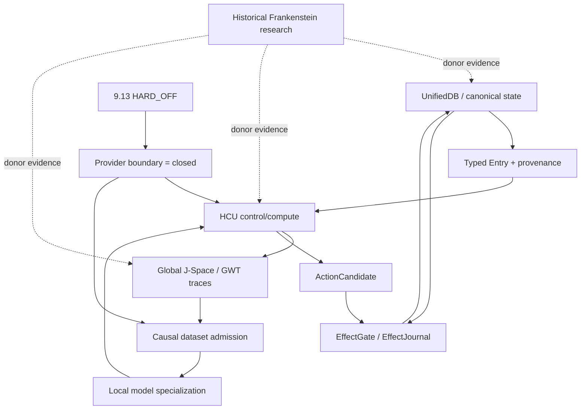

# Triggerword 3 — Frankenstein curation/research pass

**Date:** 2026-08-27  
**Organ:** GPT-5.6 Sol / ChatGPT  
**Branch:** `trigger3/frankenstein-curation-20260827-gpt56sol`  
**Starting canonical main:** `854f6bc87780f4a5242489a6c807d186b16a8c3d`  
**Repository:** `gschaidergabriel/clay-global-research-entity`  
**Root README modified:** **NO**

This report is a bounded curation delta. It does not replace canonical authority or claim repository-wide completion where exact denominators are not frozen.

---

## Executive result

The pass found a sharp current-state conflict that must dominate all Frankenstein curation:

1. `main` contains a newly implemented Bauleiter/Bugfix/package-dispenser system with 29 source-level tests reported green in commit `854f6bc…`.
2. The current `SUPERVISOR_INBOX.json` is 9.13O and explicitly carries provider-authority epoch 9.13 HARD_OFF.
3. 9.13O quarantines the provider-calling 72h Frankenstein orchestration as non-operative because it directly selects NVIDIA/Groq/Mistral and retains a stale Together allowance.
4. Therefore the new scripts are useful historical/source material but **receive zero current execution authority and zero runtime promotion** under the current state.

This is exactly the kind of contradiction Triggerword 3 is meant to preserve rather than smooth over.

---

## Evidence ledger

| Claim | Evidence class | Status | Exact boundary |
|---|---|---|---|
| Persistent research entity = Clay; product = EntityOS; compute architecture = HCU | CURRENT_SOURCE | adopted | current continuity/program authority, subject to newer owner authority |
| Verified main at pass start = `854f6bc87780f4a5242489a6c807d186b16a8c3d` | CURRENT_SOURCE | measured | GitHub commit listing during this pass |
| Supervisor inbox = 9.13O; provider authority epoch 9.13 HARD_OFF | CURRENT_SOURCE | adopted | `SUPERVISOR_INBOX.json` + selected 9.13O steering |
| Bauleiter/Bugfix/package-dispenser source exists; 29 tests reported green | CURRENT_SOURCE | source-ready | commit `854f6bc…`; source/test claim is not provider execution authority |
| Provider-calling 72h orchestration is non-operative under HARD_OFF | CURRENT_SOURCE | blocked/quarantined | selected 9.13O steering |
| GRID10 1 thread/process beat 2 threads/process on measured 4-proc/4-vCPU topology | PROJECT_MEASUREMENT | measured diagnostic | 8.3197 s/call vs 23.1806 s/call; no topology generalization |
| 4 threads/process completed zero samples within experiment timeouts | PROJECT_MEASUREMENT | measured diagnostic | same matched diagnostic |
| Latest confirmed Distillery accepted dataset tokens = 0 / 88,774 collected | NEGATIVE_RESULT | measured | 9.13O steering; no training credit |
| Canonical dataset rows admitted = 0 | NEGATIVE_RESULT | measured | 9.13O inbox |
| Whole EntityOS/HCU runtime credit = 0 | CURRENT_SOURCE | blocked | 9.13O current frontier |
| Full HCU runtime credit = 0 | CURRENT_SOURCE | blocked | 9.13O current frontier |
| Training credit = 0 | CURRENT_SOURCE | blocked | 9.13O current frontier |
| Archived Project-Frankenstein deep-read manifest covers 25 units but exact tree/history denominator is unfrozen | HISTORICAL_SOURCE | partial | `PROJECT_FRANKENSTEIN_MANIFEST.json` |
| SQLite WAL supports append-then-checkpoint transaction flow and concurrent readers | EXTERNAL_PRIMARY | source-grounded | SQLite official docs; analogy/support only |
| SQLite WAL-reset bug fixed in 3.51.3 (plus stated backports) | EXTERNAL_PRIMARY | source-grounded | SQLite official WAL docs; project runtime version still must be measured |
| Global Neuronal Workspace describes selective global availability/broadcast | EXTERNAL_PRIMARY | source-grounded | Dehaene & Changeux, Neuron 2011, DOI 10.1016/j.neuron.2011.03.018 |
| Reflexion uses feedback/reflection stored in episodic memory to alter later trials | EXTERNAL_PRIMARY | source-grounded | Shinn et al., arXiv:2303.11366; comparison only |
| NVIDIA Unified Memory reduces explicit CPU/GPU memory-management boundaries | EXTERNAL_PRIMARY | source-grounded | CUDA Programming Guide; analogy only |

---

# A. Repository topology

## Target

Canonical public root target from Triggerword-3 semantics:

```text
README.md
HUMAN_READ_THIS/
DEV_SOURCE_RESEARCH/
AI_START_HERE_DO_NOT_SCAN_REPO/
```

## This pass

Created:

- `HUMAN_READ_THIS/README.md`
- `DEV_SOURCE_RESEARCH/README.md`
- `AI_START_HERE_DO_NOT_SCAN_REPO/README.md`
- this pass report
- machine-readable evidence index

Did **not** rewrite root `README.md`.

Did **not** mass-move current root technical paths.

### Why root migration is prepared-not-run

A blind root cleanup can break:

- imports;
- relative paths;
- CI/workflows;
- receipt/source identities;
- historical reproducibility;
- current scripts that derive repository root from fixed parent counts;
- external tooling that assumes current paths.

The correct next topology action is a path-dependency census plus relocation manifest with byte/hash preservation and compatibility shims where required. Until that exists, a visual cleanup is lower quality than the existing clutter.

**Status:** `prepared-not-run`  
**Confidence:** 0.97 that migration must be dependency-aware.  
**Falsifier:** exhaustive path/reference analysis proves target files can be moved byte-identically without breaking any current source/test/receipt contract.

---

# B. Human layer

Created a short cumulative English human entry that explains:

- Project Frankenstein;
- state -> memory/retrieval -> decision -> effect -> verification loop;
- UnifiedDB;
- Emergent Retrieval;
- engineering self-reflection with mandatory exits;
- effects and verification;
- HCU and Global J-Space/GWT hypothesis boundary;
- SQLite/WAL role;
- NVIDIA Unified Memory analogy boundary;
- major negative results;
- current 9.13O HARD_OFF conflict;
- Gabriel Gschaider and Dr. Andreas Unterweger provenance roles;
- `iar.frank.ink` provenance.

No consciousness/sentience claim is used as an architecture premise.

**Status:** `source-ready` on curation branch.

---

# C. Dev / research layer

Created a progressive-disclosure technical entry with:

- authority order;
- Mermaid state/cognition/effect loop;
- historical Frankenstein manifest navigation;
- UnifiedDB/Emergent Retrieval source surfaces;
- GWT/J-Space/Hyperposition framing;
- reflection termination law;
- HCU/GRID mode semantics;
- measured thread-count counterexample;
- training ancestry/evidence warnings;
- FreeSwarm/Forge/Distillery zero-yield result;
- provider-orchestration quarantine;
- external analogy boundaries;
- evidence labels and archive status vocabulary.

The current historical Frankenstein manifest remains explicitly partial. This pass does not convert “retrieved Git window” into “complete Git history”.

**Status:** `source-ready`.

---

# D. Research Entity synthesis

## Current vs historical

The research archive is useful evidence, not a truth oracle.

### Current adopted layer

- EntityOS = current product.
- HCU = current integrated cognition/compute architecture.
- canonical durable truth/evidence remains deterministic and outside model-generated cognition.
- real state-changing effects remain behind deterministic effect authority/journaling.
- Global J-Space/GWT remains an empirical causal hypothesis.

### Historical / donor layer

- Frank / Project Frankenstein architecture;
- ClayVerse;
- Mini Entity / MicroEntity;
- Xeno;
- XCU;
- older multi-service state layouts;
- historical bio-inspired naming.

Historical names may remain in exact paths/receipts for reproducibility. They are not promoted into competing authorities.

## Required archive status vocabulary

For future indexed lines:

```text
attempted
source-ready
measured
reproduced
contradicted
blocked
prepared-not-run
adopted
retired
```

The machine-readable index created in this pass seeds this classification without copying the archive into prose.

---

# E. Agentic research framing

## Working engineering hypothesis

Useful reflective agency requires a sufficiently rich external substrate of:

- state;
- memory/retrieval;
- perception;
- arbitration/control;
- effect receipts;
- verified outcome re-entry.

Reflection is only useful if it changes a later measurable transition.

### Counterhypothesis

A sufficiently capable model with a simpler event log and tool loop may achieve the same practical agency without a rich dedicated external cognitive substrate.

### Discriminator

Matched task suite:

1. same base model/checkpoint;
2. same tool permissions;
3. same tasks and seeds where deterministic;
4. baseline = minimal event log/tool loop;
5. treatment = typed state + retrieval + explicit effect receipts + bounded reflection exits;
6. measure task success, recovery after interruption, false-effect assumptions, repeated-error rate, latency and state reconstruction accuracy.

**Engineering confidence in richer-substrate hypothesis:** 0.72.  
**Promotion rule:** task-matched executable evidence only.

---

# F. UnifiedDB + Emergent Retrieval

## Synthesis

Historical fragmentation across many DBs/services increased state ownership and reconstruction complexity. The current design direction favors one canonical deterministic authority substrate with typed internal partitions and rebuildable projections.

This does not forbid:

- multiple tables;
- typed journals;
- indexes;
- projections;
- high-rate transient RAM buffers;
- specialized readers/writers.

It forbids hidden competing truth authorities.

## Emergent Retrieval definition

Relevance appears through intersection/overlap of independently stored evidence dimensions. It is a query-time assembly property, not spontaneous fact creation.

### Open hypothesis

A multi-dimensional typed retrieval cascade improves relevant recall while reducing context contamination compared with a single semantic-vector top-k retrieval.

**Confidence:** 0.78 based on project direction, not current whole-system proof.

### Falsifier

A preregistered query set where semantic-only top-k matches or beats the cascade on relevance, causal consistency, temporal correctness, provenance correctness and downstream task performance at equal or lower latency/cost.

---

# G. AI installer layer

Created `AI_START_HERE_DO_NOT_SCAN_REPO/README.md` with:

- no assumed clone/download/home/cwd path;
- dynamic path derivation from the entry file;
- exact authority-read order;
- HARD_OFF fail-closed rule before secret/provider boundaries;
- host-specific routes for Claude Code, Codex CLI, Hermes Agent, ChatGPT Web, Claude Web, Grok Web and generic fallback;
- explicit capability matrix;
- required verification of real hooks/state/effect receipts;
- final class exactly one of `NATIVE / ADAPTED / DEGRADED / BLOCKED`.

This curation pass itself does not claim that any of those hosts has completed a native installation.

---

# H. Evidence discipline

## Preserved contradiction: green source tests vs no authority

Commit `854f6bc…` reports 29 green tests for the new orchestration scripts.

That supports only the tested source/component behavior.

It does not override 9.13 HARD_OFF.

The selected steering states that future Frankenstein orchestration must resolve authority **before**:

- secret lookup;
- provider import;
- network;
- Aider;
- external fallback dispatch.

Under HARD_OFF it must prove:

```text
provider_calls = 0
secret_lookups = 0
```

The instruction also says not to modify Frank’s own Harness to close this boundary.

## Negative result: raw scale without accepted dataset yield

Latest confirmed:

```text
accepted_dataset_tokens = 0
collected_source_tokens = 88,774
Source->GO = 0.000%
canonical_dataset_rows_admitted = 0
training_credit = 0
```

This remains visible in the public technical synthesis because hiding it would make later architecture decisions less intelligible.

## Negative result: thread oversubscription recommendation

The matched GRID10 diagnostic directly falsified the recommendation that 2 threads/process would be faster on the measured 4-process/4-vCPU topology.

This should be preserved as a counterexample, not generalized into a universal “one thread is always best” law.

---

# I. Research quality / external primary triangulation

External references used for design comparison:

1. **SQLite WAL official documentation** — transaction append/checkpoint/concurrency model; current doc also describes WAL-reset bug fixed in SQLite 3.51.3 and backports.
2. **Dehaene & Changeux (2011), Neuron** — Global Neuronal Workspace / conscious-access theory; used only as an engineering analogy/hypothesis source, not a software consciousness proof.
3. **Shinn et al. (2023), Reflexion** — reflection + episodic memory affecting later agent decisions; comparison only.
4. **NVIDIA CUDA Programming Guide, Unified Memory** — memory-management/coherence paradigms; systems analogy only.

No external source is used to upgrade local source into runtime evidence.

---

# High-value codependency map



---

# Current blocker ordering after this pass

## P0 — authority/security closure

Close the actual external caller boundary before any provider secret/import/network/fallback path. The current provider-calling Frankenstein 72h orchestration must remain non-operative under HARD_OFF.

## P0 — control/quiescence

Supervisor 9.13O retains bootstrap-v2/control-sync recovery and quiescence as current executable control priorities. This curation pass does not claim those runtime gates are closed.

## P1 — clean non-provider re-review/re-execution

Provider-authored post-HARD_OFF core changes need independent clean non-provider review/re-execution before retained runtime credit.

## P1 — evidence conversion

Forge/Distillery must produce an evidence-qualified persistent positive-token witness and idempotent replay before training readiness can be promoted.

## P1 — topology-safe repository cleanup

Before moving root technical clutter:

1. enumerate candidate root entries;
2. search all repository references/imports/workflows/docs;
3. create path migration manifest with old path -> new path;
4. preserve source bytes/hashes unless intentional source modification is declared;
5. add compatibility shims only where required;
6. run static/import/docs link checks;
7. only then perform relocation.

---

# Acceptance for this Triggerword-3 curation delta

| Area | Result |
|---|---|
| Current authority refreshed | PASS |
| Current main refreshed | PASS |
| Root README silently rewritten | PASS: not modified |
| Human entry created | PASS |
| Dev/research entry created | PASS |
| AI no-scan installer entry created | PASS |
| Archive used as evidence, not truth oracle | PASS |
| Current vs historical naming separated | PASS |
| Provider orchestration conflict exposed | PASS |
| Negative results preserved | PASS |
| External primary references added with analogy boundary | PASS |
| Full Git chronology reconstructed exhaustively | NOT PASS — denominator/history not frozen |
| Root reduced to four public entries | PREPARED_NOT_RUN — dependency-safe relocation not yet proven |
| Whole EntityOS/HCU runtime acceptance | NOT PASS / credit 0 |
| HCU full runtime acceptance | NOT PASS / credit 0 |
| Training acceptance | NOT PASS / credit 0 |

---

# Next exact non-destructive curation gate

Generate a **root path-dependency migration manifest** from exact current `main` that classifies every root entry as:

```text
PUBLIC_KEEP
MOVE_BYTE_IDENTICAL
MOVE_WITH_COMPAT_SHIM
HISTORICAL_PRESERVE
GENERATED_OR_VENDOR
UNKNOWN_BLOCK
```

For every move candidate, bind:

```text
old_path
new_path
blob/tree identity
repository references
runtime/import references
workflow references
receipt/provenance references
compatibility requirement
test required
```

Do not perform the mass move until all `UNKNOWN_BLOCK` items are resolved.

---

# Sources / exact project paths

- `research_entity/claycode/autonomous/SUPERVISOR_INBOX.json`
- `research_entity/claycode/autonomous/SUPERVISOR_STEERING_9_13O_DELTA_2026-08-27T2341P0700_GPT56SOL.json`
- `research_entity/continuity/BOOTSTRAP_MINIMAL.json`
- `research_entity/rooms/PROGRAM_STATE.json`
- `research_entity/archive_assimilation/manifests/PROJECT_FRANKENSTEIN_MANIFEST.json`
- `research_entity/topic_packets/frankenstein-master-cognition-concept/CONCEPT.md`
- current commit `854f6bc87780f4a5242489a6c807d186b16a8c3d`

External primary/reference URLs are recorded in the machine-readable evidence index.