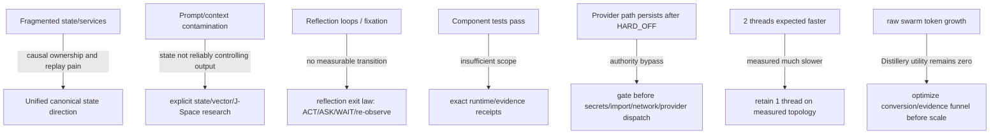

# Frankenstein evidence map

Base commit for this curation: `854f6bc87780f4a5242489a6c807d186b16a8c3d`.

This file is a navigation/evidence layer, not a replacement for current source or supervisor authority.

## Current authority snapshot

| Topic | Status | Evidence class | Exact boundary |
|---|---|---|---|
| Persistent research entity = Clay | adopted | `CURRENT_SOURCE` | identity only |
| Product = EntityOS | adopted | `CURRENT_SOURCE` | current product/system naming |
| Integrated cognition/compute = HCU | adopted | `CURRENT_SOURCE` | current architecture naming |
| Provider routes | blocked | `CURRENT_SOURCE` | 9.13 HARD_OFF; all provider routes false |
| Together | blocked | `CURRENT_SOURCE` | forbidden; remaining paid runs authorized = 0 |
| 72h Frankenstein provider orchestration | blocked/quarantined | `CURRENT_SOURCE` + `NEGATIVE_RESULT` | non-operative while direct provider paths remain |
| Whole EntityOS runtime | not passed | `CURRENT_SOURCE` | credit 0 |
| Full HCU runtime | not passed | `CURRENT_SOURCE` | credit 0 |
| Canonical semantics | not promoted | `CURRENT_SOURCE` | credit 0 |
| Training | not promoted | `CURRENT_SOURCE` | credit 0 |
| Canonical dataset rows admitted | none | `CURRENT_SOURCE` | 0 |

Primary current files:

- `/CLAY_EXECUTION_AUTHORITY.md`
- `/research_entity/claycode/autonomous/SUPERVISOR_INBOX.json`
- `/research_entity/claycode/autonomous/SUPERVISOR_STEERING_9_13O_DELTA_2026-08-27T2341P0700_GPT56SOL.json`
- `/research_entity/continuity/BOOTSTRAP_MINIMAL.json`
- `/research_entity/rooms/PROGRAM_STATE.json`

Important conflict: the bootstrap/program-state surfaces still expose older 8.78-era provider-admission descriptions. The newer inbox-selected 9.13 steering wins for the current provider boundary.

## Research lineage matrix

| Area | Current classification | Evidence / source path | What it does **not** establish |
|---|---|---|---|
| Frankenstein master concept | source-ready / partially grounded | `research_entity/topic_packets/frankenstein-master-cognition-concept/CONCEPT.md` | runtime acceptance of aspirational layers |
| Package dispenser | source-ready + locally tested | `.../frankenstein_packages_v1.py`, `tests/test_frankenstein_packages_v1.py` | autonomous 72h operation |
| Bauleiter orchestrator | source-ready + locally tested, execution blocked | `.../frankenstein_orchestrator_v1.py`, tests | provider authority or safe deployment |
| Bugfix watchdog | source-ready + locally tested, execution blocked | `.../frankenstein_bugfix_v1.py`, tests | provider authority or whole-system robustness |
| GRID10 Fabric | built / measured in bounded scopes | `tools/grid10_fabric.py` and receipts/tests | Physical-GRID10 or HCU release promotion |
| GRID10 node/regulators | built / measured in bounded scopes | `tools/grid10_node.py` and receipts/tests | general-purpose cognition |
| 4proc/4vCPU thread A/B | measured counterexample | supervisor 9.13O cites commit `636290883bfddc79a588e554d8014339ae1e98e2` | universal thread optimum |
| RAM release | diagnostic signal only | supervisor 9.13O | physical RAM win; PSS/full smaps still required |
| UnifiedDB direction | adopted architecture direction | current bootstrap/program source + historical migration evidence | every historical store already migrated |
| Emergent Retrieval | project mechanism/term | project instructions/research lineage | facts appearing without stored evidence |
| GWT/J-Space | open empirical hypothesis | J-Space traces/dataset machinery + current steering | consciousness or hidden-state causality |
| Hyperposition | adopted research method | research lineage | truth by recurrence/majority |
| GRF | historical/current research lineage | GRF topic material and code history | universal mathematical optimality |
| FreeSwarm | measured large raw volume; utility failure retained | dashboards/receipts/supervisor | semantic quality or independent evidence from token count |
| Forge/Distillery | blocked conversion funnel | supervisor current frontier | training readiness while accepted dataset tokens stay zero |
| Training | prepared/researched, current credit 0 | training topic packets/receipts | PASS from job completion alone |
| Claude bridge | source/design lineage | master concept + bridge material | current required core dependency |

## Negative-result chain → engineering move

This is the core research-chronicle rule: failures are not side notes. They explain why the next architecture exists.

## Claims that need explicit falsifiers

### External-substrate agency hypothesis

**Hypothesis:** useful reflective agency improves when cognition has a sufficiently rich external substrate of state, memory, perception, arbitration, effect receipts and verified outcome re-entry.

**Engineering confidence:** 0.72 (architecture hypothesis, not scientific fact).

**Falsifier:** matched tasks where removing or randomizing the external substrate does not materially reduce long-horizon correctness, recovery, action quality, or causal traceability versus the full system.

### Global J-Space causal-control hypothesis

**Hypothesis:** a model-specific J-Space/vector-control interface can causally alter useful behavior beyond prompt/schema artifacts.

**Engineering confidence:** 0.48.

**Falsifier:** preregistered lesion/shuffle/rescue controls show effects disappear under label-free counterbalanced conditions, or are fully explained by prompt/token leakage.

### Hyperposition usefulness hypothesis

**Hypothesis:** preserving unresolved alternatives until an evidence-bearing discriminator reduces premature false closure.

**Engineering confidence:** 0.68.

**Falsifier:** on matched decision tasks, a simpler deterministic single-hypothesis policy equals or exceeds error calibration and recovery quality without increasing hidden failure modes.

### Emergent Retrieval hypothesis

**Hypothesis:** retrieval that intersects semantic, temporal, causal, state, goal, confidence and provenance dimensions retrieves more decision-relevant evidence than a single-score semantic search alone.

**Engineering confidence:** 0.74.

**Falsifier:** family-separated evaluation shows no gain in downstream decision quality after controlling for retrieval set size and leakage.

## External primary references — analogy/context only

`EXTERNAL_PRIMARY` references do not promote project claims.

- Baars, 2005, Global Workspace Theory, DOI `10.1016/S0079-6123(05)50004-9`: https://pubmed.ncbi.nlm.nih.gov/16186014/
- Baars & Franklin, 2007, GWT/IDA architecture, DOI `10.1016/j.neunet.2007.09.013`: https://pubmed.ncbi.nlm.nih.gov/17998071/
- Shanahan & Baars, 2005, global workspace/frame problem, DOI `10.1016/j.cognition.2004.11.007`: https://pubmed.ncbi.nlm.nih.gov/16307957/
- SQLite Write-Ahead Logging: https://www.sqlite.org/wal.html
- NVIDIA CUDA Unified Memory: https://docs.nvidia.com/cuda/cuda-programming-guide/04-special-topics/unified-memory.html

## Reconstruction rules

When reconstructing chronology:

- say “first verified in accessible Git” unless creation date is actually proven;
- preserve commit hashes and exact paths;
- do not infer runtime from source existence;
- do not infer independence from multiple outputs that share a model family/pipeline/source;
- keep model family/checkpoint ancestry explicit;
- keep failed experiments and authority violations visible;
- never rewrite an old receipt to make it match a newer authority.

## Open Trigger-3 migration tasks

1. Root topology is not yet at the four-item public target. See `../repository/ROOT_MIGRATION_MANIFEST.md`.
2. Build an automated archive index over topic packets/receipts rather than copying thousands of files into prose.
3. Add Git-supported chronology pages for GRF, state/E-PQ, memory, perception, effects, prediction, reflection, goals, LoRA/IAPT/SOMA, and Frankenstein v0.7.
4. Add exact commit/source links beside every project measurement used in public-facing claims.
5. Keep the 72h provider orchestration quarantined until current authority explicitly changes and the actual external caller boundary is gated and re-executed cleanly.