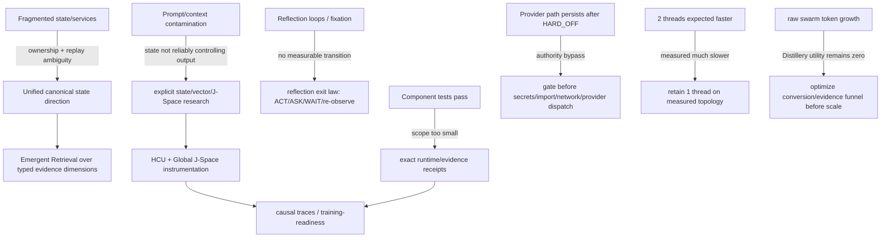

# Frankenstein evidence map

Base commit for this Trigger-3 curation: `854f6bc87780f4a5242489a6c807d186b16a8c3d`.

This file is a navigation/evidence layer, not a replacement for current source, Git history, receipts, or supervisor/owner authority. Re-enter current `main` before treating any current-state line below as live authority.

## Current authority snapshot

| Topic | Status | Evidence class | Exact boundary |
|---|---|---|---|
| Persistent research entity = Clay | adopted | `CURRENT_SOURCE` | identity only |
| Product = EntityOS | adopted | `CURRENT_SOURCE` | current product/system naming |
| Integrated cognition/compute = HCU | adopted | `CURRENT_SOURCE` | current architecture naming |
| Provider routes | blocked | `CURRENT_SOURCE` | 9.13 HARD_OFF; all provider routes false at this snapshot |
| Together | blocked | `CURRENT_SOURCE` | forbidden; remaining paid runs authorized = 0 |
| 72h Frankenstein provider orchestration | blocked/quarantined | `CURRENT_SOURCE` + `NEGATIVE_RESULT` | non-operative while direct provider paths remain |
| Whole EntityOS runtime | not passed | `CURRENT_SOURCE` | credit 0 |
| Full HCU runtime | not passed | `CURRENT_SOURCE` | credit 0 |
| Canonical semantics | not promoted | `CURRENT_SOURCE` | credit 0 |
| Training | not promoted | `CURRENT_SOURCE` | credit 0 |
| Canonical dataset rows admitted | none | `CURRENT_SOURCE` | 0 |

Primary current-facing files at this snapshot:

- `/CLAY_EXECUTION_AUTHORITY.md`
- `/research_entity/claycode/autonomous/SUPERVISOR_INBOX.json`
- `/research_entity/claycode/autonomous/SUPERVISOR_STEERING_9_13O_DELTA_2026-08-27T2341P0700_GPT56SOL.json`
- `/research_entity/continuity/BOOTSTRAP_MINIMAL.json`
- `/research_entity/rooms/PROGRAM_STATE.json`

Important conflict: bootstrap/program-state surfaces still expose older 8.x-era provider-admission descriptions. The newer inbox-selected 9.13 steering wins for the current provider boundary. A later explicit owner/supervisor authority can supersede this snapshot.

## Research lineage matrix

| Area | Current classification | Evidence / source path | What it does **not** establish |
|---|---|---|---|
| Frankenstein master concept | source-ready / partially grounded | `research_entity/topic_packets/frankenstein-master-cognition-concept/CONCEPT.md` | runtime acceptance of aspirational layers |
| Package dispenser | source-ready + commit-reported local tests | `.../frankenstein_packages_v1.py` | autonomous 72h operation |
| Bauleiter orchestrator | source-ready + commit-reported local tests, execution blocked | `.../frankenstein_orchestrator_v1.py` | provider authority or safe deployment |
| Bugfix watchdog | source-ready + commit-reported local tests, execution blocked | `.../frankenstein_bugfix_v1.py` | provider authority or whole-system robustness |
| GRID10 Fabric | built / measured in bounded scopes | `tools/grid10_fabric.py` and receipts/tests | Physical-GRID10 or HCU release promotion |
| GRID10 node/regulators | built / measured in bounded scopes | `tools/grid10_node.py` and receipts/tests | general-purpose cognition |
| 4proc/4vCPU thread A/B | measured counterexample | supervisor 9.13O cites commit `636290883bfddc79a588e554d8014339ae1e98e2` | universal thread optimum |
| RAM release | diagnostic signal only | supervisor 9.13O | physical RAM win; PSS/full smaps still required |
| UnifiedDB direction | adopted architecture direction | current authority + historical migration evidence | every historical store already migrated |
| Emergent Retrieval | project mechanism/term | project instructions/research lineage | facts appearing without stored evidence |
| GWT/J-Space | open empirical hypothesis | J-Space traces/dataset machinery + current steering | consciousness or hidden-state causality |
| Hyperposition | adopted research method | research lineage | truth by recurrence/majority |
| GRF | historical/current research lineage | GRF topic material and code history | universal mathematical optimality |
| FreeSwarm | measured large raw volume; utility failure retained | dashboards/receipts/supervisor | semantic quality or independent evidence from token count |
| Forge/Distillery | blocked conversion funnel | supervisor current frontier | training readiness while accepted dataset tokens stay zero |
| Training | prepared/researched, current credit 0 | training topic packets/receipts | PASS from job completion alone |
| Claude bridge | source/design lineage | master concept + bridge material | current required core dependency |

## Git-supported chronology: say “first verified”, not “created”

The following dates are only the earliest commits recovered by the accessible Git searches used in this Trigger-3 pass. They are **not** claims about the true invention/creation date of a mechanism.

### UnifiedDB

First verified in accessible Git from the current search:

- `08793cdecdd8a54df06daedd206ff55688c24381` — **Add UnifiedDB research foundation** — 2026-08-08 20:31:20 +07

Immediately following verified lineage includes:

- `85b56a7c14c34375bc1af14d43baed5da2c18e8b` — scientific trigger protocol
- `f23c3d547c5fefdc5de3f4e572e3bb6c41c641b9` — register UnifiedDB as eighth trigger
- `4171c48d9646a4bd88dfd96dac4547f1650bdbdc` — project command registry/mesh feedback
- `4eee2e0472ffc1b452c2b6d449919c062447db19` — eight-branch mesh preflight
- `09e12c26f52bcfad5a674d4e013c5eee1633d974` — Unified Semantic Persistence Fabric specification
- `c3ad48be208b948238d64d30e0ddc7bd0120995b` — unified ClayCode query routing plan

This lineage supports the statement that UnifiedDB became an explicit research and routing surface in accessible Git by 2026-08-08. It does not prove every historical store was already consolidated at that point.

### GRF / Hyperposition

First verified in accessible Git from the current GRF search:

- `7367f0e4cbac47d4f1782fd0d2e3f1354808ce6f` — **research: add executable C-GRF candidate contract** — 2026-08-10 23:40:43 +07

Verified follow-on lineage includes:

- `dba25ad4d35abc4e84fb9591e79300fb83bff814` — C-GRF synthesis/reentry receipt
- `7544d636460d3fc568da50254e9cf680c8a4439e` — HyperMath GRF proof-carrying IR candidate
- `d4ceafc6af9d8d262713bc6a9d5ee37d314732ca` — synthetic execution receipt
- `57a10a4f93ed3f0b5a38980f5018185988b6dbdf` — executable HyperMath GRF reference prototype
- `fc731bbdf499eaf98ddd8ca139a2ae15729aa911` — GRF fusion research report
- `4287d32fe86f645e2b26b1da3d05e81edf1d4c0d` — later GWT/GRF measurement entry

This supports a reproducible accessible-Git lineage. It does not establish that GRF began on the first recovered commit, nor that the mathematical framework is universally optimal.

## Dependency graph: failure drives the next mechanism

Failures are first-class evidence here because they constrain which architecture is still plausible.

## Agentic framing

Project target: **maximum practical agency inside a human-useful operating envelope**.

No present architecture claim requires consciousness, sentience, subjective experience, or historical bio-inspired naming. Cognitive-science terms are treated as engineering hypotheses unless project-specific causal evidence exists.

Reflection is an engineering control operation:

`inspect -> detect mismatch -> bounded correction -> persist/retrieve correction -> alter later behavior -> exit`

A valid reflection path must terminate into `ACT`, `ASK`, `WAIT`, re-observation, or another measurable state transition. Recursive reflection with no exit is rumination/fixation, not a success criterion.

## Open hypotheses, confidence and falsifiers

Confidence numbers below are engineering priors for prioritizing tests, not scientific probabilities.

### External-substrate agency hypothesis

**Hypothesis:** useful reflective agency improves when cognition has a sufficiently rich external substrate of state, memory, perception, arbitration, effect receipts and verified outcome re-entry.

**Engineering confidence:** `0.72`.

**Counter-hypothesis:** much of the apparent gain can be explained by prompt structure, decomposition, or logging rather than the substrate itself.

**Falsifier:** matched tasks where removing/randomizing the external substrate does not materially reduce long-horizon correctness, recovery, action quality, or causal traceability versus the full system.

### Global J-Space causal-control hypothesis

**Hypothesis:** a model-specific J-Space/vector-control interface can causally alter useful behavior beyond prompt/schema artifacts.

**Engineering confidence:** `0.48`.

**Counter-hypothesis:** observed vector effects are label/token/prompt leakage or post-hoc semantic interpretation.

**Falsifier:** preregistered lesion/shuffle/rescue controls show effects disappear under label-free, counterbalanced, family-separated conditions, or are fully explained by prompt/token leakage.

### Hyperposition usefulness hypothesis

**Hypothesis:** preserving unresolved alternatives until an evidence-bearing discriminator reduces premature false closure.

**Engineering confidence:** `0.68`.

**Counter-hypothesis:** a simpler deterministic single-hypothesis policy is equally calibrated and easier to verify.

**Falsifier:** on matched decision tasks, the simpler policy equals or exceeds error calibration and recovery quality without increasing hidden failure modes.

### Emergent Retrieval hypothesis

**Hypothesis:** retrieval that intersects semantic, temporal, causal, state, goal, confidence and provenance dimensions retrieves more decision-relevant evidence than single-score semantic search alone.

**Engineering confidence:** `0.74`.

**Counter-hypothesis:** gains come only from larger candidate sets or leakage from correlated metadata.

**Falsifier:** family-separated evaluation shows no gain in downstream decision quality after controlling for retrieval-set size and leakage.

## UnifiedDB + Emergent Retrieval boundary

UnifiedDB is **not a god file**. One canonical SQLite-style authority substrate may contain many typed tables, indexes, views, policies, journals, readers and writers. Rebuildable projections may live outside the authority surface, and high-rate transient sensor state can remain in RAM when its authority boundary is explicit.

`Emergent Retrieval` means relevance appears from intersections among already-stored dimensions such as semantic similarity, time, causal lineage, state, goals, perception, effects, confidence and provenance. It never means information appears from nowhere.

NVIDIA CUDA Unified Memory is only a systems-design analogy here: reducing explicit ownership/copy boundaries can simplify compute access across CPU/GPU memory. CUDA memory coherence is **not** database truth semantics, provenance, or effect authority.

## External primary references — analogy/context only

`EXTERNAL_PRIMARY` references do not promote project claims.

- Baars, 2005, *Global workspace theory of consciousness: toward a cognitive neuroscience of human experience*, DOI `10.1016/S0079-6123(05)50004-9`.
- Baars & Franklin, 2007, *An architectural model of conscious and unconscious brain functions: Global Workspace Theory and IDA*, DOI `10.1016/j.neunet.2007.09.013`.
- PyTorch, *Multiprocessing best practices*, CPU oversubscription section: recommends controlling threads per subprocess and gives `floor(N/M)` as a maximum guideline for the illustrated topology.
- SQLite, official *Write-Ahead Logging* documentation.
- NVIDIA, CUDA Programming Guide, *Unified Memory* sections. Used only as the ownership/copy-boundary analogy above.
- Shinn et al., *Reflexion: Language Agents with Verbal Reinforcement Learning*, arXiv:2303.11366. Comparison point for feedback + episodic reflective memory, not implementation equivalence.

## Reconstruction rules

When reconstructing chronology:

- say **“first verified in accessible Git”** unless creation date is actually proven;
- preserve commit hashes and exact paths;
- distinguish source-ready, measured, reproduced, contradicted, blocked, prepared-not-run, adopted and retired;
- do not infer runtime from source existence;
- do not infer whole-product PASS from a component test;
- do not infer independence from multiple outputs that share a model family/pipeline/source;
- keep model family/checkpoint ancestry explicit;
- keep failed experiments and authority violations visible;
- never rewrite an old receipt to make it match a newer authority.

## Open Trigger-3 migration tasks

1. Root topology is not yet at the four-item public target. See [`../repository/ROOT_TOPOLOGY_MIGRATION.md`](../repository/ROOT_TOPOLOGY_MIGRATION.md).
2. Build an automated archive index over topic packets/receipts rather than copying thousands of files into prose.
3. Add Git-supported chronology pages for state/E-PQ, memory, perception, effects, prediction, reflection, goals, LoRA/IAPT/SOMA, and Frankenstein v0.7.
4. Add exact commit/source links beside every project measurement used in public-facing claims.
5. Keep the 72h provider orchestration quarantined until current authority explicitly changes and the actual external caller boundary is gated and re-executed cleanly.
