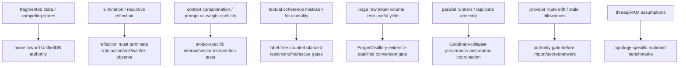

# Frankenstein evidence map

Snapshot index, not canonical truth. Refresh current authority and exact source before promotion decisions.

| Area | Current classification | Strongest bounded evidence / source | What it does **not** prove |
|---|---|---|---|
| Current identity | `ADOPTED` / `CURRENT_SOURCE` | `BOOTSTRAP_MINIMAL.json`, `PROGRAM_STATE.json`, `SUPERVISOR_INBOX.json` | runtime acceptance |
| EntityOS whole runtime | `BLOCKED` | current supervisor promotion state | no whole-product PASS |
| HCU whole runtime | `BLOCKED` | current supervisor promotion state | no full HCU PASS |
| GRID10 thread count on measured 4-process/4-vCPU topology | `MEASURED` / `PROJECT_MEASUREMENT` | current 9.13O steering records 1 thread/process outperforming 2; 4 completed no samples in timeout | other CPU/concurrency topologies; Physical-GRID10 promotion |
| GRID10 RAM reduction | `MEASURED_DIAGNOSTIC` + `BLOCKED` | current supervisor records private-dirty reduction signal | physical RAM reduction, preserved sharing, release promotion |
| Frankenstein 72h provider Bauleiter/Bugfixer | `BLOCKED` + donor preserved | `TRIGGERWORD3_HARD_OFF_CLOSURE_20260827_GPT56SOL.json`; canonical authority gate | provider runtime success; permission to run providers later |
| Free provider execution | `BLOCKED` | current `SUPERVISOR_INBOX.json`: provider routes false + emergency stop | that historical free-pool calls were safe/authorized |
| Together training | `BLOCKED` | current authority: forbidden, zero remaining authorized paid runs | future owner authority changes |
| Qwen3-0.6B hidden-state/native cvec component | `MEASURED` at component scope | current supervisor credit fields + local execution artifacts | canonical semantics, J-Space, HCU, EntityOS or training promotion |
| Frozen structural label-free native v1 | `CONTRADICTED` / `NEGATIVE_RESULT` | current steering states behavioral falsification and prohibits post-hoc retuning on its holdout | successor hypothesis with new preregistration |
| JSPACE_VECTOR_CONTROL_ABI/v1 | `SOURCE_READY` | `tools/jspace_vector_control_abi_v1.py` and HCU namespace/causality contracts | model-specific causal control |
| Global J-Space / GWT | `OPEN_HYPOTHESIS` | instrumentation/contracts and bounded model probes | consciousness, hidden-state causality from coherence/self-report |
| UnifiedDB / Emergent Retrieval | `ADOPTED_DIRECTION` + historical/source experiments | UnifiedDB receipts, KMPs, reference cascade/assembly benchmarks | fact creation; immunity from DB/concurrency bugs |
| Forge -> Distillery training utility | `BLOCKED` / `NEGATIVE_RESULT` | current supervisor confirms accepted dataset tokens remain zero | usable training data from raw token volume |
| FreeSwarm token volume | `MEASURED` but non-promoting | dashboard/metrics receipts | independent evidence, semantic quality, HCU/J-Space/training credit |
| ClayCode general-purpose release | `IN_PROGRESS` | current supervisor: WP-01/WP-02 pass, WP-03..WP-14 open | general-purpose/release PASS |
| Self-reflection-with-exit | `OPEN_HYPOTHESIS` / architecture requirement | lineage docs + Trigger-3 framing | that current runtime reliably terminates reflection |
| Root human/dev/AI entry layers | `SOURCE_READY` | this Trigger-3 additive layer | final root topology; installer hook/effect acceptance |

## Promotion discipline

A claim can move upward only with evidence at the claimed scope. In particular:

```text
source exists      != runtime observed
component PASS     != integrated PASS
logical cells      != physical decoders
provider HTTP 200  != authorized zero-cost execution
model output       != world fact
memory             != observation
repeated ancestry  != independent evidence
training completed != intended behavior learned
```

## Failure -> engineering move chain

This chronology is thematic, not a claim of exact creation dates unless Git history is explicitly cited.



Negative evidence stays attached to the branch of history it killed. A cleaner narrative is not more valuable than a reproducible one.
