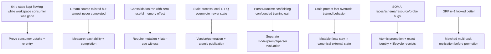

# Frankenstein deep failure lineage — E-PQ, Dream, IAPT/LoRA, SOMA, GRF

**Trigger-3 supplemental research note**  
**Role:** deepen the current `DEV_SOURCE_RESEARCH/repository/FRANKENSTEIN_RESEARCH_CHRONICLE.md`; do not create a second authority surface.  
**Evidence rule:** historical reports remain historical reports unless independently re-executed at exact current identity.

This note keeps the measurements and failure modes that are easy to lose when the lineage is compressed into architecture labels.

## 1. State can exist while cognition is causally disconnected

Primary project source for this reconstruction:

`research_entity/frank/FRANK_LOOP_OF_LOOPS_CAUSAL_REENTRY_ARCHITECTURE_20260809.md`

Classification: `HISTORICAL_SOURCE` + architecture archaeology.

The recovered Frank lineage records a particularly high-information break: the intended Global Workspace consumer/integration path was accidentally deleted while the system continued producing its **64-dimensional state vector**. The historical archive reports `experience_vectors` reaching **1,440 rows**, even though the intended workspace-context consumer had no caller.

This separates two claims that are often conflated:

```text
state production
!= state consumption
!= global availability
!= causal use
!= effect
!= verified re-entry
```

A system can therefore look “alive” in logs while an important cognitive edge is severed.

### Reusable acceptance pattern

For any modern HCU/J-Space/state path, the stronger witness is not “vector exists.” It is:

```text
state S0
-> exact typed publication P
-> exact consumer uptake U
-> bounded local change L
-> candidate/action C
-> observed result O
-> provenance-bound state delta S1
```

A missing link keeps the claim below causal closure.

## 2. E-PQ: the concurrency lesson survives the personality vocabulary

The historical E-PQ/homeostatic state is useful as a donor because it exposes a classic multi-process state bug.

The deep Dream/SOMA/LoRA lineage records an E-PQ overwrite hazard: a background path could publish a newer homeostatic state, while a foreground process retained a stale process-local singleton and later overwrote the newer value.

The durable lesson is not “E-PQ is the final personality model.” It is:

```text
mutable slow state needs version/generation identity;
background adaptation may publish a candidate/new version;
foreground readers must re-enter current state;
stale process-local copies must not regain canonical authority by accident.
```

That lesson maps directly onto current generation/provenance fail-closed rules.

## 3. Dream: implemented is not reachable

Primary project source:

`research_entity/trigger_runs/fusion/fusion-20260809T1538p0700-frank-architecture-lineage/DREAM_SOMA_LORA_DEEP_LINEAGE.md`

Classification: `HISTORICAL_SOURCE` with preserved `NEGATIVE_RESULT`s.

The Dream subsystem was designed as a resumable idle-time state machine for replay, hypothesis formation and consolidation. The important archaeology result is a liveness failure: the lineage reports that **only one Dream session had ever completed** before the idle/cooldown behavior was corrected.

The system therefore had meaningful implementation depth without meaningful reachability.

```text
source exists
+ scheduler exists
+ state machine exists
!= the state machine actually completes often enough to matter
```

### Required modern metric

Any equivalent long-horizon/background subsystem should expose at least:

- trigger opportunities;
- triggers admitted;
- runs started;
- runs completed;
- runs aborted/timed out;
- durable accepted mutations;
- later-use receipts for those mutations.

Without those counters, architecture diagrams can hide a dead subsystem.

## 4. Consolidation: execution can still produce zero useful memory effect

The same historical lineage reports that the consolidation path initially produced **zero useful memory effect** until a retrieval/keyword/FTS repair.

That establishes a second distinction:

```text
phase executed
!= useful durable mutation
!= later retrieval
!= changed later behavior
```

For current EntityOS memory/retrieval research, a better witness is:

```text
candidate evidence
-> deterministic admission
-> durable mutation identity
-> later query/retrieval identity
-> downstream decision/use identity
```

This is also why `FACT_UNKNOWN + METHOD_PRESENT != FACT_PRESENT`: a consolidation method existing in source does not prove useful consolidated memory exists.

## 5. Historical LoRA v3: keep the denominator and the scope

The deep lineage reports a Qwen2.5-3B LoRA v3 training era with:

- **1,608 training samples**;
- LoRA rank **16**;
- alpha **32**;
- **3 epochs**.

Classification: `HISTORICAL_REPORTED_TRAINING_CONFIGURATION`.

This is not current training credit. It is useful because it gives an exact-enough historical denominator for later claims about training generations.

The current project should never compress this into “Frank was trained” without checkpoint/tokenizer/dataset/evaluation identity.

## 6. IAPT: promising reported improvement, strong confounds

The historical IAPT method is described as an iterative loop of adversarial evaluation, failure extraction, targeted corrective data generation, positive anchoring and retraining.

The archive reports:

- **390+ turns**;
- **14 personas**;
- **7 iterations**;
- reported identity-coherence movement from roughly **3/10 to 9.2/10**.

Classification: `HISTORICAL_REPORTED_METHOD_AND_MEASUREMENT`, not independent current replication.

### Why the number cannot be promoted directly

At least four confounds remain material:

1. evaluator/scoring construction;
2. prompt/template changes across iterations;
3. runtime parser/post-processing behavior;
4. training-data generation and evaluation-family dependence.

A particularly important historical lesson is the **parser co-author confound**: a regex/output parser can remove, reshape or suppress text and thereby participate in the measured behavior. If weights and parser behavior change together, gain cannot be attributed to training alone.

### Modern evaluation decomposition

A clean specialization evaluation should independently identify:

```text
checkpoint / adapter
checkpoint base ancestry
prompt/template
retrieval/context
renderer/tokenizer
output parser/post-processing
protocol validator
```

Then use ablations so “model learned it” is not shorthand for “the total stack produced it.”

## 7. Prompt-vs-weight conflict: mutable architecture facts do not belong in model memory

The historical training lineage preserves a useful failure where a stale hard-coded `ARCHITECTURE FACT` in runtime context overrode newer trained behavior.

The engineering conclusion is stronger than the historical implementation detail:

> model weights are not the canonical database for mutable architecture facts.

Current authority/state should be external, versioned and provenance-bound. Training can teach protocol behavior and interfaces; it should not become the sole truth store for facts that change between versions.

## 8. SOMA: a successful-looking run followed by the bugs that actually matter

The historical SOMA (Silent Online Model Adaptation) lineage reports an initial run with approximately:

- **50 iterations**;
- **104 conversations scored**;
- **80 qualified**;
- roughly **18.7 minutes** CPU runtime;
- historical safety check pass followed by adapter deployment in that environment.

Classification: `HISTORICAL_REPORTED_EXECUTION`, no current model/training credit.

The later audits are more valuable for current design than the headline run. Preserved failure classes include:

- writes targeting obsolete database columns;
- database/connection resource leaks;
- malformed timestamp crash paths;
- EMA merge losing keys present only in the newly trained adapter;
- model resources not reliably freed on failure;
- stop logic that did not guarantee worker-thread join/termination;
- fixed keyword probes producing false positives;
- zero-norm drift being interpreted as falsely “safe”;
- adapter-load time-of-check/time-of-use race;
- configuration read at import time becoming stale after a new config was written;
- concurrent training cycles targeting the same temporary/output adapter;
- duplicate/restart windows that weakened single-writer assumptions.

### Mapping into current EntityOS/HCU laws

| Historical SOMA failure | Current engineering requirement |
|---|---|
| obsolete DB schema writes | schema/version admission + migration tests |
| stale config/import state | re-enter current authority/config before effectful boundary |
| concurrent adapter writers | atomic lease/single-writer promotion |
| EMA key loss | structure-aware merge invariants + completeness tests |
| zero-norm false safe | negative/adversarial validation, not one scalar gate |
| probe false positives | held-out behavioral tests + hard negatives |
| TOCTOU adapter load | exact consumed-byte/checkpoint identity |
| resources/threads survive failure | bounded lifecycle + explicit cleanup receipts |

This is an example of research value coming from failure compression: many seemingly unrelated bugs reduce to identity, lifecycle and atomicity boundaries.

## 9. GRF comparison: preserve the n=1 limitation

Primary source:

`agentZero/GWT-GRF-Messung-2026-08-22.md`

The project compared three designs for the same GWT engineering problem:

- A — no framework;
- B — GRF;
- C — GRF + ClayCode.

The reported qualitative trend was increasing emphasis on causal intervention, invariants and testability. GRF pushed the design from correlation-oriented checks toward intervention/counterfactual framing; ClayCode made some invariants structural and exposed a repeated-winner gap.

But the experiment was only **n=1 per arm**, used the same model family, and the GRF/ClayCode conditions had a material/effort confound.

Correct classification:

```text
indicative project measurement
!= replicated causal effect of GRF
!= universal percentage improvement
```

### High-information replication design

A stronger test should:

- use many matched architecture tasks;
- equalize context/token budget;
- randomize condition order;
- use multiple model families;
- blind or mechanize scoring where possible;
- score executable discriminators/invariants rather than prose fluency;
- preserve all failure outputs.

## 10. Why short causal windows beat global “stability” claims

The research lineage repeatedly shows that a system can run while a key consumer is dead, a consolidator is useless, a parser is co-authoring behavior, or a provider caller violates authority.

Therefore the architecture should prefer short windows with exact identities:

```text
S0 = state before
T  = trigger/event identity
R  = routing/arbitration identity
M  = exact model/checkpoint/runtime identity
C  = candidate/output identity
G  = gate/effect-request identity
O  = observed outcome/receipt identity
S1 = verified post-outcome state
```

A causal claim should say which edge was intervened on and which downstream delta changed.

Global uptime is still useful operational evidence. It is not a substitute for this chain.

## 11. Failure-driven lineage in one graph



## 12. Credit boundary

Nothing in this note changes current credit.

It does not establish:

- whole EntityOS runtime acceptance;
- full HCU runtime acceptance;
- Physical-GRID10 acceptance;
- canonical J-Space causal semantics;
- current model specialization success;
- current dataset admission;
- current training PASS.

It only preserves high-information historical denominators, confounds and failure-derived engineering requirements so that the current architecture does not relearn the same mistakes by accident.
