# Project Frankenstein — Git-supported research chronicle

**Trigger:** `triggerword 3`  
**Clay curation base:** `854f6bc87780f4a5242489a6c807d186b16a8c3d`  
**Direct historical repository:** `gschaidergabriel/Project-Frankenstein`  
**Direct historical repository head inspected:** `abba90a5767d85abc8a1ac340bae92842dab35c1`  
**Status:** research chronicle / navigation layer. Not current execution authority.

This document reconstructs the engineering lineage from **direct accessible Git** where possible and uses Clay's architecture-archaeology material only as a secondary archive index. It deliberately separates source existence, commit claims, measured results, later counterevidence and current reuse decisions.

## Reading rule

Evidence labels used here:

- `DIRECT_GIT_SOURCE` — code/commit/document inspected directly in `gschaidergabriel/Project-Frankenstein`.
- `DIRECT_GIT_REPORTED_MEASUREMENT` — a direct commit/document reports an execution/measurement; the report is preserved but is not automatically independently reproduced.
- `CLAY_ARCHIVE_RECONSTRUCTION` — Clay archive/archaeology links mechanisms or generations; useful navigation, not an independent truth oracle.
- `NEGATIVE_RESULT` — an observed/reported failure or contradiction retained because it changed the architecture.
- `INFERENCE` — the curation interpretation connecting evidence to an engineering move.
- `CURRENT_AUTHORITY` — current Clay/EntityOS authority, which outranks this historical repository for present execution.

Chronology language is conservative: **“first verified in accessible Git”** means exactly that. It is not a claim that the idea did not exist earlier.

---

## 1. Why Frankenstein matters to EntityOS/HCU

Project Frankenstein is not a second current product. It is a dense historical implementation archive containing concrete attempts at persistent state, multi-rate cognition, memory, perception, reward, reflection, idle consolidation, goals, tools/effects and model adaptation.

The useful lineage is not “old Frank was already EntityOS.” The useful lineage is:

```text
mechanism implemented
  -> failure or measurable limitation appears
  -> boundary becomes explicit
  -> newer architecture keeps the useful semantic role
  -> unsafe/ambiguous implementation detail is retired or retested
```

That pattern explains much of the movement toward one canonical state/evidence substrate, typed admission, explicit causal identity, bounded working context, effect receipts, atomic publication, model/output non-authority, and current HCU/J-Space research.

---

## 2. GRF as design lineage, not runtime proof

### First verified accessible Git anchor in this pass

`6355c4fb1637ecd833855a0e2c2936d881ae2f62` — **Add GRF paper and rewrite ABOUT.md with paper-to-system mapping**.

`DIRECT_GIT_SOURCE` commit description maps eight GRF principles to then-current subsystems such as E-PQ, Global Workspace, event-driven architecture, self-model and safety systems.

What this establishes:

- the Project Frankenstein repository explicitly used GRF as a theoretical/design framing;
- the mapping was made concrete enough to name subsystems.

What it does **not** establish:

- that GRF is scientifically validated;
- that a subsystem implements the mathematical theory with high fidelity merely because a paper maps it there;
- that current EntityOS/HCU inherits every GRF claim.

Current curation rule: reconstruct GRF at three layers — **theory**, **software mapping**, **measured causal behavior** — and never collapse those layers.

---

## 3. State and E-PQ — durable state can still poison model context

The architecture archaeology indexes `personality/e_pq.py` as a persistent personality/homeostasis subsystem with five persistent vectors, transient mood, event weighting, quality tiers, learning-rate/age behavior, SQLite/WAL persistence and snapshots.

### Direct Git anchors

`2b4f0e8b16f28c3ecb08cc069e45d68563419423` — **Add comprehensive memory & persistence architecture documentation**.

The commit describes six memory/state layers including Chat Memory, Titan, E-PQ, Consciousness Stream, World Experience and Pattern Memory.

`5c7a726ed13a75db84b8b0f88e0acaebfb2f330f` — **fix(e_pq): translate German mood descriptors to English**.

`NEGATIVE_RESULT`: German state descriptors were injected into an English model prompt and produced mixed-language output. This is a small but unusually clean example of an important system law:

```text
canonical state != safe model-facing serialization
```

A stored state can be correct while its projection contaminates behavior.

`f2cb3914a4b35885d115d239790b716d044e0058` — **consciousness level-up — GWT, Genesis→E-PQ, auto-training, reflection bridge**.

The commit describes new direct feedback routes from reflection and other generated mechanisms into E-PQ state.

Historical value: this creates an explicit research question about **causal feedback and self-reinforcement**. If generated reflection can update future personality state, then generated content can become a driver of future generation.

Current engineering consequence:

- generated reflection is a candidate observation/interpretation, not canonical truth;
- any learned disposition update needs source/outcome provenance and a bounded promotion rule;
- model-facing state projection must be measured for behavioral side effects.

---

## 4. Memory — from many stores toward one authority substrate

The historical Frankenstein architecture used multiple memory/storage mechanisms because each was developed to solve a different problem.

`CLAY_ARCHIVE_RECONSTRUCTION` indexes:

- Chat Memory / FTS;
- Titan / later LCME episodic graph/retrieval;
- E-PQ state;
- consciousness stream;
- world-experience causal learning;
- pattern memory;
- later LCME hybrid SQLite + vector + graph/FTS mechanisms.

This history is precisely why current UnifiedDB should **not** be described as “one file because one file is simpler.” The real engineering target is one deterministic authority substrate with many typed tables/indexes/views/journals and rebuildable projections.

### Emergent Retrieval lineage

The later Clay research term `Emergent Retrieval` names a useful property of this migration: relevance can appear when independently stored evidence dimensions overlap at query time — semantic similarity, time, causal lineage, state, goals, perception, effects, confidence and provenance.

It does **not** mean the database creates information from nothing.

Historical failure lesson:

```text
many specialized stores
  -> ownership / freshness / cache / causal-lineage ambiguity
  -> harder re-entry and recovery
  -> converge durable authority, keep specialized projections rebuildable
```

The relevant open test is not “SQLite vs many databases” in the abstract. It is whether the converged substrate improves recovery, provenance, idempotency and cross-dimensional retrieval without introducing unacceptable contention or leakage.

---

## 5. Thalamus / gating — filtering is useful, completeness is fragile

Clay's mechanism index points to `services/thalamus.py` as a nine-channel sensory gating implementation with continuous gains, habituation, burst/salience behavior, cognitive-mode profiles and persistent baselines.

Historical negative results include a missing input field that killed a path with `TypeError` and a documented mode that lacked a profile.

The deeper lesson is not biological analogy. It is typed interface completeness:

```text
perception/state exists
  -> admission/gating schema omits or misnames one field
  -> downstream cognition silently loses or crashes the signal
```

The current Typed Entry direction generalizes this lesson: modality, source, provenance, generation, causal identity and capability scope must be explicit before cognition consumes data.

---

## 6. Global Workspace / GWT — bus existence is not causal workspace proof

Clay archaeology classifies the historical `services/global_workspace.py` as a salience-bearing publish/subscribe bus with bounded history and subscriber-failure isolation.

That is meaningful source existence, but it is **not** sufficient evidence for a full Global Workspace causal claim.

`CLAY_ARCHIVE_RECONSTRUCTION` preserves a later correction:

```text
producer
  -> competition / selection
  -> winner / broadcast
  -> causal use
  -> action/effect
  -> outcome
  -> re-entry
```

must be demonstrated rather than inferred from class/module names.

A current Global J-Space/GWT claim therefore remains model/runtime-specific and intervention-bound. Coherent prose, repeated labels, self-report or workspace recurrence are insufficient.

Strong falsifiers include lesion, shuffle and rescue controls under counterbalanced label-free conditions.

---

## 7. Reflection and rumination — reflection needs an exit

The historical consciousness daemon is indexed as containing idle thought, deep/recursive reflection, prediction checks, goals, attention, mood trajectory and a rumination detector.

This is important because Frankenstein explored both the value and the failure mode of recursive cognition.

### Engineering definition retained now

Reflection is a control operation:

```text
inspect state/outcome
  -> detect mismatch or uncertainty
  -> retrieve/generate correction candidate
  -> persist relevant correction/evidence
  -> choose next transition
```

A useful reflection loop terminates into one of:

```text
ACT | ASK | WAIT | RE-OBSERVE | another explicitly bounded transition
```

`NEGATIVE_RESULT`: rich ambient prose and recursively generated context were observed in historical architecture as sources of fixation/bias. Clay's archaeology records that rich room prose was removed from a slim projection because it biased/fixated generated thoughts.

Current consequence: reflection quality is measured by changed later behavior and verified outcomes, not by the eloquence or length of the reflection itself.

---

## 8. Dream — the first verified resumable slow-cognition state machine

### Direct source

`662957eeaf1ca94c107137d8341dd3073b6b0301` — **feat: add dream daemon — sleep-analogue experience replay and consolidation**.

`DIRECT_GIT_SOURCE` shows a concrete state machine with:

- ~60-minute daily budget;
- replay, synthesis and consolidation phases;
- 45-minute idle trigger;
- 20-hour cooldown in the initial implementation;
- persisted current phase/progress;
- interruption and exact resume intent;
- SQLite/WAL state;
- memory and E-PQ update routes.

This is one of the strongest historical examples of a mechanism worth preserving semantically even if the physical service architecture is retired: long-horizon background work should be a **resumable, inspectable state machine**, not one giant prompt.

### Later negative evidence from Clay archaeology

The architecture lineage records a later deep audit reporting that only one dream session had completed and that the trigger/cooldown combination made the feature practically unreachable; the same audit reported a consolidation path producing zero useful memory effect until repaired.

These are `CLAY_ARCHIVE_RECONSTRUCTION` / historical reported measurements until each direct commit is re-opened, but the falsifiable lessons are strong:

```text
implemented loop != reachable loop
phase completed != useful state mutation
scheduled feature != observed execution frequency
```

Current translation: every slow cognitive stage should have source → candidate → accepted update → durable publication → later-use receipts.

---

## 9. LoRA — model weights and runtime context co-evolved

### Direct source

`9fcf1f1edcb8db9b7d1a70a54b18ee82eb5187f5` — **LoRA v3 + direct Qwen mode + 5 bug fixes**.

The commit directly reports:

- 1,608 samples;
- LoRA rank 16 / alpha 32;
- 3 epochs;
- targeted behavior categories;
- a LoRA-specific context builder;
- RAG integration;
- direct Qwen routing and anti-repetition changes.

Evidence classification: `DIRECT_GIT_REPORTED_MEASUREMENT` for the stated training configuration, not an independent replication of behavioral quality.

This commit is especially useful because it shows that **weights and runtime context changed together**. Therefore later behavior cannot automatically be attributed to weights alone.

That becomes decisive in IAPT and the AURA/Swarm failure below.

---

## 10. IAPT — failure-driven training, with a confound discovered by the method itself

### Direct Git paper

`3892e001901c0d5fa67c43737b6a94e79ecb161d` — **Add IAPT method paper: Iterative Adversarial Personality Training**.

The committed paper reports:

- interactive adversarial evaluation;
- 390+ turns across 14 personas;
- failure analysis and targeted/surgical data generation;
- positive anchoring rather than negative instruction;
- 7 training iterations;
- a reported identity-coherence trajectory from 3/10 to 9.2/10.

These numbers are `DIRECT_GIT_REPORTED_MEASUREMENT`, not current independent replication.

### The more important result: evaluator/runtime confounding

The same paper records a v6 discovery: regex/output parsers acted as **“invisible co-authors”**, shaping the language being evaluated.

That is a first-class negative result. It means an apparent model improvement can come from:

```text
weights
+ prompt/context
+ parser/filter
+ routing
+ retrieval
+ evaluator behavior
```

rather than weights alone.

Current training law therefore requires clean ablations: freeze the runtime/evaluator when comparing checkpoints, preserve exact tokenizer/renderer/runtime identity, and keep family-separated holdouts and hard negatives.

---

## 11. SOMA — autonomous adaptation exposed ordinary systems-engineering failure modes

### Direct creation/measurement source

`78f31e7f1e4fa7109a90f6e32514923ca7428a87` — **SOMA: Silent Online Model Adaptation — personal Layer 2 LoRA adapter**.

The commit adds a ten-file `services/soma/` package including:

- interaction scoring;
- CPU micro-training;
- idle/sleep-cycle orchestration;
- drift/similarity/NaN safety checks;
- adapter snapshots, EMA blend and rollback;
- GGUF conversion/hot reload;
- persisted configuration and UI controls.

The commit reports a concrete first execution:

- 50 real chat iterations;
- 104 conversations scored;
- 80 qualified;
- full CPU cycle completed in 18.7 minutes;
- safety check passed;
- GGUF adapter deployed.

Classification: `DIRECT_GIT_REPORTED_MEASUREMENT`. It proves the result was recorded in direct Git; it does not by itself prove general model improvement.

### Why SOMA matters more for systems correctness than for “self-learning” narrative

Clay's deep lineage reconstructs later SOMA audits finding failures such as:

- obsolete DB columns written by a newer scorer;
- connection/resource leaks;
- corrupted timestamps;
- EMA merging dropping unmatched adapter keys;
- full model/RAM not freed on errors;
- disabled/stop paths leaving ghost threads;
- substring-based probe false positives;
- zero-norm references falsely passing drift checks;
- adapter loading TOCTOU;
- stale persisted config vs import-time runtime config;
- concurrent training cycles targeting the same output;
- duplicate model restart races;
- snapshot/metadata and shutdown correctness issues.

These are `CLAY_ARCHIVE_RECONSTRUCTION` until each corresponding direct commit is re-opened, but they define an excellent regression corpus.

The durable lesson is plain:

```text
learning quality cannot be evaluated before ordinary state,
locking, atomicity, versioning, resource and rollback correctness work.
```

Current EntityOS should reuse the transaction/rollback/provenance lessons, not silently revive autonomous full-model training.

---

## 12. Prompt-vs-weight conflict — a direct causal counterexample

### Direct Git negative result

`62149151ba704479f46265a5b8b5865fd38ba99d` — **Purge all AURA references — rename to Swarm everywhere**.

The commit explicitly states the root cause of Frank still saying “AURA” despite training: a hard-coded `ARCHITECTURE FACT` in `core/app.py` inserted the obsolete label into relevant prompts and **overrode the training behavior**.

The diff changes that literal and propagates the rename through Thalamus/consciousness/test surfaces.

This is a particularly valuable `NEGATIVE_RESULT` because it falsifies a simplistic training story:

```text
“the weights learned X” does not imply X controls output
when runtime context repeatedly injects Y.
```

It also shows why current J-Space/vector-control research must control for lexical/prompt/schema leakage. A model's internal semantic representation can be present while an external output-binding interface still dominates the final label.

Current design consequence:

- architecture facts belong in versioned semantic state/contracts, not duplicated prompt literals;
- training evaluation must separate latent/internal control from text-label binding;
- renderer/prompt/runtime identity is part of model evaluation provenance.

---

## 13. Subconscious policy and reward — capacity must match signal volume

Clay's mechanism index reconstructs a historical `services/subconscious.py` Actor-Critic/PPO policy over a high-dimensional state and thought/action categories.

The same archaeology records a negative result: an approximately 3.1M-parameter policy was reduced to roughly 19K parameters because the available reward-signal volume was too limited for the larger learner.

Classification: `CLAY_ARCHIVE_RECONSTRUCTION` until the direct commits are re-opened.

The design lesson survives independently of the exact numbers:

```text
learner capacity must be justified by independent signal volume,
not by architectural ambition.
```

That principle is directly relevant to the current preference for small (~0.8B-class) specialization experiments and constrained J-Space control: use the smallest learner that can falsifiably improve the intended behavior without hiding failure behind scale.

---

## 14. Nucleus Accumbens / reward prediction — motivation is stateful, not truth

The historical NAcc implementation is indexed with channel-specific reward, reward-prediction error, tonic/phasic state, habituation, boredom/repetitiveness logic, opponent-process behavior and persistent logs.

This is useful as a **candidate utility/motivation subsystem**. It is not fact authority.

Current architecture keeps that distinction hard:

```text
utility / salience / reward
  != evidence
  != canonical truth
  != permission to produce a real effect
```

Any future HCU/EntityOS reuse should keep scoped utility credit from mutating evidence or EffectGate authority.

---

## 15. Perception / body / world — rich state can help and harm

Frankenstein historically maintained persistent spatial/body/world state and multiple perception paths. Clay archaeology indexes `services/spatial_state.py` with persistent locations/rooms and system/body mappings.

Two opposite lessons survive:

1. persistent world/body state gives cognition stable external referents across time;
2. verbose model-facing descriptions can become an attractor and bias generated thought.

This motivates a current separation:

```text
canonical rich state
  -> selective typed admission / projection
  -> bounded active cognitive slice
```

rather than dumping the whole state substrate into every model call.

The same distinction underlies Digital Retina / current perception work: sensor output is an observation with provenance and confidence, not automatically a world fact.

---

## 16. Project Engine — explicit goals, world models and effect risk

Direct recent Project-Frankenstein commits at the inspected head include:

`cfa7062ba62bc9d83fffada29dcc03a75c4f4050` — **Project Engine v3: Autonomous AI Agent Platform**.

The commit reports a goal system, world model, action chaining, project identity/profile, policies, learning loop, tool surface and checkpointing. It also reports concrete autonomy-cycle examples and costs.

`35bbeacbce936e284f7cb8ab73747fd3cf7bebf0` — **Project Engine v3.2: Notifications, NL Policies, A/B Testing, Time-Travel, Multi-Project**.

Historical value: Project Engine is a strong precursor for goals, persistent project state, tool statistics, strategy logs, policies and recovery.

Current correction: a powerful tool surface must not imply ambient authority. Effect requests require deterministic capability checks, release-time revalidation, journaling and outcome verification. Historical external-provider/payment/tool claims remain historical; they do not authorize present EntityOS execution.

---

## 17. What the current Project-Frankenstein README itself admits

At inspected head `abba90a5767d85abc8a1ac340bae92842dab35c1`, the historical README begins with an explicit **pre-release / not fully functional build** warning and says the intended LoRA adapter is not included.

It also explicitly states that bio-inspired subsystem names are engineering metaphors rather than claims about sentience.

These two statements matter because curation should not inflate the historical repository into something its own root document does not claim.

The same README mixes local Frank architecture with an optional Projects subsystem that requires a paid external Claude API. That provider dependence is historical source context only; current Clay supervisor 9.13 HARD_OFF forbids interpreting it as present execution authority.

---

## 18. Architecture generations reconstructed in Clay

Clay's `FRANK_ARCHITECTURE_LINEAGE.json` indexes a later design sequence R1→R3 and C4→C9. These are `CLAY_ARCHIVE_RECONSTRUCTION` until direct source commits are individually verified here.

| Generation | Indexed contribution | Current reusable lesson |
|---|---|---|
| R1 | integrated semantic runtime; single-writer causal event; preserve isolation and multirate dynamics | semantic unity does not require one process or one untyped DB |
| R2 | workspace reachability correction | module naming/stage presence does not prove GWT causality |
| R3 | hybrid freshness / multi-timescale workspace | freshness must be evaluated at causal use, not only by age |
| C4 | CognitiveFrame / WorkspaceEpisode; exact state vs semantic projection; model output proposal != authority | explicit frame and proposal boundary |
| C5 | immutable semantic memory epochs; active assembly; reader receipts | persistent state vs active cognitive slice |
| C6 | Clay-native typed epistemic roles and memory classes | evidence role/type belongs in the language/runtime contract |
| C7 | organ/runtime fabric; UnifiedDB + ClayGraph + GWT + effect broker | organ != process != storage != authority |
| C8 | salience/resource governors; anti-attractor controls | rich state must be selectively activated |
| C9 | typed admission/effect fabric; admissibility/selection/authority separation | presence != authority; effect release revalidates |

This line should be read as an engineering consolidation history, not as a series of scientific promotions.

---

## 19. Failure → engineering move graph

```mermaid
flowchart TD
  A[Many independent state stores] --> B[Unified durable authority + rebuildable projections]
  C[Rich prompt/state projection contaminates output] --> D[Typed selective projection + bounded active slice]
  E[Workspace bus exists] --> F[Require competition/use/effect/outcome/re-entry causal receipts]
  G[Dream implemented but historically hard to reach] --> H[Measure reachability and completed useful updates]
  I[Reflection can recursively feed state] --> J[Bounded reflection with explicit exit + provenance]
  K[Regex/parser becomes invisible co-author] --> L[Freeze/ablate renderer/parser during training evaluation]
  M[Hardcoded AURA prompt overrides learned Swarm] --> N[Versioned semantic truth; no uncontrolled prompt facts]
  O[SOMA adaptation has races/state/resource bugs] --> P[Atomic candidate/promotion/rollback before learning claims]
  Q[Large policy with too little reward signal] --> R[Match learner capacity to independent signal volume]
  S[Autonomous tools/project agents] --> T[Typed capabilities + EffectGate/EffectJournal + outcome re-entry]
```



The graph is the compact lineage thesis: most of the current control architecture exists because a looser predecessor made the failure measurable.

---

## 20. Current Frankenstein source under Clay — useful but quarantined where authority says so

Current Clay main contains a new Frankenstein package-dispenser/Bauleiter/Bugfix implementation. The introducing commit reports 29 local tests across the three modules.

However, the Bugfix/Bauleiter plan contains direct external provider fallback paths and stale Together assumptions. The inbox-selected supervisor 9.13O explicitly keeps provider routes HARD_OFF and quarantines that orchestration as non-operative.

Therefore:

- package decomposition / dependency / continuity logic may be useful donor source;
- local unit tests are source/component evidence;
- provider-facing loops have **zero current execution authority**;
- provider-authored core changes after HARD_OFF require clean independent non-provider review/re-execution before runtime credit;
- no historical provider plan can manufacture current permission.

This is an example of the same historical lesson at the repository-governance level: **code existence != admissibility != authority**.

---

## 21. Current training interpretation

Historical Frankenstein explored three adaptation timescales:

1. Dream/consolidation;
2. explicit IAPT/LoRA iterations;
3. SOMA idle-time adapter training.

Current EntityOS/HCU should preserve the testable parts:

- resumable consolidation state machines;
- failure-driven training-data generation;
- exact interaction/outcome provenance;
- candidate checkpoint state;
- before/after evaluation;
- hard negatives and family-held-out splits;
- locks, atomic promotion, rollback and version compatibility;
- renderer/prompt/parser ablations;
- model-specific J-Space intervention tests.

It should **not** infer that because historical SOMA or LoRA ran, current autonomous training is authorized or ready.

At current supervisor 9.13O:

```text
canonical dataset rows admitted: 0
Distillery accepted dataset tokens: 0 / 88,774
training credit: 0
Together: forbidden
paid fallback: forbidden
```

---

## 22. Agentic research framing

No present architecture claim requires consciousness, sentience or subjective experience.

Project Frankenstein's old biological/metaphysical language is valuable provenance, but current engineering claims can be stated entirely in observable terms:

```text
state
  -> perception/admission
  -> memory/retrieval
  -> candidate generation
  -> arbitration
  -> typed effect request
  -> deterministic gate/journal
  -> verified outcome
  -> state re-entry
```

The strongest current open agency hypothesis is that a sufficiently rich **external substrate** improves long-horizon recovery, correction reuse, effect idempotency and causal traceability compared with prompt/context-only control.

A serious counterhypothesis is that much of the gain can be reproduced with carefully engineered context and a simpler persistent log.

A clean discriminator should hold the model/task/prompt budget fixed and compare external typed substrate vs prompt/context-only control under interruptions, stale-state injection, effect replay hazards and correction reuse.

---

## 23. Direct Git chronology anchors verified or indexed in this pass

| Approx. order | Commit | Evidence | Mechanism / event |
|---|---|---|---|
| Feb 2026 | `6355c4fb...` | direct commit search | GRF paper + system mapping |
| Feb 2026 | `2b4f0e8b...` | direct commit search | memory/persistence architecture document |
| Feb 2026 | `5c7a726e...` | direct commit search | E-PQ prompt-language contamination fix |
| Feb 2026 | `f2cb3914...` | direct commit search | GWT weighting + reflection→E-PQ bridge |
| Feb 2026 | `662957ee...` | direct commit + diff inspected | Dream resumable replay/synthesis/consolidation daemon |
| Mar 2026 | `9fcf1f1e...` | direct commit + diff inspected | LoRA v3 + runtime/RAG/context changes |
| Mar 2026 | `3892e001...` | direct commit + paper diff inspected | IAPT method and reported 7-iteration evaluation |
| Mar 2026 | `78f31e7f...` | direct commit + diff inspected | SOMA creation + reported first full CPU cycle |
| Apr 2026 | `62149151...` | direct commit + diff inspected | hardcoded AURA prompt fact found overriding trained Swarm behavior |
| Apr 2026 | `cfa7062b...` | direct commit search | Project Engine v3 autonomous goal/tool/world-model platform |
| Apr 2026 | `35bbeacb...` | direct commit search | Project Engine v3.2 policies/A-B/time-travel/multi-project |
| Apr 2026 | `abba90a5...` | direct repository head inspected | frozen/latest accessible PF head used by Clay archaeology |

Dates in the table are only coarse month placement unless the exact Git timestamp has been explicitly recorded in the source index. Do not infer idea creation from the month label.

---

## 24. What still needs archaeology

Trigger-3 curation is deliberately incomplete where direct evidence has not yet been re-opened.

High-value next anchors:

- first directly verified E-PQ implementation commit, not only later documentation/fixes;
- first directly verified Thalamus implementation and its missing-field/missing-mode fixes;
- direct Global Workspace implementation and later reachability/causal correction commits;
- Titan→LCME migration commits and retrieval benchmarks;
- NAcc creation/calibration and boredom/RPE changes;
- Subconscious Actor-Critic creation, parameter reduction and reward-signal evidence;
- Digital Retina / perception feedback lineage;
- direct deep-Dream audit establishing reachability and zero-consolidation negatives;
- direct SOMA audit commits for every race/TOCTOU/resource failure used as a regression;
- exact v0.7 tag/release identity if one exists — do not infer it from prose;
- exact GRF mathematical artifacts and proof obligations rather than only paper-to-code mappings.

These should be added as **commit-linked claim packets**, not copied wholesale into a giant prose wall.

---

## 25. Curation conclusion

The strongest evidence-supported Frankenstein narrative is not “a finished autonomous mind.” It is a long series of real software experiments that repeatedly made hidden coupling visible:

- state leaked through prompts;
- context could dominate weights;
- parsers could masquerade as learning;
- scheduled cognition could exist without being reachable;
- a consolidation phase could run without producing useful memory change;
- autonomous adaptation could fail on locks/config/atomicity before model quality mattered;
- rich context could become fixation;
- tool capability could outgrow authority boundaries.

Those failures are not embarrassing debris. They are the causal ancestry of the stricter EntityOS/HCU design.

The current research value is therefore maximized by preserving **source, failure, repair, falsifier and current boundary together**.
