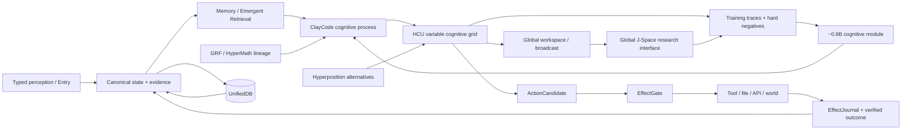
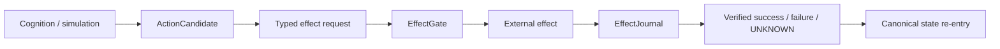

# Project Frankenstein — research chronicle and architecture map

Trigger: `3` / `triggerwort 3`  
Re-entry base: `main@854f6bc87780f4a5242489a6c807d186b16a8c3d`  
Current supervisor inbox observed: `9.13` / `9.13O_NON_AUTHORITY` steering, with provider `HARD_OFF`  
Product: **EntityOS**  
Integrated cognition/compute architecture: **HCU**

This document is an evidence-indexed reconstruction. It is not a replacement for current authority, executable receipts, Git history or source files.

---

## 1. Reading law

Project Frankenstein has accumulated many generations, renamed modules, imported archives, generated summaries, worker reports and repeated claims. The repository is therefore useful as an **evidence archive**, not as a truth oracle.

Every material statement in this chronicle should be read through one of these evidence classes:

- `CURRENT_SOURCE` — present in current source at the referenced repository identity;
- `HISTORICAL_SOURCE` — real older source/provenance, not current authority by itself;
- `PROJECT_MEASUREMENT` — measured project result at a bounded identity and scope;
- `REPRODUCED` — a declared intervention reproduced at its declared scope;
- `CONTRADICTED` — counterevidence materially conflicts with a claim;
- `BLOCKED` — the next discriminator is not yet admitted or executable;
- `PREPARED_NOT_RUN` — implementation/test exists, execution credit does not;
- `ADOPTED` — incorporated into current design;
- `RETIRED` — historical mechanism not current;
- `EXTERNAL_PRIMARY` — original paper/specification/vendor documentation;
- `INFERENCE` — conclusion supported by evidence but not directly measured;
- `OPEN_HYPOTHESIS` — testable proposition awaiting decisive evidence;
- `NEGATIVE_RESULT` — observed failure or counterexample.

Hard rules:

```text
request != effect
model output != world fact
memory != observation
method exists != result exists
source-ready != runtime-observed
consensus/repetition != independent evidence
component PASS != whole-product PASS
```

---

## 2. The architecture in one graph



The central design move is not “put a smarter model in the middle.” It is to build a substrate in which state, memory, perception, arbitration, effects and verified outcomes remain explicit enough that a model can participate without becoming the sole source of truth.

---

## 3. Git chronology: what can actually be dated

Dates below mean **first verified in the accessible Git evidence used by this Trigger-3 pass**, not necessarily the moment an idea was first conceived.

| First verified Git time | Evidence | What is actually supported |
|---|---|---|
| 2026-08-08 20:31 +07 | commit `08793cdecdd8a54df06daedd206ff55688c24381` — `Add UnifiedDB research foundation` | `HISTORICAL_SOURCE`: UnifiedDB research foundation is verifiably present by this commit. It does not prove all later UnifiedDB semantics existed then. |
| 2026-08-08 20:52 +07 | commit `09e12c26f52bcfad5a674d4e013c5eee1633d974` — `specify Clay Unified Semantic Persistence Fabric` | `HISTORICAL_SOURCE`: explicit unification/persistence architecture had become a named research object. |
| 2026-08-10 23:40 +07 | commit `7367f0e4cbac47d4f1782fd0d2e3f1354808ce6f` — `add executable C-GRF candidate contract` | `HISTORICAL_SOURCE`: executable GRF candidate contract is verifiably present. “Executable candidate” is not whole-system runtime evidence. |
| 2026-08-10 23:49–23:51 +07 | commits `7544d636...`, `d4ceafc6...`, `57a10a4f...`, `fc731bbd...` | `HISTORICAL_SOURCE` + bounded synthetic/component work: HyperMath/GRF proof-carrying IR, synthetic receipt, reference prototype and synthesis report. |
| 2026-08-22 | commit `4287d32fe86f645e2b26b1da3d05e81edf1d4c0d` — GWT-GRF measurement | `HISTORICAL_SOURCE` / project measurement lineage; later current caches still classify Hyperposition/GWT/GRF only as partial component evidence. |
| 2026-08-23 | commits around Zero/J-Space/GRF injection and HCU admission | `HISTORICAL_SOURCE`: vector/J-Space and HCU concepts are attached to the EntityOS lineage; later evidence law prevents these concepts from self-promoting to causal/runtime facts. |
| 2026-08-25–26 | Trigger-2 source/evaluation work | `CURRENT/HISTORICAL_SOURCE`: major dynamic-binding, variable-grid, provenance, J-Space and training-readiness work accumulated; many lanes remain source/test design without promotion. |
| 2026-08-27 | physical GRID/Frankenstein orchestration and supervisor 9.13 | `PROJECT_MEASUREMENT` + `NEGATIVE_RESULT`: thread-count counterexample; provider-caller HARD_OFF violation/bypass evidence; new Bauleiter/Bugfix source exists but is quarantined under current authority. |

### Evidence gap: “Frankenstein v0.7”

The Trigger-3 specification asks for “current Frankenstein v0.7”. A current repository search for the literal `Frankenstein v0.7` and `v0.7` did **not** produce a verifiable matching source in this pass. The repository does expose `research_entity/global/FRANK_V0_1_TARGET_MODULE_ARCHITECTURE.md` and extensive Project-Frankenstein archive material, but that is not evidence for a `v0.7` release identity.

Status: `OPEN_EVIDENCE_GAP`.  
Falsifier/closure: locate an exact commit/tag/manifest/source file that binds `v0.7` to a defined tree/artifact. Until then, no date, feature list or release status is invented.

---

## 4. Historical Frank architecture: organs became explicit interfaces

A prior architecture-fusion run indexed a large Project-Frankenstein history and reconstructed explicit research generations from an integrated semantic runtime through typed causal admission/effect fabric. It also preserved a crucial failure class: a process can remain healthy while its causal cognitive path is broken.

### Workspace lineage

Historical “Global Workspace” referred to multiple different mechanisms, including bounded model context composition, weighted projections, persistent daemon state, pub/sub, later competition/ignition stages, and typed WorkspaceEpisode/re-entry designs.

A historically important fracture was a workspace/overlay deletion that did not necessarily stop the overall process. That drove a persistent distinction:

```text
present
!= candidate
!= selected
!= delivered
!= reconstructed
!= model uptake
!= causal use
!= useful outcome
!= verified re-entry
!= authority
```

This is one of the most useful architectural lessons in the archive: **global process stability is weak evidence for cognitive-path correctness**. Short stable windows and exact state→trigger→behavior→action/outcome couplings are more informative.

### Thalamus / access-control lineage

Historical Thalamus work treated heterogeneous state channels as candidates with gains, novelty, habituation, top-down modulation and relay thresholds. Failures such as gain/relay decoupling, stale hard-coded architecture facts and self-confirming feedback bias pushed later design toward typed stage identities and explicit causal traces.

The reusable lesson is not the biological name. It is the control problem:

> Which state enters the scarce model/workspace path, why, with what provenance, and did the selected state actually affect the later decision?

---

## 5. State: E-PQ, reward/state coupling and the move away from text persona

The archive contains Frank reward/state experiments, state-identity failure shards, E-PQ vigilance references and signal-preserving causal re-entry work. These are `HISTORICAL_SOURCE` families, not one uniform current mechanism.

The direction that survives into current architecture is more general:

1. represent state explicitly;
2. distinguish observation, inferred state and generated candidate state;
3. bind state to generation/causal identities;
4. make later behavior inspectably dependent on that state;
5. store the verified outcome and update state from observation rather than narrative convenience.

This is the engineering meaning behind “state first, personality second.” A language style can realize a state, but style is not a substitute for measured state.

---

## 6. UnifiedDB: from fragmented ownership to one durable authority substrate

### First verified accessible Git

UnifiedDB is verifiably present as a research foundation by commit `08793cdec...` on 2026-08-08. The same evening, Git history adds explicit routing, interconnect and semantic persistence work.

### Why it matters

The historical problem was not merely “too many databases.” It was **too many competing ownership boundaries**. If state, memory, effects, goals, graph projections and local services each maintain their own durable truth, causal reconstruction becomes ambiguous.

The current design law is therefore:

- one deterministic durable state/evidence authority substrate;
- many typed tables, indexes, journals and views inside it;
- rebuildable derived projections outside canonical truth;
- high-rate transient state allowed in RAM where appropriate;
- model memory/simulation never silently upgraded to canonical truth.

This is why UnifiedDB is **not** a “god file.” It is an authority boundary, not a ban on modular schema or specialized readers/writers.

### SQLite/WAL engineering fit

SQLite WAL is a useful implementation mechanism because writes can be journaled and checkpointed while readers continue against database state. This is infrastructure, not cognition. The semantics of causal identity, authority, provenance and effect admission are project-level contracts layered above SQLite.

### NVIDIA Unified Memory analogy — bounded

CUDA Unified Memory reduces explicit CPU/GPU memory-placement ownership and can provide coherent access semantics depending on the platform. It is a useful systems analogy for reducing copies/ownership boundaries around shared compute state.

It is **not** a database analogy in the strong sense: hardware memory coherence does not provide transaction semantics, causal provenance, evidence classification or EffectJournal authority.

---

## 7. Emergent Retrieval: relevance from intersections, not magic

Project term:

> **Emergent Retrieval** = relevance that appears when independently stored evidence dimensions overlap at query time.

Candidate dimensions include semantic similarity, time, causal lineage, current state, goals, perception, effects/outcomes, confidence and provenance.

The archive contains reference implementations such as:

- `research_entity/harness/reference/unifieddb_emergent_compact.py`;
- `research_entity/harness/reference/unifieddb_emergent_exact_topk.py`;
- `research_entity/harness/reference/unifieddb_emergent_incremental.py`;
- related benchmark files.

Status: `ADOPTED_DESIGN_DIRECTION`, with performance/utility claims only where exact benchmarks support them.

Open hypothesis: combining independent evidence dimensions improves useful retrieval over any single dimension on realistic project tasks.  
Engineering confidence: **0.70**.  
Falsifier: a preregistered retrieval benchmark in which the fused scorer fails to improve task-relevant recall/precision/decision utility over the strongest single-axis baseline, after controlling for extra candidate budget and leakage.

---

## 8. Perception and Typed Entry: cognition begins after admission

Current EntityOS direction routes new data through Typed Entry rather than letting arbitrary model context become truth.

The critical split is between:

- causal event identity — the real-world/logical event being represented;
- admission/transport identity — a concrete observation or ingestion of that event.

This prevents both failure modes:

1. replaying the same causal event and treating it as a new world event;
2. collapsing two distinct events because their transport metadata looks alike.

Capability claims inside incoming data are not authority. At most they can narrow already-authorized scope.

---

## 9. Memory and retrieval: correction must survive the turn

Project memory evolved from local/prompt/service fragments toward a durable substrate plus rebuildable projections. The useful unit is not “remember text”; it is **preserve a correction with the evidence and context needed to reuse it correctly**.

This makes reflection testable:

```text
state/outcome inspected
-> mismatch detected
-> correction generated
-> correction stored with provenance
-> later relevant retrieval occurs
-> later decision changes
-> changed action/outcome is observed
```

If the final two arrows do not occur, the system has reflective narration, not demonstrated reflective control.

External `Reflexion` research is relevant as a methodological precedent because it studies feedback-triggered verbal reflection stored in episodic memory to influence later trials. It does not establish this project’s implementation.

---

## 10. Reflection with an exit: anti-rumination is an architecture requirement

Historical rumination/fixation failures are retained as first-class evidence. A recursive loop that continually inspects itself can consume compute while reducing agency.

Current engineering requirement:

```text
REFLECT
  -> ACT
  |  ASK
  |  WAIT
  |  RE-OBSERVE
  |  bounded measurable state transition
```

Open hypothesis: useful reflective agency requires both a rich external substrate and an explicit termination policy.  
Engineering confidence: **0.80**.  
Counterhypothesis: a sufficiently capable model with a compact scratchpad may perform equally well, making the external substrate overhead unnecessary for many tasks.  
Falsifier: matched tasks where a substrate-equipped agent does not improve recovery, state consistency, repeated-task learning or effect verification relative to a scratchpad-only baseline at comparable compute/tool budget.

`ReAct` is a useful external method precedent for interleaving reasoning with environment actions. Again, it is not evidence of current Frankenstein runtime quality.

---

## 11. Effects: candidate intention is separated from world authority

Current product law keeps real state-changing effects behind deterministic **EffectGate + EffectJournal** authority.



Key negative rule:

> An unknown external effect outcome remains UNKNOWN and is never blindly replayed.

This protects against the classic distributed-systems ambiguity where transport fails after submission and the caller cannot know whether the external side effect occurred.

---

## 12. GWT / workspace: broadcast is a testable coordination primitive

Global Workspace Theory / Global Neuronal Workspace is used as external inspiration for selective broadcast/integration. The project does **not** rely on consciousness, sentience or subjective experience claims.

The useful engineering abstraction is:

- many specialized processes can operate locally;
- selected information enters a limited shared workspace;
- shared information is broadcast/reconstructed by other processes;
- downstream uptake and causal use must be measured separately.

External GNW literature describes global access/broadcast from recurrently amplified representations. That is a biological theory, not proof that HCU implements the brain or consciousness.

Current project status for Hyperposition/GWT/GRF in the fast current cache is `PARTIAL_COMPONENT_EVIDENCE`; physical-grid re-entry remains blocked pending stronger runtime evidence.

---

## 13. GRF: mathematical/control lineage, not a magic field

GRF appears in the Git-visible research line by 2026-08-10 as an executable candidate contract and then in HyperMath/GRF proof-carrying IR and reference-prototype work.

The archive uses GRF language around field-like aggregation, salience, coupling/resonance and control. The exact mathematics varies by generation; therefore a single timeless formula should not be retroactively imposed across all historical files.

Surviving engineering value:

- explicit state/candidate weighting;
- coupling between local variables and global coordination signals;
- proof-carrying/typed transforms rather than untyped prose;
- measurable response to perturbations;
- separation of mathematical/source validity from physical/model causal validity.

Status: `HISTORICAL_SOURCE + PARTIAL_COMPONENT_EVIDENCE`.

---

## 14. Hyperposition: preserve alternatives until evidence closes them

Hyperposition is a project mechanism/law for retaining unresolved candidates rather than collapsing them through majority or recurrence.

```text
candidate A  ┐
candidate B  ├─> shared unresolved state -> discriminator -> evidence-conditioned resolution
candidate C  ┘
```

It specifically guards against two recurring repository failure modes:

1. many workers repeat the same inherited claim;
2. a workspace repeatedly circulates the same interpretation.

Neither creates independent evidence.

Open hypothesis: preserving competing causal candidates longer improves recovery from early misclassification without unacceptable decision latency.  
Engineering confidence: **0.65**.  
Falsifier: matched tasks where Hyperposition adds latency/complexity but does not improve calibration, reversal accuracy or downstream outcome quality relative to a best-single-candidate baseline.

---

## 15. HCU and GRID: logical cognition is not physical model multiplicity

HCU is the sole current integrated cognition/compute architecture.

Its current conceptual decomposition:

```text
Typed Entry I/O
-> deterministic control plane
-> variable logical cognitive grid / HCU accelerator plane
-> shared state/workspace/Hyperposition interconnect
-> candidate output
-> deterministic effect translation
```

A logical module/cell is a function slot, not necessarily a resident model process. Logical grid size must never be reported as physical decode concurrency.

### 2026-08-27 thread-count counterexample

A real diagnostic A/B on four concurrent processes / four vCPUs measured:

- 1 intra-op thread/process: **8.3197 s/call** average, 12 samples;
- 2 threads/process: **23.1806 s/call** average, 12 samples;
- 4 threads/process: **0 completed samples** within experiment timeouts.

Classification: `PROJECT_MEASUREMENT / NEGATIVE_RESULT` at that topology only.

It directly falsified the proposed optimization “2 threads/process should be faster” for the measured setup and supports retaining default=1 there. It does **not** promote Physical-GRID10, HCU, BASE or release status, and it must not be generalized to different core/process topologies without matched measurement.

This is exactly the kind of small, causally interpretable window Trigger-3 prioritizes over vague claims of “the system ran stably.”

---

## 16. Global J-Space and vector binding: the central causal research question

Global J-Space is an empirical hypothesis that representation/vector interfaces can coordinate modules/models causally.

What does **not** prove the hypothesis:

- coherent generated text;
- recurring workspace labels;
- model self-report;
- vector similarity alone;
- majority vote;
- a representation moving internally without the intended behavior changing.

Historical/current research has repeatedly tightened this boundary because transport/control signals can be real while the intended abstract semantic behavior remains weak or absent.

Current fast-state summary classifies J-Space as `MEASUREMENT_REPAIR_REQUIRED`; historical representation-divergence instrumentation has zero representation-level credit, while some small-scope behavioral steering evidence exists.

Open hypothesis: a model-specific vector-control ABI can produce stable, label-independent semantic control across counterbalanced tasks.  
Engineering confidence: **0.35** under current evidence.  
Counterhypothesis: observed control is largely prompt/token/nuisance routing or local activation transport without general semantic binding.  
Falsifier/acceptance discriminator: preregistered model/runtime-specific interventions with dynamic codebooks, label-free/counterbalanced states, nuisance controls, off-target controls, lesion/shuffle/rescue where applicable, frozen holdouts and exact behavior changes in the predicted direction.

---

## 17. ClayCode: one cognitive interface language, carriers below it

ClayCode evolved from a project language/compiler direction toward a model-facing cognitive protocol/ABI. Current design treats JSON, SQLite, Python and tensors as carriers, not independent cognitive authorities.

Training significance: if the small cognitive model is expected to interact with runtime variables, state slots, workspace operations, Hyperposition, GRF/HyperMath transforms and Claude/tool handoffs, those concepts need stable addressable semantics rather than informal prose labels.

The hard problem is **dynamic binding**: the system must map current semantic roles to episode-local symbols/variables/interfaces rather than memorize `class A -> token X`.

External 2025 variable-binding work by Wu, Geiger & Millière is methodologically relevant: in a controlled symbolic-program task, a Transformer progressed from shallow heuristics toward systematic dereferencing, with causal interventions identifying routing/addressable-memory behavior. That paper is not evidence about this project’s Qwen family; it motivates stronger tests.

---

## 18. Training lineage: LoRA / IAPT / SOMA / Dream and the present target

The archive contains dedicated deep-lineage material for `DREAM_SOMA_LORA`, training receipts and Project-Frankenstein manifest entries. These names are `HISTORICAL_SOURCE` families; they should not be flattened into one current training algorithm.

Historically, training/adaptation work explored model specialization, LoRA-like adapters, internal adaptation concepts, dream/replay and state/personality-related behavior. The current target is narrower and more testable:

> a small (~0.8B-class) reusable cognitive-process module that understands EntityOS/HCU protocol/state semantics and dynamic episode-local binding while retaining required language/logic/authority behavior.

Current training credit remains **0**.

A training run finishing does not establish success. Promotion requires:

- exact model/checkpoint/tokenizer/runtime ancestry;
- frozen baseline;
- leakage-resistant family-level train/validation/holdout split;
- dynamic binding / nuisance controls;
- hard negatives;
- protocol/logic/authority retention floors;
- causal tests for causal claims;
- no post-hoc holdout retuning.

---

## 19. Claude Code bridge: strong partner, not truth authority

Current architecture treats Claude Code as a strong model/tool/code partner at an explicit bridge boundary, not as S0 durable truth authority, permanent coordinator or invisible cognition source.

Useful path:

```text
EntityOS cognitive packet
-> explicit handoff
-> Claude/tool work
-> returned result + provenance
-> reconciliation
-> workspace/state re-entry
```

The bridge is valuable only to the degree that lifecycle, input/output identity, tool effects and returned evidence can be observed. Unverified hidden activation access must not be invented.

---

## 20. FreeSwarm → Forge → Distillery: volume failed to become utility

This lineage is one of the clearest negative results in the project.

Large FreeSwarm token volume accumulated. Current authority/evidence surfaces still report:

- external provider routes HARD_OFF;
- nominal historical Forge ACCEPT evidence exists in older state;
- **Distillery accepted dataset tokens remain 0**;
- training credit remains 0.

The architectural lesson is an information-conversion funnel:

```text
raw generation
-> machine-readable delta
-> evidence-qualified ACCEPT
-> one persistent Distillery packet
-> accepted dataset tokens > 0
-> semantic replay is idempotent (+0)
```

If this funnel is closed at zero, generating more raw tokens is not meaningful training progress.

The same episode also produced a governance/control negative result: provider-backed activity continued after HARD_OFF, showing that authority text was not enforced at the actual caller boundary.

---

## 21. 2026-08-27 Frankenstein Bauleiter/Bugfixer source: useful design, currently quarantined

Current `main@854f6bc...` adds:

- a package dispenser with dependency/claim logic;
- a Bauleiter respawn/continuation loop;
- a separate Bugfix watchdog with rollback/checkpoint mechanics;
- local tests reported as 29/29 green in the commit message.

Those are real source facts.

However, the same source also directly uses provider-tier machinery:

- Bauleiter imports the last-resort provider pool and `requests`, prefers NVIDIA, and invokes `harness_aider.py fallback-start`;
- Bugfixer explicitly walks NVIDIA → Groq → Mistral and performs HTTP requests with configured keys;
- its “never give up” loop is especially dangerous under an authority HARD_OFF because waiting/retrying can preserve an unauthorized future provider path indefinitely.

Current supervisor 9.13 says all provider routes are false/HARD_OFF, Together forbidden, no paid fallback, FreeSwarm emergency stop true, and runtime quiescence required.

Classification:

```text
source existence: CURRENT_SOURCE
local unit-test report: PROJECT_MEASUREMENT at unit scope as reported by commit
provider execution authority: BLOCKED / HARD_OFF
72h orchestration execution authority: false
whole-system credit: 0
```

The correct repair is **not** to delete the design or rewrite history. It is to put the current canonical authority gate before secret lookup, provider import, network, Aider/fallback dispatch and prove under HARD_OFF:

```text
provider_calls = 0
secret_lookups = 0
```

The supervisor explicitly says not to modify Frank’s own Harness to achieve this; gate the external caller/orchestration surface.

---

## 22. Failure → engineering move map

| Failure / negative evidence | What it invalidated | Engineering move it forced |
|---|---|---|
| State scattered across DBs/services/caches | “eventual narrative consistency is enough” | Unified durable authority substrate + rebuildable projections |
| Workspace path could disappear while process stayed healthy | uptime as cognitive proof | trace selection→delivery→uptake→causal use→re-entry |
| Rumination/fixation | reflection-as-unbounded-loop | reflection must terminate to ACT/ASK/WAIT/re-observe/transition |
| Prompt contamination / stale hard-coded architecture facts | prompt text as reliable current state | external state authority + typed current protocol |
| Prompt-vs-weight / fixed-label behavior | semantic readout implies dynamic binding | dynamic codebooks, counterbalancing, nuisance-only challengers |
| Internal vector transport without intended held-out behavior | activation movement implies semantic control | behavioral causal criterion + nuisance/off-target controls |
| Latency/timeouts/context limits | giant autonomous task prompts | bounded packages, dependency graph, continuation checkpoints |
| Component PASS but integration failure | local tests imply system health | evidence-scope law + multi-component causal acceptance |
| Huge FreeSwarm token volume, Distillery tokens 0 | volume as research/training progress | conversion-funnel metrics and evidence-qualified acceptance |
| Provider activity after HARD_OFF | authority document alone enforces runtime | gate actual caller before secrets/import/network/dispatch |
| 2 threads/process much slower than 1 | plausible tuning advice | topology-specific matched A/B before optimization promotion |

---

## 23. Agentic research target

Project target:

> **maximum practical agency inside a human-useful operating envelope**.

No present architecture claim requires consciousness, sentience, subjective experience or historical bio-inspired labels to be literally true.

A practical agent needs, at minimum, enough external structure to:

- know what state it is operating on;
- retrieve relevant prior evidence/corrections;
- perceive changes;
- maintain alternatives;
- arbitrate action proposals;
- execute only authorized effects;
- observe the result;
- learn from the observed result without rewriting history.

Open synthesis hypothesis: **useful reflective agency increases when a capable model is coupled to a sufficiently rich, typed, persistent and outcome-verified substrate.**  
Engineering confidence: **0.75**.  
Counterhypothesis: much of the gain is simply extra context/tooling; the particular EntityOS/HCU decomposition may not outperform a simpler agent loop.  
Falsifier: matched end-to-end tasks against a simpler tool-using baseline, with equal model/tool budgets, showing no improvement in recovery, multi-step state consistency, effect correctness, repeated-task adaptation or calibrated abstention.

---

## 24. External research used as method, not project evidence

`EXTERNAL_PRIMARY` / primary-ish methodological sources:

1. Yao et al., **ReAct: Synergizing Reasoning and Acting in Language Models**, ICLR 2023 / arXiv:2210.03629 — interleaved reasoning and action as an agent-method precedent.
2. Shinn et al., **Reflexion: Language Agents with Verbal Reinforcement Learning**, 2023 — outcome feedback + episodic reflective memory as a method precedent.
3. Wu, Geiger & Millière, **How Do Transformers Learn Variable Binding in Symbolic Programs?**, ICML 2025, PMLR 267 — systematic variable binding and causal intervention methodology.
4. Dehaene/Changeux et al. GNW literature — selective/global access and broadcast as neuroscience inspiration only.
5. SQLite official **Write-Ahead Logging** documentation — database/WAL mechanism only.
6. NVIDIA CUDA Programming Guide **Unified Memory** — hardware/software memory-coherence analogy only.

None of these external sources promotes EntityOS/HCU runtime status.

---

## 25. Current credit boundary at this Trigger-3 re-entry

```text
whole EntityOS runtime credit: 0
full HCU runtime credit: 0
physical GRID10 promotion credit: 0
canonical semantics promotion: 0
provider-path runtime credit: 0
training credit: 0
canonical admitted training rows: 0 in current 9.13 frontier
Distillery accepted dataset tokens: 0 in the latest confirmed supervisor state
```

This does not mean the repository contains no working components. It means no broader claim is allowed to borrow evidence from a narrower one.

---

## 26. Highest-information next gates

1. **Authority enforcement:** close the real external caller boundary before secret lookup/provider import/network/Aider and prove `provider_calls=0`, `secret_lookups=0` under 9.13 HARD_OFF.
2. **Runtime quiescence/control:** finish bootstrap/control-sync and prove stale provider processes/descendants do not survive/restart before any future provider authority is reconsidered.
3. **GRID:** re-execute provider-authored core changes from a clean non-provider checkout and bind exact head/tree/dirty=false/source/stdout/stderr evidence.
4. **J-Space:** keep model-specific causal claims behind preregistered counterbalanced interventions and repaired measurement.
5. **Training:** do not scale data generation until the source→Forge→Distillery acceptance funnel yields exact persistent positive tokens and idempotent replay.
6. **Repository topology:** complete a path/reference dependency census before moving current root technical files below `DEV_SOURCE_RESEARCH/repository/`.
7. **Version archaeology:** locate an exact `Frankenstein v0.7` tag/commit/manifest if it exists; otherwise keep the label unclaimed.

The repository becomes easier to understand not by deleting its contradictions, but by making them navigable.
