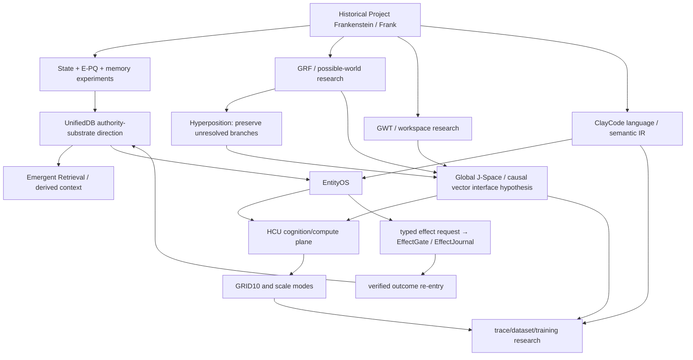
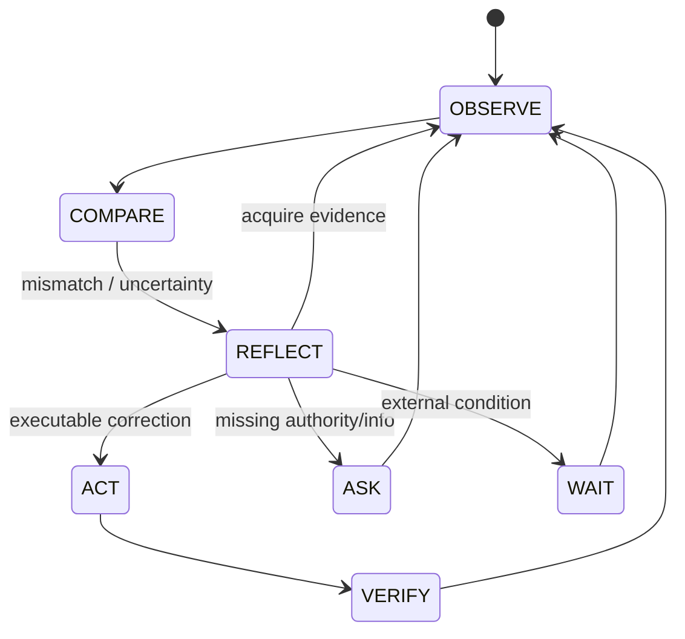

# Project Frankenstein research chronicle

> **Trigger-3 synthesis, evidence-scoped.** This document is a navigation layer over the repository, not a new source of truth.

## Re-entry snapshot

| Field | Observed value |
|---|---|
| Canonical repository | `gschaidergabriel/clay-global-research-entity` |
| Main observed before this synthesis | `854f6bc87780f4a5242489a6c807d186b16a8c3d` |
| Current supervisor inbox schema | `9.13` |
| Current steering delta | `9.13O_NON_AUTHORITY` |
| Provider authority carried forward | `9.13_UNCHANGED` |
| Provider state | `FREE_ONLY_HARD_OFF_ALL_PROVIDER_ROUTES_FALSE_TOGETHER_FORBIDDEN_NO_PAID_FALLBACK` |
| Product / compute architecture | `EntityOS` / `HCU` |
| Whole EntityOS runtime credit | `0` |
| Full HCU runtime credit | `0` |
| Canonical semantics credit | `0` |
| Training credit | `0` |

Primary current authority entry point: [`../../research_entity/claycode/autonomous/SUPERVISOR_INBOX.json`](../../research_entity/claycode/autonomous/SUPERVISOR_INBOX.json).

Lower-level caches such as `BOOTSTRAP_MINIMAL.json` and `PROGRAM_STATE.json` still carry older `8.78` surfaces at this snapshot. That is an **authority synchronization inconsistency**, not permission to average the versions.

## Evidence vocabulary

Important claims in this chronicle use these classes:

- **CURRENT_SOURCE** — exact current repository source at the observed head.
- **HISTORICAL_SOURCE** — retained source or Git/archive provenance whose historical scope is explicit.
- **PROJECT_MEASUREMENT** — measured project result with a bounded scope.
- **EXTERNAL_PRIMARY** — original paper/spec/vendor-primary source; useful context, not project evidence.
- **INFERENCE** — reasoned interpretation that is not directly measured.
- **OPEN_HYPOTHESIS** — falsifiable proposal still requiring discrimination.
- **NEGATIVE_RESULT** — failure, contradiction, blocked gate or disproven expectation retained as evidence.

Operational research states additionally include `attempted`, `source-ready`, `measured`, `reproduced`, `contradicted`, `blocked`, `prepared-not-run`, `adopted`, and `retired`.

## 1. Historical Git denominator: what can actually be dated

**HISTORICAL_SOURCE.** The Project-Frankenstein Level-0 scope law freezes one reproducible Git-history denominator for `gschaidergabriel/Project-Frankenstein`:

- inclusive base: `e1a8812767668091d146ee958bbc2ebb2743031c`;
- frozen head: `abba90a5767d85abc8a1ac340bae92842dab35c1`;
- verified compare: head is 544 commits ahead of that base;
- exact obligation count: **545** = the inclusive base + 544 verified descendants.

Source: [`../../research_entity/archive_assimilation/manifests/PROJECT_FRANKENSTEIN_LEVEL0_SCOPE_LAW.json`](../../research_entity/archive_assimilation/manifests/PROJECT_FRANKENSTEIN_LEVEL0_SCOPE_LAW.json).

This supports wording such as **“first verified in the accessible scoped Git history”**. It does not justify silently claiming that an idea was invented on the timestamp of the first surviving commit. Material before the inclusive base remains outside that Git denominator unless independently materialized by another Level-0 source.

The archive contains further exact-tree, blob-ledger and semantic-ordinal manifests under [`../../research_entity/archive_assimilation/manifests/`](../../research_entity/archive_assimilation/manifests/). They are an evidence archive, not a truth oracle.

## 2. Architecture lineage: the dependency graph



This graph is a **codependency map**, not a claim that every arrow is runtime-complete.

## 3. State, memory and UnifiedDB

### What the engineering move is

**CURRENT/HISTORICAL SOURCE DIRECTION.** A recurring architecture problem was fragmented durable state: multiple stores and services can each be locally coherent while no longer agreeing on ownership, generation or replay identity. The project direction therefore converged toward a canonical SQLite authority substrate with typed tables, journals, indexes, views and policies.

UnifiedDB is **not** “one giant table” and not a magical file containing all cognition. Rebuildable graph/search/workspace projections may remain derived. High-rate transient sensor state may remain in RAM. The boundary is about durable authority and evidence ownership.

Useful source families to inspect rather than trusting this summary:

- [`../../research_entity/runtime/UNIFIEDDB_V16_SEGMENTED_PULSE_MAINTENANCE.md`](../../research_entity/runtime/UNIFIEDDB_V16_SEGMENTED_PULSE_MAINTENANCE.md)
- [`../../research_entity/harness/reference/unifieddb_emergent_compact.py`](../../research_entity/harness/reference/unifieddb_emergent_compact.py)
- [`../../research_entity/harness/reference/unifieddb_emergent_exact_topk.py`](../../research_entity/harness/reference/unifieddb_emergent_exact_topk.py)
- [`../../research_entity/harness/reference/unifieddb_emergent_incremental.py`](../../research_entity/harness/reference/unifieddb_emergent_incremental.py)
- [`../../research_entity/harness/reference/unifieddb_claygraph_assembly.py`](../../research_entity/harness/reference/unifieddb_claygraph_assembly.py)

### Emergent Retrieval

**PROJECT TERM.** `Emergent Retrieval` means that useful relevance appears when independently stored evidence dimensions overlap at query time — semantic similarity, time, causal lineage, present state, goals, perception, effects, confidence, provenance, and related typed dimensions.

It does **not** mean that information appears from nowhere. A derived retrieval assembly remains context/projection unless separately admitted as canonical evidence.

### Falsifier

**OPEN_HYPOTHESIS — confidence 0.78.** Reducing durable ownership boundaries should improve replay/audit consistency without requiring a monolithic schema.

**Falsifier:** a matched implementation with separated durable authorities produces equal or better provenance/replay integrity, lower failure/recovery complexity, and no unresolved split-brain cases under the same workload.

## 4. GRF, Hyperposition and generated realities

The repository contains GRF/Hyperposition lineages including:

- [`../../research_entity/00_CURRENT/latest/hyperposition-gwt-grf.md`](../../research_entity/00_CURRENT/latest/hyperposition-gwt-grf.md)
- [`../../research_entity/global/AGENT_ZERO_JSPACE_IDENTITY_GRF_INJECTION.md`](../../research_entity/global/AGENT_ZERO_JSPACE_IDENTITY_GRF_INJECTION.md)
- historical execution/re-entry material under `research_entity/trigger_runs/hyperposition/`.

**CURRENT_SOURCE.** The current short Hyperposition/GWT/GRF cache classifies itself `PARTIAL_COMPONENT_EVIDENCE`: exact-merge singleton repair is implemented at component source/test scope, while physical-grid Hyperposition/GWT re-entry remains blocked pending a true GRID10 runtime pass.

**Architecture meaning.** Hyperposition preserves unresolved alternatives. Generated branches are predictions/hypotheses, not world facts. Evidence-conditioned collapse/reweighting is acceptable; majority, recurrence or elegance alone are not.

**OPEN_HYPOTHESIS — confidence 0.69.** Preserving several causally typed alternatives until evidence arrives should reduce premature commitment on ambiguous tasks.

**Falsifier:** under a preregistered ambiguity benchmark, a simpler calibrated single-candidate policy matches or beats branch-preserving Hyperposition on decision quality, calibration and resource cost without losing recovery from early uncertainty.

## 5. GWT / Global J-Space

Global-workspace terminology is used as an **engineering/research abstraction**, not a consciousness claim.

**CURRENT RESEARCH LAW.** Global J-Space/GWT is an empirical causal coordination/interface hypothesis. Strong evidence requires model/runtime-specific identity plus interventions such as perturbation, lesion/shuffle/rescue, dose-response, matched baselines and held-out behavior. Text coherence, recurring labels, self-report, majority vote or workspace recurrence do not prove internal causal control.

The desired causal trace chain is roughly:

```text
typed event
  → admission
  → route / engine / loader identity
  → cell / inference identity
  → J-Space trace
  → behavior / candidate
  → admitted dataset family
```

Every arrow needs exact identity if it is used for promotion.

**OPEN_HYPOTHESIS — confidence 0.61.** A stable, model-specific vector-control ABI can create a useful low-bandwidth coordination interface between deterministic system state and a small model.

**Falsifier:** label-free, family-disjoint, counterbalanced interventions change decoded vectors but do not change preregistered held-out behavior beyond matched sham/noise controls.

## 6. ClayCode: less redesign, more compile

Primary current workspace: [`../../research_entity/claycode/CLAYCODE_RELEASE_WORKSPACE.json`](../../research_entity/claycode/CLAYCODE_RELEASE_WORKSPACE.json).

**CURRENT_SOURCE.** The workspace is `ACTIVE_BUILD`; its own policy is “less change, more compile”. At the observed snapshot:

- `CC-WP-01-SPEC-FREEZE`: **PASS**;
- `CC-WP-02-PARSER-CANON`: **PASS** at its stated package scope;
- `CC-WP-03` through `CC-WP-14`: **OPEN**;
- `GENERAL_PURPOSE_GATE`: **NOT_PASS**;
- `CLAYCODE_RELEASE_GATE`: **NOT_PASS**;
- required application suite: no whole-suite passes are claimed by this workspace.

That means ClayCode has earned component/package evidence, not a general-purpose language release.

The long-term role is larger than syntax: ClayCode is intended to carry typed epistemic state, semantic identity, authority-separated effects, proactive goal state, untrusted ingress and deterministic lowering/runtime contracts.

## 7. EntityOS + HCU + GRID

**CURRENT IDENTITY.** EntityOS is the sole current product/system identity. HCU is the sole current integrated cognition/compute architecture. Xeno/XCU remain compatibility/research aliases where needed; historical Frank/ClayVerse names do not create a competing current product.

The core computer-like decomposition is:

```text
Typed Entry I/O
  → deterministic control
  ↔ canonical state/evidence
  → HCU shared-weight/vector/inference/J-Space plane
  → typed candidate/workspace/Hyperposition interconnect
  → typed effect request
  → EffectGate + EffectJournal
```

`GRID10` is a **ten logical cell** baseline. Ten logical cells do not imply ten resident model copies or ten simultaneous physical decodes.

### Thread-count counterexample

**PROJECT_MEASUREMENT / NEGATIVE_RESULT.** On the measured topology of four concurrent processes and four vCPUs:

| threads/process | result |
|---:|---|
| 1 | 8.3197 s/call average, 12 samples |
| 2 | 23.1806 s/call average, 12 samples |
| 4 | zero completed samples within experiment timeouts |

This directly falsified the recommendation that two threads/process should improve latency on that topology. It supports keeping the current default of one there. It does **not** promote Physical-GRID10, HCU, BASE or release and must not be generalized to different core/concurrency topologies without a matched rerun.

## 8. The 2026-08-27 Frankenstein Bauleiter / Bugfix / package work

Current topic packet: [`../../research_entity/topic_packets/frankenstein-master-cognition-concept/`](../../research_entity/topic_packets/frankenstein-master-cognition-concept/).

**CURRENT_SOURCE / source-tested:** main contains:

- `frankenstein_packages_v1.py` — package/dependency decomposition and claim logic;
- `frankenstein_orchestrator_v1.py` — Bauleiter orchestration loop;
- `frankenstein_bugfix_v1.py` — separate watchdog/rollback role;
- associated non-networked tests. The introducing commit reports **29 local tests green**.

This is bounded source/local-test evidence. It is not proof that the 72-hour orchestration ran safely or that the product passed.

### Quarantine boundary

**NEGATIVE_RESULT / BLOCKED.** The newer supervisor state explicitly quarantines the provider-calling 72-hour orchestration under current `9.13 HARD_OFF` because it can reach NVIDIA/Groq/Mistral fallback surfaces and stale plan text treats Together as available.

Current rule:

- all provider routes are false;
- Together is forbidden;
- no paid fallback;
- remaining paid runs authorized = zero;
- any future version must resolve canonical authority **before** secret lookup, provider import, network, Aider or fallback dispatch;
- under HARD_OFF, an executable receipt must prove `provider_calls=0` and `secret_lookups=0`;
- do **not** modify Frank's own Harness to fake this closure; gate the external caller/orchestration surface.

The conceptual and packaging work remains research/source material. The provider loops are non-operative until a future authority state and/or proper fail-closed gating makes them admissible.

## 9. Free-Swarm → Forge → Distillery: volume is not yield

**NEGATIVE_RESULT.** The current supervisor carries forward a decisive conversion failure: latest confirmed Distillery utility is **0 accepted dataset tokens / 88,774 collected source tokens**. Canonical dataset rows admitted remain zero; training credit remains zero.

Earlier large token/worker counts are therefore not evidence of useful dataset production. The engineering gate is conversion and replay identity, not raw generation volume.

This failure matters architecturally: it forced the project to separate generation volume from admission quality, family identity, provenance and idempotent persistence.

## 10. Training lineage and current authority

Training artifacts are retained as evidence, including paid historical attempts, model-family alternatives and tokenizer/checkpoint lineage work. They must remain explicitly separated by checkpoint ancestry and evaluation family.

**CURRENT AUTHORITY:** no autonomous external provider execution is admitted; Together is forbidden; current training credit is zero.

A future training promotion requires substantially more than “job completed”:

1. exact checkpoint/tokenizer/runtime/build identity;
2. admitted causal traces and family identities;
3. leak-resistant train/calibration/holdout separation;
4. deterministic hard negatives;
5. frozen baseline;
6. intended-behavior improvement under matched evaluation;
7. lesion/rescue or other causal controls where the hypothesis requires them;
8. off-target language/logic/authority regressions checked;
9. no promotion from provider/model consensus alone.

## 11. Reflection as engineering control

Project target: maximum practical agency inside a human-useful operating envelope.

Self-reflection is useful only if it changes a later measurable transition:



**OPEN_HYPOTHESIS — confidence 0.74.** Useful reflective agency needs a sufficiently rich external substrate of state, memory, perception, arbitration, effect receipts and verified outcome re-entry; model-only introspective text will be less reliable over long horizons.

**Falsifier:** a matched model-only controller without the external substrate equals or exceeds the substrate-backed controller on long-horizon task completion, calibrated uncertainty, recovery, replayability and false-effect claims at comparable resource cost.

## 12. Negative-result chain: why the architecture changed

| Observation | Classification | Engineering pressure |
|---|---|---|
| Fragmented state/ownership creates ambiguous synchronization | HISTORICAL_SOURCE / INFERENCE | converge durable authority and explicit provenance |
| Free-pool consultation invented nonexistent InfluxDB/vector/graph components | NEGATIVE_RESULT | inspect real code; never let model prose define architecture reality |
| Reflection can recurse without producing an effect or information gain | known failure mode / OPEN_HYPOTHESIS | require explicit exit transitions and measurable consequences |
| Prompt/schema recurrence can imitate a causal workspace | counterhypothesis | use intervention/lesion/rescue rather than textual coherence |
| Source-ready code and local tests can exist without integrated acceptance | repeated evidence boundary | maintain scope-specific credit |
| Free-Swarm volume produced zero accepted Distillery tokens at latest confirmed gate | NEGATIVE_RESULT | optimize conversion/admission, not token count |
| 2 CPU threads/process were much slower than 1 on measured GRID topology | PROJECT_MEASUREMENT / NEGATIVE_RESULT | benchmark topology-specific concurrency, avoid plausible extrapolation |
| Provider-backed changes continued after HARD_OFF | NEGATIVE_RESULT | move authority gate before secret/provider/network boundary; require clean non-provider review/reexecution |
| 72h Frankenstein provider orchestration conflicts with current authority | BLOCKED | quarantine execution while preserving source/design evidence |

Failures are not deleted from the story because they explain the next engineering move.

## 13. What this chronicle does not claim

It does not claim:

- consciousness, sentience or subjective experience;
- whole EntityOS/HCU acceptance;
- full Physical-GRID10 acceptance;
- general-purpose ClayCode release;
- canonical semantics promotion;
- accepted training data where current authority says zero;
- training success;
- current provider execution authority;
- that every historical source date equals the invention date of its concept;
- that generated realities, model outputs or remembered claims are world facts.

## 14. Next high-information discriminators

1. **P0 provider hard-off closure:** gate the real external caller boundary before secret lookup/provider import/network/Aider, then execute a repository-bound HARD_OFF test proving `provider_calls=0`, `secret_lookups=0`.
2. **P0 control/quiescence:** close bootstrap-v2/control-sync/restart/quiescence with exact ownership and ≥90 s zero-survivor/descendant/restart evidence at the authorized surface.
3. **P1 clean GRID review:** re-review/reexecute post-HARD_OFF provider-authored GRID/core changes on a clean non-provider checkout with HEAD/tree/dirty/source/stdout/stderr binding.
4. **P1 RAM falsifier:** measure RSS, PSS, PSS dirty, shared/private clean/dirty, swap and host-level delta; reject mere accounting-class shifts as RAM wins.
5. **J-Space causal gate:** only after runtime prerequisites, run label-free, family-disjoint, counterbalanced vector interventions against matched controls.
6. **Dataset utility gate:** require evidence-qualified admission to persistent positive dataset tokens and idempotent replay before treating generation as training readiness.
7. **Repository topology:** move root technical clutter only after path/import/automation dependency inventory and byte-identity checks; do not rewrite history while reorganizing it.

The next document or experiment should close one of these gates, not merely make the repository sound more complete.