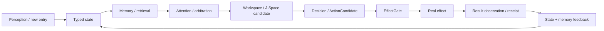

# Project Frankenstein — research chronicle and causal lineage

**Trigger-3 synthesis base:** `854f6bc87780f4a5242489a6c807d186b16a8c3d`  
**Current project identity:** Clay → EntityOS + HCU  
**Purpose of this file:** navigation and evidence synthesis, not canonical authority  
**Rule:** first verified in accessible Git is not the same claim as “created on this date.”

This chronicle reconstructs the engineering lineage only where repository evidence supports it. It keeps measurements, counterexamples and authority conflicts next to the claims they constrain.

---

## 1. Reading key

| Label | Meaning in this chronicle |
|---|---|
| `CURRENT_SOURCE` | Exact source/authority file on the observed current repository state. |
| `HISTORICAL_SOURCE` | Reproducible older source or archaeological reconstruction; not current authority by itself. |
| `PROJECT_MEASUREMENT` | Project-side measured result with stated scope. |
| `EXTERNAL_PRIMARY` | Original paper, standard or vendor documentation. |
| `INFERENCE` | Conclusion derived from evidence but not itself directly measured. |
| `OPEN_HYPOTHESIS` | Candidate mechanism requiring a discriminator. |
| `NEGATIVE_RESULT` | Falsified expectation, blocked lane or failed implementation preserved as evidence. |

Lifecycle terms: `attempted`, `source-ready`, `measured`, `reproduced`, `contradicted`, `blocked`, `prepared-not-run`, `adopted`, `retired`.

---

## 2. The recurring engineering problem

Across the historical Frank and current EntityOS/HCU research, the same systems problem reappears in different forms:

```text
state can exist without being consumed
memory can exist without being retrieved
broadcast can occur without causal use
reflection can occur without an exit
an action can be requested without happening
an effect can happen without being observed again
training can complete without producing the intended behavior
```

The architecture therefore keeps moving toward **causal closure with explicit receipts**, rather than toward more modules for their own sake.

A useful compressed loop is:



The current project does not treat any arrow as established merely because adjacent components exist.

---

## 3. Historical Frank: why the loop-of-loops mattered

**Evidence:** `research_entity/frank/FRANK_LOOP_OF_LOOPS_CAUSAL_REENTRY_ARCHITECTURE_20260809.md`  
**Status:** `HISTORICAL_SOURCE` + architecture candidate, not canonical promotion.

The archaeological reconstruction records an especially informative failure: the historical Global Workspace consumer path was deleted while a **64-dimensional state vector continued to be produced**. The archive reports `experience_vectors` reaching **1,440 rows** while the intended workspace-context path had no caller.

That is stronger than a generic “module was broken” story. It separates two hypotheses:

- H1: producing internal state is sufficient for the organism-level effect;
- H2: state must be consumed, globally available, causally used and re-enter later state.

The historical break supports H2 more strongly than H1, while still not proving a particular modern GWT/J-Space implementation.

### 3.1 Reconstructed historical causal chain

The archived reconstruction gives this minimal chain:

```text
user/environment/perception
  -> Amygdala fast salience/urgency
  -> Thalamus gain/habituation/burst/salience breakthrough
  -> NAc reward/motivation/prediction-error-like modulation
  -> workspace competition
  -> ignition / coherent focus
  -> persistent cross-process workspace broadcast
  -> core introspection / model context
  -> model thought/action/answer
  -> response_analyzer / effect outcome
  -> E-PQ + mood + goals + memory + attention + experience-vector deltas
  -> next salience/gating/workspace cycle
```

Nested slow loops included mood, memory consolidation, goal state, replay and training. The useful abstraction is therefore a **multi-rate recurrent control system**, not one feedback edge.

### 3.2 Cross-process persistence as an engineering result

The same historical reconstruction records that a similarly named **process-local workspace was empirically insufficient**; cross-process persistence/re-entry mattered. This is a project-specific engineering observation. It does not imply that a biological global workspace theory has been reproduced.

### 3.3 Preserved disagreement: 30 s vs 60 s

Historical notes disagree on nominal workspace cadence (`~30 s` in one restoration note versus `60 s` measured/documented later). Trigger 3 preserves that conflict. It is not normalized into a fictitious single value.

---

## 4. E-PQ: slow state, not magic personality

**Evidence:** historical Frank lineage and the causal re-entry reconstruction.  
**Status:** `HISTORICAL_SOURCE` / mechanism lineage.

E-PQ appears in the recovered architecture as a slower homeostatic/temperament field feeding fast access, salience and later behavior. The later F-CRF candidate represents slow state as `z_t` and fast state as `x_t` rather than allowing every module to mutate a shared “personality” implicitly.

The most important E-PQ lesson is a concurrency lesson: historical Dream/Consciousness work could publish a newer homeostatic state and a foreground process with a stale process-local singleton could later overwrite it.

This failure motivates a current general law:

```text
background adaptation may propose/publish versioned state;
foreground code must consume current versioned state;
no process-local stale copy becomes canonical truth by accident.
```

That rule survives even if the old E-PQ representation itself is later retired.

---

## 5. Dream / consolidation: implemented is not reachable is not useful

**Evidence:** `research_entity/trigger_runs/fusion/fusion-20260809T1538p0700-frank-architecture-lineage/DREAM_SOMA_LORA_DEEP_LINEAGE.md`  
**Status:** `HISTORICAL_SOURCE`; several `NEGATIVE_RESULT`s.

The early Dream architecture was a bounded idle-time state machine: replay recent interactions, synthesize hypotheses/patterns, then consolidate memory and slow state. Its strongest reusable contribution is not “dreaming”; it is **resumable long-horizon work with explicit phase/step state**.

Two negative results are more important than the naming:

1. A deep audit reported that only **one Dream session had ever completed** before liveness fixes. The long cooldown and idle trigger made the subsystem mostly unreachable.
2. The consolidation path reportedly produced **zero useful memory effect** until a retrieval/keyword/FTS repair.

These become two project-wide tests:

```text
code exists != execution is reachable
phase executed != durable useful effect
```

For a modern consolidation path, the required witness is closer to:

`input -> candidate -> accepted mutation -> durable publication -> later retrieval/use receipt`.

---

## 6. LoRA / IAPT: weight change must be isolated from runtime scaffolding

**Evidence:** same deep lineage file.  
**Status:** `HISTORICAL_REPORTED_METHOD/MEASUREMENT`, not current independent replication.

The archive reports a Qwen2.5-3B LoRA v3 era with **1,608 samples**, rank `16`, alpha `32`, and `3` epochs. Later adapter generations changed quickly; intermediate checkpoints are not reconstructed here when the repository does not contain exact evidence for each one.

### 6.1 IAPT reported method

The historical IAPT method is described as:

- interactive adversarial evaluation;
- 390+ turns over 14 personas;
- automated failure extraction;
- surgical corrective data generation;
- positive anchoring rather than only negative instructions;
- repeated retraining.

The historical report states a seven-iteration improvement from `3/10` to `9.2/10` identity coherence. Trigger 3 keeps this as a **reported historical measurement**, not an independently reproduced modern benchmark.

### 6.2 Parser co-author confound

A retained negative is that regex/output parsers can become invisible co-authors. If the runtime filters or rewrites model output while the weights also change, a behavioral gain cannot safely be attributed to training alone.

Current training evaluation therefore needs to separate at least:

```text
checkpoint effect
prompt/template effect
renderer/tokenizer effect
retrieval/context effect
post-processing/parser effect
```

### 6.3 Prompt-vs-weight conflict

A particularly useful historical failure: a stale hard-coded `ARCHITECTURE FACT` injected into prompts reportedly overrode newer learned behavior. The engineering conclusion is strong and mundane:

> model weights are not the authority for mutable architecture facts.

Current architecture facts belong in versioned state/contracts with explicit provenance.

---

## 7. SOMA: online adaptation exposed the boring bugs that matter

**Evidence:** deep Dream/SOMA/LoRA lineage.  
**Status:** historical executed/measured environment + failure archaeology.

SOMA (Silent Online Model Adaptation) is described as a personal adapter trained during idle windows from interaction scoring/feedback. The initial historical run reports:

- 50 chat iterations;
- 104 conversations scored;
- 80 qualified;
- about 18.7 minutes for a CPU cycle;
- safety check passed and an adapter was deployed in that historical environment.

The later audits are more reusable than the headline result. They found, among other things:

- writes into obsolete DB columns;
- connection leaks and malformed timestamp crashes;
- EMA merge dropping keys present only in the new adapter;
- model resources not freed on failure;
- threads that did not actually stop/join;
- false-positive keyword probes;
- zero-norm drift interpreted as falsely safe;
- adapter-load TOCTOU;
- stale import-time configuration despite a newly written config file;
- concurrent training cycles targeting the same temporary/output adapter;
- duplicate restart windows.

Those failures map directly onto current requirements for atomic promotion, exact checkpoint/tokenizer/renderer identity, concurrency exclusion, rollback, and evaluation that is harder to game than fixed keyword probes.

---

## 8. GRF: useful signal, weak sample size

**Evidence:** `agentZero/GWT-GRF-Messung-2026-08-22.md`  
**Status:** `PROJECT_MEASUREMENT`, **indicative only**.

The project compared three designs for the same GWT engineering task using the same model family:

- A — ordinary engineering, no GRF;
- B — GRF framing;
- C — GRF + ClayCode representation.

The reported qualitative pattern was not “more text.” It was increasing **testability/provability**:

- A produced useful mechanisms but mainly correlational checks;
- B reframed a key test as an intervention with causal alternatives;
- C further expressed invariants structurally and surfaced an unhandled repeated-winner case.

### 8.1 What this does and does not establish

The experiment was `n=1` per arm, all arms used the same model, and the GRF/ClayCode arms received more material. The source itself names the effort/material confound. Therefore:

- supported: GRF/ClayCode framing generated more causality/invariant-oriented artifacts **in this small comparison**;
- not supported: a stable percentage improvement;
- not supported: independence across model families;
- not supported: a causal claim that GRF alone produced the gain.

**Engineering confidence:** `0.55 / 1.00` (moderate hypothesis support, weak replication).

**High-information falsifier:** preregister many matched tasks, equalize context/token budget, randomize condition order, use multiple model families, blind the evaluator, and score executable discriminators rather than prose quality.

---

## 9. GWT / Global J-Space / Hyperposition: current causal hypothesis

**Current cache evidence:** `research_entity/00_CURRENT/latest/hyperposition-gwt-grf.md`  
**Current authority:** `research_entity/claycode/autonomous/SUPERVISOR_INBOX.json`  
**Status:** `PARTIAL_COMPONENT_EVIDENCE`; no whole-runtime promotion.

The current cache says an exact-merge singleton repair exists at component source/test scope while physical-grid Hyperposition/GWT re-entry remains blocked pending a true GRID10 runtime pass.

The key project law is:

```text
workspace recurrence != causal use
broadcast != uptake
uptake != local effect
local effect != verified re-entry
consensus != truth
```

Hyperposition is used as the rule “preserve unresolved alternatives until evidence discriminates them.” Majority or recurrence does not mint a fact.

### 9.1 Causal acceptance target

For a local model/J-Space claim, a useful experiment family is:

```text
baseline
vs lesion
vs shuffle
vs rescue
vs matched prompt-only control
```

with exact model/checkpoint/tokenizer/runtime identity and family-level holdout separation.

**Engineering confidence that a workspace-like external coordination layer can be useful:** `0.70 / 1.00` as an architecture hypothesis, informed by project lineage and external work.

**Engineering confidence that the current Global J-Space implementation has model-internal causal control:** `0.20 / 1.00` because exact promoted model-runtime evidence is still absent.

---

## 10. ClayCode: why typed invariants matter

The GRF/GWT comparison records that a working basis compiler existed at that historical point while the general-purpose gate still failed. The important architectural role for Trigger 3 is not language branding; it is the attempt to move rules from comments/prompts into typed, machine-checkable invariants.

A useful distinction is:

```text
comment: “winner set must be bounded”
vs
representation: a type/constructor cannot encode an unbounded winner set
```

The second form removes a class of runtime states rather than merely asking downstream tests to notice them.

Current release credit must still follow current compiler manifests and exact executable gates; this chronicle does not upgrade them.

---

## 11. UnifiedDB: collapse ownership boundaries, not semantics

Historical Frank accumulated many service/database boundaries. The causal re-entry archaeology cites ancestry measurements of **74 services/modules**, **18 simultaneous systemd services**, and **71 live databases** over a historical interval. The modern direction does not preserve those deployment boundaries as sacred architecture.

UnifiedDB is the project answer to a narrower problem: ambiguous truth/state ownership.

It should be read as:

```text
one canonical authority substrate
+ many typed tables
+ indexes/views
+ journals
+ explicit writers/readers
+ rebuildable derived projections
+ transient RAM state where appropriate
```

It should **not** be read as “one god table contains everything.”

The useful NVIDIA/DGX Unified Memory comparison is only an analogy: reduce copy/ownership boundaries so compute sees a coherent substrate. Hardware memory coherence is not database semantics.

---

## 12. Emergent Retrieval: overlap creates relevance, not facts

**Status:** `OPEN_HYPOTHESIS` / project retrieval concept.

Emergent Retrieval means that individually stored evidence dimensions can become jointly discriminative at query time:

```text
semantic similarity
∩ temporal relevance
∩ causal lineage
∩ current state
∩ goal/task context
∩ perception/effect history
∩ confidence
∩ provenance
```

The evidence already existed. Retrieval does not invent it.

**Engineering confidence:** `0.65 / 1.00` as a useful retrieval design hypothesis.

**Falsifier:** matched retrieval benchmark against strong simpler baselines (semantic-only, BM25/FTS-only, recency-only, causal-only), with query-family holdout and ablations for each dimension. If the combined policy does not improve useful precision/recall or downstream task success, the “emergent” combination is not earning its complexity.

---

## 13. Reflection: force an exit

A recurring failure mode in agent systems is recursive self-commentary that never creates an externally checkable transition. Trigger 3 therefore defines reflection operationally:

```text
inspect state/outcome
-> detect mismatch
-> generate bounded correction
-> store/retrieve correction with provenance
-> alter later behavior
-> ACT | ASK | WAIT | RE-OBSERVE | another measurable transition
```

This rejects a consciousness framing and makes reflection falsifiable.

**Open agency hypothesis:** practical reflective agency improves when the model is embedded in an external substrate with typed state, memory, perception, arbitration, effect receipts and verified outcome re-entry.

**Counter-hypothesis:** much of the observed gain is ordinary workflow decomposition plus more context/logging, with no distinct workspace-like causal mechanism.

**Discriminator:** keep task, model and prompt families matched; selectively remove or corrupt the re-entry/memory/effect-receipt channels and measure whether later corrections disappear in the predicted ways.

---

## 14. Free-Swarm / Forge / Distillery: scale without yield is not progress

**Current authority evidence:** 9.13O supervisor inbox/steering.  
**Status:** `NEGATIVE_RESULT` at training-conversion scope.

The current steering keeps accepted Distillery dataset tokens at **zero** and training credit at **zero**, despite large historical raw token volume. This is a classic Goodhart failure risk: optimizing “tokens produced” while the accepted evidence-bearing training funnel remains empty.

The right conversion witness is not another token counter. It is approximately:

```text
one evidence-qualified Forge ACCEPT
-> exactly one persistent Distillery packet
-> accepted_dataset_tokens > 0
-> semantic/idempotent replay adds +0
```

Until then, raw generation volume does not promote dataset or training credit.

---

## 15. Current Frankenstein master concept: useful donor, authority conflict

**Evidence:** `research_entity/topic_packets/frankenstein-master-cognition-concept/CONCEPT.md`  
**Status:** concept source + open architecture hypotheses.

The current master concept is unusually useful because it explicitly rejected hallucinated external-consultation details such as an invented InfluxDB-compatible store, invented 128-dimensional “last 10 ms” embeddings and an invented weighted-edge graph. It retained only ideas that could be mapped to real existing GRID10 mechanisms.

That is the desired evidence discipline: external consultation proposes; repository/source inspection filters; execution decides.

---

## 16. The 72-hour Bauleiter/Bugfixer plan: source exists, execution is blocked

**Evidence:** `research_entity/topic_packets/frankenstein-master-cognition-concept/BUILD_ORCHESTRATION_PLAN_20260827.json` and current 9.13O steering.  
**Status:** `blocked` / `NEGATIVE_RESULT` for authority compliance.

The plan explicitly routes work through NVIDIA Nemotron, Groq and Mistral fallbacks and describes a Together training-run allowance. The later current 9.13O authority says:

```text
all provider routes = false
Together = forbidden
paid fallback = forbidden
remaining authorized paid runs = 0
```

The latest implementation commit also added direct provider-calling orchestration/fixer code and reports 29 local component tests green. Those tests demonstrate source/component behavior, **not execution authority** and not whole EntityOS/HCU acceptance.

The required control-plane repair is earlier than retry/backoff logic: resolve canonical authority before secret lookup, provider import, network, Aider or fallback dispatch, and prove under HARD_OFF that `provider_calls=0` and `secret_lookups=0`.

Current steering additionally says: do not repair this by modifying Frank's own Harness; gate the caller/orchestration boundary instead.

---

## 17. GRID10 thread-count counterexample: a small result with high information value

**Evidence commit:** `636290883bfddc79a588e554d8014339ae1e98e2`  
**Status:** `PROJECT_MEASUREMENT` + `NEGATIVE_RESULT` for the “more intra-op threads are faster” recommendation.

Measured on four concurrent model processes and four vCPUs:

| Threads/process | Result |
|---:|---:|
| 1 | `8.3197 s/call` mean, 12 samples |
| 2 | `23.1806 s/call` mean, 12 samples |
| 4 | zero completed samples inside experiment timeouts |

This directly falsified the external recommendation for the measured topology and supports retaining the one-thread default there.

It does not promote Physical-GRID10, HCU or release acceptance, and it must not be generalized if the process/core topology changes.

This is an example of a **short stable window + matched intervention** being more informative than a broad claim that “the runtime is stable.”

---

## 18. State → trigger → model behavior → action/outcome coupling: what counts as architecture evidence

Trigger 3 should prefer local causal windows in which the chain can be bound:

```text
state S0
-> typed trigger T
-> route/arbitration decision R
-> exact model/checkpoint/runtime M
-> output/candidate C
-> gated effect request G
-> observed outcome O
-> verified state delta S1
```

The useful evidence is the binding of identities and deltas across that chain. “System stayed up for six hours” is operational evidence, not proof that the cognitive mechanism caused a particular outcome.

### Minimum controls for a causal claim

- identical task family with the candidate mechanism disabled;
- shuffled/replayed state that preserves superficial content while breaking causal alignment;
- rescue that restores only the proposed missing signal;
- exact source/model/runtime identity;
- negative/failure receipts preserved;
- outcome re-observation rather than self-report.

---

## 19. “Frankenstein v0.7” — unresolved, do not manufacture a version

The Trigger-3 specification asks the research layer to cover “current Frankenstein v0.7.” In the current accessible repository search used for this pass, an exact `v0.7` source/version artifact was **not verified**. Searches for `v0.7` returned no exact version record; the repository does contain historical Frank targets such as `FRANK_V0_1_TARGET_MODULE_ARCHITECTURE.md` and many Frankenstein lineage documents.

Therefore this chronicle records:

```text
Frankenstein v0.7 exact source identity: UNKNOWN / UNVERIFIED_IN_THIS_PASS
```

No current architecture or measurement is silently relabeled “v0.7.” A later exact Git tag, commit, manifest or source path can close this gap.

---

## 20. Compact hypothesis register

| Hypothesis | Evidence now | Confidence | Strong falsifier |
|---|---|---:|---|
| Cross-process causal re-entry matters more than state production alone | historical broken-consumer episode + reconstructed loop | 0.75 | matched modern run where removing cross-process re-entry has no predicted downstream effect |
| GRF improves causal/test-oriented architecture work | n=1/arm project comparison | 0.55 | blinded multi-task/multi-model equal-context replication shows no advantage |
| ClayCode-style typed invariants reduce hidden architecture violations | design logic + small comparative signal | 0.60 | equivalent untyped design yields same violation rate under adversarial tests |
| Global J-Space has model-specific causal control | source/component preparation only | 0.20 | lesion/shuffle/rescue shows no controlled downstream change |
| Emergent Retrieval multi-dimensional overlap improves useful retrieval | concept + historical retrieval motivation | 0.65 | held-out ablation benchmark shows no gain over simpler baselines |
| Reflection needs verified outcome re-entry to improve later behavior | architecture lineage + failure logic | 0.70 | matched tasks retain correction quality when outcome/re-entry channel is removed |
| More raw Free-Swarm generation improves training readiness | current funnel evidence argues against it | 0.10 | accepted/replay-stable dataset yield scales monotonically with raw generation under fixed admission quality |

Confidence is an engineering planning score, not Bayesian posterior probability.

---

## 21. Failure → engineering move map

```mermaid
flowchart TD
    A[Many stores / unclear state ownership] --> B[Unified canonical substrate]
    C[State produced but workspace consumer broken] --> D[Explicit broadcast/uptake/re-entry receipts]
    E[Dream existed but almost never completed] --> F[Reachability + completion metrics]
    G[Consolidation ran but useful memory effect = 0] --> H[Mutation + later-use witness]
    I[Stale process-local E-PQ overwrote newer state] --> J[Versioned atomic publication]
    K[Parser/runtime scaffolding confounded LoRA gains] --> L[Separate weight/prompt/renderer/parser evaluation]
    M[Provider fallbacks ran after HARD_OFF] --> N[Authority gate before secrets/import/network]
    O[Raw swarm volume but zero Distillery yield] --> P[Optimize evidence conversion before scale]
    Q[More CPU threads predicted faster, measured slower] --> R[Topology-specific matched A/B tests]
    S[Recursive reflection risk] --> T[Reflection must terminate in measurable transition]
```



---

## 22. External research: context, not product evidence

External primary literature gives useful comparison points but does not validate Frankenstein by analogy.

- Baars' Global Workspace Theory and Baars/Franklin IDA work motivate bounded broadcast/workspace concepts.
- More recent adversarial consciousness research is a reason to keep workspace/GWT hypotheses falsifiable rather than treating them as settled neuroscience.
- PyTorch multiprocessing guidance explains why CPU oversubscription is a plausible mechanism behind the measured thread-count result.
- SQLite WAL documentation explains the systems behavior of a WAL-based substrate; it does not certify the project's specific use.
- Reflexion provides a research comparison for feedback + episodic reflection, but Frankenstein must still prove its own later-use and effect-reentry chain.

The project target is practical agency inside a human-useful operating envelope, not a software-consciousness claim.

---

## 23. Current frontier after this Trigger-3 synthesis pass

### Documentation / topology

- Human layer: created on synthesis branch.
- Dev/research progressive-disclosure layer: created.
- AI no-scan installer/entry layer: created.
- Machine-readable evidence index: created.
- Root migration protocol: created.
- Final four-entry public root: **not complete**; requires dependency/reference inventory before safe moves.

### Runtime/control

- P0 external caller boundary remains open under 9.13 HARD_OFF.
- Provider-calling Bauleiter/Bugfixer loops remain quarantined/non-operative.
- No provider runtime, whole EntityOS, full HCU, canonical semantics or training credit is added by this documentation pass.

### Research

- Hyperposition/GWT remains partial component evidence pending exact runtime closure.
- Distillery accepted dataset yield remains zero under current steering.
- Exact Frankenstein `v0.7` identity remains unresolved.

---

## 24. Next discriminators with highest information value

1. **Caller-boundary proof:** on an admissible non-provider surface, prove HARD_OFF blocks the Frankenstein/free-pool call chain *before* secret lookup/import/network and emits `provider_calls=0`, `secret_lookups=0`.
2. **Clean review of provider-authored core deltas:** exact current non-provider checkout, `dirty=false`, source hashes + stdout/stderr binding; component credit only.
3. **Root dependency inventory:** classify every current root path as public entry, runtime-pinned, technical, historical, generated or unknown before moving bytes.
4. **J-Space causal test:** only after the required runtime gate, run branch-preservation/broadcast/uptake/re-entry lesion-shuffle-rescue controls at exact model identity.
5. **Training funnel witness:** one qualified Forge ACCEPT → one persistent Distillery packet → nonzero accepted tokens → replay `+0`.
6. **Version archaeology:** locate an exact Git tag/commit/manifest for “Frankenstein v0.7” or explicitly retire the label as unsupported.

These are preferred over another broad narrative or another increase in raw worker/token volume.
