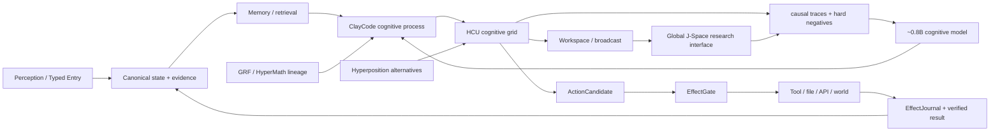
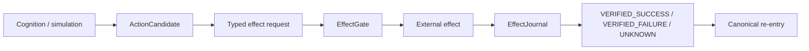

# Project Frankenstein — fused research chronicle

Trigger: `3` / `triggerwort 3`  
Fusion branch base: `main@36d79c5acd386ab9dbcef959f332961917a1b5f7`  
Re-entered version evidence through: `main@4e2adb9719256d67a4685de13dc92484a794abfc`  
Current product: **EntityOS**  
Current integrated cognition/compute architecture: **HCU**

This chronicle is a navigational synthesis over current source, historical archive, project measurements and external method literature. It is not a new authority surface. Re-read current `main`, `CLAY_EXECUTION_AUTHORITY.md`, `SUPERVISOR_INBOX.json`, and the steering selected by that inbox before any present-tense execution claim.

---

## 1. Evidence grammar

The repository contains repeated summaries, imported historical source, experimental receipts, model-generated proposals and current executable code. They do not carry equal weight.

Use these classes:

| Class | Meaning |
|---|---|
| `CURRENT_SOURCE` | present in current source at an exact identity |
| `HISTORICAL_SOURCE` | real older source/provenance, not current authority |
| `PROJECT_MEASUREMENT` | observed project result at a bounded identity/scope |
| `EXTERNAL_PRIMARY` | original paper/spec/vendor documentation |
| `INFERENCE` | evidence-supported conclusion, not directly observed |
| `OPEN_HYPOTHESIS` | testable proposition awaiting decisive evidence |
| `NEGATIVE_RESULT` | failure, contradiction or blocker worth preserving |

Lifecycle qualifiers remain separate: `attempted`, `source-ready`, `measured`, `reproduced`, `contradicted`, `blocked`, `prepared-not-run`, `adopted`, `retired`.

Hard boundaries:

```text
request != effect
model output != world fact
memory != observation
method exists != result exists
source-ready != runtime-observed
consensus/repetition != independent evidence
component PASS != whole-product PASS
entrypoint source closure != global runtime quiescence
```

---

## 2. The machine the research converged toward



The central engineering move is not “make one model smarter.” It is to externalize enough state, provenance, memory, arbitration, effect control and outcome verification that the model can participate in cognition without becoming the sole authority for reality.

---

## 3. Chronology: only date what Git can support

A project idea can exist before a file is committed. Imported history can also be incomplete. Therefore every date below means **first verified in the accessible Git evidence used by this curation**, unless a stronger source establishes an earlier creation date.

### Historical Project-Frankenstein denominator

Current Trigger-3 source indexing binds a frozen historical default-branch snapshot head `abba90a5767d85abc8a1ac340bae92842dab35c1` and an exact **545 reachable default-branch commits** denominator for that frozen source snapshot. The oldest commit observed through that reachable listing is `e1a8812767668091d146ee958bbc2ebb2743031c` dated 2026-02-14T17:05:27Z.

That is useful history evidence. It is **not** proof that the project itself began on that date, nor does it enumerate all refs/unreachable history or every recursive path in every snapshot.

### Research-line anchors visible in this repository

| First verified time | Git/source anchor | Supported statement |
|---|---|---|
| 2026-08-08 20:31 +07 | `08793cdecdd8a54df06daedd206ff55688c24381` — `Add UnifiedDB research foundation` | UnifiedDB exists as an explicit research foundation by this commit. |
| 2026-08-08 20:52 +07 | `09e12c26f52bcfad5a674d4e013c5eee1633d974` — `specify Clay Unified Semantic Persistence Fabric` | Durable-state unification had become an explicit architecture object. |
| 2026-08-10 23:40 +07 | `7367f0e4cbac47d4f1782fd0d2e3f1354808ce6f` — executable C-GRF candidate contract | GRF has a verifiable executable-candidate research anchor. Candidate/source is not whole-runtime proof. |
| 2026-08-10 23:49–23:51 +07 | `7544d636…`, `d4ceafc6…`, `57a10a4f…`, `fc731bbd…` | HyperMath/GRF proof-carrying IR, synthetic receipt, reference prototype and synthesis report exist in the research lineage. |
| 2026-08-22 | `4287d32fe86f645e2b26b1da3d05e81edf1d4c0d` | GWT/GRF measurement lineage is explicitly committed; later current cache still limits promotion to partial component evidence. |
| 2026-08-23 onward | J-Space/GRF/HCU/Zero/Xeno integration commits | vector-control and HCU concepts become increasingly fused into the EntityOS line, while evidence law becomes stricter about causal claims. |
| 2026-08-27 16:49Z | `854f6bc87780f4a5242489a6c807d186b16a8c3d` | Bauleiter/Bugfix/package-dispenser source lands, with provider-capable NVIDIA/Groq/Mistral paths and 29 locally reported tests. |
| 2026-08-27 16:59Z | `3c3dbe5020f57065f47bd4d0a2dce3c537128797` | canonical Frankenstein entrypoints are source-gated before provider import/secret/network/Aider/fallback; focused local tests reported 10/10. |
| 2026-08-27 17:03Z | `05c66f47495b22b5366e1471d842e77e5ca174ba` | fresh FreePool/Mistral provenance appears after the source gate, proving global provider quiescence was not established by the entrypoint repair. |
| 2026-08-27 17:06Z | `b16b18f…`, `36d79c5…` | post-gate quiescence failure is preserved explicitly as a negative result with open causal alternatives. |

### “Frankenstein v0.7” — source evidence contradicts it as the current verified release label

The Trigger-3 specification inherited the phrase “current Frankenstein v0.7”. A later exact source-repository check during this same macro resolved this more strongly than a mere search gap.

Current bounded evidence in `DEV_SOURCE_RESEARCH/repository/PROJECT_FRANKENSTEIN_VERSION_EVIDENCE_20260827.json` reports:

- exact code search for `v0.7`: **no match**;
- exact code search for `Frankenstein v0.7`: **no match**;
- no `v0.7` tag observed;
- an observed tag `v0.8.0` at commit `cd61158937004df6660ee8dafb2e195062b72bd7`;
- observed release name **F.R.A.N.K. v0.8.0**;
- release publication time `2026-03-11T22:41:25Z`;
- release body self-describes it as a **v0.8 pre-release**.

Classification: `HISTORICAL_SOURCE + NEGATIVE_RESULT + SOURCE_IDENTITY_EVIDENCE`.

Resolution:

```text
“current Frankenstein v0.7” as a verified current release requirement = CONTRADICTED
latest verified historical source-repo release tag observed in this pass = v0.8.0
current Clay product identity = EntityOS + HCU, not F.R.A.N.K. v0.8.0
```

Important boundary: absence of a `v0.7` tag does **not** prove nobody ever used “0.7” informally in development. Likewise, the historical `v0.8.0` tag does not make v0.8.0 the current EntityOS/HCU product version and does not describe every later historical Frankenstein commit.

---

## 4. Historical Frank: organs gradually became explicit control interfaces

The historical archaeology and fusion material contains a broad organ/module lineage: persistent cognition loops, E-PQ state, Thalamus routing, global workspace, memory/retrieval, reward/prediction systems, goal/project engines, vision pipelines, SOMA/LoRA adaptation, dream/replay, hypothesis/experiment services and effect paths.

The current system does not need to preserve every biological label. The useful information is what control problem each mechanism exposed.

### Workspace fracture: uptime did not imply cognitive-path health

Historical Global Workspace referred to several different mechanisms over time: bounded model-facing context, weighted channel projection, daemon workspace state, pub/sub, later salience/competition/ignition stages, then typed workspace episodes and re-entry.

A key failure in the historical fusion was a cognitive/workspace path disappearing while the larger process remained alive. That established a durable anti-Goodhart law:

```text
process healthy
!= producer present
!= candidate emitted
!= candidate selected
!= delivered
!= reconstructed
!= model uptake
!= causal use
!= useful outcome
!= verified re-entry
```

This is why short measured **state → trigger → model behavior → action/outcome** windows carry more architecture evidence than “the daemon ran for days.”

### Thalamus: the useful part is access control, not the name

Historical Thalamus work implemented gains, novelty, habituation, top-down mode weights, relay thresholds, prediction error and later feedback bias across heterogeneous state channels.

Failures included gain/relay decoupling, stale hard-coded architecture facts and self-confirming feedback loops. The surviving engineering question is:

> Which state is admitted to scarce cognition/workspace capacity, why, and did that selected state actually alter a later decision?

Current HCU/Typed Entry work is a more explicit answer to the same control problem.

---

## 5. E-PQ/state: from “persona” toward measurable state

The archive includes `personality/e_pq.py`, reward/state experiments and state-identity failure shards. Different generations used different variables, so no single timeless E-PQ formula should be projected backward over the entire history.

The reusable direction is:

1. state exists outside generated prose;
2. observation, inference and generated candidate state are distinguishable;
3. state changes are identity/provenance-bound;
4. later cognition is measurably conditioned on state;
5. verified outcomes re-enter and update state.

This is the engineering meaning of “state first; personality/style only realizes it linguistically.”

---

## 6. UnifiedDB: why fragmentation collapsed toward one authority substrate

### Git-visible foundation

UnifiedDB is first verified in this research repository by `08793cdec...` on 2026-08-08, followed within minutes by routing/interconnect/persistence work.

### The actual problem

The historical problem was not just too many database files. It was **competing durable ownership**. If state, memory, goals, graph projections, effects and service-local caches each decide independently what is true, causal reconstruction becomes ambiguous.

The current-compatible architecture therefore separates:

- one deterministic durable authority substrate;
- many typed tables/indexes/views/journals inside it;
- derived graph/workspace projections that are rebuildable;
- transient high-rate sensor state that can remain in RAM;
- model memory/simulation that never silently becomes canonical truth.

UnifiedDB is therefore **not a god file**. It is an authority boundary.

### SQLite/WAL: mechanism, not semantics

SQLite’s WAL mode is useful infrastructure for journaling/checkpointing and concurrent read/write patterns. It does not provide the project’s semantics for causal event identity, evidence confidence, capability admission or effect authority; those are contracts layered above the storage engine.

The current DEV index additionally notes a contemporary SQLite WAL corruption issue in specific old-version/concurrency conditions and correctly treats project impact as `CHECK_REQUIRED` until runtime SQLite version, journal mode and concurrency topology are bound.

### NVIDIA Unified Memory: bounded analogy

CUDA Unified Memory reduces explicit CPU/GPU memory-placement and copy/ownership boundaries, with platform-dependent coherence mechanisms. It is a useful systems-design analogy for coherent shared compute state.

It is not a database model. Hardware memory coherence does not create transactions, provenance or epistemic authority.

---

## 7. Emergent Retrieval: intersections create relevance, not information

Project term:

> **Emergent Retrieval** = relevance that appears when independently stored evidence dimensions overlap at query time.

Dimensions can include semantic similarity, time, causal lineage, current state, goals, perception, effects/outcomes, confidence and provenance.

Representative current/reference code families include UnifiedDB emergent cascade/assembly, exact-top-k, compact and incremental retrieval/benchmark code under `research_entity/harness/reference/` and `research_entity/unifieddb/`.

Nothing appears from nowhere. “Emergent” means that multiple individually weak evidence dimensions become jointly informative only at query time.

`OPEN_HYPOTHESIS`: fused evidence dimensions improve useful retrieval over the strongest single-axis baseline on realistic tasks.

Engineering confidence: **0.70**.

Counterhypothesis: apparent gain comes from a larger candidate budget, semantic similarity alone, or family/provenance leakage.

Falsifier: a preregistered family-separated retrieval benchmark fails to improve task-relevant precision/recall/decision utility after controlling candidate budget and leakage.

---

## 8. Perception → Typed Entry: cognition starts after admission

Historical perception included multiple visual/sensor pipelines and workspace routing. Current EntityOS generalizes the important part into Typed Entry.

```text
source emitted data
!= transport received data
!= admitted observation
!= cognitive candidate
!= selected workspace content
!= world fact
```

The key identity split is between:

- **causal event identity** — the event represented;
- **admission/transport identity** — a concrete observation/ingestion of that event.

This prevents duplicate replay from becoming fake new reality and prevents distinct events from collapsing because their transport metadata looks similar.

Capability claims inside incoming packets are data, not authority.

---

## 9. Prediction: useful only when prediction error meets observation

Historical Frank sources include prediction error in thalamic routing, reward prediction/motivation, feedback-loop work and generative-reality research.

The reusable form is:

```text
state + model -> prediction
world/tool observation -> outcome
prediction vs outcome -> error
error -> candidate salience/replan/update
verified outcome -> canonical re-entry
```

The prediction remains generated/inferred until observation closes it.

Historical feedback designs also expose a risk: a prediction can raise salience, raised salience can cause repeated workspace selection, and recurrence can then look like confirmation. Therefore internal recurrence is never sufficient evidence.

`OPEN_HYPOTHESIS`: explicit prediction-error traces improve replanning/retrieval over reactive-only control.

Engineering confidence: **0.60**.

Falsifier: matched tasks show no gain in recovery, next-action quality or sample efficiency after controlling extra compute/context.

---

## 10. Goals/will/planning: objective is state, not self-authorized capability

Historical goal/project/will sources include project engines, goal/strategy/task management and later will-architecture transfer notes.

Current-compatible path:

```text
human/owner objective
-> admitted goal/task state
-> generated plan/candidate
-> deterministic capability/effect policy
-> action
-> observed outcome
-> goal-state update
```

A generated goal cannot grant itself a capability. A persistent goal record is not proof that the goal is still appropriate. “Done” is established by observed completion criteria, not by model narration.

---

## 11. Memory: a correction is valuable only if it changes later behavior

The archive contains vector retrieval, claims/graph memory, episodic/event learning, dream/replay, project/task memory and world/body state.

The current testable reflection-memory loop is stronger than “the system remembers text”:

```text
outcome/state inspected
-> mismatch detected
-> correction generated
-> correction stored with provenance
-> later relevant retrieval
-> later decision changes
-> changed action/outcome observed
```

If later behavior does not change, reflection may be descriptive rather than causal.

`EXTERNAL_PRIMARY` methodological precedent: Reflexion studies outcome feedback transformed into reflective episodic memory that influences later trials. It is not Project-Frankenstein runtime evidence.

---

## 12. Reflection with an exit: anti-rumination is a control invariant

Rumination/fixation became a first-class failure family. Reflection must terminate into a measurable transition:

```text
ACT | ASK | WAIT | RE-OBSERVE | REPLAN | STOP
```

`OPEN_HYPOTHESIS`: useful reflective agency improves when a capable model is coupled to a typed persistent substrate plus an explicit exit policy.

Engineering confidence: **0.75**.

Counterhypothesis: a much simpler scratchpad/tool loop with equal model/tool budget performs just as well.

Falsifier: matched long-horizon tasks show no improvement in recovery, state consistency, repeated-task learning, effect correctness or calibrated abstention.

`EXTERNAL_PRIMARY` methodological precedent: ReAct interleaves reasoning with environment actions; useful as an agent-method comparison, not project proof.

---

## 13. Effect authority: intention is not world state

Current product law keeps real effects behind deterministic EffectGate/EffectJournal authority.



Distributed-system failure rule: if transport disappears after submission and the external outcome cannot be established, the result remains `UNKNOWN`. Blind replay can duplicate a real-world effect.

---

## 14. GWT/workspace: broadcast is an engineering hypothesis, not a consciousness claim

Global Workspace / Global Neuronal Workspace research is an external conceptual donor: local/specialized processing with selected representations gaining broad access/broadcast.

Project use is narrower:

- specialized HCU cells/processes can work locally;
- selected state can enter a shared workspace;
- other processes reconstruct/broadcast it;
- uptake and causal use must be measured separately.

No present EntityOS/HCU claim depends on sentience, subjective experience or biological equivalence.

Current `research_entity/00_CURRENT/latest/hyperposition-gwt-grf.md` still classifies this area as `PARTIAL_COMPONENT_EVIDENCE`; physical-grid re-entry requires stronger runtime evidence.

---

## 15. GRF: mathematical/control lineage must remain generation-specific

GRF becomes Git-visible as an executable candidate contract by `7367f0e4...`, followed by HyperMath/GRF proof-carrying IR and reference prototype work.

The archive uses GRF around field-like aggregation, salience, coupling/resonance and control, but exact mathematical forms differ by generation. A single clean equation should not be retroactively imposed on all history.

Surviving engineering value:

- explicit weighting/coupling of state/candidates;
- typed/proof-carrying transforms instead of ungrounded prose;
- perturbation-response measurability;
- strict separation of math/source correctness from physical/model causal validity.

Status: `HISTORICAL_SOURCE + PARTIAL_COMPONENT_EVIDENCE`.

---

## 16. Hyperposition: preserve unresolved alternatives until evidence closes them

Hyperposition prevents recurrence or majority from prematurely becoming truth.

```text
candidate A ┐
candidate B ├─> unresolved shared state -> discriminator -> evidence-conditioned resolution
candidate C ┘
```

This is especially important in a multi-worker archive where many apparent “independent” claims may share model family, prompts, source ancestry or orchestration.

`OPEN_HYPOTHESIS`: preserving competing candidates improves reversal/calibration over early single-candidate collapse.

Engineering confidence: **0.65**.

Falsifier: matched tasks show extra latency/complexity without improvement in calibration, reversal accuracy or downstream outcome quality.

---

## 17. HCU/GRID: logical modules are not physical model copies

HCU is the current integrated cognition/compute architecture. Logical cells are request-scoped function slots, not automatically resident model processes.

Never infer physical decode concurrency from logical grid size.

### 2026-08-27 thread-count A/B

Current supervisor evidence records a matched four-process/four-vCPU diagnostic:

- 1 intra-op Torch thread/process: **8.3197 s/call** average, 12 samples;
- 2 threads/process: **23.1806 s/call** average, 12 samples;
- 4 threads/process: **0 completed samples** within experiment timeouts.

Classification: `PROJECT_MEASUREMENT + NEGATIVE_RESULT` for that topology only.

It falsified the proposed optimization “two threads/process should improve latency” in that measured setup. It did not promote Physical GRID10, HCU, BASE, canonical semantics or whole-product acceptance.

This is a good example of why measured local causal windows matter more than architectural intuition.

---

## 18. Global J-Space/vector binding: transport is not semantic causality

Global J-Space is an empirical hypothesis that vector/representation interfaces can become a causal coordination surface between modules/models.

What does not prove it:

- fluent text;
- model self-report;
- vector similarity;
- recurring labels;
- workspace recurrence;
- a hidden representation moving without intended held-out behavior changing.

Current fast-state material classifies J-Space measurement as needing repair at representation level while retaining some bounded behavioral steering evidence.

`OPEN_HYPOTHESIS`: a model-specific vector-control ABI can produce stable label-independent semantic control across counterbalanced tasks.

Engineering confidence: **0.35** under current evidence.

Counterhypothesis: observed control is prompt/token/nuisance routing or activation transport without general semantic binding.

Acceptance discriminator: preregistered exact-model interventions with dynamic codebooks, label-free/counterbalanced states, nuisance controls, off-target controls, lesion/shuffle/rescue where appropriate, frozen holdouts and predicted behavioral change.

---

## 19. ClayCode: one cognitive semantics over many carriers

Current design treats ClayCode as the addressable model-facing cognitive process/protocol language. JSON, SQLite, Python and tensors are carriers, not second cognitive authorities.

Training significance: state slots, workspace operations, Hyperposition, GRF/HyperMath transforms, effect requests and model/tool bridge semantics must be addressable in a stable language if a small model is expected to manipulate them reliably.

The hardest problem is **dynamic binding**, not static vocabulary learning.

`EXTERNAL_PRIMARY` method precedent: Wu, Geiger & Millière (ICML 2025) show a Transformer in a controlled symbolic-program task moving from heuristics toward systematic variable dereferencing, with causal interventions identifying routing/addressable-memory mechanisms. It is not Qwen/EntityOS-specific evidence, but it motivates dynamic-codebook and causal tests.

---

## 20. Training lineage: LoRA/IAPT/SOMA/Dream are history families, not one current algorithm

The archive includes deep-lineage material for Dream/SOMA/LoRA, training receipts and Project-Frankenstein manifests. Historical mechanisms explored adaptation, feedback weighting, replay/consolidation, personality/state behavior and model specialization.

Current target is narrower:

> a small (~0.8B-class) reusable cognitive-process model that understands EntityOS/HCU state/protocol semantics and dynamic episode-local binding while preserving required language/logic/authority behavior.

Training credit remains **0** under the current authority frontier.

Training completion alone is not PASS. Promotion requires exact ancestry, frozen baseline, leakage-resistant family splits, dynamic-binding controls, hard negatives, retention floors and causal tests for causal claims.

---

## 21. Claude bridge: strong collaborator, never S0 truth authority

Current design treats Claude Code/strong-model integration as an explicit handoff boundary:

```text
EntityOS packet
-> explicit model/tool handoff
-> returned result + provenance
-> reconciliation
-> workspace/state re-entry
```

A strong model can propose code, analysis and actions. It cannot silently become the persistent entity, canonical truth store or real-effect authority.

---

## 22. FreeSwarm → Forge → Distillery: token volume did not become training utility

This is one of the clearest failure-to-architecture lineages.

Large raw FreeSwarm token counts existed, while the latest confirmed Distillery accepted dataset tokens remained **0**. Current training/canonical dataset credit remains zero.

Useful funnel:

```text
raw generation
-> machine-readable delta
-> evidence-qualified ACCEPT
-> persistent Distillery packet
-> accepted dataset tokens > 0
-> semantic replay idempotent (+0)
```

If this funnel remains zero, more raw generation is not meaningful training progress.

---

## 23. 2026-08-27 provider HARD_OFF: a live example of why authority must sit at the caller boundary

The sequence matters.

### A. Provider-capable source lands

`854f6bc...` added a package dispenser, Bauleiter and Bugfixer. The commit reported 29 local tests. The orchestrator/bugfix source directly used provider fallback machinery (NVIDIA/Groq/Mistral) and Aider/freepool paths.

### B. Current authority already says HARD_OFF

Supervisor 9.13 says provider routes are false, Together forbidden, no paid fallback, FreeSwarm emergency stop true.

### C. Canonical Frankenstein entrypoints are repaired

`3c3dbe5...` preserves provider-backed implementations as quarantined donors and places supported entrypoints behind a stdlib-only authority gate. Its receipt reports 10/10 focused local tests and compile PASS at `SOURCE_AND_LOCAL_UNIT_ONLY` scope.

That is real progress.

### D. Post-gate provider provenance still appears

`05c66f...` later records a FreePool/Mistral-origin provenance packet whose embedded timestamps are also post-gate. Later Trigger-3 commits preserve this as negative evidence.

What is proven:

> source-gating the canonical Frankenstein entrypoints **did not establish global provider quiescence**.

What is not yet proven:

- which surviving process, queued task or alternate caller caused it;
- whether the provenance corresponds to a directly observed network request by this organ;
- whether all caller chains are now closed.

Current P0 caller chain named in the negative result:

```text
stern.py -> harness_aider.py -> ~/last-resort/llm.py
```

Acceptance condition remains a real authority decision before secret lookup/provider import/network/Aider/fallback with a bounded HARD_OFF witness:

```text
provider_calls == 0
secret_lookups == 0
aider_dispatches == 0
fallback_dispatches == 0
no new provider-origin provenance
```

This is the strongest current example of the project’s evidence discipline:

```text
policy text
!= entrypoint source gate
!= all-callers gate
!= runtime quiescence
```

---

## 24. Failure → next engineering move

| Preserved failure | Invalidated shortcut | Engineering move |
|---|---|---|
| fragmented state/authority | “eventually the services agree” | unified deterministic authority substrate + rebuildable projections |
| workspace path disappeared while process remained healthy | uptime = cognition proof | trace candidate→selection→delivery→uptake→causal use→re-entry |
| rumination/fixation | more self-reflection = more agency | explicit exit to ACT/ASK/WAIT/REOBSERVE/REPLAN/STOP |
| stale hard-coded architecture/prompt contamination | prompt text = current state | external current state + typed protocol |
| prompt-vs-weight/fixed-label binding | semantic readout = dynamic binding | counterbalanced dynamic codebooks and nuisance controls |
| vector transport without held-out behavior | activation movement = semantic control | behavioral causal criterion + lesion/off-target controls |
| latency/timeouts/context limits | giant autonomous prompt | bounded packages + dependency graph + continuation checkpoints |
| local component PASS then integration failure | component green = system green | evidence-scope hierarchy and exact causal-path acceptance |
| huge FreeSwarm volume, Distillery zero | generation volume = training progress | conversion-funnel acceptance and replay idempotence |
| provider activity after HARD_OFF | authority document alone enforces execution | gate actual caller before secrets/import/network/dispatch |
| canonical entrypoint gated but fresh fallback provenance appears | one repaired entrypoint = quiescence | process/queue/caller lineage + bounded zero-call observation window |
| two threads slower than one | intuitive parallel tuning | topology-specific matched A/B |
| archive denominator incomplete | large archive = complete history | frozen denominator, source identity and explicit unknowns |
| stale `v0.7` trigger wording | inherited project label = verified version | exact source-repo tag/release evidence; historical v0.8.0 is not current EntityOS version |

---

## 25. Agency target and its serious counterhypothesis

Project target:

> **maximum practical agency inside a human-useful operating envelope**.

No current claim requires consciousness/sentience.

A practical system needs enough external structure to know state, retrieve relevant prior corrections, perceive changes, preserve alternatives, arbitrate candidate actions, execute only authorized effects, observe results and update from observed outcomes.

`OPEN_HYPOTHESIS`: a rich typed persistent and outcome-verified substrate materially improves reflective agency.

Engineering confidence: **0.75**.

Serious counterhypothesis: most benefit comes from extra context/tooling; a much simpler agent loop with the same model/tool budget can match EntityOS/HCU on useful tasks.

Falsifier: matched preregistered long-horizon tasks show no improvement in recovery, multi-step state consistency, effect correctness, repeated-task adaptation or calibrated abstention.

---

## 26. External primary/method sources — analogy and method only

- Yao et al., **ReAct: Synergizing Reasoning and Acting in Language Models**, arXiv:2210.03629 / ICLR 2023 — reasoning/action interleaving precedent.
- Shinn et al., **Reflexion: Language Agents with Verbal Reinforcement Learning**, arXiv:2303.11366 — feedback + episodic reflective memory precedent.
- Wu, Geiger & Millière, **How Do Transformers Learn Variable Binding in Symbolic Programs?**, ICML 2025 / PMLR 267 — dynamic variable-binding/causal-intervention method precedent.
- Dehaene/Changeux et al., Global Neuronal Workspace literature — global access/broadcast neuroscience inspiration only.
- SQLite official WAL documentation — database mechanism only.
- NVIDIA CUDA Programming Guide, Unified Memory — hardware/shared-memory analogy only.

None of these promotes EntityOS/HCU runtime status.

---

## 27. Current promotion boundary at this fusion point

The current 9.13 frontier still keeps broader credit at zero/unpromoted unless newer exact evidence supersedes it:

```text
whole EntityOS runtime credit: 0
full HCU runtime credit: 0
Physical GRID10 promotion credit: 0
canonical semantics promotion: 0
provider-path runtime credit: 0
training credit: 0
canonical dataset rows admitted: 0
latest confirmed Distillery accepted dataset tokens: 0
```

The Frankenstein source-level provider entrypoint repair is narrower and real. Global provider quiescence is still not established.

---

## 28. Highest-information next gates

1. **Provider quiescence:** close/instrument the real external caller chain and prove a bounded HARD_OFF zero-call/zero-secret/zero-dispatch window.
2. **Authority synchronization:** make stale current-facing surfaces successor-dynamic so 8.78-era provider allowances cannot survive beside 9.13 HARD_OFF as a self-consistent stale island.
3. **GRID:** independently re-review/re-execute provider-authored core changes on a clean non-provider checkout before runtime credit.
4. **J-Space:** repair representation-level measurement and use exact-model counterbalanced causal interventions.
5. **Training:** do not equate raw generation or completed jobs with promotion; first close admitted data lineage and evaluation gates.
6. **Repository topology:** continue the staged dependency-safe migration toward the four-entry public root without breaking authority/boot/history paths.
7. **Version archaeology:** treat verified historical `v0.8.0` as source-repo evidence only; do not resurrect `v0.7` as current without an exact contrary source.

The mature story of Project Frankenstein is not that every organ worked. It is that each important failure tightened the boundary between **what the system says, what the source contains, what the runtime did, and what the world actually showed afterward**.
