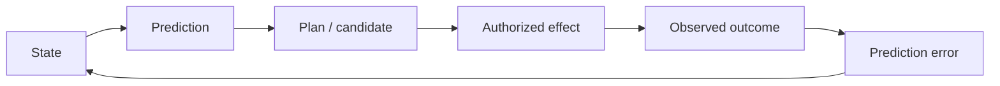
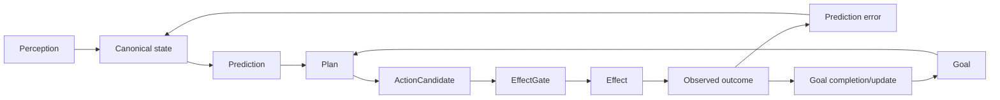

# Perception → prediction → goals → effects — lineage addendum

This file isolates three historical/control themes that are easy to flatten when Frankenstein is described only as “memory + model + tools”.

Evidence base: current EntityOS/HCU design plus historical donor paths such as `services/thalamus.py`, `services/nucleus_accumbens.py`, `services/project_engine.py`, `research_entity/notes/FRANK_PERFECT_FEEDBACK_LOOP_SYNTHESIS_20260810.md`, `research_entity/notes/WILL_ARCHITECTURE_FUSION_TRANSFER_20260811.md`, and generative-reality research packets.

## 1. Perception

Historical Frank had multiple perception/vision channels and routing stages. Current EntityOS generalizes the control boundary into **Typed Entry**.

```text
source emitted data
!= transport receipt
!= admitted observation
!= workspace candidate
!= selected model context
!= causal use
!= world fact
```

A useful Typed Entry binds, as applicable, causal event identity, admission identity, generation, source, provenance, modality/schema, observed/received time and permission/resource scope.

### Why causal event and admission identity differ

The same real/logical event can be observed more than once. Replay should not manufacture a second world event. Conversely, two distinct events must not collapse simply because they arrived through the same transport shape.

Capability statements inside perception data are input, never self-granted authority.

## 2. Prediction

Historical prediction mechanisms included Thalamus prediction error, reward prediction/motivation and broader feedback/generative-reality proposals.

The current-compatible pattern is:



A prediction is generated/inferred until observation closes it.

### Failure mode: self-confirming recurrence

A top-down prediction can raise a channel’s salience. Salience can make the same channel win workspace selection. Repeated selection can then be misread as confirmation of the original prediction.

Therefore:

```text
prediction recurrence != evidence
workspace recurrence != evidence
model confidence != evidence
```

Outcome re-entry or another independent discriminator is required.

### Hypothesis

`OPEN_HYPOTHESIS`: explicit prediction-error traces improve replanning and retrieval prioritization over a reactive-only baseline.

Engineering confidence: **0.60**.

Counterhypothesis: prediction machinery mainly adds correlated internal signals, complexity and latency.

Falsifier: matched tasks with equal model/tool budgets show no gain in failure recovery, next-action quality or sample efficiency.

## 3. Goals / will / planning

Historical donor families include project/goal/strategy/task management and later will-architecture transfer work.

Current-compatible authority chain:

```text
human/owner objective
-> admitted goal/task state
-> model-generated plan/candidate
-> deterministic capability/effect policy
-> authorized action
-> observed outcome
-> goal-state update
```

A model-generated goal cannot authorize a new capability. A persistent goal is state, not proof that the objective is good, current or complete.

Completion must be tied to observable acceptance criteria.

## 4. Reflection is the bridge, but only if it exits

Reflection can compare outcome against goal/prediction and generate a correction. It becomes useful agency only if it produces a measurable transition:

- `ACT` — authorized next step;
- `ASK` — obtain missing information/authority;
- `WAIT` — explicit bounded wait state;
- `RE-OBSERVE` — refresh volatile reality;
- `REPLAN` — replace a failed plan while preserving evidence/history;
- `STOP` — complete, invalid, unsafe or blocked.

Repeated introspection without one of these exits is rumination.

## 5. Whole loop



No arrow from prediction, goal, plan or reflection directly creates a world fact.

## 6. Why this matters for training

A future small cognitive-process model must not merely learn words such as `goal`, `prediction`, `state`, `effect` and `done`. It must learn their **interface relations**:

- prediction is tested against later observation;
- goal completion needs observable criteria;
- plan is a candidate, not permission;
- effect requires deterministic admission;
- reflection must alter later behavior or terminate;
- outcome can remain `UNKNOWN`.

That interface-level semantics is more important than reproducing historical biological names.
