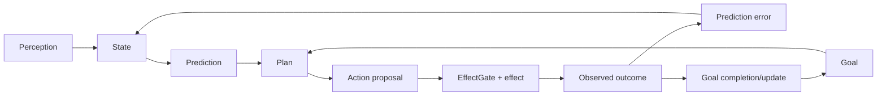

# Perception, prediction and goals — lineage addendum

This addendum closes three topics that are easy to lose when Project Frankenstein is summarized only as “memory + model + tools”. They are separate control problems.

## Perception

Historical Frank/Frankenstein sources contain dedicated perception channels and workspace/thalamic routing. Current EntityOS direction generalizes this into **Typed Entry**: perception is not “whatever text entered the prompt”; it is admitted data with source, modality, time, causal/admission identity, provenance and permission/resource context.

Useful distinction:

```text
sensor/tool/source emitted data
!= data received
!= data admitted
!= data selected for cognition
!= data used causally
!= resulting world fact
```

This protects against stale transport, replay, duplicated events and source ambiguity.

Evidence class: `HISTORICAL_SOURCE -> ADOPTED_CURRENT_DESIGN_DIRECTION`.

## Prediction

Prediction appears historically in the Frank architecture as predictive-error / expectation signals and later in broader feedback-loop and generative-reality research. Relevant archive entry points include:

- `research_entity/notes/FRANK_PERFECT_FEEDBACK_LOOP_SYNTHESIS_20260810.md`;
- `research_entity/trigger_runs/frank/20260808T1750+0700-chatgpt-secondary-r2/FINAL_REPORT.md`;
- `research_entity/trigger_runs/clayresearch/clayresearch-20260810T2324p0700-chatgpt-secondary-generative-reality-framework/GENERATIVE_REALITY_FRAMEWORK.md`;
- `research_entity/trigger_runs/clayresearch/clayresearch-20260810T2324p0700-chatgpt-secondary-generative-reality-framework/GENERATIVE_REALITY_FRAMEWORK_CANDIDATE.clay`.

The surviving engineering value is **prediction error as a measurable discrepancy**, not a free-standing truth source:

```text
state + model -> prediction
world/tool observation -> outcome
prediction vs outcome -> error
error -> candidate update / salience / replanning
verified outcome -> canonical re-entry
```

A model prediction remains `GENERATED/INFERRED` until observation closes it.

### Failure constraint

Historical top-down prediction/feedback can become self-confirming: a model’s prior increases salience, salience increases workspace selection, repeated selection then looks like confirmation.

Therefore current-compatible prediction systems need external negative controls and outcome re-entry. Repeated internal recurrence is not evidence.

Open hypothesis: explicit prediction-error traces improve replanning and retrieval prioritization over reactive-only control.  
Engineering confidence: **0.60**.  
Counterhypothesis: for many tasks, prediction machinery mainly adds correlated internal signals and latency.  
Falsifier: matched tasks show no improvement in error recovery, next-action selection or sample efficiency after controlling extra compute/context.

## Goals / will / planning

Historical goal/will work is visible in sources such as:

- `research_entity/notes/WILL_ARCHITECTURE_FUSION_TRANSFER_20260811.md`;
- `research_entity/global/RAE_LATEST_COGNITIVE_STACK.clay`;
- Frank architecture/feedback-loop fusion reports.

The reusable current principle is to separate:

```text
human/owner objective
-> admitted goal/task state
-> model-generated plan/proposal
-> deterministic capability/effect policy
-> action
-> verified outcome
-> goal-state update
```

A model-generated goal cannot self-authorize a new capability. A persistent goal record is state, not evidence that the goal is good or still applicable. Goal completion is established from observed outcome criteria, not a model saying “done”.

### Reflection and goal interaction

Reflection is only useful when it can change the goal-execution state:

- `ACT` — execute an authorized next step;
- `ASK` — request missing human information/authority;
- `WAIT` — explicit waiting state where appropriate;
- `RE-OBSERVE` — refresh volatile state;
- `REPLAN` — replace a failed plan while preserving the goal/evidence history;
- `STOP` — goal complete, invalid, unsafe or blocked.

This is the practical anti-rumination boundary.

## Codependency



No arrow from prediction, goal or plan directly mints a world fact.
