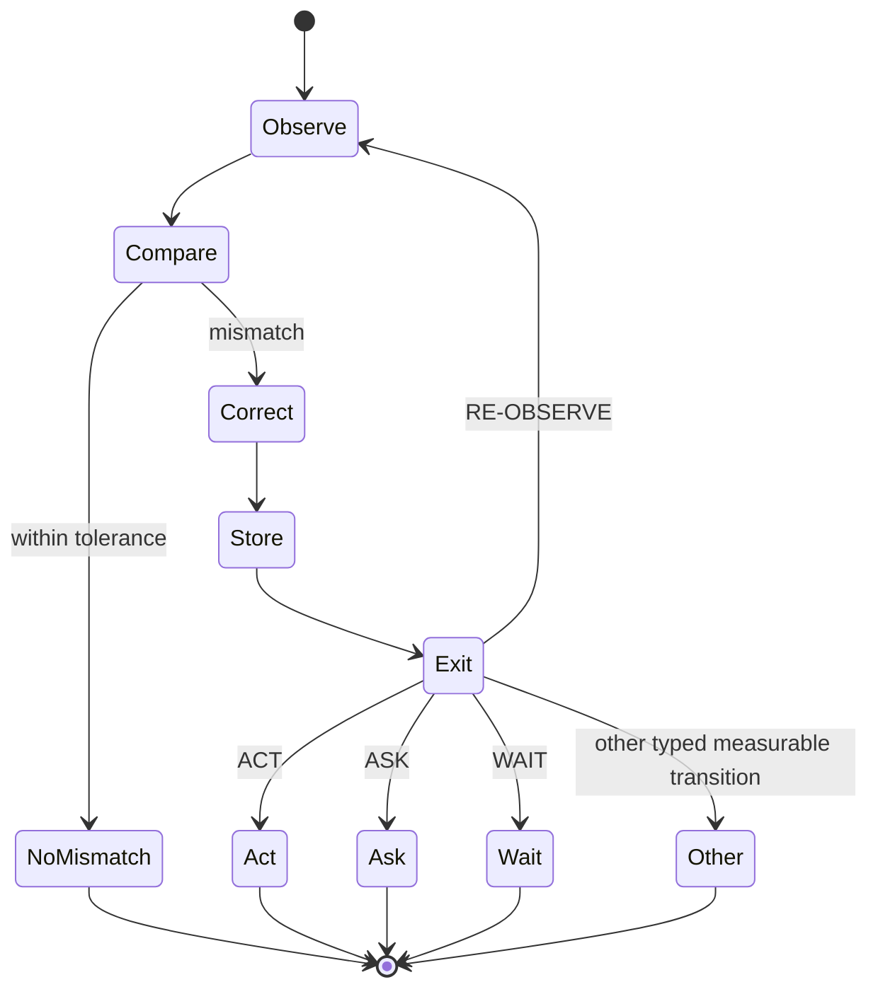

# Reflection with exit

Project Frankenstein uses **reflection** as an engineering control operation, not as evidence of consciousness or subjective experience.

The useful question is not “did the system reflect?” The useful question is:

> Did inspection of state/outcome detect a mismatch, produce a bounded correction, and change a later measurable transition?

## Minimal contract

A reflection cycle should have explicit inputs and an explicit exit.



A system that repeatedly produces reflections about its previous reflection without changing a measurable state is not demonstrating deeper cognition. It is consuming time/context in a fixation loop.

## Typed reflection record

A durable reflection record should separate at least:

```text
reflection_id
causal_event_id
generation
observed_state_ref
expected_state_ref
mismatch_type
evidence_refs
correction_candidate
confidence
uncertainty
chosen_exit
exit_reason
later_transition_ref
later_outcome_ref
```

A narrative explanation may accompany this, but the narrative is not the causal record.

## Hard distinctions

- memory != observation;
- reflection text != correction effect;
- correction candidate != admitted action;
- admitted action != successful outcome;
- repeated self-consistency != independent evidence;
- model confidence != calibrated confidence unless measured;
- a method for checking != the checked fact.

## Why external substrate matters

The project hypothesis is that useful reflective agency requires enough external substrate to constrain the loop:

- state;
- memory;
- perception;
- task/goal context;
- arbitration;
- effect requests;
- effect receipts;
- verified outcome re-entry;
- provenance and generation identity.

Without that substrate, prompt-only reflection can easily become a text transformation whose apparent correction is never checked against the system or world it claims to correct.

## Primary hypothesis

**OPEN_HYPOTHESIS:** a sufficiently rich external substrate of state, memory, perception, arbitration, effect receipts and verified outcome re-entry improves useful reflective agency compared with prompt-only self-reflection under matched model/compute conditions.

**Engineering confidence:** 0.78.

### Counterhypotheses

1. **Prompt sufficiency:** most benefit comes from giving the model a better structured prompt/context; the external machinery adds complexity without causal value.
2. **Retrieval leakage:** the apparent benefit comes from task identity leaking through metadata rather than better state grounding.
3. **Latency substitution:** improvements in a few difficult cases are offset by slower action and more stale observations.
4. **Evaluation circularity:** the same model family defines the reflection, success criteria and evaluator, creating pseudo-improvement.

### High-information discriminator

Use matched task families with:

- prompt-only reflection baseline;
- external-state reflection with the same model and available task information;
- family-separated train/calibration/holdout data;
- fixed action/effect budget;
- exact outcome verification;
- latency and loop-count accounting;
- nuisance-control metadata shuffles;
- reflection lesion (`reflection disabled`);
- memory lesion (`retrieval disabled`);
- receipt lesion (`outcome re-entry hidden`);
- rescue condition restoring one missing substrate component.

Measure downstream task success, false-action rate, stale-state errors, number of reflection cycles, time-to-exit, correction reuse, and verified effect/outcome accuracy.

**Strong falsifier:** after matching information and compute, prompt-only reflection equals or exceeds the external-substrate system across held-out task families, while the external system adds latency/fixation or its apparent gains disappear under metadata shuffling.

## Rumination/fixation guard

A practical implementation should bound reflection by policy rather than model goodwill.

Example controls:

```text
max_reflection_steps
max_reflection_time
max_same_mismatch_repeats
required_information_gain_per_repeat
forced_exit_when_no_new_evidence
escalate_to_ASK_when_missing_authority_or_input
WAIT_when_external_state_may change but no safe action exists
RE-OBSERVE after effects before another correction
```

A repeated reflection may be allowed only if it brings genuinely new evidence or a materially different discriminator.

## How this connects to GWT / J-Space / Hyperposition

A workspace can expose competing candidate states or actions. Hyperposition can preserve unresolved alternatives. J-Space/GWT mechanisms can coordinate candidate information.

None of those mechanisms should resolve uncertainty by mere recurrence or majority.

Reflection should consume the candidate set, identify what evidence is missing, and either:

- choose a safe evidence-bearing action;
- ask for missing authority/input;
- wait for a relevant external transition;
- re-observe;
- retain the alternatives as unresolved.

## Promotion criteria

Do not call a reflection mechanism “effective” because its explanations sound better.

Promotion requires evidence that it changes later behavior in the intended direction under exact identity and held-out evaluation, while not increasing unacceptable fixation, latency, unsafe effects, or fabricated certainty.

The final unit of evidence is therefore not a paragraph of self-analysis. It is a **state/outcome -> correction -> later transition -> verified outcome chain**.