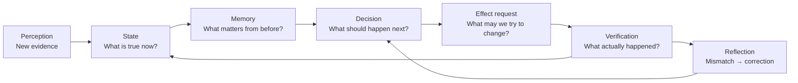
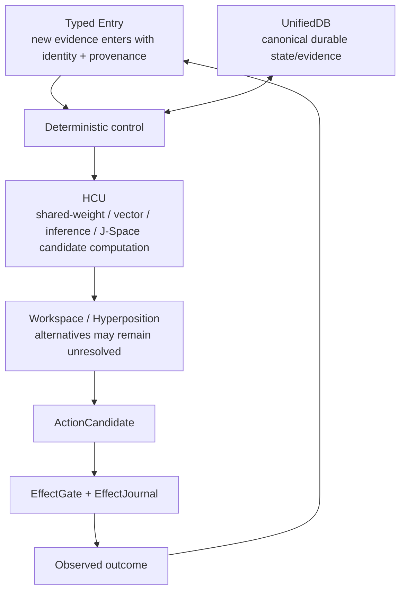

# Project Frankenstein — the human version

Project Frankenstein is a long-running research and engineering project about a practical question:

> How much useful agency can a software system gain when **state, memory, perception, decisions, actions, and verified outcomes** are connected instead of living as isolated chat turns?

It is research software, not a claim of consciousness or sentience. Old biologically inspired names are part of the historical lineage; the present engineering claims stand or fall on code, measurements, failure records, and reproducible evidence.

**Lead researcher/developer:** Gabriel Gschaider  
**Institute director/developer:** Dr. Andreas Unterweger  
**Project provenance:** `iar.frank.ink`

## The loop

The important part is the last arrow: **the result comes back in**. A requested action is not treated as a successful action merely because a model said it happened.

## What the project learned the hard way

Frankenstein did not arrive as one clean architecture. It accumulated mechanisms, failed experiments, competing databases, model prompts, LoRAs, perception systems, goal systems, global-workspace ideas, reflection loops, and increasingly strict evidence rules.

Several failures became design requirements:

- **Fragmented state was expensive and contradictory.** This pushed the project toward a canonical SQLite authority substrate: UnifiedDB (or current compatibility forms where migration is incomplete).
- **Reflection can become rumination.** Reflection is useful only if it terminates into `ACT`, `ASK`, `WAIT`, re-observation, or another measurable transition.
- **Model output is persuasive but not authoritative.** Generated explanations, consensus, and self-reports cannot create world facts.
- **Prompts and weights can fight each other.** Training, inference interfaces, and output protocols must be tested against exact checkpoint/tokenizer/runtime identity rather than inferred from fluent text.
- **More parallelism is not automatically faster.** A current GRID10 diagnostic on four concurrent processes/four vCPUs measured about 8.32 s/call at one Torch thread per process and about 23.18 s/call at two; four threads produced no completed samples within the experiment timeout. That result is topology-specific, but it is a useful counterexample to “more threads = more speed.”
- **External helpers can hallucinate architecture.** A recent Frankenstein concept pass explicitly rejected invented components from a helper model (including a nonexistent time-series database and embedding pipeline) and retained only ideas that could be grounded in the real code.
- **A working mechanism may still be non-operative.** The newest 72-hour Bauleiter/Bugfix orchestration code is currently quarantined because its provider boundary conflicts with the current HARD_OFF authority. That negative result is preserved rather than hidden.

## UnifiedDB and “Emergent Retrieval”

UnifiedDB is not a single giant file containing everything in one table. It means **one canonical authority substrate** can contain many typed tables, indexes, views, journals, writers, readers, and rebuildable projections without splitting truth across competing databases.

`Emergent Retrieval` is the project term for relevance that appears when independently stored evidence dimensions overlap at query time — for example semantic similarity + time + causal lineage + current state + goals + perception + effect receipts + confidence + provenance.

Nothing appears from nowhere. Retrieval becomes useful because multiple measured dimensions meet.

## Reflection, without mysticism

Here, self-reflection is an engineering operation:

1. inspect current state and observed outcome;
2. detect a mismatch;
3. generate a correction candidate;
4. store/retrieve the correction;
5. alter later behavior;
6. **exit the reflection loop into a measurable next transition.**

A reflection loop that only produces more reflection is a bug, not deeper cognition.

## Memory

Historical Frankenstein contained several memory mechanisms: vector retrieval, claims, graph relations, replay/consolidation, project/task memory, event learning, and world/body state. The present research direction treats these as donor mechanisms and evidence, not as automatically current truth.

The key distinction is simple:

> **memory is not observation.**

A remembered statement can help decide what to check; it cannot prove that the world still matches it.

## Perception and action

The archive records multiple visual lineages: adaptive routing, YOLO/OCR-era pipelines, FrankEye/Retina artifacts, and a later native multimodal vision replacement claim. They are kept as lineage because different generations solved different parts of the problem and sometimes superseded one another.

Actions are stricter: a requested effect is only a candidate until the deterministic effect authority admits it and the outcome is re-observed. Unknown outcomes stay unknown rather than being blindly replayed.

## Training

The research archive includes LoRA/IAPT/SOMA work, before/after probes, feedback weighting, and negative-result methodology. Current policy is much stricter than “training completed = success.” A training result only earns promotion if it improves the intended behavior under an exact model/runtime identity **without unacceptable regressions** and survives appropriate causal/fail-closed tests.

At the current authority frontier, whole-product, full-HCU, J-Space-model, and training credit remain unpromoted.

## The current system identity

The persistent research entity is **Clay**. The current product/system is **EntityOS**. The integrated cognition/compute architecture is **HCU**. Frankenstein, Frank, Xeno, and other names survive where they are useful as historical or compatibility lineage, not as competing truth authorities.

The current research architecture can be summarized as:

The model plane can propose, simulate, rank, or measure. It does not mint canonical truth.

## Where to go next

- Technical/research readers: [`../DEV_SOURCE_RESEARCH/README.md`](../DEV_SOURCE_RESEARCH/README.md)
- AI/tool installer entry: [`../AI_START_HERE_DO_NOT_SCAN_REPO/README.md`](../AI_START_HERE_DO_NOT_SCAN_REPO/README.md)
- Current Frankenstein concept packet: [`../research_entity/topic_packets/frankenstein-master-cognition-concept/`](../research_entity/topic_packets/frankenstein-master-cognition-concept/)
- Historical archaeology manifest: [`../research_entity/archive_assimilation/manifests/PROJECT_FRANKENSTEIN_MANIFEST.json`](../research_entity/archive_assimilation/manifests/PROJECT_FRANKENSTEIN_MANIFEST.json)

The project is large. The useful story is not “everything worked.” The useful story is **which failure forced which architecture change, what was measured, and what still remains unproven.**
