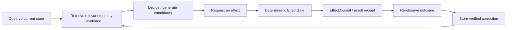

# Project Frankenstein — read this first

Project Frankenstein is an engineering and research project about building a more capable, inspectable AI system around a persistent state and evidence substrate. The current system/product name is **EntityOS**; the current integrated cognition/compute architecture is **HCU**. Historical names such as Frank, ClayVerse, Mini Entity, MicroEntity and Xeno are part of the research lineage, not competing current products.

**Lead researcher/developer:** Gabriel Gschaider  
**Institute director/developer:** Dr. Andreas Unterweger  
**Project provenance:** iar.frank.ink

This page is deliberately short. It tells a human what the project is trying to do and, just as importantly, what the repository does **not** currently prove.

## The core loop

The important boundary is simple: a model can suggest, simulate, rank, reflect and predict, but that is not the same thing as changing the world or minting a fact. Canonical state/evidence and real effects remain behind deterministic authority boundaries.

## What UnifiedDB means here

`UnifiedDB` is the project direction toward **one coherent authority substrate for durable state and evidence**. It is not a single giant untyped file and it is not supposed to make every process write into one table. One authority substrate can still contain many typed tables, indexes, views, journals, readers, writers and policies. High-rate transient sensor state may remain in RAM when durability would be harmful or pointless.

Historically the project accumulated multiple state stores and service boundaries. The UnifiedDB direction is an attempt to reduce ownership ambiguity and copy/synchronization errors while keeping types, provenance and effect authority explicit.

## Emergent Retrieval

`Emergent Retrieval` is the project term for relevance that appears when independently stored evidence dimensions overlap at query time: semantic similarity, time, causal lineage, current state, goals, perception, effects, confidence and provenance can all constrain the same query.

It does **not** mean information appears from nowhere. Retrieval can only expose or recombine information that is actually present in the admitted evidence/state substrate.

## Reflection is a control operation, not a consciousness claim

In this project, self-reflection means an engineering loop:

1. inspect state, decision and observed result;
2. detect a mismatch or uncertainty;
3. generate a bounded correction candidate;
4. store/retrieve the correction with provenance;
5. change later behavior if the evidence justifies it;
6. **exit** into `ACT`, `ASK`, `WAIT`, re-observation, or another measurable transition.

A reflection loop that only produces another reflection forever is a failure mode, not higher agency. The architecture makes no present claim that consciousness, sentience or subjective experience is required.

## Why failures are kept

Frankenstein is easier to understand if failures stay visible. Rumination/fixation, prompt-versus-weight conflicts, context contamination, latency, timeouts, integration failures, dead modules, misleading green tests and failed causal hypotheses are part of the engineering record because they explain why the next mechanism exists.

A negative result is not embarrassing debris. It is often the shortest path to the architecture.

## What is real right now — and what is not

Trigger-3 initially re-entered at `main@854f6bc87780f4a5242489a6c807d186b16a8c3d` and found a newly committed Bauleiter/Bugfixer implementation whose direct NVIDIA/Groq/Mistral donor paths conflicted with current supervisor `9.13` hard-off authority.

While the same Trigger-3 macrocycle was running, `main` advanced to **`3c3dbe5020f57065f47bd4d0a2dce3c537128797`** and closed that source boundary: the provider-backed implementations were preserved as quarantined donor files, while the canonical Bauleiter/Bugfix entrypoints now resolve current supervisor authority through a stdlib-only gate **before** provider import, secret lookup, network, Aider or fallback dispatch. Focused local/source tests report **10/10 PASS** for that hard-off gate.

That is real progress, but its scope matters:

- the current canonical entrypoints are **source/local-unit gated under HARD_OFF**;
- the preserved provider-backed donor implementations remain **quarantined/non-operative** while provider routes are off;
- Together remains forbidden and paid fallback remains forbidden;
- the 10/10 result is not provider-runtime execution and not 72-hour deployment acceptance;
- whole EntityOS/HCU runtime credit, full HCU credit and training credit remain zero at the current supervisor scope.

So:

- **SOURCE PRESENT** is not the same as **AUTHORIZED TO RUN**.
- **source/unit hard-off PASS** is not the same as provider-path runtime acceptance.
- a model output is not a world fact;
- a request is not an effect;
- a component pass is not whole EntityOS/HCU acceptance;
- repeated worker agreement is not independent evidence;
- a historical authorization is not current authority.

## The research idea in one sentence

The project tests whether useful reflective agency becomes more reliable when model cognition is embedded in a sufficiently rich external substrate of typed state, memory, perception, arbitration, effect receipts and verified outcome re-entry — while keeping serious alternative explanations and falsifiers visible.

## Where to go next

- **Technical / research chronology:** [`../DEV_SOURCE_RESEARCH/README.md`](../DEV_SOURCE_RESEARCH/README.md)
- **AI/tool installer entry:** [`../AI_START_HERE_DO_NOT_SCAN_REPO/README.md`](../AI_START_HERE_DO_NOT_SCAN_REPO/README.md)
- **Current Trigger-3 migration ledger:** [`../DEV_SOURCE_RESEARCH/repository/TRIGGER3_CURRENT_STATE_AND_MIGRATION_2026-08-27.md`](../DEV_SOURCE_RESEARCH/repository/TRIGGER3_CURRENT_STATE_AND_MIGRATION_2026-08-27.md)

The root `README.md` is intentionally not rewritten by this Trigger-3 phase.