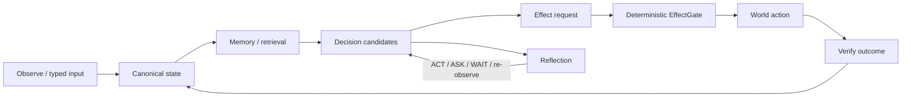

# Project Frankenstein — the human entrance

Project Frankenstein is a long-running engineering and research effort to build a useful local AI system whose **state, memory, decisions, actions, and verification remain inspectable**.

The present research system is called **EntityOS**. Its integrated cognition/compute architecture is **HCU**. Older names such as Frank, ClayVerse, Mini Entity, Xeno, and XCU remain important to the engineering history, but they are not separate current products.

**Lead researcher / developer:** Gabriel Gschaider  
**Institute director / developer:** Dr. Andreas Unterweger  
**Project provenance:** `iar.frank.ink`

## The shortest useful picture

The important part is the return arrow. A request is not an effect. A model answer is not a world fact. An action is not considered successful merely because somebody intended it to happen: its outcome has to return as evidence.

## What Frankenstein is trying to maximize

The target is **maximum practical agency inside a human-useful operating envelope**. That means the system should be able to notice, remember, decide, use tools, recover from mistakes, and improve its later behavior — while keeping authority boundaries explicit.

No current architecture claim depends on consciousness, sentience, subjective experience, or historical bio-inspired naming. Terms such as *global workspace* are used as engineering/research abstractions. A useful mechanism has to earn its place through source evidence, measurement, and falsifiable tests.

## One canonical substrate, not one giant file

The project moved away from a fragmented collection of independent state stores toward **UnifiedDB**, a canonical SQLite-based authority substrate.

That does **not** mean one table or one omniscient file. One authority substrate can contain many typed tables, indexes, views, writers, readers, policies, journals, and rebuildable projections. Very fast transient sensor state can still live in RAM. The point is to reduce ambiguous ownership and copy boundaries around durable state.

### Emergent Retrieval

`Emergent Retrieval` is the project term for relevance that appears when independently stored evidence dimensions overlap at query time — for example semantic similarity, time, causal lineage, current state, goals, effects, confidence, provenance, and epistemic status.

Nothing appears from nowhere. Current reference code constructs a **derived context assembly** from canonical records and explicitly marks it `ASSEMBLY_CONTEXT_ONLY`; it is not a second truth store.

## Reflection must have an exit

Self-reflection is treated as an engineering control operation:

1. inspect state and outcome;
2. detect a mismatch or uncertainty;
3. generate a correction or information need;
4. store/retrieve the correction with provenance;
5. change a later choice;
6. **exit** into `ACT`, `ASK`, `WAIT`, `re-observe`, or another measurable state transition.

A reflection loop that only produces more reflection is a failure mode, not extra intelligence.

## Perception, action, and memory

- **Perception** should enter through typed, provenance-carrying admission rather than silently becoming truth.
- **Memory** is useful only if retrieval preserves what kind of evidence a record is and where it came from.
- **Decision/cognition** can produce candidates, simulations, J-Space measurements, or hypotheses, but those do not mint canonical facts.
- **Action** is translated into a typed effect request and remains behind deterministic effect authority and journaling.
- **Verification** closes the loop by bringing observed outcomes back into state.

## Global J-Space / GWT and HCU

HCU is the integrated compute architecture. `GRID10` is a ten-logical-cell baseline mode; logical cells are not the same thing as ten resident models or ten simultaneous physical decodes.

Global J-Space/GWT is an **empirical causal coordination/interface hypothesis**. The project has source-ready instrumentation concepts for comparing explicit ClayCode/GRF traces with model-internal readouts and for bounded ablation/steering experiments. A decoded latent concept is a measurement candidate, not truth and not evidence of consciousness.

## Training: what counts and what does not

Training is not considered successful merely because a job finished or a benchmark number rose. Promotion requires exact checkpoint/tokenizer/runtime identity, leak-resistant evaluation, matched baselines, causal or lesion/rescue tests where applicable, off-target regressions, and retained authority behavior.

At the current 2026-08-27 authority epoch, external provider routes are HARD-OFF and Together is forbidden. Historical paid training attempts remain quarantined diagnostics with zero current training credit. No new paid/provider execution is implied by this documentation.

## Negative results are part of the design

Frankenstein's architecture is partly a history of things that did not work well enough:

- fragmented state created ownership and synchronization ambiguity;
- recursive reflection can become rumination/fixation unless it has measurable exits;
- prompt/schema recurrence can imitate a causal internal workspace;
- source-ready components can look complete before integrated runtime evidence exists;
- provider orchestration can violate a later emergency stop if the authority gate sits too far downstream;
- more CPU threads can make inference dramatically slower under oversubscription;
- large token volume and repeated model agreement do not create independent evidence;
- generated/simulated futures can contaminate facts unless origin and reconciliation stay typed.

These are not embarrassing footnotes. They are constraints that forced the next engineering move.

## Where to go next

- **Technical and research map:** [`../DEV_SOURCE_RESEARCH/README.md`](../DEV_SOURCE_RESEARCH/README.md)
- **AI/tool installation entrance:** [`../AI_START_HERE_DO_NOT_SCAN_REPO/README.md`](../AI_START_HERE_DO_NOT_SCAN_REPO/README.md)
- **Current evidence chronicle:** [`../DEV_SOURCE_RESEARCH/research/FRANKENSTEIN_RESEARCH_CHRONICLE.md`](../DEV_SOURCE_RESEARCH/research/FRANKENSTEIN_RESEARCH_CHRONICLE.md)

The repository is still being reorganized. Historical source paths are preserved until moves can be proven dependency-safe; documentation must never claim that a move happened before it actually did.
