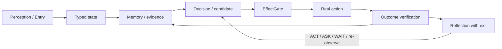

# Project Frankenstein — human front door

This folder is the short human-readable entrance to the project. It is deliberately not a replacement for the research archive.

## One sentence

Project Frankenstein is a long-running engineering and research lineage for building persistent, agentic software that can observe state, remember evidence, make bounded decisions, act through controlled effect paths, verify outcomes, and learn from failures without turning model output into truth.

**Current authority note:** the current product/system identity is **EntityOS** and the current integrated cognition/compute architecture is **HCU**. “Frankenstein”, “Frank”, “Xeno”, and older names remain useful lineage or compatibility terms where the source history requires them; they are not competing current product authorities.

Project provenance: **iar.frank.ink**. Lead researcher/developer: **Gabriel Gschaider**. Institute director/developer: **Dr. Andreas Unterweger**.

## The loop

The important part is not the diagram. The important part is that every arrow has an evidence boundary.

- A **request is not an effect**.
- A **model answer is not a world fact**.
- A **memory is not a new observation**.
- A **method existing is not the same as a result existing**.
- A **component test passing is not the same as the whole system passing**.

That sounds fussy. It is. The project has accumulated enough scars to justify the fuss.

## UnifiedDB

UnifiedDB is the project’s direction toward one canonical SQLite-backed state/evidence substrate rather than many partially overlapping databases and services that can disagree about reality.

“One database authority” does **not** mean “one giant table” or “one god file”. A coherent substrate may contain many typed tables, indexes, views, writers, readers, policies, journals, and rebuildable projections. High-rate transient sensor state may remain in RAM. The point is to reduce ambiguous ownership and copy boundaries, not to flatten every kind of data into one schema.

## Emergent Retrieval

**Emergent Retrieval** is the project term for relevance that becomes visible when independently stored evidence dimensions overlap at query time: semantic similarity, time, causal lineage, current state, goals, perception, effects, confidence, provenance, and related signals.

Nothing appears from nowhere. The “emergent” part is the useful intersection, not magical new information.

Historical and experimental source families include `research_entity/unifieddb/`, `research_entity/knowledge_micro_packets/unifieddb/`, and the reference implementations under `research_entity/harness/reference/`.

## Reflection without rumination

Self-reflection here is an engineering control operation, not a consciousness claim. A useful reflective cycle is:

1. inspect state and the observed outcome;
2. detect a mismatch;
3. generate a bounded correction candidate;
4. store/retrieve the correction with provenance;
5. alter later behavior;
6. **exit reflection** into ACT, ASK, WAIT, re-observe, or another measurable transition.

A system that only reflects about reflection has discovered a very expensive way to stand still.

## GWT / Global J-Space

Global Workspace / GWT ideas are used as an engineering and empirical coordination hypothesis: information from specialized processes may become more useful when selected into a shared workspace and made available across functions. The project does **not** rely on a claim that this creates consciousness or subjective experience.

Global J-Space goes further by testing vector/control interfaces and model-specific causal interventions. Coherent text, self-report, recurrence, or majority agreement is insufficient evidence of a causal internal interface.

Start technical reading at `DEV_SOURCE_RESEARCH/README.md`.

## HCU and GRID

HCU is the current integrated cognition/compute architecture. GRID10 is a 10-logical-cell baseline mode. Logical cells are not ten permanently resident models, and larger logical-module counts are not claims about physical decode concurrency.

The current research archive contains source-ready, component-level, diagnostic, contradicted, and blocked results. Those statuses must remain distinct.

## Negative results are part of the design

Project Frankenstein keeps failures because they explain why the architecture changed. Examples in the archive include rumination/fixation, context contamination, prompt-vs-weight conflicts, latency and timeout failures, provider/control-path violations, integration failures, zero-yield training-data funnels, dead or stale modules, and experiments whose attractive interpretation failed under a stronger control.

A negative result that kills a bad idea is progress. A negative result quietly deleted from the story is technical debt wearing makeup.

## Where to go next

- Human overview: this folder.
- Technical/research map: `DEV_SOURCE_RESEARCH/README.md`.
- Evidence/status matrix: `DEV_SOURCE_RESEARCH/research/FRANKENSTEIN_EVIDENCE_MAP.md`.
- Repository cleanup/migration plan: `DEV_SOURCE_RESEARCH/repository/ROOT_MIGRATION_PLAN.md`.
- AI/agent entry without repo-wide scanning: `AI_START_HERE_DO_NOT_SCAN_REPO/README.md`.
- Current authority still outranks every summary: `CLAY_EXECUTION_AUTHORITY.md`, `research_entity/continuity/BOOTSTRAP_MINIMAL.json`, `research_entity/rooms/PROGRAM_STATE.json`, and `research_entity/claycode/autonomous/SUPERVISOR_INBOX.json`.

The root `README.md` is intentionally untouched by this Trigger-3 pass; it currently contains older framing and must not be treated as stronger than the current authority stack.
